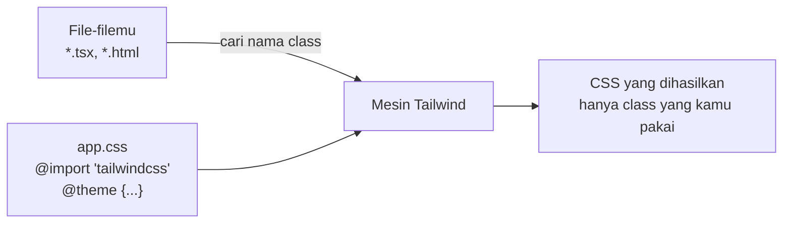

::part[Pelajari Konsepnya]{n="1"}

## 🎯 Yang akan kamu pelajari

- Apa itu utility class, beserta kelebihan dan kekurangannya
- Bagaimana Tailwind hanya membuat CSS yang benar-benar kamu pakai
- Install Tailwind v4 di Vite dan Next.js
- Menambahkan warna, font, dan breakpoint sendiri di CSS (`@theme`)
- Tools editor yang membuat Tailwind lebih mudah

## 🔤 Istilah penting

| Istilah | Artinya (sederhana) |
|---|---|
| **Utility class** | Class kecil yang melakukan satu hal: `p-4` = padding 1rem |
| **Utility-first** | Styling kebanyakan memakai utility class langsung di HTML |
| **Design token** | Nilai desain yang diberi nama: warna brand, ukuran jarak |
| **`@theme`** | Tempat di CSS-mu untuk menambahkan token sendiri |
| **Preflight** | Reset dari Tailwind yang menghapus style bawaan browser |
| **Variant** | Prefix yang membuat class berlaku di situasi tertentu: `hover:`, `md:`, `dark:` |

## 🧠 Ide besarnya

CSS biasa itu seperti **menjahit baju custom** untuk setiap component: kamu merancang class `.job-card`, memberinya nama, dan merawatnya selamanya. Tailwind itu seperti **LEGO**: sekotak kepingan kecil standar — `p-4`, `rounded-xl`, `shadow-sm` — yang kamu pasang langsung di HTML. Karena semua kepingan berasal dari set yang sama (design token-mu), hasilnya selalu serasi.

## ❓ Kenapa ini penting

Proyek CSS besar sering berakhir dengan:
- keputusan penamaan yang melelahkan,
- style lama yang tidak ada yang berani hapus,
- nilai acak seperti `padding: 13px` di mana-mana.

Tailwind membantu karena:
- setiap class hanya memengaruhi elemen tempatnya berada (tidak ada kejutan "rule mana yang menang"),
- nilainya berasal dari **skala** yang tetap (jarak, warna, ukuran font),
- hanya class yang kamu pakai yang masuk ke CSS akhir,
- setiap component React membawa style-nya sendiri.

Kalau dipakai sembarangan, Tailwind juga berantakan:
- `mt-[13px] text-[#4a4a4a]` di mana-mana membawa kembali nilai acak.
- Menyusun nama class seperti `` `bg-${color}-500` `` diam-diam **tidak menghasilkan CSS** (dijelaskan di bawah).

## 📖 Langkah demi langkah

### 1. Cara kerja Tailwind



Tailwind **membaca file-filemu seperti mesin pencari**, mencari nama class lengkap seperti `"bg-red-500"`. Lalu ia menulis CSS hanya untuk class-class itu. Itulah kenapa class yang disusun dari potongan saat aplikasi berjalan (`"bg-" + color + "-500"`) tidak pernah ditemukan: kata lengkapnya tidak pernah muncul di file.

### 2. Install dengan Vite

```bash
npm install tailwindcss @tailwindcss/vite
```

```ts
// vite.config.ts
import tailwindcss from "@tailwindcss/vite";
export default defineConfig({ plugins: [react(), tailwindcss()] });
```

```css
/* src/index.css */
@import "tailwindcss";
```

### 3. Install dengan Next.js

`create-next-app` menanyakan apakah kamu mau Tailwind. Untuk menambahkannya manual:

```bash
npm install tailwindcss @tailwindcss/postcss postcss
```

```js
// postcss.config.mjs
export default { plugins: { "@tailwindcss/postcss": {} } };
```

```css
/* app/globals.css */
@import "tailwindcss";
```

### 4. Pengaturan sendiri, di CSS

```css
@import "tailwindcss";

@source "../content";                       /* also scan a folder outside the default detection */

@theme {
  --color-brand-50: oklch(0.97 0.02 275);
  --color-brand-500: oklch(0.55 0.2 275);   /* → bg-brand-500, text-brand-500, border-brand-500… */
  --font-display: "Plus Jakarta Sans", ui-sans-serif, system-ui, sans-serif;   /* → font-display */
  --breakpoint-3xl: 120rem;                 /* → 3xl:… */
}

@custom-variant dark (&:where(.dark, .dark *));   /* class-based dark mode */

@utility container-page {                   /* a real utility: works with md:, hover:, … */
  max-width: 72rem;
  margin-inline: auto;
  padding-inline: 1rem;
}

@layer base {
  body { background-color: var(--color-slate-50); color: var(--color-slate-900); }
}
```

- `@theme` — menambahkan token. Setiap token menjadi **class** (`bg-brand-500`) dan **variabel CSS** (`var(--color-brand-500)`). Seperti menambah warna baru di toko cat: langsung tersedia untuk semua dinding.
- `@source` — cari nama class juga di folder ini.
- `@custom-variant dark` — dark mode aktif saat `<html>` punya class `dark`.
- `@utility` — membuat utility class sendiri yang juga berfungsi dengan `md:`, `hover:`, dan sejenisnya.
- `@layer base` — beberapa style dasar global.

Tutorial lama (Tailwind v3) memakai file `tailwind.config.js`. Di v4, pengaturannya ada di CSS.

### 5. Preflight (reset)

`@import "tailwindcss"` menyertakan **Preflight**, yang menghapus style bawaan browser: tanpa margin, heading terlihat seperti teks biasa, list tanpa bullet. Jadi `<h1>` terlihat polos sampai kamu menambahkan `text-3xl font-bold`. Itu disengaja — kamu mulai dari halaman yang bersih.

### 6. Tools editor

- **Tailwind CSS IntelliSense** (VS Code): autocomplete nama class, pratinjau CSS saat hover, peringatan untuk class yang bentrok.
- **prettier-plugin-tailwindcss**: mengurutkan class dengan urutan yang sama di mana-mana.
- DevTools browser menampilkan CSS yang dihasilkan seperti CSS lainnya.

## ⚠️ Kesalahan umum

- `` className={`text-${color}-600`} `` — tidak menghasilkan CSS. Pakai tabel berisi nama class lengkap.
- Lupa bahwa Preflight menghapus style bawaan heading dan list.
- Menyalin tutorial `tailwind.config.js` v3 ke proyek v4.
- Nilai sembarang seperti `mt-[13px]` di mana-mana, bukan memakai skala.
- Memakai `@apply` untuk membangun ulang class gaya lama untuk semuanya — kelebihan Tailwind jadi hilang.
- Memakai class Tailwind untuk artikel panjang — pakai plugin Typography (`prose`).

## 🏆 Praktik terbaik

- [ ] Taruh warna brand, font, radius, dan breakpoint di `@theme`; hindari nilai sembarang.
- [ ] Selalu tulis nama class **lengkap** di kodemu (pakai tabel lookup).
- [ ] Pakai `@utility` untuk helper khusus proyek; jaga `@layer base` tetap kecil.
- [ ] Install IntelliSense dan plugin Prettier untuk mengurutkan class.
- [ ] Kelompok class yang berulang → buat **component**, bukan banyak rule `@apply`.
- [ ] Tentukan sejak awal cara kerja dark mode (pengaturan sistem atau class `.dark`).

::part[Jelaskan & Rancang]{n="2"}

## 🗣️ Jelaskan

Rekan tim bilang: "Tailwind itu cuma inline style." Jelaskan dua perbedaan penting (petunjuk: skala nilai yang tetap, dan variant seperti `hover:` dan `md:` yang tidak bisa dilakukan inline style).

## 📐 Rancang

Ubah design token CareerPilot dari materi CSS (warna brand, warna status, jarak, radius, font, dark mode) menjadi `app.css` Tailwind v4. Nilai mana yang masuk ke `@theme`, default Tailwind mana yang dipertahankan, dan bagaimana badge status mendapat warnanya tanpa menyusun nama class dari string?

:::quiz
Tampilkan contoh setup-nya

```css
@import "tailwindcss";

@theme {
  --color-brand-50: oklch(0.97 0.02 275);
  --color-brand-600: oklch(0.51 0.2 275);
  --color-brand-700: oklch(0.45 0.19 275);

  /* semantic status colors → bg-status-offer, text-status-offer… */
  --color-status-saved: oklch(0.55 0.02 255);
  --color-status-applied: oklch(0.55 0.17 255);
  --color-status-interview: oklch(0.7 0.16 70);
  --color-status-offer: oklch(0.6 0.15 150);
  --color-status-rejected: oklch(0.58 0.2 25);

  --font-sans: "Inter", ui-sans-serif, system-ui, sans-serif;   /* override the default font-sans */
  --radius-card: 0.75rem;                                       /* → rounded-card */
}

@custom-variant dark (&:where(.dark, .dark *));
```

- **Pertahankan default** untuk jarak (`p-4` = `1rem`) dan warna abu-abu — tidak perlu didefinisikan ulang.
- **Badge** memakai tabel berisi nama class lengkap (jangan pernah `` `bg-status-${status}` ``):

```ts
const STATUS_BADGE = {
  saved: "bg-status-saved/10 text-status-saved",
  applied: "bg-status-applied/10 text-status-applied",
  interview: "bg-status-interview/15 text-status-interview",
  offer: "bg-status-offer/10 text-status-offer",
  rejected: "bg-status-rejected/10 text-status-rejected",
} satisfies Record<Status, string>;
```

- **Dark mode**: tambahkan class `.dark` ke `<html>` dan pakai class `dark:`.
:::

### 📝 Checklist self-review

- [ ] Hanya token khusus proyek yang ditambahkan ke `@theme`
- [ ] Warna status punya nama yang menjelaskan kegunaannya
- [ ] Tidak ada nama class yang disusun dari string

::ai-review{task="design"}

::part[Latihan Kecil]{n="3"}

:::exercise{path="exercises/web/m4/w2/04-tailwind-setup" ai="ai-allowed" title="Konfigurasi Tailwind v4 dengan token-mu"}
Tulis file CSS utama Tailwind v4: import Tailwind, tambahkan folder sumber, tambahkan warna brand, font display, dan breakpoint custom di `@theme`, dark mode berbasis class, sebuah utility custom, dan style dasar. Tes akan mem-build-nya dengan Tailwind dan mengecek CSS yang dihasilkan.
:::

:::hints
- Taruh `@import "tailwindcss";` paling awal.
- Token breakpoint dinamai `--breakpoint-3xl`.
- `@utility name { … }` — tanpa titik sebelum namanya.
:::

## ✅ Cek cepat

:::quiz
Kenapa `` `bg-${color}-500` `` tidak berfungsi di Tailwind?

Tailwind hanya membuat CSS untuk nama class lengkap yang ditemukan di file-filemu. Class yang disusun saat aplikasi berjalan tidak pernah muncul sebagai kata lengkap, jadi CSS-nya tidak dibuat.
:::

:::quiz
Apa yang dihasilkan token `--color-brand-500` di `@theme`?

Class warna seperti `bg-brand-500`, `text-brand-500`, `border-brand-500`, dan variabel CSS `--color-brand-500`.
:::

## 📚 Lanjut belajar

- [Tailwind CSS docs: Installation](https://tailwindcss.com/docs/installation)
- [Tailwind CSS docs: Theme variables](https://tailwindcss.com/docs/theme)
- [Tailwind CSS docs: Detecting classes in source files](https://tailwindcss.com/docs/detecting-classes-in-source-files)
