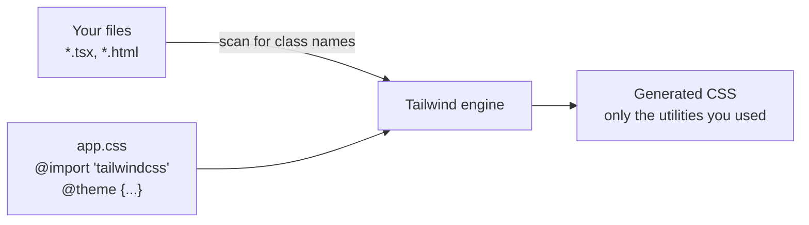

::part[Learn the Concept]{n="1"}

## 🎯 What you'll learn

- Utility-first CSS: the idea, the benefits and the criticism
- How Tailwind generates only the CSS you use
- Installing Tailwind v4 in Vite and Next.js projects
- CSS-first config: `@import`, `@source`, `@theme`, `@custom-variant`, `@utility`, `@layer base`
- Editor setup: IntelliSense and Prettier class sorting

## 🧠 The big idea

Traditional CSS is **sewing custom clothes** for each component: you design a `.job-card` class, name it, and maintain it. Tailwind is a **box of standard LEGO pieces** — `p-4`, `rounded-xl`, `shadow-sm` — that you snap together directly in the markup. Every piece comes from one design system (your tokens), so the result stays consistent.

## ❓ Why does this exist?

Large CSS codebases suffer from naming fatigue, dead styles nobody dares delete, and inconsistent one-off values (`padding: 13px`). Utility classes:
- are scoped to the element (no cascade surprises),
- are generated from a **design scale** (spacing, colors, font sizes),
- disappear from the bundle when unused (only classes found in your files are generated),
- make components self-contained — ideal for React.

## 💥 What happens if we DON'T (or misuse it)?

- Without a design system: 40 shades of gray and 25 border radii.
- Misusing Tailwind: arbitrary values everywhere (`mt-[13px] text-[#4a4a4a]`) recreate the chaos with uglier syntax.
- Building class names dynamically (`` `bg-${color}-500` ``) — Tailwind can't find them, so the styles silently don't exist.

## 📖 How it works, step by step

### 1. How Tailwind works



It scans files for **complete class name strings**, then generates the matching CSS. That's why dynamic string building breaks: `"bg-red-500"` must appear literally somewhere.

### 2. Install with Vite

```bash
npm install tailwindcss @tailwindcss/vite
```

```ts
// vite.config.ts
import tailwindcss from "@tailwindcss/vite";
export default defineConfig({ plugins: [react(), tailwindcss()] });
```

```css
/* src/index.css */
@import "tailwindcss";
```

### 3. Install with Next.js

`create-next-app` offers Tailwind during setup. Manually:

```bash
npm install tailwindcss @tailwindcss/postcss postcss
```

```js
// postcss.config.mjs
export default { plugins: { "@tailwindcss/postcss": {} } };
```

```css
/* app/globals.css */
@import "tailwindcss";
```

### 4. CSS-first configuration

```css
@import "tailwindcss";

@source "../content";                       /* also scan a folder outside the default detection */

@theme {
  --color-brand-50: oklch(0.97 0.02 275);
  --color-brand-500: oklch(0.55 0.2 275);   /* → bg-brand-500, text-brand-500, border-brand-500… */
  --font-display: "Plus Jakarta Sans", ui-sans-serif, system-ui, sans-serif;   /* → font-display */
  --breakpoint-3xl: 120rem;                 /* → 3xl:… */
}

@custom-variant dark (&:where(.dark, .dark *));   /* class-based dark mode */

@utility container-page {                   /* a real utility: works with md:, hover:, … */
  max-width: 72rem;
  margin-inline: auto;
  padding-inline: 1rem;
}

@layer base {
  body { background-color: var(--color-slate-50); color: var(--color-slate-900); }
}
```

- Every `@theme` token becomes **utilities** and a **CSS variable** (`var(--color-brand-500)`), usable in plain CSS or inline styles.
- Automatic source detection scans your project but skips `.gitignore`d files and `node_modules`; `@source` adds paths explicitly.
- Tailwind v3 projects used `tailwind.config.js`; v4 moved configuration into CSS (a JS config can still be loaded with `@config` during migration).

### 5. Preflight

`@import "tailwindcss"` includes **Preflight**, a reset: margins removed, headings unstyled, images `display: block`, `border-box` everywhere. That's why an `<h1>` looks like normal text until you add `text-3xl font-bold` — intentional.

### 6. Tooling

- **Tailwind CSS IntelliSense** (VS Code): autocomplete, hover previews, lint for conflicting classes.
- **prettier-plugin-tailwindcss**: sorts classes in a consistent order automatically.
- Browser DevTools show the generated rules like any CSS.

## ⚖️ Trade-offs

| Choice | ✅ | ❌ |
|---|---|---|
| Tailwind utilities | fast iteration, consistent tokens, tiny CSS, no naming | long class lists; HTML looks busy |
| Hand-written CSS/BEM | clean markup, full control | naming, dead CSS, inconsistency |
| CSS Modules | scoped, plain CSS | still invent values and names |
| CSS-in-JS (runtime) | dynamic styles | runtime cost; poor fit for React Server Components |
| Arbitrary values `[…]` | escape hatch | bypasses the design system if overused |

## ✅ When to use it / 🚫 When NOT to use it

- ✅ Component-based apps (React/Next.js) with a design system.
- ✅ Teams that want consistency without writing lots of CSS.
- 🚫 Long-form content styling → use the Typography plugin (`prose`) or plain CSS.
- 🚫 Dynamic class strings built from variables → map complete class names instead.

## 🏆 Best practices

- [ ] Put brand colors, fonts, radii and breakpoints in `@theme`; avoid arbitrary values.
- [ ] Always write **complete** class names in source (lookup tables, not string concatenation).
- [ ] Use `@utility` for project-specific reusable utilities; keep `@layer base` minimal.
- [ ] Install IntelliSense and the Prettier class-sorting plugin.
- [ ] Extract repeated class combinations into **components**, not `@apply` everywhere.
- [ ] Decide dark mode strategy early (media vs class).

## 🏭 How it's used in industry

- Tailwind is the default styling choice for new Next.js projects and powers shadcn/ui (Week 5).
- Design-system teams publish tokens that map directly to `@theme` variables.
- AI UI generators (v0 and similar) output Tailwind markup, so reading Tailwind fluently is a daily skill.

## ⚠️ Common mistakes

- `` className={`text-${color}-600`} `` — generates nothing.
- Forgetting that Preflight removed default heading/list styles.
- Copying v3 `tailwind.config.js` tutorials into a v4 project without `@config` or migrating tokens to `@theme`.
- Using `@apply` to recreate BEM classes for everything (you lose Tailwind's benefits).

::part[Explain & Design]{n="2"}

## 🗣️ Explain it

A teammate says "Tailwind is just inline styles". Explain two important differences.

## 📐 Design it

Translate CareerPilot's design tokens from the CSS fundamentals lesson (brand colors, status colors, spacing, radii, fonts, dark mode) into a Tailwind v4 `app.css`. Which tokens become `@theme` variables, which stay Tailwind defaults, and how would a status badge get its colors without dynamic class names?

:::quiz
Show a possible setup

```css
@import "tailwindcss";

@theme {
  --color-brand-50: oklch(0.97 0.02 275);
  --color-brand-600: oklch(0.51 0.2 275);
  --color-brand-700: oklch(0.45 0.19 275);

  /* semantic status colors → bg-status-offer, text-status-offer… */
  --color-status-saved: oklch(0.55 0.02 255);
  --color-status-applied: oklch(0.55 0.17 255);
  --color-status-interview: oklch(0.7 0.16 70);
  --color-status-offer: oklch(0.6 0.15 150);
  --color-status-rejected: oklch(0.58 0.2 25);

  --font-sans: "Inter", ui-sans-serif, system-ui, sans-serif;   /* override the default font-sans */
  --radius-card: 0.75rem;                                       /* → rounded-card */
}

@custom-variant dark (&:where(.dark, .dark *));
```

- **Keep defaults** for spacing (`p-4` = `1rem` on a 0.25rem scale) and grays — no need to redefine them.
- **Badges** use a complete lookup table (never `` `bg-status-${status}` ``):

```ts
const STATUS_BADGE = {
  saved: "bg-status-saved/10 text-status-saved",
  applied: "bg-status-applied/10 text-status-applied",
  interview: "bg-status-interview/15 text-status-interview",
  offer: "bg-status-offer/10 text-status-offer",
  rejected: "bg-status-rejected/10 text-status-rejected",
} satisfies Record<Status, string>;
```

- Dark mode: toggle a `.dark` class on `<html>` and use `dark:` variants, or redefine CSS variables under `.dark` for semantic surface colors.
:::

### 📝 Self-review checklist

- [ ] Only project-specific tokens added to `@theme`
- [ ] Semantic names for statuses
- [ ] No dynamic class name construction

::ai-review{task="design"}

::part[Toy Exercise]{n="3"}

:::exercise{path="exercises/web/m4/w2/04-tailwind-setup" ai="ai-allowed" title="Configure Tailwind v4 with your tokens"}
Write a Tailwind v4 entry stylesheet: import Tailwind, register sources, add brand colors, a display font and a custom breakpoint in `@theme`, class-based dark mode, a custom utility and base styles. The test compiles it with Tailwind and inspects the generated CSS.
:::

:::hints
- The order doesn't matter much, but `@import "tailwindcss";` goes first.
- A breakpoint token is named `--breakpoint-3xl`.
- `@utility name { … }` — no leading dot.
:::

## ✅ Quick check

:::quiz
Why doesn't `` `bg-${color}-500` `` work in Tailwind?

Tailwind generates CSS only for complete class names it finds in source files; a class built at runtime never appears literally, so no CSS is generated for it.
:::

:::quiz
What does a `--color-brand-500` token in `@theme` create?

Color utilities like `bg-brand-500`, `text-brand-500`, `border-brand-500` and a CSS variable `--color-brand-500`.
:::

## 📖 Kamus (glossary)

| Term | Bahasa Indonesia |
|---|---|
| Utility-first | Mengutamakan kelas utilitas kecil |
| Design token | Token desain (nilai warna, jarak, font) |
| Preflight | Reset CSS bawaan Tailwind |
| Variant | Varian (hover:, md:, dark:) |
| Source detection | Deteksi file sumber untuk mencari nama kelas |

## 📚 Keep learning

- [Tailwind CSS docs: Installation](https://tailwindcss.com/docs/installation)
- [Tailwind CSS docs: Theme variables](https://tailwindcss.com/docs/theme)
- [Tailwind CSS docs: Detecting classes in source files](https://tailwindcss.com/docs/detecting-classes-in-source-files)
