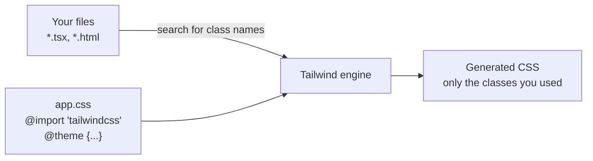

::part[Learn the Concept]{n="1"}

## 🎯 What you'll learn

- What utility classes are, and their pros and cons
- How Tailwind creates only the CSS you actually use
- Installing Tailwind v4 in Vite and Next.js
- Adding your own colors, fonts and breakpoints in CSS (`@theme`)
- Editor tools that make Tailwind easier

## 🔤 Key words

| Word | In simple words | Bahasa Indonesia |
|---|---|---|
| **Utility class** | A tiny class that does one thing: `p-4` = padding 1rem | Kelas kecil satu fungsi |
| **Utility-first** | Styling mostly with utility classes in the HTML | Mengutamakan kelas kecil |
| **Design token** | A named design value: a brand color, a spacing size | Token desain |
| **`@theme`** | The place in your CSS where you add your own tokens | Tempat token |
| **Preflight** | Tailwind's reset that removes browser default styles | Reset bawaan |
| **Variant** | A prefix that applies a class only in a situation: `hover:`, `md:`, `dark:` | Varian kondisi |

## 🧠 The big idea

Normal CSS is like **tailoring a custom shirt** for every component: you design a `.job-card` class, give it a name and look after it forever. Tailwind is like **LEGO**: a box of small standard pieces — `p-4`, `rounded-xl`, `shadow-sm` — that you snap together right in the HTML. Because all pieces come from the same set (your design tokens), everything matches.

## ❓ Why it matters

Big CSS projects often end up with:
- tiring naming decisions,
- old styles nobody dares delete,
- random values like `padding: 13px` everywhere.

Tailwind helps because:
- each class only affects the element it's on (no "which rule wins" surprises),
- values come from a fixed **scale** (spacing, colors, font sizes),
- only the classes you use end up in the final CSS,
- each React component carries its own styles.

Used badly, Tailwind is messy too:
- `mt-[13px] text-[#4a4a4a]` everywhere brings the random values back.
- Building class names like `` `bg-${color}-500` `` silently produces **no CSS** (explained below).

## 📖 Step by step

### 1. How Tailwind works



Tailwind **reads your files like a search engine**, looking for full class names such as `"bg-red-500"`. Then it writes CSS only for those. That's why a class built from pieces at runtime (`"bg-" + color + "-500"`) is never found: the full word never appears in your files.

### 2. Install with Vite

```bash
npm install tailwindcss @tailwindcss/vite
```

```ts
// vite.config.ts
import tailwindcss from "@tailwindcss/vite";
export default defineConfig({ plugins: [react(), tailwindcss()] });
```

```css
/* src/index.css */
@import "tailwindcss";
```

### 3. Install with Next.js

`create-next-app` asks if you want Tailwind. To add it by hand:

```bash
npm install tailwindcss @tailwindcss/postcss postcss
```

```js
// postcss.config.mjs
export default { plugins: { "@tailwindcss/postcss": {} } };
```

```css
/* app/globals.css */
@import "tailwindcss";
```

### 4. Your own settings, in CSS

```css
@import "tailwindcss";

@source "../content";                       /* also scan a folder outside the default detection */

@theme {
  --color-brand-50: oklch(0.97 0.02 275);
  --color-brand-500: oklch(0.55 0.2 275);   /* → bg-brand-500, text-brand-500, border-brand-500… */
  --font-display: "Plus Jakarta Sans", ui-sans-serif, system-ui, sans-serif;   /* → font-display */
  --breakpoint-3xl: 120rem;                 /* → 3xl:… */
}

@custom-variant dark (&:where(.dark, .dark *));   /* class-based dark mode */

@utility container-page {                   /* a real utility: works with md:, hover:, … */
  max-width: 72rem;
  margin-inline: auto;
  padding-inline: 1rem;
}

@layer base {
  body { background-color: var(--color-slate-50); color: var(--color-slate-900); }
}
```

- `@theme` — add tokens. Each one becomes **classes** (`bg-brand-500`) and a **CSS variable** (`var(--color-brand-500)`). Like adding a new color to the paint shop: it's instantly available for every wall.
- `@source` — also search this folder for class names.
- `@custom-variant dark` — dark mode switches on when `<html>` has the class `dark`.
- `@utility` — make your own utility class that also works with `md:`, `hover:` and friends.
- `@layer base` — a few global base styles.

Older tutorials (Tailwind v3) use a `tailwind.config.js` file. In v4, settings live in CSS.

### 5. Preflight (the reset)

`@import "tailwindcss"` includes **Preflight**, which removes the browser's default styles: no margins, headings look like normal text, lists have no bullets. So an `<h1>` looks plain until you add `text-3xl font-bold`. That's on purpose — you start from a clean page.

### 6. Editor tools

- **Tailwind CSS IntelliSense** (VS Code): autocomplete class names, preview the CSS on hover, warn about conflicting classes.
- **prettier-plugin-tailwindcss**: sorts classes in the same order everywhere.
- Browser DevTools show the generated CSS like any other CSS.

## ⚠️ Common mistakes

- `` className={`text-${color}-600`} `` — creates no CSS. Use a table of complete class names.
- Forgetting that Preflight removed default heading and list styles.
- Copying a v3 `tailwind.config.js` tutorial into a v4 project.
- Arbitrary values like `mt-[13px]` everywhere, instead of the scale.
- Using `@apply` to rebuild old-style classes for everything — you lose Tailwind's benefits.
- Using Tailwind classes for long articles — use the Typography plugin (`prose`) instead.

## 🏆 Best practices

- [ ] Put brand colors, fonts, radius and breakpoints in `@theme`; avoid arbitrary values.
- [ ] Always write **complete** class names in your code (use lookup tables).
- [ ] Use `@utility` for project-specific helpers; keep `@layer base` small.
- [ ] Install IntelliSense and the Prettier class-sorting plugin.
- [ ] Repeated class groups → make a **component**, not many `@apply` rules.
- [ ] Decide early how dark mode works (system setting or a `.dark` class).

::part[Explain & Design]{n="2"}

## 🗣️ Explain it

A teammate says: "Tailwind is just inline styles." Explain two important differences (hint: the fixed scale of values, and variants like `hover:` and `md:` that inline styles can't do).

## 📐 Design it

Turn CareerPilot's design tokens from the CSS lesson (brand colors, status colors, spacing, radius, fonts, dark mode) into a Tailwind v4 `app.css`. Which values go into `@theme`, which Tailwind defaults do you keep, and how does a status badge get its colors without building class names from strings?

:::quiz
Show a possible setup

```css
@import "tailwindcss";

@theme {
  --color-brand-50: oklch(0.97 0.02 275);
  --color-brand-600: oklch(0.51 0.2 275);
  --color-brand-700: oklch(0.45 0.19 275);

  /* semantic status colors → bg-status-offer, text-status-offer… */
  --color-status-saved: oklch(0.55 0.02 255);
  --color-status-applied: oklch(0.55 0.17 255);
  --color-status-interview: oklch(0.7 0.16 70);
  --color-status-offer: oklch(0.6 0.15 150);
  --color-status-rejected: oklch(0.58 0.2 25);

  --font-sans: "Inter", ui-sans-serif, system-ui, sans-serif;   /* override the default font-sans */
  --radius-card: 0.75rem;                                       /* → rounded-card */
}

@custom-variant dark (&:where(.dark, .dark *));
```

- **Keep the defaults** for spacing (`p-4` = `1rem`) and grays — no need to redefine them.
- **Badges** use a table of complete class names (never `` `bg-status-${status}` ``):

```ts
const STATUS_BADGE = {
  saved: "bg-status-saved/10 text-status-saved",
  applied: "bg-status-applied/10 text-status-applied",
  interview: "bg-status-interview/15 text-status-interview",
  offer: "bg-status-offer/10 text-status-offer",
  rejected: "bg-status-rejected/10 text-status-rejected",
} satisfies Record<Status, string>;
```

- **Dark mode**: add a `.dark` class to `<html>` and use `dark:` classes.
:::

### 📝 Self-review checklist

- [ ] Only project-specific tokens are added to `@theme`
- [ ] Status colors have names that describe their purpose
- [ ] No class names built from strings

::ai-review{task="design"}

::part[Toy Exercise]{n="3"}

:::exercise{path="exercises/web/m4/w2/04-tailwind-setup" ai="ai-allowed" title="Configure Tailwind v4 with your tokens"}
Write a Tailwind v4 CSS entry file: import Tailwind, add a source folder, add brand colors, a display font and a custom breakpoint in `@theme`, class-based dark mode, a custom utility and base styles. The test builds it with Tailwind and checks the generated CSS.
:::

:::hints
- Put `@import "tailwindcss";` first.
- A breakpoint token is named `--breakpoint-3xl`.
- `@utility name { … }` — no dot before the name.
:::

## ✅ Quick check

:::quiz
Why doesn't `` `bg-${color}-500` `` work in Tailwind?

Tailwind only creates CSS for complete class names it finds in your files. A class built while the app runs never appears as a full word, so no CSS is created.
:::

:::quiz
What does the token `--color-brand-500` in `@theme` create?

Color classes like `bg-brand-500`, `text-brand-500`, `border-brand-500`, and a CSS variable `--color-brand-500`.
:::

## 📚 Keep learning

- [Tailwind CSS docs: Installation](https://tailwindcss.com/docs/installation)
- [Tailwind CSS docs: Theme variables](https://tailwindcss.com/docs/theme)
- [Tailwind CSS docs: Detecting classes in source files](https://tailwindcss.com/docs/detecting-classes-in-source-files)
