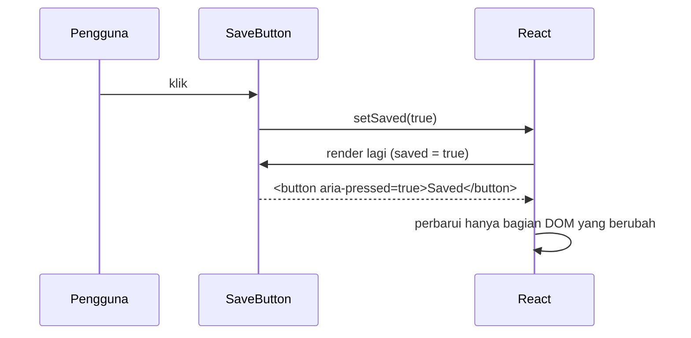

::part[Pelajari Konsepnya]{n="1"}

## 🎯 Yang akan kamu pelajari

- `useState`: cara component mengingat sesuatu
- Menangani klik, ketikan, dan submit form di React
- Kenapa kamu harus **mengganti** state, bukan mengubahnya
- Updater function: `setCount(c => c + 1)`
- **Lifting state up**: berbagi state antar component
- Menjaga state tetap kecil, dan Rules of Hooks

## 🔤 Istilah penting

| Istilah | Artinya (sederhana) |
|---|---|
| **State** | Data yang diingat component di antara render (lowongan tersimpan, menu yang terbuka) |
| **`useState`** | Hook pembuat state: `const [value, setValue] = useState(0)` |
| **Setter** | Function yang mengubah state dan meminta React menggambar ulang |
| **Re-render** | React menjalankan component-mu lagi untuk menggambar tampilan baru |
| **Immutable update** | Membuat array/object baru alih-alih mengubah yang lama |
| **Lifting state up** | Memindahkan state ke parent agar beberapa child bisa berbagi |
| **Derived value** | Nilai yang dihitung dari state, bukan disimpan |
| **Hook** | Function khusus React yang namanya diawali `use` |

## 🧠 Ide besarnya

Component React bekerja seperti **photo booth**. Setiap render mengambil foto tampilan dengan state saat itu. Memanggil setter tidak mengedit foto lama — ia meminta React mengambil **foto baru** dengan state yang baru.

Dua hal yang mengikutinya:
- Kamu harus memberi React nilai **baru** (bukan mencoret-coret foto lama).
- Di dalam handler klik, variabel berisi nilai dari foto **itu**, walaupun kamu sudah memanggil setter.

## ❓ Kenapa ini penting

Tampilan terus berubah: lowongan tersimpan, menu terbuka, teks yang diketik, tab yang dipilih. Di Minggu 1 kamu menyimpannya di variabel dan menggambar ulang secara manual. State di React membuat tampilan selalu cocok dengan data — **asal** kamu mengikuti aturannya.

Melanggar aturan menimbulkan bug yang membingungkan:

```tsx
const [saved, setSaved] = useState<string[]>([]);
saved.push(title);          // mutates the current snapshot
setSaved(saved);            // same reference → React may skip the re-render

const [count, setCount] = useState(0);
setCount(count + 1);
setCount(count + 1);        // still +1: both read the same snapshot's count

let clicks = 0;             // a normal variable resets on every render
```

## 📖 Langkah demi langkah

### 1. `useState`

```tsx
"use client";
import { useState } from "react";

export function SaveButton() {
  const [saved, setSaved] = useState(false);          // [current value, setter]
  return (
    <button type="button" aria-pressed={saved} onClick={() => setSaved(!saved)}>
      {saved ? "Saved" : "Save"}
    </button>
  );
}
```

`useState(false)` memberi dua hal: nilai saat ini (`saved`) dan function untuk mengubahnya (`setSaved`). Yang terjadi saat diklik:



### 2. Event

```tsx
<button onClick={() => handleSave(job.id)}>Save</button>           // pass a function, don't call it
<input onChange={(event) => setQuery(event.target.value)} />
<form onSubmit={(event) => { event.preventDefault(); submit(); }}>
```

- `onClick={handleSave}` ✅ memberi React function untuk dipanggil nanti. `onClick={handleSave()}` ❌ langsung memanggilnya saat menggambar — seperti menekan bel pintu saat masih memasangnya.
- Type event untuk TypeScript: `React.MouseEvent<HTMLButtonElement>`, `React.ChangeEvent<HTMLInputElement>`, `React.FormEvent<HTMLFormElement>`.

### 3. Ganti, jangan ubah

```tsx
setJobs([...jobs, newJob]);                                   // add
setJobs(jobs.filter((job) => job.id !== id));                 // remove
setJobs(jobs.map((job) => (job.id === id ? { ...job, saved: true } : job)));   // update one
setFilters({ ...filters, remote: true });                     // object field
setSavedIds((prev) => { const next = new Set(prev); next.add(id); return next; });   // Set
```

React mengecek "apakah ini array yang **sama** dengan sebelumnya?" — seperti satpam yang mengecek nomor kartu identitas, bukan membaca setiap halamannya. Kalau kamu `push` ke array lama, kartunya tetap sama, jadi React bisa mengira tidak ada yang berubah. Array **baru** = kartu baru = React menggambar ulang.

### 4. Updater function

```tsx
function addThree() {
  setCount((c) => c + 1);
  setCount((c) => c + 1);
  setCount((c) => c + 1);    // 3: each updater receives the latest pending value
}
```

React **mengelompokkan** (batching) update dari satu klik menjadi satu kali gambar ulang. `setCount(count + 1)` tiga kali membaca foto lama yang sama tiga kali → +1. `setCount(c => c + 1)` seperti estafet catatan: setiap orang menambahkan 1 ke angka yang ia terima → +3.

Pakai bentuk updater setiap kali state baru bergantung pada state lama.

### 5. Lifting state up

Saat dua component butuh data yang sama, pindahkan state ke parent terdekat yang sama-sama mereka miliki, lalu kirim ke bawah:

```tsx
function SavedJobsBoard({ jobs }: { jobs: Job[] }) {
  const [savedIds, setSavedIds] = useState<ReadonlySet<number>>(() => new Set());
  const toggle = (id: number) =>
    setSavedIds((prev) => {
      const next = new Set(prev);
      next.has(id) ? next.delete(id) : next.add(id);
      return next;
    });

  return (
    <>
      <p>{savedIds.size} saved</p>
      {jobs.map((job) => (
        <SaveButton key={job.id} saved={savedIds.has(job.id)} onToggle={() => toggle(job.id)} jobTitle={job.title} />
      ))}
    </>
  );
}
```

Seperti keluarga yang punya satu **kalender bersama di kulkas** daripada setiap orang punya buku harian sendiri: satu tempat menyimpan kebenaran, dan semua orang membacanya dari situ.

- Data turun **ke bawah** sebagai props (`saved`).
- Event naik **ke atas** sebagai callback (`onToggle`).
- `SaveButton` sekarang **controlled**: ia menampilkan apa yang diberitahu dan melaporkan klik.

### 6. Jaga state tetap kecil

```tsx
const [jobs, setJobs] = useState<Job[]>(initialJobs);
const [query, setQuery] = useState("");
const visible = jobs.filter((job) => job.title.toLowerCase().includes(query.toLowerCase()));   // derived: no state!
```

Jangan simpan yang bisa kamu hitung (`visibleJobs`, jumlah, nama lengkap). Dua salinan informasi yang sama akan tidak sinkron — seperti dua jam dinding di rumah yang tidak pernah menunjukkan waktu yang sama.

### 7. Nilai awal yang mahal

```tsx
const [savedIds] = useState(() => new Set(readFromStorage()));   // runs once, not on every render
```

Memberikan function berarti ia hanya dijalankan pertama kali.

### 8. Rules of Hooks

1. Panggil hook hanya di **bagian atas** component atau custom hook — jangan di dalam `if`, loop, atau function bersarang.
2. Panggil hook hanya dari component React atau custom hook.

React mengingat hook berdasarkan **urutannya**, seperti nomor kursi di bioskop. Kalau sebuah hook kadang dilewati (di dalam `if`), semua orang bergeser kursi dan state jadi tertukar. Aturan ESLint `react-hooks` menangkap kesalahan ini.

:::note[React Compiler]
React Compiler (ditawarkan oleh `create-next-app`) otomatis mengoptimalkan component-mu, jadi kamu jarang butuh `useMemo` atau `useCallback`. Ia bergantung pada kamu mengikuti aturan ini: tidak mengubah state secara langsung, dan tanpa efek samping saat render.
:::

## ⚠️ Kesalahan umum

- `onClick={handle()}` alih-alih `onClick={handle}`.
- Mengubah array atau object, lalu memberikan yang sama ke setter.
- Berharap nilainya langsung berubah setelah memanggil setter (`console.log(count)` masih menampilkan foto lama).
- Menyalin props ke state, lalu bingung kenapa perubahannya tidak tampil.
- Menyimpan nilai yang bisa dihitung (seperti list yang sudah difilter) di state.
- Menyimpan data server di banyak `useState` terpisah — pakai library data (TanStack Query, Minggu 4).

## 🏆 Praktik terbaik

- [ ] Jangan pernah mengubah state secara langsung; buat array, object, dan Set baru.
- [ ] Pakai updater function saat state baru bergantung pada yang lama.
- [ ] Jaga state seminimal mungkin; hitung nilai turunan saat render.
- [ ] Taruh state di parent bersama yang paling bawah; naikkan hanya saat perlu.
- [ ] Buat input dan tombol yang dipakai ulang menjadi controlled (`value`/`onChange`, `saved`/`onToggle`).
- [ ] Ikuti Rules of Hooks dan biarkan aturan ESLint `react-hooks` tetap aktif.

::part[Jelaskan & Rancang]{n="2"}

## 🗣️ Jelaskan

Jelaskan ide photo booth ke rekan tim yang menulis `setCount(count + 1)` tiga kali tapi hanya mendapat +1.

## 📐 Rancang

Rencanakan state untuk **halaman pencarian lowongan** CareerPilot (di browser untuk sekarang): teks pencarian, toggle khusus remote, skill yang dipilih (bisa beberapa), opsi urutan, id lowongan tersimpan, dan baki "bandingkan" yang menampung maksimal 3 lowongan. Tentukan mana yang state, mana yang dihitung, di mana disimpan, dan tulis function update untuk toggle skill dan menambahkan lowongan ke baki bandingkan.

:::quiz
Tampilkan contoh desainnya

**State (di `JobSearchPage`, sebuah Client Component)**
```ts
const [query, setQuery] = useState("");
const [remoteOnly, setRemoteOnly] = useState(false);
const [skills, setSkills] = useState<ReadonlySet<string>>(() => new Set());
const [sort, setSort] = useState<"newest" | "salary">("newest");
const [savedIds, setSavedIds] = useState<ReadonlySet<number>>(() => new Set());
const [compareIds, setCompareIds] = useState<readonly number[]>([]);   // ordered, max 3
```

**Dihitung saat render**
```ts
const visibleJobs = jobs
  .filter((j) => j.title.toLowerCase().includes(query.trim().toLowerCase()))
  .filter((j) => !remoteOnly || j.remote)
  .filter((j) => [...skills].every((s) => j.skills.includes(s)))
  .toSorted(sort === "salary" ? bySalaryDesc : byNewest);
const compareJobs = compareIds.map((id) => jobs.find((j) => j.id === id)).filter(Boolean);
const canAddToCompare = compareIds.length < 3;
```

**Update**
```ts
const toggleSkill = (skill: string) =>
  setSkills((prev) => {
    const next = new Set(prev);
    next.has(skill) ? next.delete(skill) : next.add(skill);
    return next;
  });

const addToCompare = (id: number) =>
  setCompareIds((prev) => (prev.includes(id) || prev.length >= 3 ? prev : [...prev, id]));
```

**Tempatnya**: semua di halaman, karena bar filter, hasil, dan baki bandingkan bersaudara. Nanti, filter pindah ke **URL** agar link bisa dibagikan (Minggu 4), dan `savedIds` menjadi **data server** yang disimpan oleh Flask API.
:::

### 📝 Checklist self-review

- [ ] Tidak ada data hitungan yang disimpan di state
- [ ] Array/Set baru dan updater function
- [ ] Alasan yang jelas untuk tempat state disimpan

::ai-review{task="design"}

::part[Latihan Kecil]{n="3"}

:::exercise{path="exercises/web/m4/w3/03-state-events" ai="no-ai" title="Papan lowongan tersimpan dengan state yang dinaikkan"}
Bangun `SaveButton` yang controlled, `SavedJobsBoard` yang menyimpan id tersimpan di `Set` (diganti, tidak pernah diubah) dengan jumlah live dan tombol hapus semua, serta counter yang tombol `+3`-nya berfungsi berkat updater function. Tes mengekliknya seperti pengguna dan mengecek bahwa kamu tidak mengubah state secara langsung.
:::

:::hints
- `useState<ReadonlySet<number>>(() => new Set())` — `ReadonlySet` membuat TypeScript mencegahmu memanggil `.add` pada state itu sendiri.
- Di `toggle`, salin dulu: `const next = new Set(previous)`.
- `disabled={savedIds.size === 0}` untuk tombol hapus semua.
:::

## ✅ Cek cepat

:::quiz
Kenapa React butuh array baru agar menggambar ulang dengan andal?

React mengecek apakah state berubah dengan membandingkan reference (`Object.is`). Mengubah array lama membuat reference-nya tetap sama, jadi React bisa melewati update.
:::

:::quiz
Apa itu "lifting state up"?

Memindahkan state bersama ke parent terdekat yang sama, mengirim nilai ke bawah sebagai props dan perubahan ke atas lewat callback, agar component bersaudara tetap sinkron.
:::

## 📚 Lanjut belajar

- [React docs: State — A Component's Memory](https://react.dev/learn/state-a-components-memory)
- [React docs: Updating Arrays in State](https://react.dev/learn/updating-arrays-in-state)
- [React docs: Sharing State Between Components](https://react.dev/learn/sharing-state-between-components)
