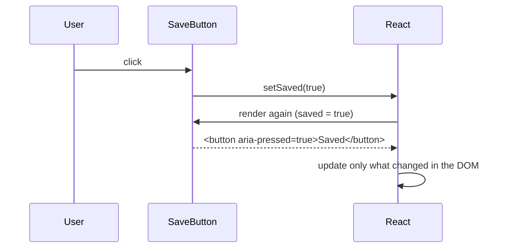

::part[Learn the Concept]{n="1"}

## 🎯 What you'll learn

- `useState`: how a component remembers things
- Handling clicks, typing and form submits in React
- Why you must **replace** state instead of changing it
- Updater functions: `setCount(c => c + 1)`
- **Lifting state up**: sharing state between components
- Keeping state small, and the Rules of Hooks

## 🔤 Key words

| Word | In simple words | Bahasa Indonesia |
|---|---|---|
| **State** | Data a component remembers between renders (saved jobs, open menu) | Data yang diingat komponen |
| **`useState`** | The hook that creates state: `const [value, setValue] = useState(0)` | Pembuat state |
| **Setter** | The function that changes state and asks React to redraw | Pengubah state |
| **Re-render** | React runs your component again to draw the new screen | Menggambar ulang |
| **Immutable update** | Make a new array/object instead of changing the old one | Ganti, bukan ubah |
| **Lifting state up** | Moving state to a parent so several children can share it | Menaikkan state |
| **Derived value** | A value you calculate from state instead of storing it | Nilai turunan |
| **Hook** | A special React function whose name starts with `use` | Hook |

## 🧠 The big idea

A React component works like a **photo booth**. Each render takes a photo of the screen with the current state. Calling a setter doesn't edit the old photo — it asks React to take a **new photo** with the new state.

Two things follow:
- You must give React **new** values (not scribble on the old photo).
- Inside a click handler, variables hold the values from **that** photo, even after you call the setter.

## ❓ Why it matters

Screens change all the time: saved jobs, open menus, typed text, selected tabs. In Week 1 you stored this in variables and redrew by hand. React's state makes the screen always match the data — **if** you follow its rules.

Breaking the rules causes confusing bugs:

```tsx
const [saved, setSaved] = useState<string[]>([]);
saved.push(title);          // mutates the current snapshot
setSaved(saved);            // same reference → React may skip the re-render

const [count, setCount] = useState(0);
setCount(count + 1);
setCount(count + 1);        // still +1: both read the same snapshot's count

let clicks = 0;             // a normal variable resets on every render
```

## 📖 Step by step

### 1. `useState`

```tsx
"use client";
import { useState } from "react";

export function SaveButton() {
  const [saved, setSaved] = useState(false);          // [current value, setter]
  return (
    <button type="button" aria-pressed={saved} onClick={() => setSaved(!saved)}>
      {saved ? "Saved" : "Save"}
    </button>
  );
}
```

`useState(false)` gives two things: the current value (`saved`) and a function to change it (`setSaved`). What happens on a click:



### 2. Events

```tsx
<button onClick={() => handleSave(job.id)}>Save</button>           // pass a function, don't call it
<input onChange={(event) => setQuery(event.target.value)} />
<form onSubmit={(event) => { event.preventDefault(); submit(); }}>
```

- `onClick={handleSave}` ✅ gives React the function to call later. `onClick={handleSave()}` ❌ calls it immediately while drawing — like pressing the doorbell while installing it.
- Event types for TypeScript: `React.MouseEvent<HTMLButtonElement>`, `React.ChangeEvent<HTMLInputElement>`, `React.FormEvent<HTMLFormElement>`.

### 3. Replace, don't change

```tsx
setJobs([...jobs, newJob]);                                   // add
setJobs(jobs.filter((job) => job.id !== id));                 // remove
setJobs(jobs.map((job) => (job.id === id ? { ...job, saved: true } : job)));   // update one
setFilters({ ...filters, remote: true });                     // object field
setSavedIds((prev) => { const next = new Set(prev); next.add(id); return next; });   // Set
```

React checks "is this the **same** array as before?" — like a security guard checking the ID card number, not reading every page. If you `push` into the old array, it's still the same card, so React may think nothing changed. A **new** array = a new card = React redraws.

### 4. Updater functions

```tsx
function addThree() {
  setCount((c) => c + 1);
  setCount((c) => c + 1);
  setCount((c) => c + 1);    // 3: each updater receives the latest pending value
}
```

React **batches** updates from one click into one redraw. `setCount(count + 1)` three times reads the same old photo three times → +1. `setCount(c => c + 1)` is like passing a note down a line: each person adds 1 to the number they received → +3.

Use the updater form whenever the new state depends on the old state.

### 5. Lifting state up

When two components need the same data, move the state to their closest shared parent and pass it down:

```tsx
function SavedJobsBoard({ jobs }: { jobs: Job[] }) {
  const [savedIds, setSavedIds] = useState<ReadonlySet<number>>(() => new Set());
  const toggle = (id: number) =>
    setSavedIds((prev) => {
      const next = new Set(prev);
      next.has(id) ? next.delete(id) : next.add(id);
      return next;
    });

  return (
    <>
      <p>{savedIds.size} saved</p>
      {jobs.map((job) => (
        <SaveButton key={job.id} saved={savedIds.has(job.id)} onToggle={() => toggle(job.id)} jobTitle={job.title} />
      ))}
    </>
  );
}
```

Like a family with one shared **calendar on the fridge** instead of everyone keeping their own diary: one place holds the truth, and everyone reads from it.

- Data goes **down** as props (`saved`).
- Events go **up** as callbacks (`onToggle`).
- `SaveButton` is now **controlled**: it shows what it's told and reports clicks.

### 6. Keep state small

```tsx
const [jobs, setJobs] = useState<Job[]>(initialJobs);
const [query, setQuery] = useState("");
const visible = jobs.filter((job) => job.title.toLowerCase().includes(query.toLowerCase()));   // derived: no state!
```

Don't store what you can calculate (`visibleJobs`, counts, full names). Two copies of the same information get out of sync — like two clocks in a house that never show the same time.

### 7. Expensive starting values

```tsx
const [savedIds] = useState(() => new Set(readFromStorage()));   // runs once, not on every render
```

Passing a function means it runs only the first time.

### 8. Rules of Hooks

1. Call hooks only at the **top** of a component or custom hook — never inside `if`, loops or nested functions.
2. Call hooks only from React components or custom hooks.

React remembers hooks by their **order**, like seat numbers in a cinema. If a hook is skipped sometimes (inside an `if`), everyone shifts seats and state gets mixed up. The `react-hooks` ESLint rules catch this.

:::note[React Compiler]
The React Compiler (offered by `create-next-app`) automatically optimizes your components, so you rarely need `useMemo` or `useCallback`. It depends on you following these rules: no changing state directly, and no side effects while rendering.
:::

## ⚠️ Common mistakes

- `onClick={handle()}` instead of `onClick={handle}`.
- Changing an array or object, then passing the same one to the setter.
- Expecting the value to change right after calling the setter (`console.log(count)` still shows the old photo).
- Copying props into state, then wondering why updates don't show.
- Storing calculated values (like a filtered list) in state.
- Keeping server data in many separate `useState`s — use a data library (TanStack Query, Week 4).

## 🏆 Best practices

- [ ] Never change state directly; create new arrays, objects and Sets.
- [ ] Use updater functions when the new state depends on the old.
- [ ] Keep state minimal; calculate derived values during render.
- [ ] Put state in the lowest shared parent; lift only when needed.
- [ ] Make reusable inputs and buttons controlled (`value`/`onChange`, `saved`/`onToggle`).
- [ ] Follow the Rules of Hooks and keep the `react-hooks` ESLint rules on.

::part[Explain & Design]{n="2"}

## 🗣️ Explain it

Explain the photo booth idea to a teammate who wrote `setCount(count + 1)` three times and only got +1.

## 📐 Design it

Plan the state for CareerPilot's **job search page** (in the browser for now): search text, a remote-only toggle, selected skills (several), a sort option, saved job ids, and a "compare" tray that holds up to 3 jobs. Decide what is state, what is calculated, where it lives, and write the update functions for toggling a skill and adding a job to compare.

:::quiz
Show a possible design

**State (in `JobSearchPage`, a Client Component)**
```ts
const [query, setQuery] = useState("");
const [remoteOnly, setRemoteOnly] = useState(false);
const [skills, setSkills] = useState<ReadonlySet<string>>(() => new Set());
const [sort, setSort] = useState<"newest" | "salary">("newest");
const [savedIds, setSavedIds] = useState<ReadonlySet<number>>(() => new Set());
const [compareIds, setCompareIds] = useState<readonly number[]>([]);   // ordered, max 3
```

**Calculated during render**
```ts
const visibleJobs = jobs
  .filter((j) => j.title.toLowerCase().includes(query.trim().toLowerCase()))
  .filter((j) => !remoteOnly || j.remote)
  .filter((j) => [...skills].every((s) => j.skills.includes(s)))
  .toSorted(sort === "salary" ? bySalaryDesc : byNewest);
const compareJobs = compareIds.map((id) => jobs.find((j) => j.id === id)).filter(Boolean);
const canAddToCompare = compareIds.length < 3;
```

**Updates**
```ts
const toggleSkill = (skill: string) =>
  setSkills((prev) => {
    const next = new Set(prev);
    next.has(skill) ? next.delete(skill) : next.add(skill);
    return next;
  });

const addToCompare = (id: number) =>
  setCompareIds((prev) => (prev.includes(id) || prev.length >= 3 ? prev : [...prev, id]));
```

**Where it lives**: all in the page, because the filter bar, the results and the compare tray are siblings. Later, the filters move to the **URL** so links can be shared (Week 4), and `savedIds` becomes **server data** saved by the Flask API.
:::

### 📝 Self-review checklist

- [ ] No calculated data stored in state
- [ ] New arrays/Sets and updater functions
- [ ] A clear reason for where state lives

::ai-review{task="design"}

::part[Toy Exercise]{n="3"}

:::exercise{path="exercises/web/m4/w3/03-state-events" ai="no-ai" title="A saved-jobs board with lifted state"}
Build a controlled `SaveButton`, a `SavedJobsBoard` that keeps saved ids in a `Set` (replaced, never changed) with a live count and a clear button, and a counter whose `+3` button works thanks to updater functions. The tests click through it like a user and check that you don't change state directly.
:::

:::hints
- `useState<ReadonlySet<number>>(() => new Set())` — `ReadonlySet` makes TypeScript stop you from calling `.add` on the state itself.
- In `toggle`, copy first: `const next = new Set(previous)`.
- `disabled={savedIds.size === 0}` for the clear button.
:::

## ✅ Quick check

:::quiz
Why does React need a new array to redraw reliably?

React checks whether state changed by comparing references (`Object.is`). Changing the old array keeps the same reference, so React may skip the update.
:::

:::quiz
What is "lifting state up"?

Moving shared state to the closest common parent, sending values down as props and changes up with callbacks, so sibling components stay in sync.
:::

## 📚 Keep learning

- [React docs: State — A Component's Memory](https://react.dev/learn/state-a-components-memory)
- [React docs: Updating Arrays in State](https://react.dev/learn/updating-arrays-in-state)
- [React docs: Sharing State Between Components](https://react.dev/learn/sharing-state-between-components)
