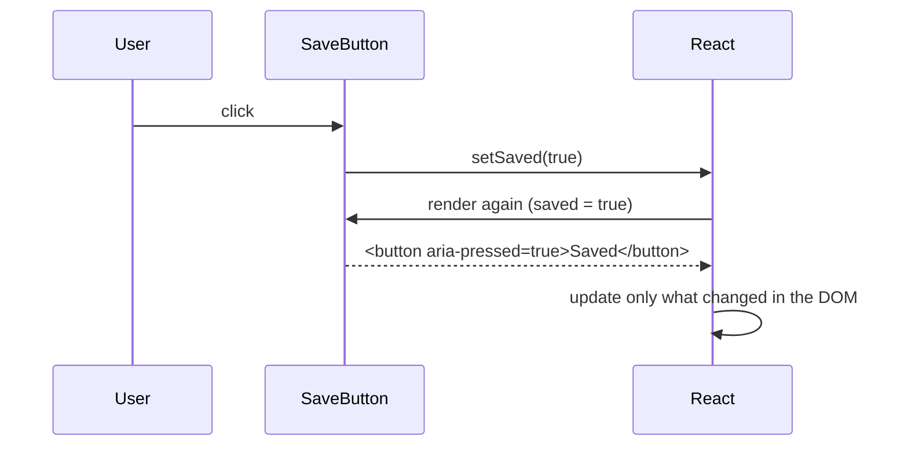

::part[Learn the Concept]{n="1"}

## 🎯 What you'll learn

- `useState`: what "state" means in React and how re-rendering works
- Event handlers in JSX (`onClick`, `onChange`, `onSubmit`) and the synthetic event object
- **Immutability**: updating arrays, objects and Sets correctly
- Updater functions and **batching** (`setCount(c => c + 1)`)
- **Lifting state up** and controlled components
- Choosing the minimal state; derived values computed during render
- The Rules of Hooks

## 🧠 The big idea

A React component is like a **snapshot camera**. Each render takes a photo of the UI for the current props and state. Calling a setter doesn't edit the old photo — it asks React to take a **new photo** with new state. That's why you must give React **new** values (not modify the old ones), and why a variable you read in a handler is the value from **that** snapshot.

## ❓ Why does this exist?

UIs change: saved jobs, open menus, form inputs, selected tabs. Week 1 stored that in variables and redrew by hand. React's state + re-render loop makes the UI a function of state, consistently — as long as you follow its rules.

## 💥 What happens if we DON'T follow the rules?

```tsx
const [saved, setSaved] = useState<string[]>([]);
saved.push(title);          // mutates the current snapshot
setSaved(saved);            // same reference → React may skip the re-render

const [count, setCount] = useState(0);
setCount(count + 1);
setCount(count + 1);        // still +1: both read the same snapshot's count

let clicks = 0;             // a normal variable resets on every render
```

## 📖 How it works, step by step

### 1. `useState`

```tsx
"use client";
import { useState } from "react";

export function SaveButton() {
  const [saved, setSaved] = useState(false);          // [current value, setter]
  return (
    <button type="button" aria-pressed={saved} onClick={() => setSaved(!saved)}>
      {saved ? "Saved" : "Save"}
    </button>
  );
}
```

Render cycle: **trigger** (setter called) → **render** (React calls your component again with new state) → **commit** (React updates only the changed DOM).



### 2. Events

```tsx
<button onClick={() => handleSave(job.id)}>Save</button>           // pass a function, don't call it
<input onChange={(event) => setQuery(event.target.value)} />
<form onSubmit={(event) => { event.preventDefault(); submit(); }}>
```

- `onClick={handleSave}` ✅ vs `onClick={handleSave()}` ❌ (calls it during render).
- Types: `React.MouseEvent<HTMLButtonElement>`, `React.ChangeEvent<HTMLInputElement>`, `React.FormEvent<HTMLFormElement>`.
- React attaches listeners at the root (**event delegation**, like Week 1) — you just write `onX` props.

### 3. Immutability

```tsx
setJobs([...jobs, newJob]);                                   // add
setJobs(jobs.filter((job) => job.id !== id));                 // remove
setJobs(jobs.map((job) => (job.id === id ? { ...job, saved: true } : job)));   // update one
setFilters({ ...filters, remote: true });                     // object field
setSavedIds((prev) => { const next = new Set(prev); next.add(id); return next; });   // Set
```

React compares references (`Object.is`). A new reference = "something changed" = re-render. Mutation also breaks features like time-travel debugging and memoization.

### 4. Updater functions and batching

```tsx
function addThree() {
  setCount((c) => c + 1);
  setCount((c) => c + 1);
  setCount((c) => c + 1);    // 3: each updater receives the latest pending value
}
```

React **batches** state updates inside an event handler into one re-render. Use the updater form whenever the next state depends on the previous one.

### 5. Lifting state up

When two components need the same data, move the state to their closest common parent and pass it down:

```tsx
function SavedJobsBoard({ jobs }: { jobs: Job[] }) {
  const [savedIds, setSavedIds] = useState<ReadonlySet<number>>(() => new Set());
  const toggle = (id: number) =>
    setSavedIds((prev) => {
      const next = new Set(prev);
      next.has(id) ? next.delete(id) : next.add(id);
      return next;
    });

  return (
    <>
      <p>{savedIds.size} saved</p>
      {jobs.map((job) => (
        <SaveButton key={job.id} saved={savedIds.has(job.id)} onToggle={() => toggle(job.id)} jobTitle={job.title} />
      ))}
    </>
  );
}
```

`SaveButton` is now **controlled**: it displays `saved` and reports clicks. Data flows **down** via props; events flow **up** via callbacks.

### 6. Minimal state, derived values

```tsx
const [jobs, setJobs] = useState<Job[]>(initialJobs);
const [query, setQuery] = useState("");
const visible = jobs.filter((job) => job.title.toLowerCase().includes(query.toLowerCase()));   // derived: no state!
```

Don't store what you can compute (`visibleJobs`, `count`, `fullName`). Duplicated state goes out of sync.

### 7. Lazy initial state

```tsx
const [savedIds] = useState(() => new Set(readFromStorage()));   // runs once, not on every render
```

### 8. Rules of Hooks

1. Call hooks only at the **top level** of a component or custom hook — not inside `if`, loops or nested functions.
2. Call hooks only from React functions.

React identifies hooks by **call order**; a conditional hook shifts the order and state gets mixed up or crashes (lesson 06). The ESLint plugin `react-hooks` enforces this — `create-next-app` includes it.

:::note[React Compiler]
The React Compiler (offered by `create-next-app`) automatically memoizes components and values, so you rarely need `useMemo`/`useCallback` for performance. It relies on your code following these rules — pure renders and no mutation.
:::

## ⚖️ Trade-offs

| Choice | ✅ | ❌ |
|---|---|---|
| Local state | simple, encapsulated | hard to share |
| Lifted state | single source of truth | prop passing through layers ("prop drilling") → Context/Zustand in Week 5 |
| Controlled children | predictable, testable | parent code grows |
| Derived values | always consistent | recomputed each render (usually cheap) |
| Updater functions | correct with batching | slightly more verbose |

## ✅ When to use it / 🚫 When NOT to use it

- ✅ `useState` for UI state owned by one component or a small subtree.
- ✅ Lift state when siblings need it; keep it as low as possible otherwise.
- 🚫 Don't put server data you fetched into many independent `useState`s — use a data library (TanStack Query, Week 4).
- 🚫 Don't store derived data or props copies in state.

## 🏆 Best practices

- [ ] Never mutate state; create new arrays/objects/Sets.
- [ ] Use updater functions when the new state depends on the old.
- [ ] Keep state minimal; compute derived values during render.
- [ ] Put state in the lowest common owner; lift only when needed.
- [ ] Controlled components for reusable inputs/buttons (`value`/`onChange`, `saved`/`onToggle`).
- [ ] Follow the Rules of Hooks and keep the `react-hooks` ESLint rules on.
- [ ] Group related state into one object only when fields change together.

## 🏭 How it's used in industry

- Every interactive React component uses `useState`; code reviews routinely catch mutation and duplicated state.
- Libraries follow the controlled pattern (`value`/`onChange`, `open`/`onOpenChange`) so apps can own state.
- State location decisions (local vs lifted vs global vs server cache) are a common frontend interview topic.

## ⚠️ Common mistakes

- `onClick={handle()}` instead of `onClick={handle}`.
- Mutating arrays/objects before setting state.
- Expecting state to change immediately after calling the setter (`console.log(count)` shows the old snapshot).
- Copying props into state and wondering why updates don't show.

::part[Explain & Design]{n="2"}

## 🗣️ Explain it

Explain the snapshot analogy to a teammate who wrote `setCount(count + 1)` three times and got +1.

## 📐 Design it

Design the state for CareerPilot's **job search page** (client-side for now): search text, remote-only toggle, selected skills (multi-select), sort option, saved job ids, and a "compare" tray that holds up to 3 jobs. Decide what's state, what's derived, where each piece lives, and write the update functions for toggling a skill and adding to compare.

:::quiz
Show a possible design

**State (in `JobSearchPage`, a Client Component)**
```ts
const [query, setQuery] = useState("");
const [remoteOnly, setRemoteOnly] = useState(false);
const [skills, setSkills] = useState<ReadonlySet<string>>(() => new Set());
const [sort, setSort] = useState<"newest" | "salary">("newest");
const [savedIds, setSavedIds] = useState<ReadonlySet<number>>(() => new Set());
const [compareIds, setCompareIds] = useState<readonly number[]>([]);   // ordered, max 3
```

**Derived (computed during render)**
```ts
const visibleJobs = jobs
  .filter((j) => j.title.toLowerCase().includes(query.trim().toLowerCase()))
  .filter((j) => !remoteOnly || j.remote)
  .filter((j) => [...skills].every((s) => j.skills.includes(s)))
  .toSorted(sort === "salary" ? bySalaryDesc : byNewest);
const compareJobs = compareIds.map((id) => jobs.find((j) => j.id === id)).filter(Boolean);
const canAddToCompare = compareIds.length < 3;
```

**Updates**
```ts
const toggleSkill = (skill: string) =>
  setSkills((prev) => {
    const next = new Set(prev);
    next.has(skill) ? next.delete(skill) : next.add(skill);
    return next;
  });

const addToCompare = (id: number) =>
  setCompareIds((prev) => (prev.includes(id) || prev.length >= 3 ? prev : [...prev, id]));
```

**Where it lives**: all in the page because the filter bar, results and compare tray are siblings. Later: `query`/`remoteOnly`/`skills`/`sort` move to the **URL** (shareable links, Week 4), and `savedIds` becomes **server data** (saved in the Flask API).
:::

### 📝 Self-review checklist

- [ ] No derived data stored in state
- [ ] Immutable updates, updater functions
- [ ] State location justified; future URL/server state noted

::ai-review{task="design"}

::part[Toy Exercise]{n="3"}

:::exercise{path="exercises/web/m4/w3/03-state-events" ai="no-ai" title="A saved-jobs board with lifted state"}
Build a controlled `SaveButton`, a `SavedJobsBoard` that owns saved ids in an immutable `Set` and shows a live count and a clear button, and a counter whose `+3` works thanks to updater functions. Tests click through it like a user and check you don't mutate state.
:::

:::hints
- `useState<ReadonlySet<number>>(() => new Set())` — `ReadonlySet` makes TypeScript stop you from calling `.add` on state.
- In `toggle`, copy first: `const next = new Set(previous)`.
- `disabled={savedIds.size === 0}` for the clear button.
:::

## ✅ Quick check

:::quiz
Why does React need a new array reference to re-render reliably?

React decides whether state changed by comparing references with `Object.is`; mutating keeps the same reference, so React may skip the update.
:::

:::quiz
What is "lifting state up"?

Moving shared state to the closest common parent, passing values down as props and changes up via callbacks, so siblings stay in sync.
:::

## 📖 Kamus (glossary)

| Term | Bahasa Indonesia |
|---|---|
| State | Status/keadaan yang disimpan komponen |
| Re-render | Render ulang |
| Immutability | Kekekalan data — tidak mengubah objek lama |
| Batching | Menggabungkan beberapa pembaruan jadi satu render |
| Lifting state up | Menaikkan state ke komponen induk |
| Derived state | Nilai turunan yang dihitung saat render |

## 📚 Keep learning

- [React docs: State — A Component's Memory](https://react.dev/learn/state-a-components-memory)
- [React docs: Updating Arrays in State](https://react.dev/learn/updating-arrays-in-state)
- [React docs: Sharing State Between Components](https://react.dev/learn/sharing-state-between-components)
