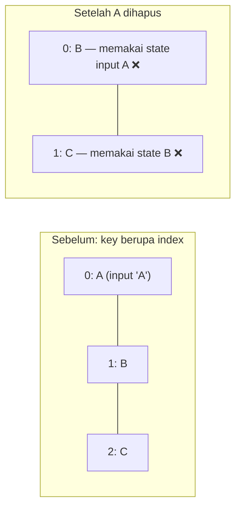

::part[Pelajari Konsepnya]{n="1"}

## 🎯 Yang akan kamu pelajari

- Cara menampilkan sesuatu hanya di kondisi tertentu: `return`, `? :`, `&&`
- Bug `0 &&`
- Merancang tampilan **loading / error / kosong / sukses**
- Menampilkan list dan kelompok dengan `map`
- Key: kenapa penting dan kenapa index berisiko
- Memfilter dan mengurutkan tanpa state tambahan

## 🔤 Istilah penting

| Istilah | Artinya (sederhana) |
|---|---|
| **Conditional rendering** | Menampilkan hal berbeda tergantung sebuah kondisi |
| **Early return** | Keluar dari component lebih awal: `if (!user) return <Login />` |
| **Ternary** | `kondisi ? a : b` — pilih salah satu dari dua |
| **Empty state** | Yang ditampilkan layar saat belum ada data |
| **Skeleton** | Bentuk abu-abu sebagai pengganti sementara saat data dimuat |
| **Key** | Name tag unik untuk setiap item dalam list |
| **Virtualization** | Hanya menggambar baris yang terlihat di list yang sangat panjang |

## 🧠 Ide besarnya

Setiap layar punya **lebih dari satu situasi**: data sedang dimuat, gagal, kosong, atau siap. Masing-masing butuh tampilannya sendiri. Pemula hanya merancang layar "bahagia" dengan data sempurna. Profesional merancang semua situasi lebih dulu — seperti **checklist pilot** yang tidak hanya mencakup penerbangan normal, tapi juga cuaca buruk dan masalah mesin.

## ❓ Kenapa ini penting

Panggilan API sungguhan butuh waktu dan kadang gagal; pengguna baru punya nol lamaran; filter kadang tidak menemukan apa-apa. Kalau layar tidak menangani kasus ini, pengguna melihat halaman kosong, spinner yang tidak pernah berhenti, atau crash.

```tsx
function Applications({ data, loading, error }) {
  return (
    <>
      {loading && <Spinner />}
      {error && <p>{error}</p>}
      {data.length && <p>{data.length} applications</p>}   {/* renders "0" when empty */}
      {data.map((app, i) => <Row key={i} app={app} />)}    {/* crashes when data is undefined */}
    </>
  );
}
```

- Spinner dan error bisa tampil bersamaan.
- List kosong menampilkan `0` yang aneh.
- `data.map` crash saat data masih dimuat.
- Key berupa index membuat state baris tertukar.

## 📖 Langkah demi langkah

### 1. Cara menampilkan sesuatu secara kondisional

```tsx
if (!user) return <LoginPrompt />;                          // early return: whole component

{isRemote ? <RemoteBadge /> : <CityBadge city={city} />}   // either/or

{unread > 0 && <span>{unread} new</span>}                   // show or nothing — with a boolean!

const ICONS = { saved: BookmarkIcon, offer: TrophyIcon } satisfies Partial<Record<Status, Icon>>;
const Icon = ICONS[status];                                  // lookup instead of long chains
{Icon && <Icon aria-hidden />}
```

- **Early return** — "tidak punya tiket, tidak boleh masuk": tampilkan hal lain lalu berhenti.
- **Ternary `? :`** — pilih salah satu dari dua.
- **`&&`** — tampilkan, atau tidak tampilkan apa-apa.
- **Tabel lookup** — pengganti rantai `if / else if` yang panjang.

React tidak menampilkan apa pun untuk `false`, `null`, `undefined`, dan `true`. Tapi ia **menampilkan `0` dan `NaN` sebagai teks**. Itulah kenapa `{count && …}` bisa mencetak `0`. Selalu pakai true/false sungguhan: `{count > 0 && …}`.

### 2. Rancang setiap situasi

```tsx
type RequestState<T> =
  | { status: "idle" }
  | { status: "loading" }
  | { status: "error"; message: string }
  | { status: "success"; data: T };

function ApplicationsView({ state, onRetry }: { state: RequestState<Application[]>; onRetry: () => void }) {
  switch (state.status) {
    case "idle": return null;
    case "loading": return <div role="status">Loading applications…</div>;
    case "error": return <div role="alert"><p>{state.message}</p><button onClick={onRetry}>Try again</button></div>;
    case "success":
      return state.data.length === 0 ? <EmptyState message="No applications yet" /> : <ApplicationList applications={state.data} />;
  }
}
```

- Memakai satu union type (Minggu 2) membuat "loading **dan** error bersamaan" jadi mustahil.
- `state.data` hanya ada di kasus sukses, jadi kamu tidak bisa memakainya tanpa sengaja saat loading.
- Error selalu memberi jalan keluar ("Coba lagi").
- **Skeleton** (bentuk abu-abu dari konten) terasa lebih cepat daripada spinner — seperti melihat meja sudah ditata sebelum makanan datang.

### 3. List dan kelompok

```tsx
<ul>
  {applications.map((app) => (
    <li key={app.id}>
      {app.role} at {app.company}
    </li>
  ))}
</ul>
```

Dikelompokkan berdasarkan status:

```tsx
{STATUS_ORDER.map((status) => {
  const items = applications.filter((app) => app.status === status);
  if (items.length === 0) return null;
  return (
    <section key={status} aria-label={STATUS_LABELS[status]}>
      <h2>{STATUS_LABELS[status]}</h2>
      <ul>{items.map((app) => <li key={app.id}>{app.role}</li>)}</ul>
    </section>
  );
})}
```

Key hanya perlu unik **di antara saudaranya** dalam list yang sama. Fragment di dalam list juga butuh key: `<Fragment key={id}>…</Fragment>`.

### 4. Key adalah identitas



React menempelkan state milik setiap item (teks yang diketik, menu yang terbuka) ke **key**-nya. Dengan key berupa index, ini seperti **parkiran yang mengenali mobil dari nomor petaknya**: kalau mobil pertama pergi dan semua maju satu petak, petugas memberikan karcis milik mobil A ke mobil B. Id yang stabil (seperti plat nomor) menjaga karcis tetap bersama mobil yang benar.

Kamu juga bisa mengganti key **dengan sengaja** untuk mulai dari awal:

```tsx
<ApplicationEditor key={selectedApplication.id} application={selectedApplication} />
// switching applications gives a fresh editor instead of leftover form state
```

Saat key berubah, React membuang editor lama dan membuat editor baru yang masih kosong.

### 5. Filter dan urutkan dengan menghitung

```tsx
const [filter, setFilter] = useState<Status | "all">("all");
const visible = filter === "all" ? applications : applications.filter((app) => app.status === filter);
```

Simpan hanya **pilihannya** ("all" atau sebuah status). Hitung list yang terlihat saat render. Untuk perhitungan yang sangat berat di list besar, `useMemo` (atau React Compiler) bisa mengingat hasilnya — tapi ukur dulu.

### 6. List yang sangat panjang

Menggambar ribuan baris itu lambat. Pilihannya:
- pagination dari API (Modul 2),
- tombol "Muat lagi",
- **virtualization** (`@tanstack/react-virtual`): hanya menggambar baris yang ada di layar, seperti jendela kereta yang hanya menunjukkan pemandangan yang sedang dilewati.

## ⚠️ Kesalahan umum

- `{items.length && …}` menampilkan `0`.
- Memanggil `data.map` sebelum datanya ada.
- `key={Math.random()}` — setiap render membuat item baru (fokus hilang, lambat).
- Spinner yang tidak pernah berhenti, karena kasus error tidak pernah memperbarui state.
- Ternary bersarang (`a ? b : c ? d : e`) yang tidak bisa dibaca siapa pun — pakai component atau `switch`.
- Menyimpan list yang sudah difilter di state.

## 🏆 Praktik terbaik

- [ ] Selalu tangani idle, loading, error, kosong, dan sukses; error diberi tombol coba lagi.
- [ ] Pakai kondisi true/false sungguhan (`count > 0 &&`), jangan angka mentah.
- [ ] Key dari id yang stabil; jangan acak; index hanya untuk list yang urutannya tidak pernah berubah.
- [ ] Hitung data yang difilter, diurutkan, dan dikelompokkan saat render.
- [ ] Beri tahu screen reader tentang perubahan (`role="status"`, `role="alert"`).
- [ ] Pindahkan cabang ke component sendiri kalau sudah panjang.
- [ ] Beri pagination atau virtualization untuk list panjang.

::part[Jelaskan & Rancang]{n="2"}

## 🗣️ Jelaskan

Dengan ide checklist pilot, jelaskan ke desainer kenapa mockup-nya butuh empat layar tambahan (loading, error, kosong, "tidak ada hasil untuk filter ini") sebelum pengembangan dimulai.

## 📐 Rancang

Rancang state untuk **halaman perusahaan** CareerPilot: info perusahaan dimuat lebih dulu; daftar lamaran untuk perusahaan itu dimuat terpisah dan bisa gagal sendiri; list-nya bisa kosong; pengguna bisa memfilter berdasarkan status, dan filter bisa tidak menemukan apa-apa. Tulis type state-nya dan kerangka component-nya.

:::quiz
Tampilkan contoh desainnya

```ts
type CompanyState = RequestState<Company>;
type ApplicationsState = RequestState<Application[]>;

function CompanyPage({ company, applications, onRetryApplications }: {
  company: CompanyState; applications: ApplicationsState; onRetryApplications: () => void;
}) {
  if (company.status === "loading" || company.status === "idle") return <CompanySkeleton />;
  if (company.status === "error") return <ErrorPanel title="Couldn't load this company" message={company.message} />;

  return (
    <>
      <CompanyHeader company={company.data} />
      <ApplicationsSection state={applications} onRetry={onRetryApplications} />   {/* fails independently */}
    </>
  );
}

function ApplicationsSection({ state, onRetry }) {
  const [filter, setFilter] = useState<Status | "all">("all");
  switch (state.status) {
    case "idle":
    case "loading": return <ListSkeleton rows={3} />;
    case "error": return <InlineError message="Applications couldn't load" onRetry={onRetry} />;
    case "success": {
      if (state.data.length === 0) return <EmptyState message="You haven't applied to this company yet" action={<AddApplicationButton />} />;
      const visible = filter === "all" ? state.data : state.data.filter((a) => a.status === filter);
      return (
        <>
          <StatusFilter value={filter} onChange={setFilter} counts={countByStatus(state.data)} />
          {visible.length === 0
            ? <EmptyState message={`No ${STATUS_LABELS[filter as Status]} applications`} action={<button onClick={() => setFilter("all")}>Show all</button>} />
            : <ApplicationList applications={visible} />}
        </>
      );
    }
  }
}
```

- Dua layar kosong yang **berbeda**: "belum ada apa-apa" (tawarkan untuk menambah) dan "filter menyembunyikan semuanya" (tawarkan untuk menampilkan semua).
- Kalau list gagal, bagian lain halaman tetap berfungsi.
:::

### 📝 Checklist self-review

- [ ] Setiap bagian bisa gagal sendiri-sendiri
- [ ] "Kosong" dan "tidak ada hasil untuk filter" adalah layar yang berbeda
- [ ] Setiap layar masalah memberi langkah berikutnya

::ai-review{task="design"}

::part[Latihan Kecil]{n="3"}

:::exercise{path="exercises/web/m4/w3/04-conditional-lists" ai="no-ai" title="Semua keadaan tampilan lamaran"}
Tampilkan layar idle, loading, error dengan coba lagi, kosong, dan sukses dari satu union state; tambahkan tombol filter status beserta jumlahnya; kelompokkan lamaran berdasarkan status dengan urutan tetap; tampilkan jumlah belum dibaca tanpa `0` yang nyasar. Tes gagal kalau ada peringatan key dari React.
:::

:::hints
- `switch (state.status)` di bagian atas menjaga setiap situasi tetap terpisah.
- Taruh `useState` filter di component child yang hanya ditampilkan saat sukses — hook tidak boleh dipanggil secara kondisional.
- `STATUS_ORDER.filter((s) => applications.some((a) => a.status === s))` memberikan tab yang perlu ditampilkan.
:::

## ✅ Cek cepat

:::quiz
Apa yang ditampilkan `{0 && <p>Hi</p>}`?

Teks `0`. Pakai kondisi true/false seperti `count > 0 &&`.
:::

:::quiz
Bagaimana `key` bisa mereset state sebuah component?

Saat key berubah, React menghapus component lama dan membuat yang baru dengan state yang masih bersih.
:::

## 📚 Lanjut belajar

- [React docs: Conditional Rendering](https://react.dev/learn/conditional-rendering)
- [React docs: Rendering Lists](https://react.dev/learn/rendering-lists)
- [React docs: Preserving and Resetting State](https://react.dev/learn/preserving-and-resetting-state)
