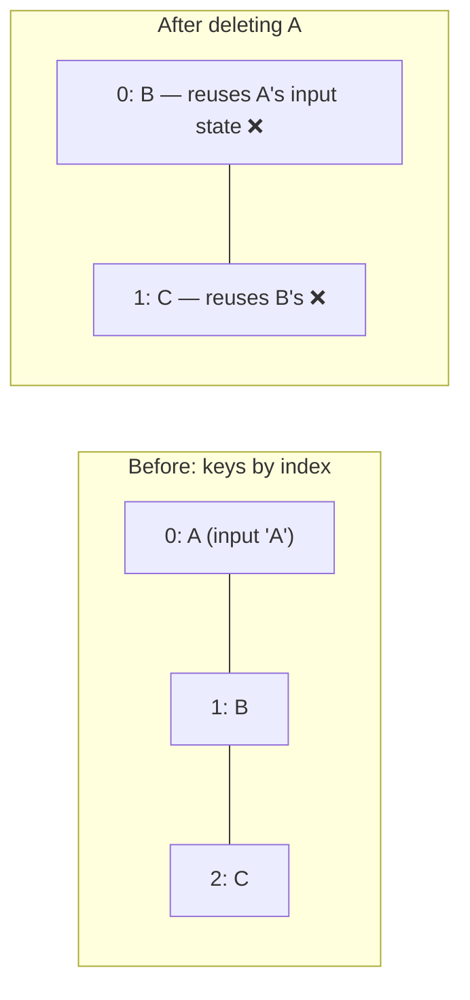

::part[Learn the Concept]{n="1"}

## 🎯 What you'll learn

- Ways to show something only in some cases: `return`, `? :`, `&&`
- The `0 &&` bug
- Designing **loading / error / empty / success** screens
- Rendering lists and groups with `map`
- Keys: why they matter and why the index is risky
- Filtering and sorting without extra state

## 🔤 Key words

| Word | In simple words | Bahasa Indonesia |
|---|---|---|
| **Conditional rendering** | Showing different things depending on a condition | Tampil sesuai kondisi |
| **Early return** | Leaving the component early: `if (!user) return <Login />` | Keluar lebih awal |
| **Ternary** | `condition ? a : b` — pick one of two | Pilih salah satu |
| **Empty state** | What the screen shows when there is no data yet | Tampilan saat kosong |
| **Skeleton** | Grey placeholder shapes shown while data loads | Kerangka pemuat |
| **Key** | A unique name tag for each item in a list | Kunci identitas |
| **Virtualization** | Only drawing the rows you can see in a very long list | Tampilkan yang terlihat saja |

## 🧠 The big idea

Every screen has **more than one situation**: data is loading, failed, empty, or ready. Each needs its own screen. Beginners only design the "happy" screen with perfect data. Professionals design all situations first — like a **pilot's checklist** that covers not only a normal flight, but also bad weather and engine problems.

## ❓ Why it matters

Real API calls take time and sometimes fail; new users have zero applications; filters sometimes find nothing. If the screen doesn't handle these cases, users see a blank page, a spinner that never stops, or a crash.

```tsx
function Applications({ data, loading, error }) {
  return (
    <>
      {loading && <Spinner />}
      {error && <p>{error}</p>}
      {data.length && <p>{data.length} applications</p>}   {/* renders "0" when empty */}
      {data.map((app, i) => <Row key={i} app={app} />)}    {/* crashes when data is undefined */}
    </>
  );
}
```

- The spinner and the error can show at the same time.
- An empty list shows a strange `0`.
- `data.map` crashes while data is still loading.
- Index keys mix up the rows' state.

## 📖 Step by step

### 1. Ways to show things conditionally

```tsx
if (!user) return <LoginPrompt />;                          // early return: whole component

{isRemote ? <RemoteBadge /> : <CityBadge city={city} />}   // either/or

{unread > 0 && <span>{unread} new</span>}                   // show or nothing — with a boolean!

const ICONS = { saved: BookmarkIcon, offer: TrophyIcon } satisfies Partial<Record<Status, Icon>>;
const Icon = ICONS[status];                                  // lookup instead of long chains
{Icon && <Icon aria-hidden />}
```

- **Early return** — "no ticket, no entry": show something else and stop.
- **Ternary `? :`** — pick one of two.
- **`&&`** — show it, or show nothing.
- **Lookup table** — instead of a long `if / else if` chain.

React shows nothing for `false`, `null`, `undefined` and `true`. But it **shows `0` and `NaN` as text**. That's why `{count && …}` can print `0`. Always use a real true/false: `{count > 0 && …}`.

### 2. Design every situation

```tsx
type RequestState<T> =
  | { status: "idle" }
  | { status: "loading" }
  | { status: "error"; message: string }
  | { status: "success"; data: T };

function ApplicationsView({ state, onRetry }: { state: RequestState<Application[]>; onRetry: () => void }) {
  switch (state.status) {
    case "idle": return null;
    case "loading": return <div role="status">Loading applications…</div>;
    case "error": return <div role="alert"><p>{state.message}</p><button onClick={onRetry}>Try again</button></div>;
    case "success":
      return state.data.length === 0 ? <EmptyState message="No applications yet" /> : <ApplicationList applications={state.data} />;
  }
}
```

- Using one union type (Week 2) makes "loading **and** error at the same time" impossible.
- `state.data` only exists in the success case, so you can't accidentally use it while loading.
- Errors always offer a way forward ("Try again").
- **Skeletons** (grey shapes of the content) feel faster than a spinner — like seeing the table set before the food arrives.

### 3. Lists and groups

```tsx
<ul>
  {applications.map((app) => (
    <li key={app.id}>
      {app.role} at {app.company}
    </li>
  ))}
</ul>
```

Grouped by status:

```tsx
{STATUS_ORDER.map((status) => {
  const items = applications.filter((app) => app.status === status);
  if (items.length === 0) return null;
  return (
    <section key={status} aria-label={STATUS_LABELS[status]}>
      <h2>{STATUS_LABELS[status]}</h2>
      <ul>{items.map((app) => <li key={app.id}>{app.role}</li>)}</ul>
    </section>
  );
})}
```

Keys only need to be unique **among siblings** in the same list. A fragment in a list needs a key too: `<Fragment key={id}>…</Fragment>`.

### 4. Keys are identity



React attaches each item's own state (typed text, an open menu) to its **key**. With index keys it's like a **parking lot where cars are identified by spot number**: if the first car leaves and everyone moves forward one spot, the guard now gives car B the ticket that belonged to car A. Stable ids (like license plates) keep each car's ticket with the right car.

You can also change a key **on purpose** to start fresh:

```tsx
<ApplicationEditor key={selectedApplication.id} application={selectedApplication} />
// switching applications gives a fresh editor instead of leftover form state
```

When the key changes, React throws away the old editor and creates a new, empty one.

### 5. Filter and sort by calculating

```tsx
const [filter, setFilter] = useState<Status | "all">("all");
const visible = filter === "all" ? applications : applications.filter((app) => app.status === filter);
```

Store only the **choice** ("all" or a status). Calculate the visible list during render. For very expensive calculations on big lists, `useMemo` (or the React Compiler) can remember the result — but measure first.

### 6. Very long lists

Drawing thousands of rows is slow. Options:
- pagination from the API (Module 2),
- a "Load more" button,
- **virtualization** (`@tanstack/react-virtual`): draw only the rows on screen, like a train window that only shows the scenery you're passing.

## ⚠️ Common mistakes

- `{items.length && …}` showing `0`.
- Calling `data.map` before the data exists.
- `key={Math.random()}` — every render creates new items (lost focus, slow).
- A spinner that never stops, because the error case never updates the state.
- Nested ternaries (`a ? b : c ? d : e`) that nobody can read — use a component or a `switch`.
- Storing the filtered list in state.

## 🏆 Best practices

- [ ] Always handle idle, loading, error, empty and success; errors get a retry button.
- [ ] Use real true/false conditions (`count > 0 &&`), never a raw number.
- [ ] Keys from stable ids; never random; index only for lists that never change order.
- [ ] Calculate filtered, sorted and grouped data during render.
- [ ] Tell screen readers about changes (`role="status"`, `role="alert"`).
- [ ] Move a branch into its own component when it gets long.
- [ ] Paginate or virtualize long lists.

::part[Explain & Design]{n="2"}

## 🗣️ Explain it

Explain to a designer, with the pilot checklist idea, why the mockup needs four more screens (loading, error, empty, "no results for this filter") before development starts.

## 📐 Design it

Design the states for CareerPilot's **company page**: the company info loads first; the list of applications for that company loads separately and can fail on its own; the list can be empty; the user can filter by status, and the filter can find nothing. Write the state types and an outline of the components.

:::quiz
Show a possible design

```ts
type CompanyState = RequestState<Company>;
type ApplicationsState = RequestState<Application[]>;

function CompanyPage({ company, applications, onRetryApplications }: {
  company: CompanyState; applications: ApplicationsState; onRetryApplications: () => void;
}) {
  if (company.status === "loading" || company.status === "idle") return <CompanySkeleton />;
  if (company.status === "error") return <ErrorPanel title="Couldn't load this company" message={company.message} />;

  return (
    <>
      <CompanyHeader company={company.data} />
      <ApplicationsSection state={applications} onRetry={onRetryApplications} />   {/* fails independently */}
    </>
  );
}

function ApplicationsSection({ state, onRetry }) {
  const [filter, setFilter] = useState<Status | "all">("all");
  switch (state.status) {
    case "idle":
    case "loading": return <ListSkeleton rows={3} />;
    case "error": return <InlineError message="Applications couldn't load" onRetry={onRetry} />;
    case "success": {
      if (state.data.length === 0) return <EmptyState message="You haven't applied to this company yet" action={<AddApplicationButton />} />;
      const visible = filter === "all" ? state.data : state.data.filter((a) => a.status === filter);
      return (
        <>
          <StatusFilter value={filter} onChange={setFilter} counts={countByStatus(state.data)} />
          {visible.length === 0
            ? <EmptyState message={`No ${STATUS_LABELS[filter as Status]} applications`} action={<button onClick={() => setFilter("all")}>Show all</button>} />
            : <ApplicationList applications={visible} />}
        </>
      );
    }
  }
}
```

- Two **different** empty screens: "nothing exists yet" (offer to add one) and "the filter hides everything" (offer to show all).
- If the list fails, the rest of the page still works.
:::

### 📝 Self-review checklist

- [ ] Each part can fail on its own
- [ ] "Empty" and "no results for this filter" are different screens
- [ ] Every problem screen offers a next step

::ai-review{task="design"}

::part[Toy Exercise]{n="3"}

:::exercise{path="exercises/web/m4/w3/04-conditional-lists" ai="no-ai" title="Every state of an applications view"}
Show idle, loading, error with retry, empty and success screens from one union state; add status filter buttons with counts; group applications by status in a fixed order; show unread counts without a stray `0`. The tests fail on React key warnings.
:::

:::hints
- A `switch (state.status)` at the top keeps each situation separate.
- Put the filter `useState` in a child component that is only shown for success — hooks can't be called conditionally.
- `STATUS_ORDER.filter((s) => applications.some((a) => a.status === s))` gives the tabs to show.
:::

## ✅ Quick check

:::quiz
What does `{0 && <p>Hi</p>}` show?

The text `0`. Use a true/false condition like `count > 0 &&`.
:::

:::quiz
How can a `key` reset a component's state?

When the key changes, React removes the old component and creates a new one with fresh state.
:::

## 📚 Keep learning

- [React docs: Conditional Rendering](https://react.dev/learn/conditional-rendering)
- [React docs: Rendering Lists](https://react.dev/learn/rendering-lists)
- [React docs: Preserving and Resetting State](https://react.dev/learn/preserving-and-resetting-state)
