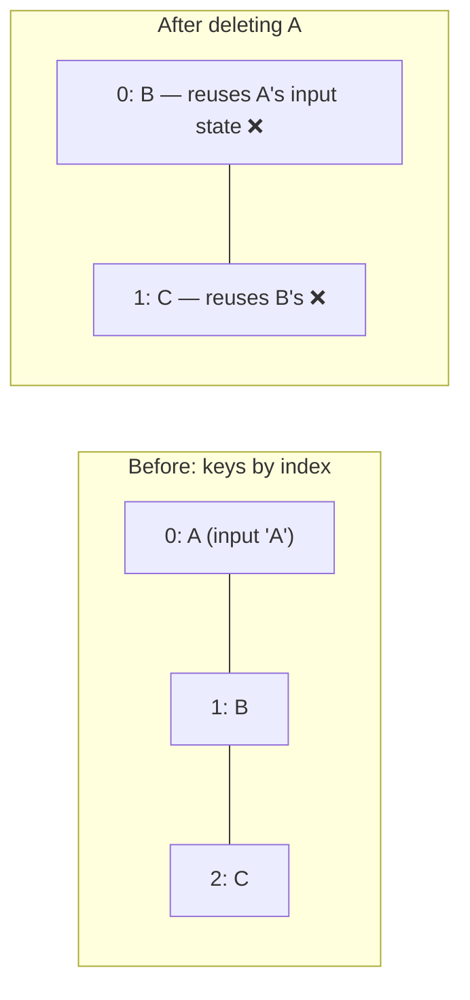

::part[Learn the Concept]{n="1"}

## 🎯 What you'll learn

- Conditional patterns: early `return`, ternary, `&&`, `null`, lookup objects
- The `0 &&` bug and other falsy traps
- Modeling **idle / loading / error / empty / success** with a discriminated union
- Rendering lists, nested lists and groups with `map`
- **Keys** in depth: identity, why index keys break, keys on fragments
- Filtering, sorting and grouping as derived data
- Resetting component state with a `key`

## 🧠 The big idea

Every screen has **more than one situation**: data is loading, failed, empty, or ready — and each needs its own UI. Beginners design only the "happy" screen with perfect data. Professionals design all the states first, like a pilot's checklist that covers not just "normal flight" but also "engine failure".

## ❓ Why does this exist?

Real API calls take time and fail; users start with zero applications; filters return nothing. If the UI doesn't handle these, users see blank screens, spinners forever, or a crash (`undefined.map`). React makes "for this state, show this" natural — if you model the states explicitly.

## 💥 What happens if we DON'T?

```tsx
function Applications({ data, loading, error }) {
  return (
    <>
      {loading && <Spinner />}
      {error && <p>{error}</p>}
      {data.length && <p>{data.length} applications</p>}   {/* renders "0" when empty */}
      {data.map((app, i) => <Row key={i} app={app} />)}    {/* crashes when data is undefined */}
    </>
  );
}
```

Spinner and error at the same time, a stray `0`, a crash while loading, and index keys that confuse row state.

## 📖 How it works, step by step

### 1. Conditional patterns

```tsx
if (!user) return <LoginPrompt />;                          // early return: whole component

{isRemote ? <RemoteBadge /> : <CityBadge city={city} />}   // either/or

{unread > 0 && <span>{unread} new</span>}                   // show or nothing — with a boolean!

const ICONS = { saved: BookmarkIcon, offer: TrophyIcon } satisfies Partial<Record<Status, Icon>>;
const Icon = ICONS[status];                                  // lookup instead of long chains
{Icon && <Icon aria-hidden />}
```

Returning `null` renders nothing. `false`, `null`, `undefined` and `true` render nothing — but **`0` and `NaN` render as text**, and `""` renders empty text.

### 2. Model request states

```tsx
type RequestState<T> =
  | { status: "idle" }
  | { status: "loading" }
  | { status: "error"; message: string }
  | { status: "success"; data: T };

function ApplicationsView({ state, onRetry }: { state: RequestState<Application[]>; onRetry: () => void }) {
  switch (state.status) {
    case "idle": return null;
    case "loading": return <div role="status">Loading applications…</div>;
    case "error": return <div role="alert"><p>{state.message}</p><button onClick={onRetry}>Try again</button></div>;
    case "success":
      return state.data.length === 0 ? <EmptyState message="No applications yet" /> : <ApplicationList applications={state.data} />;
  }
}
```

The union makes "loading and error at once" impossible (Week 2), and TypeScript only allows `state.data` in the success branch.

**Skeletons** beat spinners for perceived performance: render grey placeholder rows with `aria-busy` on the region, or a status message for screen readers.

### 3. Lists

```tsx
<ul>
  {applications.map((app) => (
    <li key={app.id}>
      {app.role} at {app.company}
    </li>
  ))}
</ul>
```

Groups:

```tsx
{STATUS_ORDER.map((status) => {
  const items = applications.filter((app) => app.status === status);
  if (items.length === 0) return null;
  return (
    <section key={status} aria-label={STATUS_LABELS[status]}>
      <h2>{STATUS_LABELS[status]}</h2>
      <ul>{items.map((app) => <li key={app.id}>{app.role}</li>)}</ul>
    </section>
  );
})}
```

Keys only need to be unique **among siblings**. Fragments need keys too: `<Fragment key={id}>…</Fragment>`.

### 4. Keys = identity



React keeps component state (input text, open menus, animations) attached to the **key**. If keys shift, state moves to the wrong item. Stable ids keep it with the right data.

Keys can also **reset** state deliberately:

```tsx
<ApplicationEditor key={selectedApplication.id} application={selectedApplication} />
// switching applications gives a fresh editor instead of leftover form state
```

### 5. Filter and sort as derived data

```tsx
const [filter, setFilter] = useState<Status | "all">("all");
const visible = filter === "all" ? applications : applications.filter((app) => app.status === filter);
```

Store only the **filter choice**; compute the visible list during render. For expensive computations on large lists, `useMemo` (or the React Compiler) can cache them — measure first.

### 6. Very long lists

Rendering thousands of rows is slow. Options: pagination from the API (Module 2), "load more", or **virtualization** (`@tanstack/react-virtual`) that renders only visible rows.

## ⚖️ Trade-offs

| Choice | ✅ | ❌ |
|---|---|---|
| Early returns | readable per state | logic spread across returns |
| Inline ternaries/&& | compact | nested ternaries become unreadable → extract components |
| Discriminated union state | impossible states excluded | more typing up front |
| Index keys | "works" for static lists | breaks with add/remove/reorder |
| Client filtering | instant | only for data already loaded; server filtering for big data |

## ✅ When to use it / 🚫 When NOT to use it

- ✅ Design loading, error, empty and success states for every data view.
- ✅ Stable ids as keys; `key` to reset state intentionally.
- 🚫 Nested ternaries more than one level deep — extract a component or use a switch.
- 🚫 Storing filtered lists in state.

## 🏆 Best practices

- [ ] Always handle idle/loading/error/empty/success; provide retry for errors.
- [ ] Use `count > 0 &&` (booleans) in conditions, never a raw number.
- [ ] Keys from stable ids; never random; index only for static, never-reordered lists.
- [ ] Derive filtered/sorted/grouped data during render.
- [ ] Announce async state changes accessibly (`role="status"`, `role="alert"`).
- [ ] Extract components when a branch grows beyond a few lines.
- [ ] Paginate or virtualize long lists.

## 🏭 How it's used in industry

- Design systems include standard Empty, Error and Skeleton components; product designers spec every state.
- TanStack Query exposes `isPending`/`isError`/`data` — the same state modeling (Week 4).
- Missing empty/error states are among the most common UI bugs reported in QA.

## ⚠️ Common mistakes

- `{items.length && …}` rendering `0`.
- Rendering `data.map` before data exists.
- `key={Math.random()}` — remounts every render (lost focus, slow).
- Showing a spinner forever because the error path never updates state.

::part[Explain & Design]{n="2"}

## 🗣️ Explain it

Explain to a designer why the mockup needs four more screens (loading, error, empty, "no results for this filter") before development starts.

## 📐 Design it

Design the states and rendering logic for CareerPilot's **company page**: company info loads first; the applications list for that company loads separately and may fail independently; the list can be empty; the user can filter by status and the filter can produce no results. Write the state types and a component outline.

:::quiz
Show a possible design

```ts
type CompanyState = RequestState<Company>;
type ApplicationsState = RequestState<Application[]>;

function CompanyPage({ company, applications, onRetryApplications }: {
  company: CompanyState; applications: ApplicationsState; onRetryApplications: () => void;
}) {
  if (company.status === "loading" || company.status === "idle") return <CompanySkeleton />;
  if (company.status === "error") return <ErrorPanel title="Couldn't load this company" message={company.message} />;

  return (
    <>
      <CompanyHeader company={company.data} />
      <ApplicationsSection state={applications} onRetry={onRetryApplications} />   {/* fails independently */}
    </>
  );
}

function ApplicationsSection({ state, onRetry }) {
  const [filter, setFilter] = useState<Status | "all">("all");
  switch (state.status) {
    case "idle":
    case "loading": return <ListSkeleton rows={3} />;
    case "error": return <InlineError message="Applications couldn't load" onRetry={onRetry} />;
    case "success": {
      if (state.data.length === 0) return <EmptyState message="You haven't applied to this company yet" action={<AddApplicationButton />} />;
      const visible = filter === "all" ? state.data : state.data.filter((a) => a.status === filter);
      return (
        <>
          <StatusFilter value={filter} onChange={setFilter} counts={countByStatus(state.data)} />
          {visible.length === 0
            ? <EmptyState message={`No ${STATUS_LABELS[filter as Status]} applications`} action={<button onClick={() => setFilter("all")}>Show all</button>} />
            : <ApplicationList applications={visible} />}
        </>
      );
    }
  }
}
```

Two different empty states: "nothing exists" (offer to create) vs "filter hides everything" (offer to reset the filter). A failing list doesn't take down the whole page.
:::

### 📝 Self-review checklist

- [ ] Independent failures handled independently
- [ ] "Empty" vs "no results for filter" distinguished
- [ ] Recovery actions provided

::ai-review{task="design"}

::part[Toy Exercise]{n="3"}

:::exercise{path="exercises/web/m4/w3/04-conditional-lists" ai="no-ai" title="Every state of an applications view"}
Render idle, loading, error with retry, empty and success states from a discriminated union; add status filter buttons with counts; group applications by status in a fixed order; show unread counts without a stray `0`. Tests fail on React key warnings.
:::

:::hints
- A `switch (state.status)` at the top keeps each state separate.
- Put the filter `useState` in a child component rendered only for success — hooks can't be conditional.
- `STATUS_ORDER.filter((s) => applications.some((a) => a.status === s))` gives the tabs to show.
:::

## ✅ Quick check

:::quiz
What does `{0 && <p>Hi</p>}` render?

The text `0`. Use a boolean condition like `count > 0 &&`.
:::

:::quiz
How can a `key` be used to reset a component's state?

Changing a component's `key` makes React unmount the old instance and mount a new one with fresh state.
:::

## 📖 Kamus (glossary)

| Term | Bahasa Indonesia |
|---|---|
| Conditional rendering | Render bersyarat |
| Empty state | Tampilan saat data kosong |
| Skeleton | Kerangka pemuat (placeholder) |
| Key | Kunci identitas item daftar |
| Virtualization | Virtualisasi — hanya merender baris yang terlihat |

## 📚 Keep learning

- [React docs: Conditional Rendering](https://react.dev/learn/conditional-rendering)
- [React docs: Rendering Lists](https://react.dev/learn/rendering-lists)
- [React docs: Preserving and Resetting State](https://react.dev/learn/preserving-and-resetting-state)
