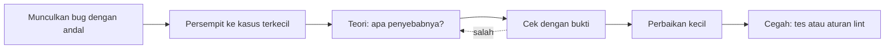

::part[Pelajari Konsepnya]{n="1"}

## 🎯 Yang akan kamu pelajari

- Alur debugging yang bisa diulang untuk bug apa pun
- Membaca pesan error React dan Next.js
- Memakai React DevTools
- 8 jenis bug React yang paling umum dan cara memperbaikinya
- Masalah Next.js: error di server vs browser, hydration mismatch
- Mengubah setiap bug menjadi tes

## 🔤 Istilah penting

| Istilah | Artinya (sederhana) |
|---|---|
| **Reproduce** | Memunculkan bug lagi dengan sengaja, dengan langkah yang persis |
| **Isolate** | Membuang semua yang tidak berkaitan sampai hanya bug-nya yang tersisa |
| **Stale closure** | Function yang masih memakai nilai lama dari render sebelumnya |
| **Effect loop** | Effect yang mengubah state, yang menjalankan effect lagi, tanpa henti |
| **Hydration** | Browser "menghidupkan" HTML yang datang dari server |
| **Hydration mismatch** | HTML dari server berbeda dengan render pertama di browser |
| **Breakpoint** | Titik jeda tempat debugger berhenti agar kamu bisa melihat-lihat |
| **Regression test** | Tes yang memastikan bug yang sudah diperbaiki tidak kembali |

## 🧠 Ide besarnya

Debugging adalah **kerja detektif, bukan menebak-nebak**. Detektif tidak menangkap orang pertama yang ia lihat. Ia mengumpulkan bukti, membuat teori, lalu mengujinya. Mengubah kode secara acak sampai bug-nya hilang biasanya hanya menyembunyikan bug itu dan menciptakan dua bug baru.

## ❓ Kenapa ini penting

Bug React datang dalam sedikit **bentuk yang berulang**. Begitu kamu mengenal bentuk-bentuknya, kebanyakan bug hanya butuh beberapa menit, bukan berjam-jam — dan kamu bisa menjelaskannya saat interview dan code review.

Akibat menebak-nebak:
- Menambah `useEffect` untuk "menyinkronkan" sesuatu → loop dan tampilan berkedip.
- `key={Math.random()}` untuk "memaksa update" → fokus hilang dan halaman lambat.
- Mematikan aturan lint `react-hooks` → membungkam peringatan yang justru menunjuk ke bug-nya.
- Meminta AI "perbaiki" lalu menempel kode yang hanya menyembunyikan gejalanya.

## 📖 Langkah demi langkah

### 1. Alur kerjanya



1. **Reproduce**: tulis langkah, data, dan browser yang persis.
2. **Isolate**: buang bagian yang tidak berkaitan sampai bug tetap terjadi di potongan terkecil.
3. **Teori**: "list tidak berubah karena state diubah langsung".
4. **Cek**: log nilainya, lihat state di DevTools, atau pasang breakpoint.
5. **Perbaiki** penyebabnya, bukan gejalanya.
6. **Cegah**: tulis tes yang gagal dulu, nyalakan aturan lint, atau tambahkan type.

Seperti dokter: memunculkan gejalanya, menjalankan tes, mendiagnosis, lalu mengobati penyebabnya — bukan sekadar memberi obat pereda nyeri.

### 2. Baca pesannya dulu

- **Tampilan error Next.js** menunjukkan file dan barisnya. Error di server juga tercetak di **terminal**.
- Peringatan React di console browser biasanya menyebut nama component dan masalahnya ("Each child in a list should have a unique key").
- Kalau ada banyak error, baca yang **pertama**. Sisanya sering hanya akibat dari error pertama — seperti domino.

### 3. React DevTools

- Tab **Components**: klik sebuah component untuk melihat props, state, dan hook-nya; kamu bahkan bisa mengubah state secara live.
- **Highlight updates when components render**: lihat apa yang digambar ulang saat kamu mengeklik.
- **Profiler**: rekam sebuah klik dan temukan component yang lambat.
- Di Next.js, hanya Client Component yang menampilkan state live.

### 4. Jenis bug yang umum

| Yang kamu lihat | Kemungkinan penyebab | Perbaikan |
|---|---|---|
| Klik tidak berefek sampai ada hal lain yang menggambar ulang | **state diubah langsung** (`push`, `obj.x = …`) | buat array dan object baru |
| Counter atau timer tertahan di nilai lama | **stale closure** (function menyimpan foto lama) | updater function, dependency yang benar |
| Setelah menghapus baris, teks yang diketik pindah ke baris lain | **key berupa index atau tidak stabil** | id yang stabil sebagai key |
| "Maximum update depth exceeded", tab membeku | **effect loop**: effect mengubah state yang mengubah dependency-nya sendiri | hapus effect-nya (hitung saja), atau bergantung pada nilai sederhana |
| Crash: "Rendered more/fewer hooks…" | **hook di dalam `if`** | hook di bagian atas, buat **output**-nya yang kondisional |
| Layar menampilkan nilai lama setelah props berubah | **props disalin ke state** | hitung saat render, atau reset dengan `key` |
| Handler langsung jalan saat halaman dimuat | `onClick={handle()}` | `onClick={handle}` atau `() => handle(id)` |
| Peringatan: uncontrolled → controlled | `value` dimulai dengan `undefined` | mulai dengan `""` |

### 5. Stale closure dalam kode sungguhan

```tsx
useEffect(() => {
  const id = setInterval(() => setSeconds(seconds + 1), 1000);   // seconds is 0 forever inside this closure
  return () => clearInterval(id);
}, []);
```

Effect berjalan sekali, dan function-nya mengingat `seconds` dari render pertama — seperti **foto sebuah jam**: selalu menunjukkan waktu yang sama. Perbaiki dengan updater: `setSeconds((s) => s + 1)`. Aturan lint `react-hooks/exhaustive-deps` memperingatkan kasus seperti ini.

### 6. Apakah kamu benar-benar butuh effect itu?

Banyak bug berasal dari effect yang seharusnya tidak ada:

```tsx
// ❌ derived state synced by an effect: extra render, can drift
const [visible, setVisible] = useState(jobs);
useEffect(() => setVisible(jobs.filter(matches)), [jobs, query]);

// ✅ derive during render
const visible = jobs.filter(matches);
```

Effect dipakai untuk berbicara dengan **hal di luar React**: timer, subscription, jaringan, DOM. Kalau sebuah nilai bisa dihitung dari props dan state, hitung saja. (Minggu 5 membahasnya lebih dalam.)

### 7. Masalah khusus Next.js

- **"You're importing a component that needs useState…"** → file-nya butuh `"use client"`, atau pindahkan bagian interaktifnya ke client component.
- **Error Server Component** muncul di terminal, dan `console.log` di kode server juga tercetak di sana.
- **Hydration mismatch** ("Text content does not match server-rendered HTML"): HTML dari server dan render pertama browser berbeda — seperti **paket kiriman yang tidak cocok dengan struk pesanan**. Penyebab umum:
  - `Date.now()` atau `Math.random()` saat render,
  - pengecekan `typeof window` yang memberi output berbeda,
  - format tanggal atau angka yang berbeda antara server dan browser,
  - HTML yang tidak valid (`<p>` di dalam `<p>`),
  - extension browser yang mengubah halaman.

  Perbaikan: buat render pertama sama di kedua sisi, dan pindahkan nilai yang khusus browser ke effect atau component khusus client.
- Jalankan `next build` sebelum push — ia menangkap error type dan lint yang mungkin tidak jelas terlihat di dev server.

### 8. Breakpoint untuk bug yang sulit

Tulis `debugger;` di kodemu, atau klik nomor baris di panel Sources browser. Kode akan berhenti di sana, dan kamu bisa melihat setiap variabel dan melangkah baris demi baris — seperti menjeda tayangan ulang sepak bola untuk melihat persis siapa yang menyentuh bola.

## ⚠️ Kesalahan umum

- Mengubah hal-hal secara acak sampai bug-nya hilang.
- Memperbaiki dengan menambah effect, key acak, atau `setTimeout`.
- Mematikan peringatan atau aturan lint tanpa memahaminya.
- `console.log` object yang nanti berubah — log salinannya (`structuredClone(value)`).
- Memakai `suppressHydrationWarning` di mana-mana alih-alih memperbaiki output yang berbeda.
- Mengira "React-nya rusak" — hampir selalu ada aturan yang kita langgar di kode kita.

## 🏆 Praktik terbaik

- [ ] Munculkan dan persempit bug sebelum mengubah kode; ubah satu hal setiap kali.
- [ ] Baca error pertama; cek terminal untuk error dari server.
- [ ] Pakai React DevTools untuk melihat props, state, dan penggambaran ulang.
- [ ] Hitung nilai alih-alih menyinkronkannya dengan effect; ikuti Rules of Hooks.
- [ ] Jaga TypeScript strict dan aturan lint `react-hooks` tetap aktif — keduanya mencegah bug.
- [ ] Tambahkan tes untuk setiap bug yang diperbaiki; tulis **penyebab → perbaikan** di pesan commit.
- [ ] Jalankan `next build` dan tes sebelum push.

::part[Jelaskan & Rancang]{n="2"}

## 🗣️ Jelaskan

Jelaskan stale closure ke developer junior dengan ide "foto sebuah jam", dan tunjukkan perbaikan satu baris untuk sebuah timer.

## 📐 Rancang

Tulis **playbook debugging** untuk `CONTRIBUTING.md` CareerPilot: langkah yang diikuti, tool yang dipakai untuk masalah di browser vs server, apa yang wajib ada di laporan bug, dan kapan sebuah bug dianggap "sudah diperbaiki".

:::quiz
Tampilkan contoh playbook-nya

**Laporan bug wajib berisi**: langkah untuk memunculkan bug, hasil yang diharapkan vs yang terjadi, URL halaman, role pengguna, browser dan perangkat, screenshot atau rekaman, error di console/terminal, dan request id dari error API (dari logging di Modul 2).

**Langkah**
1. Munculkan bug di lokal dengan data yang sama (seed script atau salinan response API).
2. Tentukan jenisnya: error build, server (terminal / log API), browser (console), jaringan (tab Network di DevTools: status dan payload), atau tampilan (CSS).
3. Persempit: halaman atau component terkecil; untuk masalah API, munculkan dengan `curl`.
4. Buat teori dan cek dengan bukti: React DevTools, breakpoint, log, tab Network, log API berdasarkan request id.
5. Tulis tes yang gagal (Testing Library untuk component, Playwright untuk alur).
6. Perbaiki penyebabnya dengan perubahan sekecil mungkin.
7. Cegah: aturan lint, type, atau tes; tulis **penyebab → perbaikan** di pull request.

**Definisi selesai**: tes gagal sebelum perbaikan dan lolos setelahnya; lint, `tsc`, tes, dan `next build` lolos di CI; dicek di preview deployment; tiket bug terhubung ke pull request-nya.

**Jangan**: mematikan aturan lint, `suppressHydrationWarning` tanpa komentar, key acak, effect yang menyalin state hasil hitungan, merge "jalan di komputerku" tanpa tes.
:::

### 📝 Checklist self-review

- [ ] Template laporan mencatat cara memunculkan bug
- [ ] Jalur terpisah untuk masalah browser, server, dan jaringan
- [ ] Tes wajib untuk setiap perbaikan

::ai-review{task="design"}

::part[Latihan Kecil]{n="3"}

:::exercise{path="exercises/web/m4/w3/06-debugging-react" ai="no-ai" title="Berburu bug: lima bug React sungguhan"}
Lima component, lima laporan bug dari QA: state yang diubah langsung, stale closure dengan timer yang tidak pernah berhenti, key berupa index yang memindahkan teks ketikan ke baris yang salah, effect loop yang membekukan halaman, dan hook di dalam `if` yang crash saat pengguna menjadi admin. Temukan setiap penyebabnya, buat perbaikan terkecil, dan tulis komentar **penyebab → perbaikan**.
:::

:::hints
- Jalankan tesnya dulu: setiap tes yang gagal adalah cara memunculkan bug-nya.
- Untuk halaman yang membeku: nilai mana di array dependency yang menjadi object baru di setiap render?
- Untuk crash: hook harus dipanggil dengan urutan yang sama di setiap render — buat **output**-nya yang kondisional, bukan hook-nya.
:::

## ✅ Cek cepat

:::quiz
Apa penyebab "Maximum update depth exceeded" dengan `useEffect`?

Effect memperbarui state yang mengubah salah satu dependency-nya sendiri setiap kali (sering berupa object, array, atau function baru yang dibuat saat render), sehingga render → effect → setState → render tidak pernah berhenti.
:::

:::quiz
Sebutkan dua penyebab hydration mismatch di Next.js.

Output yang berbeda setiap kali (tanggal, angka acak, pengecekan `typeof window`, format angka/tanggal yang berbeda) dan HTML bersarang yang tidak valid atau extension browser yang mengubah halaman.
:::

## 📚 Lanjut belajar

- [React docs: You Might Not Need an Effect](https://react.dev/learn/you-might-not-need-an-effect)
- [React Developer Tools](https://react.dev/learn/react-developer-tools)
- Dokumentasi Next.js (tersedia di `node_modules/next/dist/docs`): panduan Debugging

## 📣 Akhir Minggu 3 — bagikan progresmu

:::linkedin{type="weekly"}
⚛️ Minggu 3: React dengan Next.js — dari sudut pandang developer backend Python.

- Component hanyalah function: data masuk, tampilan keluar
- State adalah snapshot — akhirnya paham kenapa `setCount(count + 1)` tiga kali hanya menambah satu
- Server Component sebagai default, `"use client"` hanya untuk bagian yang interaktif
- Membuat form controlled dengan validasi yang aksesibel, dan memperbaiki lima bug klasik React (stale closure, key berupa index, effect loop, hook kondisional, mutasi state)

Bug yang paling banyak mengajariku: [jawabanmu].

Berikutnya: routing, data fetching, dan caching di Next.js App Router. 🚀

#React #NextJS #Frontend #LearningInPublic
:::
