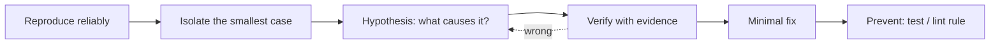

::part[Learn the Concept]{n="1"}

## 🎯 What you'll learn

- A repeatable workflow: reproduce → isolate → hypothesize → verify → fix → prevent
- Reading React and Next.js error overlays, warnings and stack traces
- React DevTools: component tree, props/state, "why did this render?", Profiler
- The classic bug families: mutation, stale closures, wrong keys, effect loops, hook order, derived-state drift
- Next.js-specific issues: server vs client errors, hydration mismatches
- Turning every bug into a test (Week 6 connects this to CI)

## 🧠 The big idea

Debugging is **detective work, not guessing**. A detective doesn't arrest the first suspect; they collect evidence, form a hypothesis, and test it. Random code changes until the bug disappears ("shotgun debugging") often hide the bug and create two new ones.

## ❓ Why does this exist?

React's model (render snapshots, hooks, reconciliation) produces a small set of recurring bug shapes. Once you know the shapes, most bugs take minutes instead of hours — and you can explain them in interviews and code reviews.

## 💥 What happens if we DON'T debug systematically?

- Adding `useEffect` to "sync" things, creating loops and flicker.
- Sprinkling `key={Math.random()}` to "force updates", destroying focus and performance.
- Disabling the `react-hooks` ESLint rule to silence a warning that was pointing at the bug.
- Asking an AI to "fix it" and pasting code that masks the symptom.

## 📖 How it works, step by step

### 1. The workflow



1. **Reproduce**: exact steps, data and browser. Write them down.
2. **Isolate**: remove unrelated components until the bug still happens in the smallest tree.
3. **Hypothesize**: "the list doesn't update because state is mutated".
4. **Verify**: `console.log` the reference, inspect state in DevTools, set a breakpoint.
5. **Fix** the cause, not the symptom.
6. **Prevent**: add a failing test first (like the exercise), enable a lint rule, add a type.

### 2. Read the message first

- **Next.js dev overlay** shows build and runtime errors with the file and line; server errors also print in the **terminal**.
- React warnings in the console usually name the component and the problem ("Each child in a list should have a unique key", "A component is changing an uncontrolled input to be controlled").
- Read the **first** error in a cascade; later ones are often consequences.

### 3. React DevTools

- **Components** tab: select a component to see props, state and hooks; edit state live; jump to source.
- **Highlight updates when components render**: see what re-renders on each interaction.
- **Profiler**: record an interaction, find slow components and why they rendered.
- In Next.js, only Client Components show interactive state; Server Components appear as server-rendered output.

### 4. Bug families and their signatures

| Symptom | Likely cause | Fix |
|---|---|---|
| Click does nothing until something else re-renders | **mutation** (`push`, `obj.x = …`) + same reference | create new arrays/objects |
| Counter stuck, timer shows old value | **stale closure** (handler/effect captured an old snapshot) | updater function, correct dependencies, refs for latest values |
| Wrong row keeps typed text after delete/reorder | **index or unstable keys** | stable ids as keys |
| "Maximum update depth exceeded", frozen tab | **effect loop**: effect sets state that changes its own dependency (often a new object/array/function each render) | remove the effect (derive instead), memoize, depend on primitives |
| "Rendered more/fewer hooks…" crash | **conditional hook** | hooks at top level, conditional output |
| UI shows old values after props change | **props copied into state** / derived state stored | compute during render or reset with `key` |
| Event handler runs on render | `onClick={handle()}` | `onClick={handle}` / `() => handle(id)` |
| Warning: controlled ↔ uncontrolled | `value` starts `undefined` | initialize with `""` |

### 5. Stale closures, concretely

```tsx
useEffect(() => {
  const id = setInterval(() => setSeconds(seconds + 1), 1000);   // seconds is 0 forever inside this closure
  return () => clearInterval(id);
}, []);
```

The effect runs once and its function remembers the first render's `seconds`. Fix with an updater (`setSeconds((s) => s + 1)`), or include dependencies correctly. The `react-hooks/exhaustive-deps` lint rule points at these.

### 6. Do you need that effect?

Many bugs come from effects that shouldn't exist:

```tsx
// ❌ derived state synced by an effect: extra render, can drift
const [visible, setVisible] = useState(jobs);
useEffect(() => setVisible(jobs.filter(matches)), [jobs, query]);

// ✅ derive during render
const visible = jobs.filter(matches);
```

Effects are for **synchronizing with external systems** (timers, subscriptions, the network, the DOM) — Week 5 goes deeper.

### 7. Next.js-specific debugging

- **"You're importing a component that needs useState…"** → the file needs `"use client"` (or move the interactive part into a client component).
- **Server Component errors** appear in the terminal; `console.log` in server code prints there too.
- **Hydration mismatch** ("Text content does not match server-rendered HTML"): the server HTML and the first client render differ. Causes: `Date.now()`/`Math.random()` in render, `typeof window` branches, locale-dependent formatting, browser extensions changing the DOM, invalid HTML nesting (`<p>` inside `<p>`). Fix by rendering deterministic output and moving browser-only values into effects or client-only components.
- `next build` catches type and lint errors the dev server might not show prominently — run it before pushing.

### 8. Breakpoints beat logs for complex bugs

Add `debugger;` or click a line number in the browser Sources panel (Client Components) or use VS Code's Next.js debug configuration (server code). Step through, inspect variables in scope, and watch the call stack.

## ⚖️ Trade-offs

| Tool | ✅ | ❌ |
|---|---|---|
| `console.log` | fast, everywhere | noisy; logs objects that later mutate (log copies) |
| Breakpoints | full context, step-by-step | setup; async code jumps around |
| React DevTools | component-aware | doesn't show Server Component internals |
| Writing a failing test first | proves the fix, prevents regressions | takes a few minutes |
| AI assistant | quick hypotheses | may treat the symptom; verify with evidence |

## ✅ When to use it / 🚫 When NOT to use it

- ✅ Use the workflow for every non-trivial bug; write the failing test before the fix.
- ✅ Keep `react-hooks` ESLint rules and TypeScript strict on — they're preventive debugging.
- 🚫 Don't silence warnings or disable rules without understanding them.
- 🚫 Don't "fix" by adding effects, random keys or `setTimeout`s.

## 🏆 Best practices

- [ ] Reproduce and isolate before changing code; change one thing at a time.
- [ ] Read the first error and the component stack; check the terminal for server errors.
- [ ] Use React DevTools to inspect props/state and highlight re-renders.
- [ ] Prefer deriving values over syncing with effects; follow the Rules of Hooks.
- [ ] Log snapshots (`structuredClone(value)`) rather than live objects.
- [ ] Add a regression test for each fixed bug; mention **cause → fix** in the commit message.
- [ ] Run `next build` and the test suite before pushing.

## 🏭 How it's used in industry

- Teams track bugs with reproduction steps and require a regression test in the fix PR.
- Error monitoring (Sentry, Datadog RUM) captures production React errors with component stacks and session replays.
- Interviewers often show a buggy component (stale closure, keys, effect loop) and ask you to explain and fix it — exactly the exercise.

## ⚠️ Common mistakes

- Debugging in production builds without source maps and wondering why stack traces are unreadable.
- Fixing a hydration mismatch with `suppressHydrationWarning` everywhere instead of fixing non-deterministic rendering.
- Assuming the bug is in React ("React is broken") — it's almost always a rule broken in our code.

::part[Explain & Design]{n="2"}

## 🗣️ Explain it

Explain a stale closure to a junior developer using the snapshot analogy from lesson 03, and show the one-line fix for a timer.

## 📐 Design it

Write a **debugging playbook** your team could put in CareerPilot's `CONTRIBUTING.md`: the steps to follow, which tools to use for client vs server issues, what information a bug report must include, and the "definition of fixed".

:::quiz
Show a possible playbook

**Bug report must include**: steps to reproduce, expected vs actual, URL/route, user role, browser + device, screenshot or recording, console/terminal errors, request id from the API error (Module 2 Week 6 logging!).

**Steps**
1. Reproduce locally with the same data (seed script or copy of the API response).
2. Classify: build error, server (terminal / API logs), client (browser console), network (DevTools Network tab: status, payload), or visual (CSS).
3. Isolate: smallest route/component; for API issues, reproduce with `curl`/HTTP file.
4. Hypothesize and verify with evidence: React DevTools (props/state/renders), breakpoints, logs of snapshots, Network tab, API logs by request id.
5. Write a failing test (unit/component with Testing Library, or Playwright for flows).
6. Fix the cause; keep the diff minimal.
7. Prevent: lint rule, type, or test; note **cause → fix** in the PR description.

**Definition of fixed**: test fails before and passes after; `npm run lint`, `tsc`, tests and `next build` pass in CI; verified in the preview deployment; bug ticket links the PR.

**Don'ts**: disabling lint rules, `suppressHydrationWarning` without a comment, random keys, effects to sync derived state, merging "works on my machine" without a test.
:::

### 📝 Self-review checklist

- [ ] Report template captures reproduction data
- [ ] Client, server and network investigation paths
- [ ] Regression tests required

::ai-review{task="design"}

::part[Toy Exercise]{n="3"}

:::exercise{path="exercises/web/m4/w3/06-debugging-react" ai="no-ai" title="Bug hunt: five real React bugs"}
Five components, five QA bug reports: mutated state, a stale closure with a leaking timer, index keys that move input text to the wrong row, an effect loop that freezes the page, and a conditional hook that crashes when a user becomes an admin. Find each cause, apply the smallest fix, and write **cause → fix** comments.
:::

:::hints
- Run the tests first: each failing test is a reproduction.
- For the freeze: what's a new object on every render in the dependency array?
- For the crash: hooks must be called in the same order every render — make the **output** conditional, not the hook.
:::

## ✅ Quick check

:::quiz
What causes "Maximum update depth exceeded" with `useEffect`?

An effect updates state that changes one of its own dependencies every time (often a new object/array/function created during render), so render → effect → setState → render loops forever.
:::

:::quiz
Name two causes of a hydration mismatch in Next.js.

Non-deterministic rendering (dates, random values, `typeof window` checks, locale formatting differences) and invalid HTML nesting or DOM changes by browser extensions.
:::

## 📖 Kamus (glossary)

| Term | Bahasa Indonesia |
|---|---|
| Reproduce | Mereproduksi bug (membuatnya terjadi lagi) |
| Stale closure | Closure basi — memakai nilai lama |
| Effect loop | Perulangan tak berujung dari efek |
| Hydration mismatch | Ketidakcocokan HTML server dan render klien |
| Regression test | Tes regresi — mencegah bug kembali |
| Breakpoint | Titik henti debugger |

## 📚 Keep learning

- [React docs: You Might Not Need an Effect](https://react.dev/learn/you-might-not-need-an-effect)
- [React Developer Tools](https://react.dev/learn/react-developer-tools)
- Next.js docs (bundled in `node_modules/next/dist/docs`): Debugging guide

## 📣 End of Week 3 — share your progress

:::linkedin{type="weekly"}
⚛️ Week 3: React with Next.js — from a Python backend developer's point of view.

- Components are just functions: data in, UI out
- State is a snapshot — which finally explained why `setCount(count + 1)` three times only adds one
- Server Components by default, `"use client"` only for the interactive parts
- Built a controlled form with accessible validation, and fixed five classic React bugs (stale closures, index keys, effect loops, conditional hooks, mutation)

The bug that taught me the most: [your answer].

Next: routing, data fetching and caching in the Next.js App Router. 🚀

#React #NextJS #Frontend #LearningInPublic
:::
