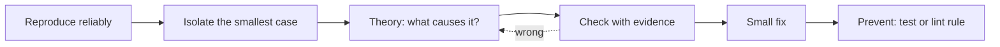

::part[Learn the Concept]{n="1"}

## 🎯 What you'll learn

- A debugging workflow you can repeat for any bug
- Reading React and Next.js error messages
- Using React DevTools
- The 8 most common React bug types and their fixes
- Next.js problems: server vs browser errors, hydration mismatch
- Turning every bug into a test

## 🔤 Key words

| Word | In simple words | Bahasa Indonesia |
|---|---|---|
| **Reproduce** | Make the bug happen again on purpose, with exact steps | Memunculkan bug lagi |
| **Isolate** | Remove everything unrelated until only the bug is left | Mempersempit |
| **Stale closure** | A function still using an old value from an earlier render | Nilai basi |
| **Effect loop** | An effect that updates state, which runs the effect again, forever | Efek berputar terus |
| **Hydration** | The browser "waking up" the HTML that came from the server | Menghidupkan HTML |
| **Hydration mismatch** | Server HTML and the first browser render are different | HTML tidak cocok |
| **Breakpoint** | A pause point where the debugger stops so you can look around | Titik jeda |
| **Regression test** | A test that makes sure a fixed bug never comes back | Tes pencegah bug kembali |

## 🧠 The big idea

Debugging is **detective work, not guessing**. A detective doesn't arrest the first person they see. They collect evidence, make a theory, and test it. Changing random code until the bug disappears usually hides the bug and creates two new ones.

## ❓ Why it matters

React bugs come in a small number of **repeating shapes**. Once you know the shapes, most bugs take minutes instead of hours — and you can explain them in interviews and code reviews.

What guessing leads to:
- Adding a `useEffect` to "sync" things → loops and flicker.
- `key={Math.random()}` to "force updates" → lost focus and slow pages.
- Turning off the `react-hooks` lint rule → silencing the warning that pointed at the bug.
- Asking AI to "fix it" and pasting code that only hides the symptom.

## 📖 Step by step

### 1. The workflow



1. **Reproduce**: write down the exact steps, data and browser.
2. **Isolate**: remove unrelated parts until the bug still happens in the smallest piece.
3. **Theory**: "the list doesn't update because state is changed directly".
4. **Check**: log the value, look at state in DevTools, or set a breakpoint.
5. **Fix** the cause, not the symptom.
6. **Prevent**: write a failing test first, turn on a lint rule, or add a type.

Like a doctor: reproduce the symptom, run tests, diagnose, treat the cause — not just give painkillers.

### 2. Read the message first

- The **Next.js error overlay** shows the file and line. Server errors also print in the **terminal**.
- React warnings in the browser console usually name the component and the problem ("Each child in a list should have a unique key").
- When there are many errors, read the **first** one. The rest are often side effects of it — like dominoes.

### 3. React DevTools

- **Components** tab: click a component to see its props, state and hooks; you can even change state live.
- **Highlight updates when components render**: see what redraws when you click.
- **Profiler**: record a click and find slow components.
- In Next.js, only Client Components show live state.

### 4. The common bug types

| What you see | Likely cause | Fix |
|---|---|---|
| A click does nothing until something else redraws | **changed state directly** (`push`, `obj.x = …`) | make new arrays and objects |
| A counter or timer is stuck on an old value | **stale closure** (a function kept an old snapshot) | updater function, correct dependencies |
| After deleting a row, typed text jumps to the wrong row | **index or unstable keys** | stable ids as keys |
| "Maximum update depth exceeded", tab freezes | **effect loop**: effect sets state that changes its own dependency | remove the effect (calculate instead), or depend on simple values |
| Crash: "Rendered more/fewer hooks…" | **hook inside an `if`** | hooks at the top, make the **output** conditional |
| Screen shows old values after props change | **props copied into state** | calculate during render, or reset with `key` |
| A handler runs as soon as the page loads | `onClick={handle()}` | `onClick={handle}` or `() => handle(id)` |
| Warning: uncontrolled → controlled | `value` starts as `undefined` | start with `""` |

### 5. Stale closure, in real code

```tsx
useEffect(() => {
  const id = setInterval(() => setSeconds(seconds + 1), 1000);   // seconds is 0 forever inside this closure
  return () => clearInterval(id);
}, []);
```

The effect runs once, and its function remembers `seconds` from the first render — like a **photo of a clock**: it always shows the same time. Fix it with an updater: `setSeconds((s) => s + 1)`. The `react-hooks/exhaustive-deps` lint rule warns about these.

### 6. Do you really need that effect?

Many bugs come from effects that shouldn't exist:

```tsx
// ❌ derived state synced by an effect: extra render, can drift
const [visible, setVisible] = useState(jobs);
useEffect(() => setVisible(jobs.filter(matches)), [jobs, query]);

// ✅ derive during render
const visible = jobs.filter(matches);
```

Effects are for talking to **things outside React**: timers, subscriptions, the network, the DOM. If you can calculate a value from props and state, just calculate it. (Week 5 goes deeper.)

### 7. Next.js-specific problems

- **"You're importing a component that needs useState…"** → the file needs `"use client"`, or move the interactive part into a client component.
- **Server Component errors** show in the terminal, and `console.log` in server code prints there too.
- **Hydration mismatch** ("Text content does not match server-rendered HTML"): the server's HTML and the browser's first render are different — like a **delivery that doesn't match the order receipt**. Common causes:
  - `Date.now()` or `Math.random()` while rendering,
  - `typeof window` checks that give different output,
  - dates or numbers formatted differently on server and browser,
  - invalid HTML (a `<p>` inside a `<p>`),
  - browser extensions changing the page.

  Fix: make the first render the same on both sides, and move browser-only values into effects or client-only components.
- Run `next build` before pushing — it catches type and lint errors the dev server may not show clearly.

### 8. Breakpoints for hard bugs

Write `debugger;` in your code, or click a line number in the browser's Sources panel. The code pauses there, and you can look at every variable and step line by line — like pausing a football replay to see exactly who touched the ball.

## ⚠️ Common mistakes

- Changing random things until the bug disappears.
- Fixing with more effects, random keys or `setTimeout`.
- Turning off warnings or lint rules without understanding them.
- `console.log` of an object that changes later — log a copy (`structuredClone(value)`).
- Using `suppressHydrationWarning` everywhere instead of fixing the different output.
- Thinking "React is broken" — it's almost always a rule we broke in our code.

## 🏆 Best practices

- [ ] Reproduce and isolate before changing code; change one thing at a time.
- [ ] Read the first error; check the terminal for server errors.
- [ ] Use React DevTools to inspect props, state and redraws.
- [ ] Calculate values instead of syncing them with effects; follow the Rules of Hooks.
- [ ] Keep TypeScript strict and the `react-hooks` lint rules on — they prevent bugs.
- [ ] Add a test for each fixed bug; write **cause → fix** in the commit message.
- [ ] Run `next build` and the tests before pushing.

::part[Explain & Design]{n="2"}

## 🗣️ Explain it

Explain a stale closure to a junior developer with the "photo of a clock" idea, and show the one-line fix for a timer.

## 📐 Design it

Write a **debugging playbook** for CareerPilot's `CONTRIBUTING.md`: the steps to follow, which tools to use for browser vs server problems, what a bug report must include, and when a bug counts as "fixed".

:::quiz
Show a possible playbook

**A bug report must include**: steps to reproduce, expected vs actual result, the page URL, the user role, browser and device, a screenshot or recording, console/terminal errors, and the request id from the API error (from Module 2's logging).

**Steps**
1. Reproduce locally with the same data (seed script or a copy of the API response).
2. Decide the type: build error, server (terminal / API logs), browser (console), network (DevTools Network tab: status and payload), or visual (CSS).
3. Isolate: the smallest page or component; for API problems, reproduce with `curl`.
4. Make a theory and check it with evidence: React DevTools, breakpoints, logs, the Network tab, API logs by request id.
5. Write a failing test (Testing Library for components, Playwright for flows).
6. Fix the cause with the smallest change.
7. Prevent it: a lint rule, a type or a test; write **cause → fix** in the pull request.

**Definition of fixed**: the test failed before and passes after; lint, `tsc`, tests and `next build` pass in CI; checked on the preview deployment; the bug ticket links the pull request.

**Don'ts**: turning off lint rules, `suppressHydrationWarning` without a comment, random keys, effects that copy calculated state, merging "works on my machine" without a test.
:::

### 📝 Self-review checklist

- [ ] The report template captures how to reproduce
- [ ] Separate paths for browser, server and network problems
- [ ] Tests are required for every fix

::ai-review{task="design"}

::part[Toy Exercise]{n="3"}

:::exercise{path="exercises/web/m4/w3/06-debugging-react" ai="no-ai" title="Bug hunt: five real React bugs"}
Five components, five bug reports from QA: state changed directly, a stale closure with a timer that never stops, index keys that move typed text to the wrong row, an effect loop that freezes the page, and a hook inside an `if` that crashes when a user becomes an admin. Find each cause, make the smallest fix, and write **cause → fix** comments.
:::

:::hints
- Run the tests first: each failing test is a way to reproduce the bug.
- For the freeze: which value in the dependency array is a new object on every render?
- For the crash: hooks must be called in the same order on every render — make the **output** conditional, not the hook.
:::

## ✅ Quick check

:::quiz
What causes "Maximum update depth exceeded" with `useEffect`?

The effect updates state that changes one of its own dependencies every time (often a new object, array or function created during render), so render → effect → setState → render never stops.
:::

:::quiz
Name two causes of a hydration mismatch in Next.js.

Output that differs each time (dates, random numbers, `typeof window` checks, different number/date formatting) and invalid HTML nesting or browser extensions changing the page.
:::

## 📚 Keep learning

- [React docs: You Might Not Need an Effect](https://react.dev/learn/you-might-not-need-an-effect)
- [React Developer Tools](https://react.dev/learn/react-developer-tools)
- Next.js docs (bundled in `node_modules/next/dist/docs`): Debugging guide

## 📣 End of Week 3 — share your progress

:::linkedin{type="weekly"}
⚛️ Week 3: React with Next.js — from a Python backend developer's point of view.

- Components are just functions: data in, UI out
- State is a snapshot — which finally explained why `setCount(count + 1)` three times only adds one
- Server Components by default, `"use client"` only for the interactive parts
- Built a controlled form with accessible validation, and fixed five classic React bugs (stale closures, index keys, effect loops, conditional hooks, mutation)

The bug that taught me the most: [your answer].

Next: routing, data fetching and caching in the Next.js App Router. 🚀

#React #NextJS #Frontend #LearningInPublic
:::
