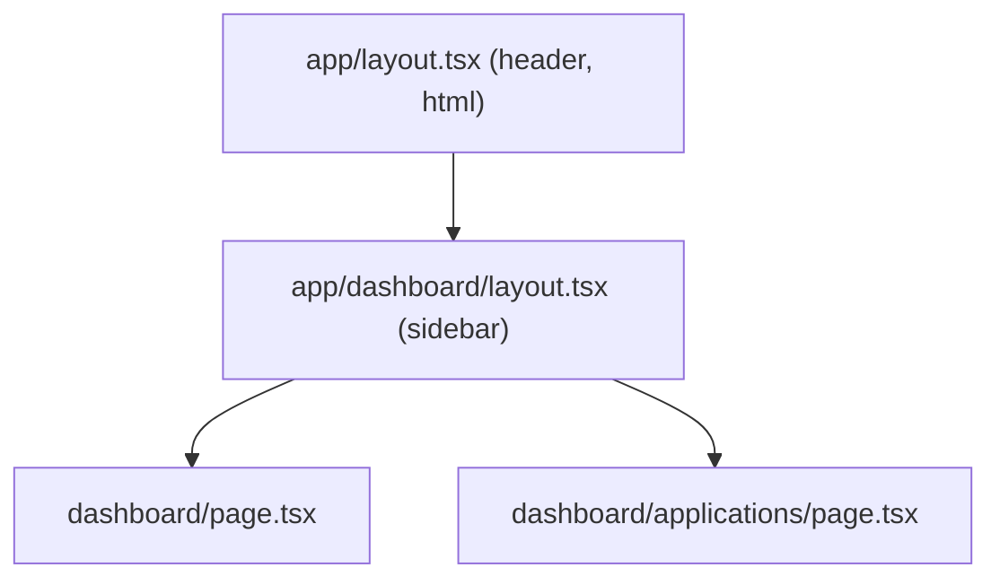

::part[Pelajari Konsepnya]{n="1"}

## 🎯 Yang akan kamu pelajari

- Folder menjadi URL; `page.tsx` membuat halaman yang bisa dibuka pengunjung
- **Layout** yang membungkus halaman dan tetap tampil saat berpindah halaman
- URL **dinamis** seperti `/jobs/42` dengan `[id]`
- Membaca `?status=…` dari URL
- **Route group** `(auth)` dan **folder privat** `_components`
- File khusus: `loading.tsx`, `not-found.tsx`
- Tempat menaruh component

## 🔤 Istilah penting

| Istilah | Artinya (sederhana) |
|---|---|
| **Route** | URL yang ditanggapi aplikasimu, seperti `/jobs` |
| **Segment** | Satu bagian URL di antara garis miring: `jobs` di `/jobs/42` |
| **Layout** | Bingkai (header, sidebar) yang dipakai bersama beberapa halaman |
| **Dynamic segment** | Folder seperti `[id]` yang cocok dengan nilai apa pun |
| **`params`** | Nilai dari segment dinamis: `{ id: "42" }` |
| **`searchParams`** | Bagian `?key=value` dari URL |
| **Route group** | Folder dalam `( )` yang mengelompokkan route tanpa mengubah URL |
| **Private folder** | Folder berawalan `_` yang tidak pernah menjadi URL |

## 🧠 Ide besarnya

Folder `app/` itu seperti **denah mal**: setiap folder adalah lorong (segment URL), `page.tsx` adalah pintu toko yang bisa dimasuki pengunjung, dan `layout.tsx` adalah dekorasi lorong yang dilihat semua orang di bagian itu. Berjalan lebih dalam tetap mempertahankan dekorasi di luarnya — layout tetap tampil sementara halaman di dalamnya berganti.

## ❓ Kenapa ini penting

- Di Flask kamu menulis `@app.route("/jobs")`. Di Next.js **pohon file adalah daftar URL-nya**, jadi kamu bisa melihat struktur seluruh aplikasi sekilas.
- Setiap halaman otomatis dipisah ke JavaScript-nya sendiri, jadi halaman dimuat lebih cepat.
- Kalau dilakukan dengan buruk, muncul masalah:
  - Semua di satu `page.tsx` dengan saklar `?tab=` → tidak ada link yang bisa dibagikan, bundle raksasa.
  - Menyalin header dan sidebar ke setiap halaman → keduanya ter-reset setiap kali pindah halaman.
  - Folder helper yang tidak sengaja berisi `page.tsx` → URL publik yang tidak diinginkan.

## 📖 Langkah demi langkah

### 1. Folder dan halaman

```text
app/
├── layout.tsx                → wraps everything (required: <html>, <body>)
├── page.tsx                  → /
├── jobs/
│   ├── page.tsx              → /jobs
│   └── [id]/
│       ├── page.tsx          → /jobs/42
│       ├── loading.tsx       → shown while /jobs/42 renders
│       └── not-found.tsx     → shown when notFound() is called
├── (auth)/                   → route group: not part of the URL
│   ├── login/page.tsx        → /login
│   └── register/page.tsx     → /register
├── dashboard/
│   ├── layout.tsx            → wraps /dashboard/*
│   ├── page.tsx              → /dashboard
│   └── applications/page.tsx → /dashboard/applications
├── jobs/_components/         → private: never routable
└── api/health/route.ts       → GET /api/health (Route Handler)
```

Hanya file `page.tsx` dan `route.ts` yang membuat URL publik. File lain (component, helper) aman diletakkan di sampingnya.

### 2. Layout

```tsx
// app/dashboard/layout.tsx
export default function DashboardLayout({ children }: { children: React.ReactNode }) {
  return (
    <div className="grid md:grid-cols-[16rem_1fr]">
      <aside aria-label="Dashboard">…</aside>
      <section>{children}</section>
    </div>
  );
}
```



Saat kamu pindah dari `/dashboard` ke `/dashboard/applications`, hanya halamannya yang berganti. Layout-nya tetap — seperti bingkai TV yang tetap sama saat salurannya diganti. State-nya (seperti posisi scroll sidebar) tetap tersimpan.

### 3. URL dinamis dan `params`

```tsx
// app/jobs/[id]/page.tsx
import { notFound } from "next/navigation";

export default async function JobPage({ params }: { params: Promise<{ id: string }> }) {
  const { id } = await params;                     // params is a Promise in Next.js 15+
  if (!/^[1-9]\d*$/.test(id)) notFound();          // validate URL input
  const job = await getJob(Number(id));
  if (!job) notFound();
  return <h1>{job.title}</h1>;
}
```

- `[id]` cocok dengan nilai apa pun, seperti kotak surat berlabel "nomor kamar": `/jobs/42`, `/jobs/7`…
- `params` adalah **Promise** — tulis `await params`.
- Nilainya selalu berupa **teks**. Cek dan ubah dulu, sama seperti `request.args` di Flask.
- `notFound()` menampilkan layar 404.

Next.js juga membuat helper type, jadi kamu tidak perlu menulis type params sendiri:

```tsx
export default async function JobPage(props: PageProps<"/jobs/[id]">) {
  const { id } = await props.params;
}
```

| Folder | Cocok dengan | `params` |
|---|---|---|
| `[id]` | `/jobs/42` | `{ id: "42" }` |
| `[...slug]` | `/docs/a/b` | `{ slug: ["a", "b"] }` |
| `[[...slug]]` | `/docs` dan `/docs/a/b` | `{ slug: undefined }` / `{ slug: ["a","b"] }` |

### 4. Search params (`?status=…`)

```tsx
export default async function ApplicationsPage({ searchParams }: { searchParams: Promise<{ status?: string; page?: string }> }) {
  const { status, page } = await searchParams;
}
```

Membaca `searchParams` berarti halaman dibuat ulang untuk setiap request, karena bergantung pada URL. Di Client Component, pakai `useSearchParams()` (materi 02).

### 5. Route group dan folder privat

- `(marketing)`, `(auth)`, `(app)` — mengelompokkan route dan memberi setiap kelompok layout-nya sendiri, **tanpa** mengubah URL. Seperti bagian mal ("Food court", "Fashion") yang tidak muncul di alamat toko.
- `_components`, `_lib` — `_` di awal berarti "tidak pernah menjadi URL". Tanda yang jelas: "ini bukan halaman".

### 6. `loading.tsx` dan `not-found.tsx`

```tsx
// app/jobs/[id]/loading.tsx
export default function Loading() {
  return <p role="status">Loading job…</p>;
}
```

- `loading.tsx` langsung tampil selagi halaman dimuat, dan layout tetap bisa dipakai. Seperti restoran yang menyajikan air minum dan alat makan sambil makanannya dimasak.
- `not-found.tsx` tampil saat `notFound()` dipanggil di bagian aplikasi itu.

### 7. Tempat menaruh kode

Simpan component yang hanya dipakai satu route di sampingnya (`app/jobs/_components/job-row.tsx`). Taruh kode bersama di folder `components/` dan `lib/` tingkat atas, dan import dengan `@/`. Pilih satu kebiasaan untuk seluruh tim.

:::fastapi
Flask dan FastAPI mendefinisikan route dengan decorator Python; Next.js mendefinisikannya dengan file. Ketiganya memakai path parameter (`/jobs/<int:id>`, `/jobs/{id}`, `app/jobs/[id]`) — dan di ketiganya, kamu harus memvalidasi yang datang dari URL.
:::

## ⚠️ Kesalahan umum

- Memakai `params.id` tanpa `await` (sejak Next.js 15 berupa Promise).
- Menganggap params sebagai angka tanpa mengeceknya.
- Menaruh `"use client"` di layout — semua di dalamnya jadi kode browser.
- `route.ts` dan `page.tsx` di folder yang sama (keduanya bentrok).
- Route untuk tab kecil di dalam widget (tidak perlu) — tapi bagian besar biasanya layak punya URL sendiri.

## 🏆 Praktik terbaik

- [ ] Satu root layout dengan `<html lang>`; layout per bagian untuk navigasi bersama.
- [ ] `await params` / `searchParams`, cek nilainya, dan panggil `notFound()` kalau sesuatu tidak ada.
- [ ] Tambahkan `loading.tsx` ke route yang memuat data.
- [ ] Pakai route group untuk bagian dengan layout berbeda (marketing, app, auth).
- [ ] Awali folder yang bukan route dengan `_`; pakai alias `@/` untuk kode bersama.
- [ ] Pakai `PageProps<'/route'>` dan `LayoutProps` untuk props ber-type.
- [ ] Jaga halaman tetap tipis: muat data, lalu susun component.

::part[Jelaskan & Rancang]{n="2"}

## 🗣️ Jelaskan

Jelaskan ke developer Flask perbandingan `app/jobs/[id]/page.tsx` dengan `@app.get("/jobs/<int:id>")`, termasuk mengecek id dan menampilkan 404.

## 📐 Rancang

Rencanakan pohon folder `app/` untuk CareerPilot Fase 4: halaman landing dan harga yang publik, login dan register, area setelah login dengan dashboard, daftar dan detail lamaran (dengan tab catatan), perusahaan, pengaturan, dan route proxy API. Tunjukkan route group, layout, file loading/not-found, dan folder component privat.

:::quiz
Tampilkan contoh pohonnya

```text
app/
├── layout.tsx                         ← <html>, fonts, providers
├── (marketing)/
│   ├── layout.tsx                     ← public header/footer
│   ├── page.tsx                       → /
│   └── pricing/page.tsx               → /pricing
├── (auth)/
│   ├── layout.tsx                     ← centered card layout
│   ├── login/page.tsx                 → /login
│   └── register/page.tsx              → /register
├── (app)/
│   ├── layout.tsx                     ← sidebar + user menu; checks session
│   ├── dashboard/
│   │   ├── page.tsx                   → /dashboard
│   │   └── loading.tsx
│   ├── applications/
│   │   ├── page.tsx                   → /applications?status=&page=
│   │   ├── loading.tsx
│   │   ├── _components/application-row.tsx
│   │   └── [id]/
│   │       ├── layout.tsx             ← application header + tabs (Overview | Notes)
│   │       ├── page.tsx               → /applications/12
│   │       ├── notes/page.tsx         → /applications/12/notes
│   │       ├── loading.tsx
│   │       ├── not-found.tsx
│   │       └── error.tsx
│   ├── companies/[id]/page.tsx        → /companies/3
│   └── settings/page.tsx              → /settings
├── api/
│   └── [...path]/route.ts             → /api/* proxy to Flask with the session token (BFF)
└── not-found.tsx                      ← app-wide 404
```

- Tiga route group memberi halaman marketing, auth, dan app layout yang berbeda, sementara URL-nya tetap bersih.
- Layout detail lamaran menjaga header dan tab tetap tampil saat kamu berpindah antara Overview dan Notes.
:::

### 📝 Checklist self-review

- [ ] URL bersih dan bisa dibagikan
- [ ] Layout sesuai dengan bagian-bagian aplikasi
- [ ] File loading, not-found, dan error di tempat data dimuat

::ai-review{task="design"}

::part[Latihan Kecil]{n="3"}

:::exercise{path="exercises/web/m4/w4/01-routing-layouts" ai="no-ai" title="Bangun file-file route aplikasi kecil"}
Tulis `routeFromFile()` untuk mengubah path file App Router menjadi URL (route group, folder privat, route handler), lalu buat `layout`, `page`, halaman dinamis `[id]` dengan params yang di-await dan `notFound()`, `loading`, `not-found`, halaman di dalam route group, dan layout bersarang yang sungguhan. Tes meng-import dan me-render file-filemu seperti yang dilakukan Next.js.
:::

:::hints
- Di `routeFromFile`, buang `app`, nama file, dan setiap folder `(group)`; kembalikan `null` kalau ada folder yang diawali `_`.
- Halaman dinamis: `const { id } = await params;` lalu cek dengan `/^[1-9]\d*$/`.
- `notFound()` melempar error, jadi kode sesudahnya tidak pernah dijalankan — TypeScript tahu ini (`never`).
:::

## ✅ Cek cepat

:::quiz
Apakah `app/(auth)/login/page.tsx` membuat `/auth/login` atau `/login`?

`/login` — folder dalam tanda kurung bukan bagian dari URL.
:::

:::quiz
Apa yang dipertahankan layout saat berpindah halaman, yang tidak dipertahankan page?

Layout tetap tampil (beserta state-nya) saat kamu berpindah antar halaman di dalamnya; hanya bagian halamannya yang berganti.
:::

## 📚 Lanjut belajar

- Dokumentasi Next.js (tersedia di `node_modules/next/dist/docs`): Layouts and Pages, Project Structure, Dynamic Routes
- [Next.js docs: Layouts and Pages](https://nextjs.org/docs/app/getting-started/layouts-and-pages)
