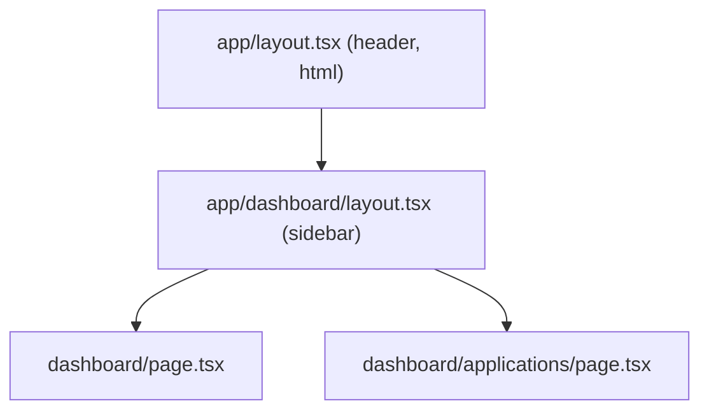

::part[Learn the Concept]{n="1"}

## 🎯 What you'll learn

- Folders become URLs; `page.tsx` makes a page visitors can open
- **Layouts** that wrap pages and stay on screen while you navigate
- **Dynamic** URLs like `/jobs/42` with `[id]`
- Reading `?status=…` from the URL
- **Route groups** `(auth)` and **private folders** `_components`
- Special files: `loading.tsx`, `not-found.tsx`
- Where to put components

## 🔤 Key words

| Word | In simple words | Bahasa Indonesia |
|---|---|---|
| **Route** | A URL your app responds to, like `/jobs` | Rute / alamat halaman |
| **Segment** | One part of a URL between slashes: `jobs` in `/jobs/42` | Bagian URL |
| **Layout** | A frame (header, sidebar) shared by several pages | Bingkai halaman |
| **Dynamic segment** | A folder like `[id]` that matches any value | Bagian URL dinamis |
| **`params`** | The values from dynamic segments: `{ id: "42" }` | Nilai dari URL |
| **`searchParams`** | The `?key=value` part of a URL | Parameter query |
| **Route group** | A folder in `( )` that organizes routes without changing the URL | Grup rute |
| **Private folder** | A folder starting with `_` that never becomes a URL | Folder privat |

## 🧠 The big idea

The `app/` folder is like a **shopping mall floor plan**: each folder is a corridor (a URL segment), `page.tsx` is a shop door visitors can enter, and `layout.tsx` is the corridor decoration everyone in that section sees. Walking deeper keeps the outer decorations — layouts stay on screen while the pages inside change.

## ❓ Why it matters

- In Flask you write `@app.route("/jobs")`. In Next.js the **file tree is the list of URLs**, so you can see the whole app structure at a glance.
- Each page is split into its own JavaScript automatically, so pages load faster.
- Doing it badly causes problems:
  - Everything in one `page.tsx` with `?tab=` switches → no shareable links, huge bundles.
  - Copying the header and sidebar into every page → they reset on every navigation.
  - A helper folder containing a `page.tsx` by accident → an unwanted public URL.

## 📖 Step by step

### 1. Folders and pages

```text
app/
├── layout.tsx                → wraps everything (required: <html>, <body>)
├── page.tsx                  → /
├── jobs/
│   ├── page.tsx              → /jobs
│   └── [id]/
│       ├── page.tsx          → /jobs/42
│       ├── loading.tsx       → shown while /jobs/42 renders
│       └── not-found.tsx     → shown when notFound() is called
├── (auth)/                   → route group: not part of the URL
│   ├── login/page.tsx        → /login
│   └── register/page.tsx     → /register
├── dashboard/
│   ├── layout.tsx            → wraps /dashboard/*
│   ├── page.tsx              → /dashboard
│   └── applications/page.tsx → /dashboard/applications
├── jobs/_components/         → private: never routable
└── api/health/route.ts       → GET /api/health (Route Handler)
```

Only `page.tsx` and `route.ts` files create public URLs. Other files (components, helpers) can safely sit next to them.

### 2. Layouts

```tsx
// app/dashboard/layout.tsx
export default function DashboardLayout({ children }: { children: React.ReactNode }) {
  return (
    <div className="grid md:grid-cols-[16rem_1fr]">
      <aside aria-label="Dashboard">…</aside>
      <section>{children}</section>
    </div>
  );
}
```



When you go from `/dashboard` to `/dashboard/applications`, only the page changes. The layouts stay — like a TV frame that stays the same while the channel changes. Their state (like a scrolled sidebar) is kept.

### 3. Dynamic URLs and `params`

```tsx
// app/jobs/[id]/page.tsx
import { notFound } from "next/navigation";

export default async function JobPage({ params }: { params: Promise<{ id: string }> }) {
  const { id } = await params;                     // params is a Promise in Next.js 15+
  if (!/^[1-9]\d*$/.test(id)) notFound();          // validate URL input
  const job = await getJob(Number(id));
  if (!job) notFound();
  return <h1>{job.title}</h1>;
}
```

- `[id]` matches any value, like a mailbox labeled "room number": `/jobs/42`, `/jobs/7`…
- `params` is a **Promise** — write `await params`.
- The value is always **text**. Check it and convert it, just like `request.args` in Flask.
- `notFound()` shows the 404 screen.

Next.js also creates type helpers, so you don't have to write the params type yourself:

```tsx
export default async function JobPage(props: PageProps<"/jobs/[id]">) {
  const { id } = await props.params;
}
```

| Folder | Matches | `params` |
|---|---|---|
| `[id]` | `/jobs/42` | `{ id: "42" }` |
| `[...slug]` | `/docs/a/b` | `{ slug: ["a", "b"] }` |
| `[[...slug]]` | `/docs` and `/docs/a/b` | `{ slug: undefined }` / `{ slug: ["a","b"] }` |

### 4. Search params (`?status=…`)

```tsx
export default async function ApplicationsPage({ searchParams }: { searchParams: Promise<{ status?: string; page?: string }> }) {
  const { status, page } = await searchParams;
}
```

Reading `searchParams` means the page is built fresh for each request, because it depends on the URL. In Client Components, use `useSearchParams()` (lesson 02).

### 5. Route groups and private folders

- `(marketing)`, `(auth)`, `(app)` — group routes and give each group its own layout, **without** changing the URL. Like mall sections ("Food court", "Fashion") that don't appear in shop addresses.
- `_components`, `_lib` — a `_` at the start means "never a URL". A clear sign: "this is not a page".

### 6. `loading.tsx` and `not-found.tsx`

```tsx
// app/jobs/[id]/loading.tsx
export default function Loading() {
  return <p role="status">Loading job…</p>;
}
```

- `loading.tsx` shows immediately while the page loads, and the layout stays usable. Like a restaurant bringing water and cutlery while the food is cooked.
- `not-found.tsx` shows when `notFound()` is called in that part of the app.

### 7. Where to put code

Keep components used by only one route next to it (`app/jobs/_components/job-row.tsx`). Put shared code in top-level `components/` and `lib/`, and import it with `@/`. Pick one habit for the whole team.

:::fastapi
Flask and FastAPI define routes with Python decorators; Next.js defines them with files. All three use path parameters (`/jobs/<int:id>`, `/jobs/{id}`, `app/jobs/[id]`) — and in all three, you must validate what comes from the URL.
:::

## ⚠️ Common mistakes

- Using `params.id` without `await` (since Next.js 15 it's a Promise).
- Treating params as numbers without checking them.
- Putting `"use client"` on a layout — everything inside becomes browser code.
- A `route.ts` and a `page.tsx` in the same folder (they conflict).
- Routes for tiny tabs inside a widget (not needed) — but big sections usually deserve their own URL.

## 🏆 Best practices

- [ ] One root layout with `<html lang>`; section layouts for shared navigation.
- [ ] `await params` / `searchParams`, check them, and call `notFound()` when something doesn't exist.
- [ ] Add `loading.tsx` to routes that load data.
- [ ] Use route groups for sections with different layouts (marketing, app, auth).
- [ ] Start non-route folders with `_`; use the `@/` alias for shared code.
- [ ] Use `PageProps<'/route'>` and `LayoutProps` for typed props.
- [ ] Keep pages thin: load data, then compose components.

::part[Explain & Design]{n="2"}

## 🗣️ Explain it

Explain to a Flask developer how `app/jobs/[id]/page.tsx` compares to `@app.get("/jobs/<int:id>")`, including checking the id and showing a 404.

## 📐 Design it

Plan the `app/` folder tree for CareerPilot Phase 4: public landing and pricing pages, login and register, a logged-in area with a dashboard, an applications list and detail page (with a notes tab), companies, settings, and an API proxy route. Show route groups, layouts, loading/not-found files and private component folders.

:::quiz
Show a possible tree

```text
app/
├── layout.tsx                         ← <html>, fonts, providers
├── (marketing)/
│   ├── layout.tsx                     ← public header/footer
│   ├── page.tsx                       → /
│   └── pricing/page.tsx               → /pricing
├── (auth)/
│   ├── layout.tsx                     ← centered card layout
│   ├── login/page.tsx                 → /login
│   └── register/page.tsx              → /register
├── (app)/
│   ├── layout.tsx                     ← sidebar + user menu; checks session
│   ├── dashboard/
│   │   ├── page.tsx                   → /dashboard
│   │   └── loading.tsx
│   ├── applications/
│   │   ├── page.tsx                   → /applications?status=&page=
│   │   ├── loading.tsx
│   │   ├── _components/application-row.tsx
│   │   └── [id]/
│   │       ├── layout.tsx             ← application header + tabs (Overview | Notes)
│   │       ├── page.tsx               → /applications/12
│   │       ├── notes/page.tsx         → /applications/12/notes
│   │       ├── loading.tsx
│   │       ├── not-found.tsx
│   │       └── error.tsx
│   ├── companies/[id]/page.tsx        → /companies/3
│   └── settings/page.tsx              → /settings
├── api/
│   └── [...path]/route.ts             → /api/* proxy to Flask with the session token (BFF)
└── not-found.tsx                      ← app-wide 404
```

- Three route groups give marketing, auth and app pages different layouts, while the URLs stay clean.
- The application detail layout keeps the header and tabs on screen while you switch between Overview and Notes.
:::

### 📝 Self-review checklist

- [ ] URLs are clean and shareable
- [ ] Layouts match the sections of the app
- [ ] Loading, not-found and error files where data is loaded

::ai-review{task="design"}

::part[Toy Exercise]{n="3"}

:::exercise{path="exercises/web/m4/w4/01-routing-layouts" ai="no-ai" title="Build the route files of a small app"}
Write `routeFromFile()` to turn App Router file paths into URLs (route groups, private folders, route handlers), then create real `layout`, `page`, a dynamic `[id]` page with awaited params and `notFound()`, `loading`, `not-found`, a page in a route group and a nested layout. The tests import and render your files like Next.js would.
:::

:::hints
- In `routeFromFile`, remove `app`, the file name and every `(group)` folder; return `null` if any folder starts with `_`.
- The dynamic page: `const { id } = await params;` then check it with `/^[1-9]\d*$/`.
- `notFound()` throws, so code after it never runs — TypeScript knows this (`never`).
:::

## ✅ Quick check

:::quiz
Does `app/(auth)/login/page.tsx` create `/auth/login` or `/login`?

`/login` — folders in parentheses are not part of the URL.
:::

:::quiz
What does a layout keep when you navigate, that a page doesn't?

Layouts stay on screen (with their state) when you move between their child pages; only the page part changes.
:::

## 📚 Keep learning

- Next.js docs (bundled in `node_modules/next/dist/docs`): Layouts and Pages, Project Structure, Dynamic Routes
- [Next.js docs: Layouts and Pages](https://nextjs.org/docs/app/getting-started/layouts-and-pages)
