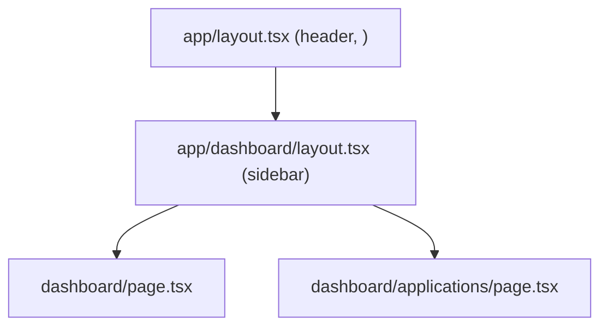

::part[Learn the Concept]{n="1"}

## 🎯 What you'll learn

- Folders = route segments, `page.tsx` = a public URL
- Root and nested **layouts** that persist across navigation
- **Dynamic segments** (`[id]`), catch-all (`[...slug]`), and `params` as a Promise
- `searchParams` in pages, and the `PageProps`/`LayoutProps` type helpers
- **Route groups** `(auth)` and **private folders** `_components`
- Special files: `loading.tsx`, `not-found.tsx`, `error.tsx` (lesson 04), `route.ts` (Route Handlers)
- Colocation and project organization

## 🧠 The big idea

The `app/` folder is a **building floor plan**: each folder is a hallway (URL segment), a `page.tsx` is a door visitors can enter, and a `layout.tsx` is the hallway decoration everyone walking through that section sees. Walking deeper into the building keeps the outer decorations — layouts nest and stay put while pages change.

## ❓ Why does this exist?

Hand-configuring routes (like Flask's `@app.route` or a React Router config) spreads URL structure away from the code. File-based routing makes the URL structure **visible in the file tree**, enables per-route code splitting automatically, and lets Next.js prerender, stream and cache per segment.

## 💥 What happens if we DON'T use it well?

- Everything in `app/page.tsx` with `?tab=` switches → no deep links, no per-page loading states, huge bundles.
- Duplicating the header/sidebar markup in every page → state (like a sidebar's scroll) resets on every navigation.
- A `components/` folder inside `app/jobs/` without an underscore **and** a `page.tsx` inside it → accidentally public URLs.

## 📖 How it works, step by step

### 1. Folders and pages

```text
app/
├── layout.tsx                → wraps everything (required: <html>, <body>)
├── page.tsx                  → /
├── jobs/
│   ├── page.tsx              → /jobs
│   └── [id]/
│       ├── page.tsx          → /jobs/42
│       ├── loading.tsx       → shown while /jobs/42 renders
│       └── not-found.tsx     → shown when notFound() is called
├── (auth)/                   → route group: not part of the URL
│   ├── login/page.tsx        → /login
│   └── register/page.tsx     → /register
├── dashboard/
│   ├── layout.tsx            → wraps /dashboard/*
│   ├── page.tsx              → /dashboard
│   └── applications/page.tsx → /dashboard/applications
├── jobs/_components/         → private: never routable
└── api/health/route.ts       → GET /api/health (Route Handler)
```

Only `page` and `route` files make a segment publicly accessible. Other files (components, utils) can live next to them safely.

### 2. Layouts

```tsx
// app/dashboard/layout.tsx
export default function DashboardLayout({ children }: { children: React.ReactNode }) {
  return (
    <div className="grid md:grid-cols-[16rem_1fr]">
      <aside aria-label="Dashboard">…</aside>
      <section>{children}</section>
    </div>
  );
}
```



Navigating between `/dashboard` and `/dashboard/applications` re-renders only the page; the layouts stay mounted and keep their state.

### 3. Dynamic segments and `params`

```tsx
// app/jobs/[id]/page.tsx
import { notFound } from "next/navigation";

export default async function JobPage({ params }: { params: Promise<{ id: string }> }) {
  const { id } = await params;                     // params is a Promise in Next.js 15+
  if (!/^[1-9]\d*$/.test(id)) notFound();          // validate URL input
  const job = await getJob(Number(id));
  if (!job) notFound();
  return <h1>{job.title}</h1>;
}
```

After `next dev`/`next build`, Next.js also generates global type helpers so you don't write the params type by hand:

```tsx
export default async function JobPage(props: PageProps<"/jobs/[id]">) {
  const { id } = await props.params;
}
```

| Folder | Matches | `params` |
|---|---|---|
| `[id]` | `/jobs/42` | `{ id: "42" }` |
| `[...slug]` | `/docs/a/b` | `{ slug: ["a", "b"] }` |
| `[[...slug]]` | `/docs` and `/docs/a/b` | `{ slug: undefined }` / `{ slug: ["a","b"] }` |

Params are always **strings** from the URL — validate and convert them, just like `request.args` in Flask.

### 4. Search params

```tsx
export default async function ApplicationsPage({ searchParams }: { searchParams: Promise<{ status?: string; page?: string }> }) {
  const { status, page } = await searchParams;
}
```

Reading `searchParams` makes the page render per request (it depends on the URL). In Client Components, use `useSearchParams()` (lesson 02).

### 5. Route groups and private folders

- `(marketing)`, `(auth)`, `(app)` — organize routes, give different sections different layouts, without changing URLs.
- `_components`, `_lib` — opt a folder out of routing entirely; a clear signal "not a route".

### 6. `loading.tsx` and `not-found.tsx`

```tsx
// app/jobs/[id]/loading.tsx
export default function Loading() {
  return <p role="status">Loading job…</p>;
}
```

`loading.tsx` wraps the page in a `<Suspense>` boundary automatically: navigation is instant, the layout stays interactive, and the content streams in. `not-found.tsx` renders when `notFound()` is called in that segment.

### 7. Colocation

Keep route-specific components, tests and styles next to the route (`app/jobs/_components/job-row.tsx`); put shared code in top-level `components/` and `lib/` with the `@/` alias. Next.js is unopinionated — pick one convention for the team.

:::fastapi
Flask and FastAPI define routes in Python decorators; Next.js defines them by files. Both use path parameters (`/jobs/<int:id>` / `/jobs/{id}` vs `app/jobs/[id]`) — and in all three, URL input must be validated.
:::

## ⚖️ Trade-offs

| Choice | ✅ | ❌ |
|---|---|---|
| File-based routing | URL structure visible, automatic code splitting | many files named `page.tsx` (configure editor tab labels) |
| Nested layouts | persistent UI and state, less duplication | layouts can't read `searchParams`; must plan structure |
| Route groups | organize and multiple layouts without URL changes | extra nesting to understand |
| Dynamic segments | one file for many pages | must validate params and handle not-found |

## ✅ When to use it / 🚫 When NOT to use it

- ✅ A route per meaningful page (shareable URL); layouts for shared chrome.
- ✅ `loading.tsx` for routes that fetch data; `not-found` for resources that may not exist.
- 🚫 Tabs within a small widget don't need routes; big sections usually do.
- 🚫 Don't put non-route code in folders without `_` if they might contain `page` files.

## 🏆 Best practices

- [ ] One root layout with `<html lang>`; section layouts for shared navigation.
- [ ] `await params`/`searchParams`, validate, and call `notFound()` for invalid or missing resources.
- [ ] Add `loading.tsx` (or `<Suspense>`) to routes that fetch data.
- [ ] Use route groups for sections with different layouts (marketing vs app vs auth).
- [ ] Mark non-route folders private with `_`; use the `@/` alias for shared code.
- [ ] Use `PageProps<'/route'>` / `LayoutProps` helpers for typed props.
- [ ] Keep pages thin: fetch + compose components.

## 🏭 How it's used in industry

- Most new Next.js apps use the App Router with route groups like `(marketing)` and `(dashboard)`.
- SEO-heavy sites (job portals, e-commerce) rely on one route per resource for indexing and sharing.
- Monorepos colocate route components and tests to keep features self-contained.

## ⚠️ Common mistakes

- Using `params.id` without `await` (Next.js 15+ made it a Promise).
- Treating params as numbers without validation.
- Putting `"use client"` on a layout, turning the entire subtree into client code.
- A `route.ts` and `page.tsx` in the same folder (conflict).

::part[Explain & Design]{n="2"}

## 🗣️ Explain it

Explain to a Flask developer how `app/jobs/[id]/page.tsx` compares to `@app.get("/jobs/<int:id>")`, including what's different about validation and 404s.

## 📐 Design it

Design the `app/` folder tree for CareerPilot Phase 4: public landing and pricing pages, login/register, a logged-in area with dashboard, applications list and detail (with notes tab), companies, settings, and an API proxy route. Show route groups, layouts, loading/not-found files and private component folders.

:::quiz
Show a possible tree

```text
app/
├── layout.tsx                         ← <html>, fonts, providers
├── (marketing)/
│   ├── layout.tsx                     ← public header/footer
│   ├── page.tsx                       → /
│   └── pricing/page.tsx               → /pricing
├── (auth)/
│   ├── layout.tsx                     ← centered card layout
│   ├── login/page.tsx                 → /login
│   └── register/page.tsx              → /register
├── (app)/
│   ├── layout.tsx                     ← sidebar + user menu; checks session
│   ├── dashboard/
│   │   ├── page.tsx                   → /dashboard
│   │   └── loading.tsx
│   ├── applications/
│   │   ├── page.tsx                   → /applications?status=&page=
│   │   ├── loading.tsx
│   │   ├── _components/application-row.tsx
│   │   └── [id]/
│   │       ├── layout.tsx             ← application header + tabs (Overview | Notes)
│   │       ├── page.tsx               → /applications/12
│   │       ├── notes/page.tsx         → /applications/12/notes
│   │       ├── loading.tsx
│   │       ├── not-found.tsx
│   │       └── error.tsx
│   ├── companies/[id]/page.tsx        → /companies/3
│   └── settings/page.tsx              → /settings
├── api/
│   └── [...path]/route.ts             → /api/* proxy to Flask with the session token (BFF)
└── not-found.tsx                      ← app-wide 404
```

The three route groups give marketing, auth and app pages different layouts while URLs stay clean; the application detail layout keeps its header and tabs mounted while switching between Overview and Notes.
:::

### 📝 Self-review checklist

- [ ] URLs are clean and shareable
- [ ] Layouts match sections of the UI
- [ ] Loading/not-found/error at data routes

::ai-review{task="design"}

::part[Toy Exercise]{n="3"}

:::exercise{path="exercises/web/m4/w4/01-routing-layouts" ai="no-ai" title="Build the route files of a small app"}
Write `routeFromFile()` to map App Router files to URLs (route groups, private folders, route handlers), then create real `layout`, `page`, dynamic `[id]` page with awaited params and `notFound()`, `loading`, `not-found`, a route group page and a nested layout. Tests import and render your files like Next.js would.
:::

:::hints
- In `routeFromFile`, drop `app`, the file name, and every `(group)` folder; return `null` if any folder starts with `_`.
- The dynamic page: `const { id } = await params;` then validate with `/^[1-9]\d*$/`.
- `notFound()` throws, so code after it never runs — TypeScript knows this (`never`).
:::

## ✅ Quick check

:::quiz
Does `app/(auth)/login/page.tsx` create `/auth/login` or `/login`?

`/login` — route groups in parentheses aren't part of the URL.
:::

:::quiz
What does a layout keep across navigation that a page doesn't?

Layouts stay mounted (with their state) when navigating between their child pages; only the page part re-renders.
:::

## 📖 Kamus (glossary)

| Term | Bahasa Indonesia |
|---|---|
| Route segment | Segmen rute (bagian URL) |
| Layout | Tata letak bersama |
| Dynamic segment | Segmen dinamis (`[id]`) |
| Route group | Grup rute (tidak masuk URL) |
| Private folder | Folder privat (tidak jadi rute) |
| Colocation | Menaruh kode terkait berdekatan |

## 📚 Keep learning

- Next.js docs (bundled in `node_modules/next/dist/docs`): Layouts and Pages, Project Structure, Dynamic Routes
- [Next.js docs: Layouts and Pages](https://nextjs.org/docs/app/getting-started/layouts-and-pages)
