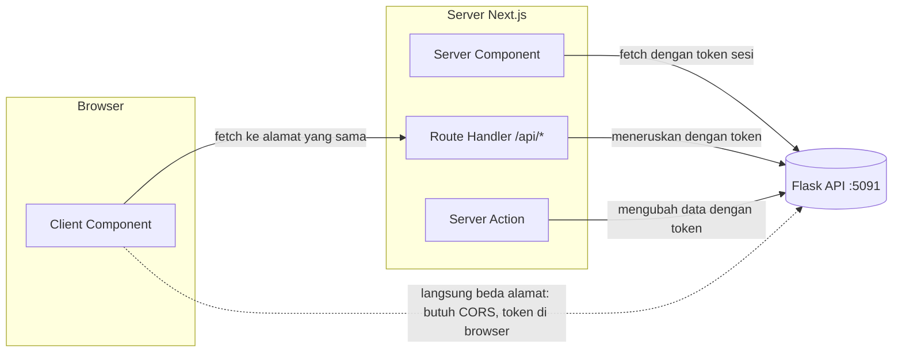

::part[Pelajari Konsepnya]{n="1"}

## 🎯 Yang akan kamu pelajari

- Tiga tempat untuk memanggil API-mu: Server Component, Route Handler, Client Component
- Satu API client ber-type untuk Flask API-mu
- `ApiError` berisi status, kode error, dan error per field
- Error **yang diperkirakan** (tampilkan layar yang ramah) vs **tak terduga** (jaring pengaman)
- `redirect()` untuk 401, `notFound()` untuk 404, `error.tsx` dengan tombol coba lagi
- Kapan CORS berperan

## 🔤 Istilah penting

| Istilah | Artinya (sederhana) |
|---|---|
| **API client** | Satu file yang tahu cara berbicara dengan API-mu |
| **Route Handler** | Endpoint API kecil di dalam Next.js (`app/api/.../route.ts`) |
| **BFF** | Server Next.js-mu memanggil Flask untuk browser dan menambahkan token |
| **Expected error** | Error yang sudah kamu rencanakan: password salah, tidak ditemukan, form tidak valid |
| **Unexpected error** | Kejutan: server crash, jaringan putus, bug |
| **Error boundary** | Jaring pengaman yang menangkap crash dan menampilkan layar pengganti (`error.tsx`) |
| **CORS** | Aturan browser untuk memanggil API di alamat yang berbeda |
| **httpOnly cookie** | Cookie yang tidak bisa dibaca JavaScript — lebih aman untuk token sesi |

## 🧠 Ide besarnya

Flask API dan aplikasi Next.js-mu berbicara lewat **penerjemah** — API client. Satu penerjemah yang hafal kamusnya (URL, header, kode error) jauh lebih baik daripada setiap component mengarang kalimatnya sendiri.

Dan seperti percakapan lain, sebagian masalah sudah **diperkirakan** ("password salah", "tidak ditemukan") dan layak mendapat jawaban yang sopan. Sebagian lagi adalah **kejutan** ("server crash") dan butuh jaring pengaman — seperti pertunjukan sirkus yang sudah merencanakan triknya, tapi tetap memasang jaring di bawahnya.

## ❓ Kenapa ini penting

API sungguhan bisa gagal: token kedaluwarsa, validasi menolak input, server restart, jaringan putus. Kalau setiap component memanggil `fetch` dengan caranya sendiri, sebagian halaman crash, sebagian menampilkan JSON mentah, sebagian spinner-nya berputar selamanya.

```tsx
export default async function Page() {
  const res = await fetch("http://localhost:5091/api/v1/applications");   // no auth, no error handling
  const { data } = await res.json();                                     // 401 body → data undefined
  return data.map((a) => <li>{a.role}</li>);                             // 💥 crash → generic 500 page
}
```

Tanpa token, tanpa pengecekan error: response 401 membuat `data` bernilai undefined dan halaman crash.

## 📖 Langkah demi langkah

### 1. Di mana request sebaiknya dijalankan?



| Tempat | Dipakai untuk | Catatan |
|---|---|---|
| **Server Component** | membaca data untuk halaman | token tetap di server |
| **Server Action** | menyimpan data dari form dan tombol | Minggu 5; cek login pengguna di dalamnya |
| **Route Handler (BFF)** | request dari browser, webhook | alamat sama dengan situsnya → tanpa CORS |
| **Client Component → Flask langsung** | hanya data publik yang tidak sensitif | butuh CORS; token akan ada di browser |

Untuk CareerPilot: halaman **membaca** di Server Component, **perubahan** lewat Server Action atau Route Handler, dan browser tidak pernah memegang token Flask kalau sesi disimpan di **httpOnly cookie** (Minggu 5). Seperti restoran: pelanggan memesan di kasir (Next.js), dan hanya staf yang masuk ke dapur (Flask).

### 2. API client ber-type

```ts
export class ApiError extends Error {
  constructor(public readonly status: number, public readonly code: string, message: string, public readonly fields?: Record<string, string[]>) {
    super(message);
    this.name = "ApiError";
  }
}

export function createApiClient({ baseUrl, getToken, fetchImpl = fetch }: ClientOptions) {
  async function request<T>(path: string, query: Record<string, string | number | undefined> = {}): Promise<T> {
    const url = new URL(path, baseUrl);
    for (const [key, value] of Object.entries(query)) if (value !== undefined) url.searchParams.set(key, String(value));

    let response: Response;
    try {
      response = await fetchImpl(url, {
        headers: { Accept: "application/json", ...(getToken() ? { Authorization: `Bearer ${getToken()}` } : {}) },
        cache: "no-store",
      });
    } catch {
      throw new ApiError(0, "network_error", "Could not reach the CareerPilot API");
    }

    const body = await response.json().catch(() => null);
    if (!response.ok) {
      const error = body?.error;
      throw new ApiError(response.status, error?.code ?? "unknown_error", error?.message ?? `Request failed (${response.status})`, error?.fields);
    }
    return body as T;
  }

  return {
    listApplications: (filters: { status?: Status; page?: number } = {}) => request<ApplicationList>("/api/v1/applications", filters),
  };
}
```

- Client ini tahu **kontrak** API-mu dari Modul 2: bentuk `{ data, meta }`, kode error, dan error per field.
- Jaringan gagal → `ApiError` dengan status `0` dan kode `network_error`.
- Component hanya memanggil function sederhana seperti `listApplications()`.
- `cache: "no-store"` — jangan meng-cache data pribadi.

### 3. Error yang diperkirakan vs tak terduga

| Situasi | Jenis | Yang dilakukan |
|---|---|---|
| 401 (sesi habis) | diperkirakan | `redirect("/login?next=…")` |
| 404 tidak ditemukan | diperkirakan | `notFound()` → `not-found.tsx` |
| 422 data form tidak valid | diperkirakan | tampilkan error per field di form (Minggu 5) |
| 409 aksi tidak diizinkan | diperkirakan | tampilkan pesan di samping tombol |
| 500, jaringan mati, bug | tak terduga | lempar → `error.tsx` terdekat |

```tsx
export default async function ApplicationsPage({ searchParams }: PageProps<"/applications">) {
  const api = await getServerApi();
  try {
    const { data, meta } = await api.listApplications(await parseFilters(searchParams));
    return <ApplicationsList applications={data} meta={meta} />;
  } catch (error) {
    if (error instanceof ApiError && error.status === 401) redirect("/login?next=/applications");
    throw error;
  }
}
```

Penting: `redirect()` dan `notFound()` bekerja dengan **melempar** sinyal khusus. Kalau `catch`-mu menelan semuanya, keduanya berhenti berfungsi. Tangani yang sudah kamu perkirakan, lalu `throw error` lagi untuk sisanya.

### 4. Layar error (`error.tsx`)

```tsx
// app/applications/error.tsx
"use client";

import { useEffect } from "react";

export default function ApplicationsError({ error, retry }: { error: Error & { digest?: string }; retry: () => void }) {
  useEffect(() => {
    console.error(error);                    // report to Sentry or similar in production
  }, [error]);

  return (
    <div role="alert">
      <h2>We couldn&apos;t load your applications</h2>
      <button onClick={() => retry()}>Try again</button>
    </div>
  );
}
```

- Menangkap crash di bagian aplikasinya, sementara layout di atasnya tetap berfungsi — seperti **MCB listrik** yang hanya mematikan satu ruangan, bukan seluruh rumah.
- `retry()` memuat dan menggambar bagian itu lagi.
- Harus berupa Client Component (`"use client"`).
- Di production, detail error server disembunyikan dari pengguna; `digest` menghubungkan error dengan log server.
- `global-error.tsx` menangkap error di root layout itu sendiri dan harus berisi `<html>` dan `<body>`-nya sendiri.

### 5. Loading dan gagal sebagian

Beri setiap halaman data sebuah `loading.tsx` atau `<Suspense>`. Untuk dashboard dengan widget yang berdiri sendiri, beri setiap widget penanganan loading dan error-nya sendiri, agar satu panggilan API yang gagal tidak mengosongkan seluruh halaman.

### 6. CORS dalam satu menit

Kalau Client Component di `http://localhost:3091` memanggil `http://localhost:5091` secara langsung, Flask harus mengizinkan alamat itu (`flask-cors` dengan daftar yang eksplisit). Panggilan dari Server Component, Server Action, dan Route Handler adalah antar server, jadi CORS sama sekali tidak berlaku.

## ⚠️ Kesalahan umum

- `catch` yang menelan semuanya, termasuk `redirect()` dan `notFound()`.
- Mengira `fetch` melempar error untuk 404 atau 500 (tidak — cek `response.ok`).
- `error.tsx` tanpa `"use client"`.
- Menulis `http://localhost:5091` langsung di dalam component.
- Menampilkan pesan error mentah atau stack trace ke pengguna.
- Meng-cache response yang berisi data pribadi.

## 🏆 Praktik terbaik

- [ ] Satu API client: base URL, header, parsing JSON, dan pemetaan error di satu tempat.
- [ ] Ubah kode error API menjadi pesan yang ramah di satu tempat.
- [ ] Tangani error yang diperkirakan dengan sengaja; biarkan yang tak terduga sampai ke `error.tsx`.
- [ ] Tambahkan `error.tsx` dan `loading.tsx` ke halaman data, dan sebuah `global-error.tsx`.
- [ ] Catat error (dengan request id dari Flask) ke monitoring.
- [ ] Simpan token di server; jangan cache data pribadi.
- [ ] Cek param URL sebelum dikirim ke API.
- [ ] Tambahkan timeout (`AbortSignal.timeout`) untuk API yang lambat.

::part[Jelaskan & Rancang]{n="2"}

## 🗣️ Jelaskan

Dengan ide jaring sirkus, jelaskan ke rekan tim beda error yang diperkirakan dan yang tak terduga di halaman lamaran, dengan satu contoh masing-masing dan di mana ditanganinya.

## 📐 Rancang

Rencanakan penanganan error untuk **halaman detail lamaran** CareerPilot (`/applications/[id]`). Halaman ini memuat lamaran, catatannya, dan ringkasan perusahaan lewat tiga panggilan API. Cakup: id yang tidak valid, 401, 403, 404, satu widget gagal, API mati, dan endpoint perusahaan yang lambat.

:::quiz
Tampilkan contoh rencananya

| Kasus | Di mana ditangkap | Yang dilihat pengguna |
|---|---|---|
| id bukan bilangan bulat positif | halaman (cek params) | `notFound()` → "Lamaran tidak ditemukan" + link ke daftar |
| 401 di panggilan mana pun | API client → halaman | `redirect("/login?next=/applications/12")` |
| 403 (lamaran milik orang lain) | API sengaja mengembalikan 404 (Modul 2) | sama dengan tidak ditemukan — jangan beri tahu bahwa lamarannya ada |
| 404 lamaran | halaman | `notFound()` |
| Panggilan catatan gagal (500) | `<Suspense>` + error boundary kecil di sekitar `<NotesSection>` | "Catatan gagal dimuat" + Coba lagi; bagian lain tetap berfungsi |
| Ringkasan perusahaan lambat (3 detik) | `<Suspense fallback={<CompanySkeleton />}>` | halaman langsung tampil; info perusahaan muncul belakangan; setelah `AbortSignal.timeout(5000)` → "Info perusahaan tidak tersedia" |
| API mati total | panggilan lamaran melempar `network_error` | `app/applications/[id]/error.tsx`: "Kami tidak bisa menjangkau CareerPilot saat ini" + Coba lagi; error dilaporkan |
| Bug saat render | error boundary | boundary yang sama; peringatan di monitoring |

Struktur:

```tsx
export default async function Page(props: PageProps<"/applications/[id]">) {
  const id = parseId((await props.params).id) ?? notFound();
  const application = await loadOrHandle(() => api.getApplication(id));   // 401 → redirect, 404 → notFound, else throw
  return (
    <>
      <ApplicationHeader application={application} />
      <SectionBoundary title="Notes"><Suspense fallback={<NotesSkeleton />}><NotesSection id={id} /></Suspense></SectionBoundary>
      <SectionBoundary title="Company"><Suspense fallback={<CompanySkeleton />}><CompanySummary companyId={application.company.id} /></Suspense></SectionBoundary>
    </>
  );
}
```
:::

### 📝 Checklist self-review

- [ ] Setiap error punya penanggung jawab dan tampilannya
- [ ] Satu bagian yang gagal tidak mengosongkan halaman
- [ ] "Tidak punya izin" tidak membocorkan bahwa datanya ada

::ai-review{task="design"}

::part[Latihan Kecil]{n="3"}

:::exercise{path="exercises/web/m4/w4/04-api-integration" ai="no-ai" title="API client ber-type, redirect, dan error boundary"}
Tulis API client untuk Flask API Fase 2 yang mengubah response error dan kegagalan jaringan menjadi `ApiError`, halaman Server Component yang mengecek search params, redirect saat 401, dan membiarkan error lain sampai ke error boundary, plus `error.tsx` dengan `retry()` dan `loading.tsx`.
:::

:::hints
- `new URL(path, baseUrl)` + `url.searchParams.set` menyusun query dengan aman.
- `await response.json().catch(() => null)` menangani halaman error yang bukan JSON.
- Di halaman: `catch (error) { if (error instanceof ApiError && error.status === 401) redirect(...); throw error; }`.
:::

## ✅ Cek cepat

:::quiz
Kenapa error yang tidak kamu tangani di `catch` Server Component harus dilempar lagi?

Next.js memakai sinyal yang dilempar untuk `redirect()` dan `notFound()`, dan error tak terduga harus sampai ke `error.tsx`. Menelannya merusak navigasi dan menyembunyikan kegagalan.
:::

:::quiz
Kapan memanggil Flask API butuh CORS?

Saat kode browser memanggilnya langsung dari alamat yang berbeda. Panggilan dari Server Component, Server Action, atau Route Handler tidak memakai CORS.
:::

## 📚 Lanjut belajar

- Dokumentasi Next.js (tersedia di dalam proyek): Error Handling; Fetching Data; Route Handlers; panduan Backend for Frontend
- [MDN: Cross-Origin Resource Sharing](https://developer.mozilla.org/en-US/docs/Web/HTTP/Guides/CORS)
