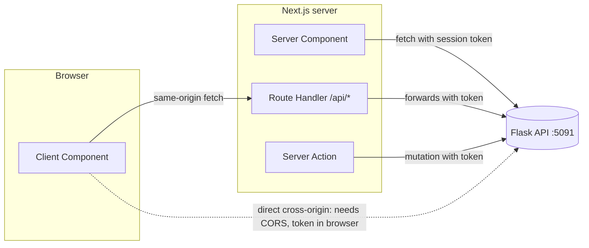

::part[Learn the Concept]{n="1"}

## 🎯 What you'll learn

- Three places to call your API: Server Components, Route Handlers, Client Components
- One typed API client for your Flask API
- `ApiError` with the status, error code and field errors
- **Expected** errors (show a friendly screen) vs **unexpected** errors (safety net)
- `redirect()` for 401, `notFound()` for 404, `error.tsx` with a retry button
- When CORS matters

## 🔤 Key words

| Word | In simple words | Bahasa Indonesia |
|---|---|---|
| **API client** | One file that knows how to talk to your API | Pemanggil API |
| **Route Handler** | A small API endpoint inside Next.js (`app/api/.../route.ts`) | Endpoint di Next.js |
| **BFF** | Your Next.js server calls Flask for the browser and adds the token | Server perantara |
| **Expected error** | An error you plan for: wrong password, not found, invalid form | Error yang diperkirakan |
| **Unexpected error** | A surprise: server crashed, network down, a bug | Error tak terduga |
| **Error boundary** | A safety net that catches crashes and shows a fallback screen (`error.tsx`) | Jaring pengaman error |
| **CORS** | A browser rule for calling an API on a different address | Izin lintas situs |
| **httpOnly cookie** | A cookie JavaScript can't read — safer for session tokens | Cookie aman |

## 🧠 The big idea

Your Flask API and your Next.js app talk through a **translator** — the API client. One translator who knows the dictionary (URLs, headers, error codes) is much better than every component making up its own phrases.

And like any conversation, some problems are **expected** ("wrong password", "not found") and deserve a polite answer. Others are **surprises** ("the server crashed") and need a safety net — like a circus act that plans the tricks, but still has a net underneath.

## ❓ Why it matters

Real APIs fail: tokens expire, validation rejects input, servers restart, networks drop. If each component calls `fetch` its own way, some pages crash, some show raw JSON, some spin forever.

```tsx
export default async function Page() {
  const res = await fetch("http://localhost:5091/api/v1/applications");   // no auth, no error handling
  const { data } = await res.json();                                     // 401 body → data undefined
  return data.map((a) => <li>{a.role}</li>);                             // 💥 crash → generic 500 page
}
```

No token, no error check: a 401 response makes `data` undefined and the page crashes.

## 📖 Step by step

### 1. Where should the request run?



| Where | Use for | Notes |
|---|---|---|
| **Server Component** | reading data for a page | the token stays on the server |
| **Server Action** | saving data from forms and buttons | Week 5; check the user's login inside |
| **Route Handler (BFF)** | browser requests, webhooks | same address as the site → no CORS |
| **Client Component → Flask directly** | public, non-sensitive data only | needs CORS; the token would be in the browser |

For CareerPilot: pages **read** in Server Components, **changes** go through Server Actions or Route Handlers, and the browser never holds the Flask token if the session is in an **httpOnly cookie** (Week 5). Like a restaurant: customers order at the counter (Next.js), and only the staff go into the kitchen (Flask).

### 2. A typed API client

```ts
export class ApiError extends Error {
  constructor(public readonly status: number, public readonly code: string, message: string, public readonly fields?: Record<string, string[]>) {
    super(message);
    this.name = "ApiError";
  }
}

export function createApiClient({ baseUrl, getToken, fetchImpl = fetch }: ClientOptions) {
  async function request<T>(path: string, query: Record<string, string | number | undefined> = {}): Promise<T> {
    const url = new URL(path, baseUrl);
    for (const [key, value] of Object.entries(query)) if (value !== undefined) url.searchParams.set(key, String(value));

    let response: Response;
    try {
      response = await fetchImpl(url, {
        headers: { Accept: "application/json", ...(getToken() ? { Authorization: `Bearer ${getToken()}` } : {}) },
        cache: "no-store",
      });
    } catch {
      throw new ApiError(0, "network_error", "Could not reach the CareerPilot API");
    }

    const body = await response.json().catch(() => null);
    if (!response.ok) {
      const error = body?.error;
      throw new ApiError(response.status, error?.code ?? "unknown_error", error?.message ?? `Request failed (${response.status})`, error?.fields);
    }
    return body as T;
  }

  return {
    listApplications: (filters: { status?: Status; page?: number } = {}) => request<ApplicationList>("/api/v1/applications", filters),
  };
}
```

- The client knows your API's **contract** from Module 2: the `{ data, meta }` shape, error codes and field errors.
- Network failure → `ApiError` with status `0` and code `network_error`.
- Components only call simple functions like `listApplications()`.
- `cache: "no-store"` — don't cache personal data.

### 3. Expected vs unexpected errors

| Situation | Type | What to do |
|---|---|---|
| 401 (session expired) | expected | `redirect("/login?next=…")` |
| 404 not found | expected | `notFound()` → `not-found.tsx` |
| 422 invalid form data | expected | show field errors in the form (Week 5) |
| 409 action not allowed | expected | show a message next to the button |
| 500, network down, a bug | unexpected | throw → the nearest `error.tsx` |

```tsx
export default async function ApplicationsPage({ searchParams }: PageProps<"/applications">) {
  const api = await getServerApi();
  try {
    const { data, meta } = await api.listApplications(await parseFilters(searchParams));
    return <ApplicationsList applications={data} meta={meta} />;
  } catch (error) {
    if (error instanceof ApiError && error.status === 401) redirect("/login?next=/applications");
    throw error;
  }
}
```

Important: `redirect()` and `notFound()` work by **throwing** special signals. If your `catch` swallows everything, they stop working. Handle what you expect, then `throw error` again for everything else.

### 4. Error screens (`error.tsx`)

```tsx
// app/applications/error.tsx
"use client";

import { useEffect } from "react";

export default function ApplicationsError({ error, retry }: { error: Error & { digest?: string }; retry: () => void }) {
  useEffect(() => {
    console.error(error);                    // report to Sentry or similar in production
  }, [error]);

  return (
    <div role="alert">
      <h2>We couldn&apos;t load your applications</h2>
      <button onClick={() => retry()}>Try again</button>
    </div>
  );
}
```

- It catches crashes in its part of the app, while the layout above keeps working — like a **circuit breaker** that turns off one room, not the whole house.
- `retry()` loads and draws that part again.
- It must be a Client Component (`"use client"`).
- In production, server error details are hidden from users; the `digest` connects the error to the server logs.
- `global-error.tsx` catches errors in the root layout itself and must include its own `<html>` and `<body>`.

### 5. Loading and partial failure

Give every data page a `loading.tsx` or `<Suspense>`. For a dashboard with independent widgets, give each widget its own loading and error handling, so one failing API call doesn't blank the whole page.

### 6. CORS in one minute

If a Client Component on `http://localhost:3091` calls `http://localhost:5091` directly, Flask must allow that address (`flask-cors` with an explicit list). Calls from Server Components, Server Actions and Route Handlers are server-to-server, so CORS doesn't apply at all.

## ⚠️ Common mistakes

- A `catch` that swallows everything, including `redirect()` and `notFound()`.
- Thinking `fetch` throws on 404 or 500 (it doesn't — check `response.ok`).
- `error.tsx` without `"use client"`.
- Hardcoding `http://localhost:5091` inside components.
- Showing raw error messages or stack traces to users.
- Caching responses that contain personal data.

## 🏆 Best practices

- [ ] One API client: base URL, headers, JSON parsing and error mapping in one place.
- [ ] Turn API error codes into friendly messages in one place.
- [ ] Handle expected errors on purpose; let unexpected ones reach `error.tsx`.
- [ ] Add `error.tsx` and `loading.tsx` to data pages, and a `global-error.tsx`.
- [ ] Log errors (with request ids from Flask) to monitoring.
- [ ] Keep tokens on the server; don't cache personal data.
- [ ] Check URL params before sending them to the API.
- [ ] Add timeouts (`AbortSignal.timeout`) for slow APIs.

::part[Explain & Design]{n="2"}

## 🗣️ Explain it

Using the circus-net idea, explain to a teammate the difference between an expected and an unexpected error on the applications page, with one example of each and where it's handled.

## 📐 Design it

Plan the error handling for CareerPilot's **application detail page** (`/applications/[id]`). It loads the application, its notes and a company summary with three API calls. Cover: an invalid id, 401, 403, 404, one widget failing, the API being down, and a slow company endpoint.

:::quiz
Show a possible plan

| Case | Where it's caught | What the user sees |
|---|---|---|
| id isn't a positive whole number | page (params check) | `notFound()` → "Application not found" + link to the list |
| 401 on any call | API client → page | `redirect("/login?next=/applications/12")` |
| 403 (someone else's application) | the API returns 404 on purpose (Module 2) | same as not found — don't reveal it exists |
| 404 application | page | `notFound()` |
| Notes call fails (500) | `<Suspense>` + a small error boundary around `<NotesSection>` | "Notes couldn't load" + Retry; the rest works |
| Company summary is slow (3 s) | `<Suspense fallback={<CompanySkeleton />}>` | the page shows immediately; company info appears later; after `AbortSignal.timeout(5000)` → "Company info unavailable" |
| API completely down | the application call throws `network_error` | `app/applications/[id]/error.tsx`: "We can't reach CareerPilot right now" + Retry; error reported |
| A rendering bug | error boundary | same boundary; alert in monitoring |

Structure:

```tsx
export default async function Page(props: PageProps<"/applications/[id]">) {
  const id = parseId((await props.params).id) ?? notFound();
  const application = await loadOrHandle(() => api.getApplication(id));   // 401 → redirect, 404 → notFound, else throw
  return (
    <>
      <ApplicationHeader application={application} />
      <SectionBoundary title="Notes"><Suspense fallback={<NotesSkeleton />}><NotesSection id={id} /></Suspense></SectionBoundary>
      <SectionBoundary title="Company"><Suspense fallback={<CompanySkeleton />}><CompanySummary companyId={application.company.id} /></Suspense></SectionBoundary>
    </>
  );
}
```
:::

### 📝 Self-review checklist

- [ ] Every error has an owner and a screen
- [ ] One failing part doesn't blank the page
- [ ] "No permission" doesn't reveal that the item exists

::ai-review{task="design"}

::part[Toy Exercise]{n="3"}

:::exercise{path="exercises/web/m4/w4/04-api-integration" ai="no-ai" title="Typed API client, redirects and error boundaries"}
Write an API client for the Phase 2 Flask API that turns error responses and network failures into `ApiError`, a Server Component page that checks search params, redirects on 401 and lets other errors reach the error boundary, plus `error.tsx` with `retry()` and `loading.tsx`.
:::

:::hints
- `new URL(path, baseUrl)` + `url.searchParams.set` builds the query safely.
- `await response.json().catch(() => null)` handles error pages that aren't JSON.
- In the page: `catch (error) { if (error instanceof ApiError && error.status === 401) redirect(...); throw error; }`.
:::

## ✅ Quick check

:::quiz
Why must you throw again the errors you don't handle in a Server Component `catch`?

Next.js uses thrown signals for `redirect()` and `notFound()`, and unexpected errors must reach `error.tsx`. Swallowing them breaks navigation and hides failures.
:::

:::quiz
When does calling the Flask API need CORS?

When browser code calls it directly from a different address. Server calls from Server Components, Server Actions or Route Handlers don't use CORS.
:::

## 📚 Keep learning

- Next.js docs (bundled): Error Handling; Fetching Data; Route Handlers; Backend for Frontend guide
- [MDN: Cross-Origin Resource Sharing](https://developer.mozilla.org/en-US/docs/Web/HTTP/Guides/CORS)
