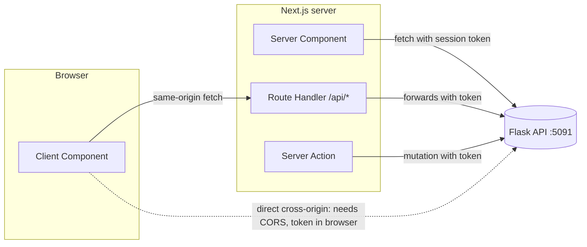

::part[Learn the Concept]{n="1"}

## 🎯 What you'll learn

- Three places to call your API: Server Components, Route Handlers (BFF), Client Components
- A typed API client for the Phase 2 contract (`{ data, meta }`, `{ error: { code, fields } }`)
- `ApiError` with status, code and field errors
- **Expected** errors (return and render) vs **unexpected** errors (throw → `error.tsx`)
- `redirect()` on 401, `notFound()` on 404, `error.tsx` with `retry()`, `global-error.tsx`
- CORS vs same-origin calls, and why BFF often avoids it
- Timeouts and not caching personal data

## 🧠 The big idea

Your Flask API and your Next.js app speak through a **translator** — the API client. One translator who knows the dictionary (URLs, headers, error codes) is far better than every component improvising its own phrasebook. And like any conversation, some misunderstandings are **expected** ("wrong password", "not found") and deserve a polite reply, while others are **surprises** ("server crashed") that need a safety net.

## ❓ Why does this exist?

Real APIs fail: tokens expire, validation rejects input, servers restart, networks drop. If each component calls `fetch` differently, error handling becomes inconsistent: some pages crash, some show raw JSON, some redirect, some spin forever. Centralizing the client and choosing an error strategy per error type makes the app predictable.

## 💥 What happens if we DON'T?

```tsx
export default async function Page() {
  const res = await fetch("http://localhost:5091/api/v1/applications");   // no auth, no error handling
  const { data } = await res.json();                                     // 401 body → data undefined
  return data.map((a) => <li>{a.role}</li>);                             // 💥 crash → generic 500 page
}
```

## 📖 How it works, step by step

### 1. Where should the request run?



| Where | Use for | Notes |
|---|---|---|
| **Server Component** | reading data for a page | token from cookies stays on the server; no loading waterfall in the browser |
| **Server Action** | mutations from forms/buttons | Week 5; check auth inside |
| **Route Handler (BFF)** | browser-initiated reads, webhooks, proxies | same origin → no CORS; add auth server-side |
| **Client Component → API directly** | public, non-sensitive data | requires CORS on Flask; exposes API URL and any token in the browser |

For CareerPilot: pages read in Server Components, mutations use Server Actions or Route Handlers, and the browser never holds the Flask JWT if you store the session in an **httpOnly cookie** (Week 5).

### 2. A typed client

```ts
export class ApiError extends Error {
  constructor(public readonly status: number, public readonly code: string, message: string, public readonly fields?: Record<string, string[]>) {
    super(message);
    this.name = "ApiError";
  }
}

export function createApiClient({ baseUrl, getToken, fetchImpl = fetch }: ClientOptions) {
  async function request<T>(path: string, query: Record<string, string | number | undefined> = {}): Promise<T> {
    const url = new URL(path, baseUrl);
    for (const [key, value] of Object.entries(query)) if (value !== undefined) url.searchParams.set(key, String(value));

    let response: Response;
    try {
      response = await fetchImpl(url, {
        headers: { Accept: "application/json", ...(getToken() ? { Authorization: `Bearer ${getToken()}` } : {}) },
        cache: "no-store",
      });
    } catch {
      throw new ApiError(0, "network_error", "Could not reach the CareerPilot API");
    }

    const body = await response.json().catch(() => null);
    if (!response.ok) {
      const error = body?.error;
      throw new ApiError(response.status, error?.code ?? "unknown_error", error?.message ?? `Request failed (${response.status})`, error?.fields);
    }
    return body as T;
  }

  return {
    listApplications: (filters: { status?: Status; page?: number } = {}) => request<ApplicationList>("/api/v1/applications", filters),
  };
}
```

The client knows the **contract** from Module 2: JSON envelopes, error codes, field errors. Components know only `listApplications()`. Consider generating types from the Flask OpenAPI spec so drift becomes a compile error.

### 3. Expected vs unexpected errors

| Situation | Type | Handling |
|---|---|---|
| 401 unauthorized (expired session) | expected | `redirect("/login?next=…")` |
| 404 not found | expected | `notFound()` → `not-found.tsx` |
| 422 validation failed | expected | return field errors to the form (Week 5) |
| 409 invalid transition | expected | show a message near the control |
| 500, network down, bug in rendering | unexpected | throw → nearest `error.tsx` |

```tsx
export default async function ApplicationsPage({ searchParams }: PageProps<"/applications">) {
  const api = await getServerApi();
  try {
    const { data, meta } = await api.listApplications(await parseFilters(searchParams));
    return <ApplicationsList applications={data} meta={meta} />;
  } catch (error) {
    if (error instanceof ApiError && error.status === 401) redirect("/login?next=/applications");
    throw error;
  }
}
```

(`redirect` and `notFound` work by throwing special errors — don't swallow them in a broad `catch`; rethrow anything you don't handle.)

### 4. Error boundaries

```tsx
// app/applications/error.tsx
"use client";

import { useEffect } from "react";

export default function ApplicationsError({ error, retry }: { error: Error & { digest?: string }; retry: () => void }) {
  useEffect(() => {
    console.error(error);                    // report to Sentry or similar in production
  }, [error]);

  return (
    <div role="alert">
      <h2>We couldn&apos;t load your applications</h2>
      <button onClick={() => retry()}>Try again</button>
    </div>
  );
}
```

- Catches errors thrown while rendering its segment (and children), keeps the layout above it working.
- `retry()` re-fetches and re-renders the segment (in Next.js 16.3, `retry` became the recommended prop; `reset` only clears the error state).
- In production, server error messages are hidden from the browser; the `digest` links the client error to server logs.
- `global-error.tsx` catches errors in the root layout itself and must render its own `<html>` and `<body>`.

### 5. Loading and partial failure

Pair every data route with `loading.tsx` or `<Suspense>`. For dashboards with independent widgets, give each widget its own Suspense + error handling so one failing API call doesn't blank the whole page.

### 6. CORS in one minute (again)

If a Client Component on `http://localhost:3091` calls `http://localhost:5091` directly, Flask must allow that origin (`flask-cors` with an explicit list, credentials only if needed). Calls from Server Components, Server Actions and Route Handlers are server-to-server and don't involve CORS at all.

## ⚖️ Trade-offs

| Choice | ✅ | ❌ |
|---|---|---|
| Fetch in Server Components | secure tokens, fast first render, less client JS | server must reach the API; every navigation hits the server |
| BFF Route Handlers | same origin, hide API details, add caching/auth | extra layer to maintain |
| Direct browser → API | simple for public APIs | CORS, token exposure, more client code |
| Throwing unexpected errors | boundaries catch consistently | must not throw for expected cases |
| Returning expected errors | precise UX | more branching code |

## ✅ When to use it / 🚫 When NOT to use it

- ✅ One API client module per backend; typed resource functions.
- ✅ `redirect` for auth, `notFound` for missing resources, `error.tsx` for surprises.
- 🚫 Don't show raw error messages or stack traces to users.
- 🚫 Don't cache responses that contain personal data.

## 🏆 Best practices

- [ ] Centralize base URL, headers, JSON parsing and error mapping in one client.
- [ ] Map API error codes to user-friendly messages in one place.
- [ ] Handle expected errors explicitly; let unexpected ones reach `error.tsx`.
- [ ] Add `error.tsx` + `loading.tsx` to data routes; add `global-error.tsx`.
- [ ] Log errors (with request ids from the Flask API) to monitoring.
- [ ] Keep tokens server-side; use `cache: "no-store"` (or no caching) for personal data.
- [ ] Validate URL params before sending them to the API.
- [ ] Add timeouts (`AbortSignal.timeout`) for slow upstreams.

## 🏭 How it's used in industry

- BFF layers are common in larger companies: the web app has its own server that aggregates internal microservices (Module 5).
- Error monitoring (Sentry, Datadog) is wired into `error.tsx`/`global-error.tsx` and server instrumentation.
- API clients are generated from OpenAPI (Orval, openapi-fetch) so frontend and Flask/FastAPI contracts stay in sync.

## ⚠️ Common mistakes

- Catching everything, including Next.js `redirect()`/`notFound()` errors.
- Assuming `fetch` rejects on 4xx/5xx.
- `error.tsx` without `"use client"`.
- Hardcoding `http://localhost:5091` in components.

::part[Explain & Design]{n="2"}

## 🗣️ Explain it

Explain to a teammate the difference between an expected error and an unexpected error in the applications page, with one example of each and where it's handled.

## 📐 Design it

Design the error handling matrix for CareerPilot's **application detail page** (`/applications/[id]`) that loads the application, its notes and a company summary from three API calls. Cover invalid id, 401, 403, 404, one widget failing, the API down, and a slow company endpoint.

:::quiz
Show a possible matrix

| Case | Where detected | UX |
|---|---|---|
| id isn't a positive integer | page (params validation) | `notFound()` → "Application not found" + link to list |
| 401 on any call | API client → page | `redirect("/login?next=/applications/12")` |
| 403 (another user's application) | API returns 404 by design (Module 2) | same as not found — don't reveal existence |
| 404 application | page | `notFound()` |
| Notes call fails (500) | `<Suspense>` + small error boundary around `<NotesSection>` | "Notes couldn't load" + Retry; rest of page works |
| Company summary slow (3 s) | `<Suspense fallback={<CompanySkeleton />}>` | page shows immediately; company streams in; `AbortSignal.timeout(5000)` → inline "Company info unavailable" |
| API completely down | application call throws `network_error` | `app/applications/[id]/error.tsx`: "We can't reach CareerPilot right now" + Retry; error reported with digest |
| Rendering bug | error boundary | same boundary; alert in monitoring |

Structure:

```tsx
export default async function Page(props: PageProps<"/applications/[id]">) {
  const id = parseId((await props.params).id) ?? notFound();
  const application = await loadOrHandle(() => api.getApplication(id));   // 401 → redirect, 404 → notFound, else throw
  return (
    <>
      <ApplicationHeader application={application} />
      <SectionBoundary title="Notes"><Suspense fallback={<NotesSkeleton />}><NotesSection id={id} /></Suspense></SectionBoundary>
      <SectionBoundary title="Company"><Suspense fallback={<CompanySkeleton />}><CompanySummary companyId={application.company.id} /></Suspense></SectionBoundary>
    </>
  );
}
```
:::

### 📝 Self-review checklist

- [ ] Each error has an owner and a UX
- [ ] Partial failures don't blank the page
- [ ] Authorization failures don't leak existence

::ai-review{task="design"}

::part[Toy Exercise]{n="3"}

:::exercise{path="exercises/web/m4/w4/04-api-integration" ai="no-ai" title="Typed API client, redirects and error boundaries"}
Write an API client for the Phase 2 Flask contract that maps error bodies and network failures to `ApiError`, a Server Component page that validates search params, redirects on 401 and lets other errors reach the boundary, plus `error.tsx` with `retry()` and `loading.tsx`.
:::

:::hints
- `new URL(path, baseUrl)` + `url.searchParams.set` builds the query safely.
- `await response.json().catch(() => null)` handles non-JSON error pages.
- In the page, `catch (error) { if (error instanceof ApiError && error.status === 401) redirect(...); throw error; }`.
:::

## ✅ Quick check

:::quiz
Why must you rethrow errors you don't handle in a Server Component `catch`?

Next.js uses thrown errors for `redirect()` and `notFound()`, and unexpected errors must reach `error.tsx`; swallowing them breaks navigation and hides failures.
:::

:::quiz
When does calling the Flask API require CORS?

When browser code calls it directly from a different origin; server-side calls from Server Components, Server Actions or Route Handlers don't use CORS.
:::

## 📖 Kamus (glossary)

| Term | Bahasa Indonesia |
|---|---|
| API client | Klien API — modul pemanggil API |
| Error boundary | Batas penangkap error |
| Expected / unexpected error | Error yang diperkirakan / tak terduga |
| BFF (Backend for Frontend) | Server khusus untuk kebutuhan frontend |
| Redirect | Pengalihan halaman |

## 📚 Keep learning

- Next.js docs (bundled): Error Handling; Fetching Data; Route Handlers; Backend for Frontend guide
- [MDN: Cross-Origin Resource Sharing](https://developer.mozilla.org/en-US/docs/Web/HTTP/Guides/CORS)
