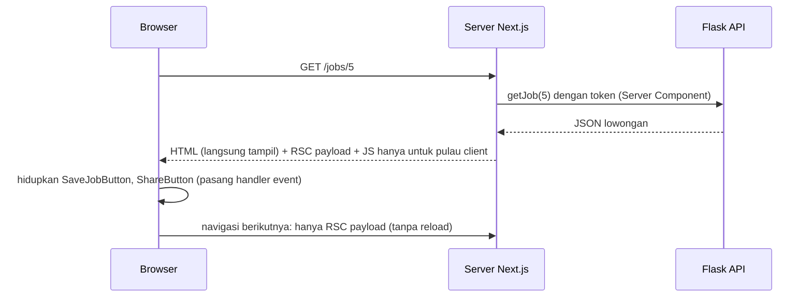

::part[Pelajari Konsepnya]{n="1"}

## 🎯 Yang akan kamu pelajari

- Bagaimana sebuah halaman dibangun: server dulu, lalu browser menambahkan interaktivitas
- Cara menentukan server atau client untuk setiap component
- Apa saja yang ditarik ke browser oleh baris `"use client"`
- Props apa yang boleh dikirim dari server ke client
- Menaruh konten server di dalam pembungkus client yang interaktif
- Menjaga pemuatan data dan rahasia tetap di server

## 🔤 Istilah penting

| Istilah | Artinya (sederhana) |
|---|---|
| **Server Component** | Berjalan di server; mengirim HTML jadi, tanpa JavaScript untuk dirinya |
| **Client Component** | Berjalan juga di browser; bisa memakai state dan klik |
| **Boundary** | Garis yang dibuat `"use client"` antara kode server dan browser |
| **Bundle** | File-file JavaScript yang diunduh browser |
| **Hydration** | Browser memasang handler klik ke HTML dari server |
| **Serializable** | Data sederhana yang bisa dikirim lewat jaringan (teks, angka, object biasa) |
| **Client island** | Bagian interaktif kecil di dalam halaman yang di-render server |
| **Data Access Layer** | File khusus server yang memuat data dan mengecek izin |

## 🧠 Ide besarnya

Bayangkan sebuah **restoran**. Dapur (server) memasak dengan bahan dan resep yang tidak pernah dilihat pelanggan — password database, token API, library besar. Piring yang sampai ke meja (HTML) sudah siap disantap. Beberapa hal terjadi **di meja** (browser): menambah sambal, minta air lagi — bagian yang interaktif.

Kamu tidak membawa seluruh dapur ke setiap meja. Server Component menjaga dapur tetap di dapur; Client Component adalah hal-hal kecil yang kamu lakukan di meja.

## ❓ Kenapa ini penting

React gaya lama mengirim **semua** kode component ke browser, lalu memuat data setelah halaman terbuka: spinner, unduhan besar, dan rahasia yang butuh API tambahan. Server Component di-render di server secara default, tidak mengirim JavaScript untuk bagian yang tidak interaktif, dan memuat data dekat dengan sumbernya.

Cara lama, dan masalahnya:

```tsx
"use client";                                           // at the top of page.tsx
export default function JobPage({ params }) {
  const [job, setJob] = useState(null);
  useEffect(() => {
    fetch(`${process.env.API_URL}/jobs/${id}`, { headers: { Authorization: `Bearer ${process.env.API_TOKEN}` } })   // secret in the bundle (or undefined)
      .then((r) => r.json()).then(setJob);
  }, [id]);
  if (!job) return <Spinner />;                          // loading flash, empty HTML for crawlers
  return <MarkdownRenderer text={job.description} />;    // 80 KB library shipped to every visitor
}
```

- Token-nya berakhir di kode browser (atau bernilai `undefined`).
- Pengguna melihat spinner dulu, dan Google melihat halaman kosong.
- Library Markdown yang besar diunduh oleh setiap pengunjung.

## 📖 Langkah demi langkah

### 1. Bagaimana halaman dibangun



1. Server memuat data (dengan token) dan membangun halaman.
2. Browser langsung mendapat HTML jadi, plus JavaScript **hanya** untuk bagian yang interaktif.
3. Browser "membangunkan" bagian-bagian itu (hydration) — seperti menyalakan lampu di ruangan yang sudah lengkap perabotnya.

### 2. Tentukan untuk setiap component

| Butuh… | Jadikan |
|---|---|
| data dari API atau database, rahasia, library besar (Markdown, highlight kode), konten statis | **Server** |
| `useState`, `useEffect`, handler klik, fitur browser (`localStorage`, clipboard), context, animasi | **Client** |

Mulai dari server. Taruh `"use client"` **serendah** mungkin — di daun-daun kecil, bukan seluruh halaman.

### 3. Garis batasnya

```tsx
// app/jobs/[id]/page.tsx — Server Component
import { SaveJobButton } from "./save-job-button";   // a client island
import { JobDescription } from "./job-description"; // stays on the server

export default async function JobPage({ params }: PageProps<"/jobs/[id]">) {
  const { id } = await params;
  const job = await getJob(Number(id));
  if (!job) notFound();
  return (
    <article>
      <h1>{job.title}</h1>
      <JobDescription text={job.description} />
      <SaveJobButton jobId={job.id} initialSaved={job.saved} />
    </article>
  );
}
```

```tsx
// app/jobs/[id]/save-job-button.tsx
"use client";
export function SaveJobButton({ jobId, initialSaved }: { jobId: number; initialSaved: boolean }) { … }
```

File dengan `"use client"` — **dan semua yang di-import-nya** — masuk ke bundle browser. Seperti koper: apa pun yang kamu masukkan ikut bepergian. Tapi konten server yang dikirim sebagai `children` **tidak** ikut dikemas; itu sudah dimasak di dapur.

### 4. Props harus berupa data sederhana

Props dari server ke client dikirim lewat jaringan — seperti mengirim paket lewat kurir:
- ✅ Bisa dikirim: teks, angka, boolean, `null`, array, object biasa, `Date`, `Map`/`Set`, Promise, JSX yang dibuat di server, dan **Server Action**.
- ❌ Tidak bisa dikirim: function biasa, instance class dengan method, koneksi database.

### 5. Konten server di dalam pembungkus client

```tsx
// Client wrapper with state
"use client";
export function Collapsible({ title, children }: { title: string; children: React.ReactNode }) {
  const [open, setOpen] = useState(false);
  return (
    <section>
      <button aria-expanded={open} onClick={() => setOpen(!open)}>{title}</button>
      {open && children}
    </section>
  );
}

// Server page
<Collapsible title="Company details">
  <CompanyDetails companyId={job.companyId} />   {/* async Server Component, rendered on the server */}
</Collapsible>
```

Kotak `Collapsible` itu interaktif (buka/tutup), tapi isinya (`CompanyDetails`) tetap dimuat dan dibangun di server. Seperti **kotak bekal yang tutupnya kamu buka di meja** — makanan di dalamnya tetap dimasak di dapur.

### 6. Jaga garis batasnya

```ts
// lib/data.ts
import "server-only";           // build error if a Client Component imports this module
```

- Taruh semua pemuatan data di file `server-only` (sebuah **Data Access Layer**). Cek izin di sana.
- Kirim hanya field yang dibutuhkan Client Component — jangan pernah object API atau database utuh yang berisi field privat.
- `client-only` melakukan kebalikannya, untuk file yang khusus browser.

### 7. Pola umum: provider

Context provider (tema, TanStack Query) harus berupa Client Component. Taruh di satu file client kecil, lalu pakai di layout (server):

```tsx
// app/providers.tsx
"use client";
export function Providers({ children }: { children: React.ReactNode }) {
  return <QueryClientProvider client={getQueryClient()}>{children}</QueryClientProvider>;
}
```

Layout tetap Server Component, dan halaman di dalamnya (`children`) tetap bisa berupa Server Component.

## ⚠️ Kesalahan umum

- "You're importing a component that needs `useState`…" → tambahkan `"use client"` ke **component itu**, bukan seluruh halaman.
- Menaruh `"use client"` di layout atau halaman untuk membungkam error.
- Mengirim function (`onSave={…}`) dari Server Component ke Client Component.
- Meng-import file data khusus server ke file client hanya demi sebuah type — pakai `import type`.
- Memakai `window` di Server Component.
- Memuat data di `useEffect` padahal Server Component bisa memuatnya.

## 🏆 Praktik terbaik

- [ ] Server sebagai default; `"use client"` hanya di daun yang membutuhkannya.
- [ ] Simpan pemuatan data di file `server-only`, dengan pengecekan izin.
- [ ] Kirim props yang kecil dan sederhana ke Client Component.
- [ ] Pakai `children` untuk menaruh konten server di dalam pembungkus client.
- [ ] Taruh context provider di satu component client kecil bernama `Providers`.
- [ ] Perhatikan ukuran bundle (output `next build`) saat menambah library browser.

::part[Jelaskan & Rancang]{n="2"}

## 🗣️ Jelaskan

Jelaskan ide restoran ke rekan tim, lalu jelaskan kenapa menaruh `"use client"` di `app/layout.tsx` sama seperti memindahkan seluruh dapur ke setiap meja.

## 📐 Rancang

Untuk **halaman detail lamaran** CareerPilot (header, langkah status dengan dropdown "pindahkan", daftar catatan dengan tambah/hapus, sidebar perusahaan, skor kecocokan AI dengan tombol "hitung ulang", tombol bagikan), tandai setiap component sebagai server atau client, daftar props yang melewati garis batas, dan sebutkan di mana data dimuat.

:::quiz
Tampilkan contoh pembagiannya

```text
app/(app)/applications/[id]/page.tsx     SERVER  getApplication(id), getNotes(id), getCompany(companyId), getMatch(id)
├── ApplicationHeader                      SERVER  { role, companyName, appliedOn }
├── StatusPipeline                         SERVER  renders stages from status
│   └── MoveStatusMenu                     CLIENT  { applicationId, status, allowedNext: Status[] }  → Server Action moveStatus
├── NotesSection                           SERVER  notes list markup
│   ├── NoteItem                           SERVER  { id, body, createdAt }
│   │   └── DeleteNoteButton               CLIENT  { noteId }  → Server Action deleteNote
│   └── AddNoteForm                        CLIENT  { applicationId }  (live counter, pending state) → Server Action addNote
├── CompanySidebar                         SERVER  { name, website, openRoles }
├── MatchScoreCard                         SERVER  { score, strengths, gaps }
│   └── RecalculateButton                  CLIENT  { applicationId } → Server Action (calls AI service), shows pending
└── ShareButton                            CLIENT  { url }  (clipboard API)
```

- Semua data dimuat di server, secara bersamaan (`Promise.all` atau bagian `<Suspense>` yang terpisah).
- Hanya id, status, dan teks tampilan yang melewati garis batas. Perubahan lewat Server Action, bukan callback biasa.
- `allowedNext` dihitung di server dari aturan bisnis, jadi browser tidak bisa menawarkan perpindahan yang tidak diizinkan (API tetap mengecek juga).
:::

### 📝 Checklist self-review

- [ ] Client component hanya daun-daun yang interaktif
- [ ] Props kecil dan sederhana
- [ ] Perubahan lewat Server Action atau Route Handler dengan pengecekan izin

::ai-review{task="design"}

::part[Latihan Kecil]{n="3"}

:::exercise{path="exercises/web/m4/w4/05-server-client-components" ai="no-ai" title="Pecah halaman yang semuanya client"}
Sebuah halaman lowongan ditulis sebagai satu Client Component besar yang membocorkan token rahasia dan memuat data di `useEffect`. Refactor menjadi file data khusus server, halaman Server Component yang async, component deskripsi di server, dan dua pulau client kecil dengan props sederhana. Tes mengecek directive, import, rahasia, dan perilakunya.
:::

:::hints
- Mulai dari `lib/data.ts` (`import "server-only"`), lalu tulis ulang halaman sebagai `async` tanpa hook.
- Pulau client meng-import `saveJob` dari `lib/client-api.ts`, jangan dari `lib/data.ts`.
- Toggle optimistis: ubah state dulu, panggil API, lalu batalkan di `catch`.
:::

## ✅ Cek cepat

:::quiz
Apa saja yang masuk ke bundle browser saat sebuah file punya `"use client"`?

File itu dan semua file yang di-import-nya. Server Component yang dikirim sebagai `children` atau props dibangun di server dan tidak ikut.
:::

:::quiz
Kenapa Server Component tidak bisa mengirim `onClick={handleSave}` ke Client Component?

Props yang melewati garis batas harus data sederhana; function biasa tidak bisa dikirim ke browser. Pakai Server Action, atau tulis handler-nya di dalam Client Component.
:::

## 📚 Lanjut belajar

- Dokumentasi Next.js (tersedia di dalam proyek): Server and Client Components; The Server and Client Boundary; panduan Data Security
- [React docs: Server Components](https://react.dev/reference/rsc/server-components)
