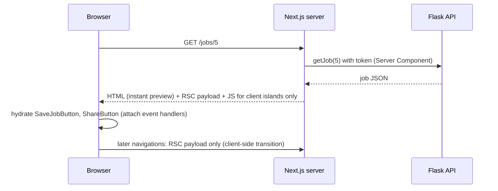

::part[Learn the Concept]{n="1"}

## 🎯 What you'll learn

- How a request renders: Server Components → RSC payload + HTML → hydration of Client Components
- Deciding server vs client per component
- The `"use client"` boundary and what it pulls into the bundle
- Serializable props, passing Server Components as `children` to Client Components
- `server-only` / `client-only`, and keeping data access secure
- Refactoring a "client everything" page into server content with client islands

## 🧠 The big idea

Think of a **restaurant**. The kitchen (server) prepares the food with ingredients and recipes customers never see (database credentials, API tokens, heavy libraries). The plate that reaches the table (HTML) is ready to eat. A few things happen **at the table** (client): adding sauce, cutting, asking for more water — interactive bits.

You wouldn't bring the whole kitchen to every table. Server Components keep the kitchen in the kitchen; Client Components are the small table-side interactions.

## ❓ Why does this exist?

Classic React apps shipped all component code to the browser, then fetched data after load (spinners, waterfalls, big bundles, secrets needing extra APIs). React Server Components (used by the Next.js App Router) render on the server by default, send zero JavaScript for non-interactive parts, and fetch data close to the source — while still allowing rich interactivity where needed.

## 💥 What happens if we DON'T?

```tsx
"use client";                                           // at the top of page.tsx
export default function JobPage({ params }) {
  const [job, setJob] = useState(null);
  useEffect(() => {
    fetch(`${process.env.API_URL}/jobs/${id}`, { headers: { Authorization: `Bearer ${process.env.API_TOKEN}` } })   // secret in the bundle (or undefined)
      .then((r) => r.json()).then(setJob);
  }, [id]);
  if (!job) return <Spinner />;                          // loading flash, empty HTML for crawlers
  return <MarkdownRenderer text={job.description} />;    // 80 KB library shipped to every visitor
}
```

## 📖 How it works, step by step

### 1. The render pipeline



### 2. Decide per component

| Needs… | Component |
|---|---|
| data from DB/API, secrets, heavy libraries (markdown, syntax highlighting), static markup | **Server** |
| `useState`, `useEffect`, event handlers, browser APIs (`localStorage`, clipboard), context consumers, animations | **Client** |

Default to server; **push `"use client"` down to the leaves**.

### 3. The boundary

```tsx
// app/jobs/[id]/page.tsx — Server Component
import { SaveJobButton } from "./save-job-button";   // a client island
import { JobDescription } from "./job-description"; // stays on the server

export default async function JobPage({ params }: PageProps<"/jobs/[id]">) {
  const { id } = await params;
  const job = await getJob(Number(id));
  if (!job) notFound();
  return (
    <article>
      <h1>{job.title}</h1>
      <JobDescription text={job.description} />
      <SaveJobButton jobId={job.id} initialSaved={job.saved} />
    </article>
  );
}
```

```tsx
// app/jobs/[id]/save-job-button.tsx
"use client";
export function SaveJobButton({ jobId, initialSaved }: { jobId: number; initialSaved: boolean }) { … }
```

A file with `"use client"` — and **everything it imports** — becomes part of the client bundle. Components it renders through `children` or other props that were created on the server are **not** pulled in.

### 4. Props must be serializable

Server → Client props are sent over the network: strings, numbers, booleans, `null`, arrays, plain objects, `Date`, `Map`/`Set`, Promises (for `use()`), JSX created on the server, and **Server Actions**. Not allowed: regular functions, class instances with methods, DB connections.

### 5. Server content inside client wrappers

```tsx
// Client wrapper with state
"use client";
export function Collapsible({ title, children }: { title: string; children: React.ReactNode }) {
  const [open, setOpen] = useState(false);
  return (
    <section>
      <button aria-expanded={open} onClick={() => setOpen(!open)}>{title}</button>
      {open && children}
    </section>
  );
}

// Server page
<Collapsible title="Company details">
  <CompanyDetails companyId={job.companyId} />   {/* async Server Component, rendered on the server */}
</Collapsible>
```

This **interleaving** keeps data fetching on the server even inside interactive UI.

### 6. Guard the boundary

```ts
// lib/data.ts
import "server-only";           // build error if a Client Component imports this module
```

- Put all data access in server-only modules (a **Data Access Layer**): check auth there, return minimal DTOs.
- Never pass full database/API objects with secrets or internal fields to Client Components — pick fields.
- `client-only` does the reverse for browser-only modules.

### 7. Common pattern: provider wrappers

Context providers (theme, TanStack Query client) must be Client Components. Wrap them in a small client file and render it in a (server) layout:

```tsx
// app/providers.tsx
"use client";
export function Providers({ children }: { children: React.ReactNode }) {
  return <QueryClientProvider client={getQueryClient()}>{children}</QueryClientProvider>;
}
```

The layout stays a Server Component; `children` pages can still be Server Components.

## ⚖️ Trade-offs

| Choice | ✅ | ❌ |
|---|---|---|
| Server Components | no JS for static parts, secure data access, fast first load | no interactivity; each navigation needs the server |
| Client Components | interactivity, instant local updates | bundle size, hydration cost, can't access secrets |
| Big client boundaries | simpler mental model | large bundles, lost server benefits |
| Small islands | best performance and security | more files, props plumbing |

## ✅ When to use it / 🚫 When NOT to use it

- ✅ Pages and layouts as Server Components that fetch and compose.
- ✅ Client islands for buttons, forms with live validation, menus, charts with interaction.
- 🚫 Don't mark layouts or pages `"use client"` to silence an error — move the interactive part into its own file.
- 🚫 Don't fetch in `useEffect` what a Server Component could fetch.

## 🏆 Best practices

- [ ] Server by default; `"use client"` only in leaf components that need it.
- [ ] Keep data access in `server-only` modules with auth checks and DTOs.
- [ ] Pass minimal, serializable props to Client Components.
- [ ] Use `children` to nest server-rendered content inside client wrappers.
- [ ] Wrap context providers in a small client `Providers` component.
- [ ] Watch bundle size (`next build` output, bundle analyzer) when adding client libraries.
- [ ] Don't import server modules from client files (enforce with `server-only`).

## 🏭 How it's used in industry

- The App Router with Server Components is the default for new Next.js projects; many teams migrated from the Pages Router to cut client JavaScript.
- Data Access Layers with `server-only` are a recommended security pattern for authorization in Next.js apps.
- AI chat UIs stream server-rendered content and keep only the input box and message list interactive.

## ⚠️ Common mistakes

- "You're importing a component that needs `useState`…" → add `"use client"` to **that** component, not the page.
- Passing functions (`onSave={…}`) from a Server Component to a Client Component.
- Importing a server-only data module into a client file "just for a type" — use `import type`.
- Reading `window` in a Server Component.

::part[Explain & Design]{n="2"}

## 🗣️ Explain it

Explain the restaurant analogy to a teammate, then explain why putting `"use client"` in `app/layout.tsx` is like moving the whole kitchen to every table.

## 📐 Design it

For CareerPilot's **application detail page** (header, status pipeline with a "move" dropdown, notes list with add/delete, company sidebar, AI match score with a "recalculate" button, share button), mark each component server or client, list the props crossing the boundary, and say where data is fetched.

:::quiz
Show a possible split

```text
app/(app)/applications/[id]/page.tsx     SERVER  getApplication(id), getNotes(id), getCompany(companyId), getMatch(id)
├── ApplicationHeader                      SERVER  { role, companyName, appliedOn }
├── StatusPipeline                         SERVER  renders stages from status
│   └── MoveStatusMenu                     CLIENT  { applicationId, status, allowedNext: Status[] }  → Server Action moveStatus
├── NotesSection                           SERVER  notes list markup
│   ├── NoteItem                           SERVER  { id, body, createdAt }
│   │   └── DeleteNoteButton               CLIENT  { noteId }  → Server Action deleteNote
│   └── AddNoteForm                        CLIENT  { applicationId }  (live counter, pending state) → Server Action addNote
├── CompanySidebar                         SERVER  { name, website, openRoles }
├── MatchScoreCard                         SERVER  { score, strengths, gaps }
│   └── RecalculateButton                  CLIENT  { applicationId } → Server Action (calls AI service), shows pending
└── ShareButton                            CLIENT  { url }  (clipboard API)
```

- All data fetched on the server in parallel (`Promise.all` or separate `<Suspense>` sections).
- Only ids, statuses and display strings cross the boundary; Server Actions are passed/imported, never plain callbacks.
- `allowedNext` is computed on the server from the domain rules so the client can't offer invalid transitions (the API still validates).
:::

### 📝 Self-review checklist

- [ ] Client components are only the interactive leaves
- [ ] Props are minimal and serializable
- [ ] Mutations go through Server Actions or Route Handlers with auth

::ai-review{task="design"}

::part[Toy Exercise]{n="3"}

:::exercise{path="exercises/web/m4/w4/05-server-client-components" ai="no-ai" title="Split a client-everything page"}
A job page was written as one Client Component that leaks a secret token and fetches in `useEffect`. Refactor it into a server-only data module, an async Server Component page, a server description component and two small client islands with serializable props. Tests check directives, imports, secrets and behavior.
:::

:::hints
- Start with `lib/data.ts` (`import "server-only"`), then rewrite the page as `async` without hooks.
- Client islands import `saveJob` from `lib/client-api.ts`, never `lib/data.ts`.
- Optimistic toggle: set state first, call the API, roll back in `catch`.
:::

## ✅ Quick check

:::quiz
What gets included in the client bundle when a file has `"use client"`?

That file and every module it imports (its module graph). Server Components passed to it as `children` or props are rendered on the server and not included.
:::

:::quiz
Why can't a Server Component pass `onClick={handleSave}` to a Client Component?

Props crossing the boundary must be serializable; plain functions can't be sent to the browser. Use a Server Action or define the handler inside the Client Component.
:::

## 📖 Kamus (glossary)

| Term | Bahasa Indonesia |
|---|---|
| Server Component | Komponen yang dirender di server |
| Client boundary | Batas klien (`"use client"`) |
| RSC payload | Data hasil render Server Component yang dikirim ke klien |
| Hydration | Hidrasi — mengaktifkan interaktivitas HTML |
| Client island | Pulau interaktif kecil di halaman server |
| Data Access Layer | Lapisan akses data (dengan cek otorisasi) |

## 📚 Keep learning

- Next.js docs (bundled): Server and Client Components; The Server and Client Boundary; Data Security guide
- [React docs: Server Components](https://react.dev/reference/rsc/server-components)
