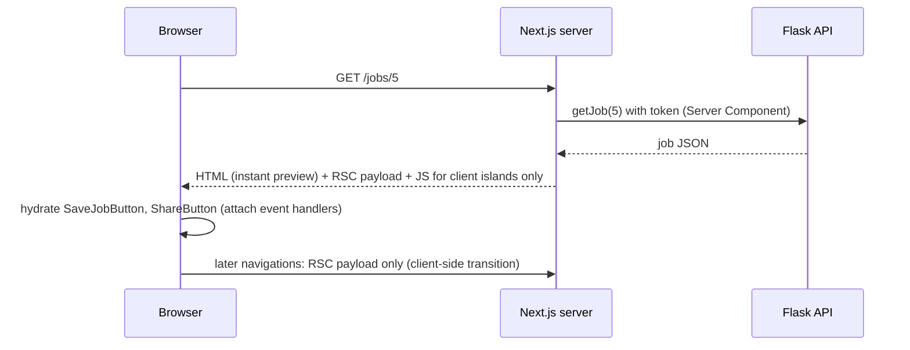

::part[Learn the Concept]{n="1"}

## 🎯 What you'll learn

- How a page is built: server first, then the browser adds interactivity
- How to decide server or client for each component
- What the `"use client"` line pulls into the browser
- Which props can go from server to client
- Putting server content inside interactive client wrappers
- Keeping data access and secrets on the server

## 🔤 Key words

| Word | In simple words | Bahasa Indonesia |
|---|---|---|
| **Server Component** | Runs on the server; sends finished HTML, no JavaScript for itself | Komponen server |
| **Client Component** | Runs in the browser too; can use state and clicks | Komponen browser |
| **Boundary** | The line created by `"use client"` between server and browser code | Batas server/browser |
| **Bundle** | The JavaScript files the browser downloads | Paket JavaScript |
| **Hydration** | The browser attaching click handlers to HTML from the server | Menghidupkan HTML |
| **Serializable** | Simple data that can be sent over the network (text, numbers, plain objects) | Bisa dikirim |
| **Client island** | A small interactive part inside a server-rendered page | Pulau interaktif |
| **Data Access Layer** | Server-only files that load data and check permissions | Lapisan akses data |

## 🧠 The big idea

Think of a **restaurant**. The kitchen (the server) cooks with ingredients and recipes customers never see — database passwords, API tokens, big libraries. The plate that arrives (HTML) is ready to eat. A few things happen **at the table** (the browser): adding sambal, asking for more water — the interactive parts.

You don't bring the whole kitchen to every table. Server Components keep the kitchen in the kitchen; Client Components are the small things you do at the table.

## ❓ Why it matters

Old-style React sent **all** component code to the browser, then loaded data after the page opened: spinners, big downloads, and secrets that needed extra APIs. Server Components render on the server by default, send no JavaScript for non-interactive parts, and load data close to the source.

The old way, and its problems:

```tsx
"use client";                                           // at the top of page.tsx
export default function JobPage({ params }) {
  const [job, setJob] = useState(null);
  useEffect(() => {
    fetch(`${process.env.API_URL}/jobs/${id}`, { headers: { Authorization: `Bearer ${process.env.API_TOKEN}` } })   // secret in the bundle (or undefined)
      .then((r) => r.json()).then(setJob);
  }, [id]);
  if (!job) return <Spinner />;                          // loading flash, empty HTML for crawlers
  return <MarkdownRenderer text={job.description} />;    // 80 KB library shipped to every visitor
}
```

- The token ends up in browser code (or is simply `undefined`).
- Users see a spinner first, and Google sees an empty page.
- A big Markdown library is downloaded by every visitor.

## 📖 Step by step

### 1. How a page is built



1. The server loads the data (with the token) and builds the page.
2. The browser gets ready-made HTML right away, plus JavaScript **only** for the interactive parts.
3. The browser "wakes up" those parts (hydration) — like switching on the lights in a room that is already furnished.

### 2. Decide for each component

| It needs… | Make it |
|---|---|
| data from the API or database, secrets, big libraries (Markdown, code highlighting), static content | **Server** |
| `useState`, `useEffect`, click handlers, browser features (`localStorage`, clipboard), context, animations | **Client** |

Start with server. Put `"use client"` as **low** as possible — on the small leaves, not the whole page.

### 3. The boundary

```tsx
// app/jobs/[id]/page.tsx — Server Component
import { SaveJobButton } from "./save-job-button";   // a client island
import { JobDescription } from "./job-description"; // stays on the server

export default async function JobPage({ params }: PageProps<"/jobs/[id]">) {
  const { id } = await params;
  const job = await getJob(Number(id));
  if (!job) notFound();
  return (
    <article>
      <h1>{job.title}</h1>
      <JobDescription text={job.description} />
      <SaveJobButton jobId={job.id} initialSaved={job.saved} />
    </article>
  );
}
```

```tsx
// app/jobs/[id]/save-job-button.tsx
"use client";
export function SaveJobButton({ jobId, initialSaved }: { jobId: number; initialSaved: boolean }) { … }
```

A file with `"use client"` — **and everything it imports** — goes into the browser bundle. It's like a suitcase: whatever you pack inside travels with it. But server content passed in as `children` is **not** packed; it's already cooked in the kitchen.

### 4. Props must be simple data

Props from server to client travel over the network — like sending a package by courier:
- ✅ Can send: text, numbers, booleans, `null`, arrays, plain objects, `Date`, `Map`/`Set`, Promises, JSX made on the server, and **Server Actions**.
- ❌ Can't send: normal functions, class instances with methods, database connections.

### 5. Server content inside a client wrapper

```tsx
// Client wrapper with state
"use client";
export function Collapsible({ title, children }: { title: string; children: React.ReactNode }) {
  const [open, setOpen] = useState(false);
  return (
    <section>
      <button aria-expanded={open} onClick={() => setOpen(!open)}>{title}</button>
      {open && children}
    </section>
  );
}

// Server page
<Collapsible title="Company details">
  <CompanyDetails companyId={job.companyId} />   {/* async Server Component, rendered on the server */}
</Collapsible>
```

The `Collapsible` box is interactive (open/close), but what's inside (`CompanyDetails`) is still loaded and built on the server. Like a **lunch box with a lid you open at the table** — the food inside was still cooked in the kitchen.

### 6. Protect the boundary

```ts
// lib/data.ts
import "server-only";           // build error if a Client Component imports this module
```

- Put all data loading in `server-only` files (a **Data Access Layer**). Check permissions there.
- Send only the fields a Client Component needs — never whole API or database objects with private fields.
- `client-only` does the opposite, for browser-only files.

### 7. Common pattern: providers

Context providers (theme, TanStack Query) must be Client Components. Put them in one small client file, and use it in a (server) layout:

```tsx
// app/providers.tsx
"use client";
export function Providers({ children }: { children: React.ReactNode }) {
  return <QueryClientProvider client={getQueryClient()}>{children}</QueryClientProvider>;
}
```

The layout stays a Server Component, and the pages inside (`children`) can still be Server Components.

## ⚠️ Common mistakes

- "You're importing a component that needs `useState`…" → add `"use client"` to **that** component, not the whole page.
- Putting `"use client"` on a layout or page to silence an error.
- Passing functions (`onSave={…}`) from a Server Component to a Client Component.
- Importing a server-only data file into a client file just for a type — use `import type`.
- Using `window` in a Server Component.
- Loading data in `useEffect` that a Server Component could load.

## 🏆 Best practices

- [ ] Server by default; `"use client"` only on the leaves that need it.
- [ ] Keep data loading in `server-only` files, with permission checks.
- [ ] Send small, simple props to Client Components.
- [ ] Use `children` to put server content inside client wrappers.
- [ ] Put context providers in one small client `Providers` component.
- [ ] Watch the bundle size (`next build` output) when adding browser libraries.

::part[Explain & Design]{n="2"}

## 🗣️ Explain it

Explain the restaurant idea to a teammate, then explain why putting `"use client"` in `app/layout.tsx` is like moving the whole kitchen to every table.

## 📐 Design it

For CareerPilot's **application detail page** (header, status steps with a "move" dropdown, notes list with add/delete, company sidebar, AI match score with a "recalculate" button, share button), mark each component server or client, list the props that cross the boundary, and say where data is loaded.

:::quiz
Show a possible split

```text
app/(app)/applications/[id]/page.tsx     SERVER  getApplication(id), getNotes(id), getCompany(companyId), getMatch(id)
├── ApplicationHeader                      SERVER  { role, companyName, appliedOn }
├── StatusPipeline                         SERVER  renders stages from status
│   └── MoveStatusMenu                     CLIENT  { applicationId, status, allowedNext: Status[] }  → Server Action moveStatus
├── NotesSection                           SERVER  notes list markup
│   ├── NoteItem                           SERVER  { id, body, createdAt }
│   │   └── DeleteNoteButton               CLIENT  { noteId }  → Server Action deleteNote
│   └── AddNoteForm                        CLIENT  { applicationId }  (live counter, pending state) → Server Action addNote
├── CompanySidebar                         SERVER  { name, website, openRoles }
├── MatchScoreCard                         SERVER  { score, strengths, gaps }
│   └── RecalculateButton                  CLIENT  { applicationId } → Server Action (calls AI service), shows pending
└── ShareButton                            CLIENT  { url }  (clipboard API)
```

- All data is loaded on the server, at the same time (`Promise.all` or separate `<Suspense>` sections).
- Only ids, statuses and display text cross the boundary. Changes go through Server Actions, never plain callbacks.
- `allowedNext` is calculated on the server from the business rules, so the browser can't offer a move that isn't allowed (the API still checks too).
:::

### 📝 Self-review checklist

- [ ] Client components are only the interactive leaves
- [ ] Props are small and simple
- [ ] Changes go through Server Actions or Route Handlers with permission checks

::ai-review{task="design"}

::part[Toy Exercise]{n="3"}

:::exercise{path="exercises/web/m4/w4/05-server-client-components" ai="no-ai" title="Split a client-everything page"}
A job page was written as one big Client Component that leaks a secret token and loads data in `useEffect`. Refactor it into a server-only data file, an async Server Component page, a server description component and two small client islands with simple props. The tests check the directives, imports, secrets and behavior.
:::

:::hints
- Start with `lib/data.ts` (`import "server-only"`), then rewrite the page as `async` without hooks.
- Client islands import `saveJob` from `lib/client-api.ts`, never from `lib/data.ts`.
- Optimistic toggle: change the state first, call the API, and undo it in `catch`.
:::

## ✅ Quick check

:::quiz
What goes into the browser bundle when a file has `"use client"`?

That file and every file it imports. Server Components passed to it as `children` or props are built on the server and not included.
:::

:::quiz
Why can't a Server Component pass `onClick={handleSave}` to a Client Component?

Props crossing the boundary must be simple data; normal functions can't be sent to the browser. Use a Server Action, or write the handler inside the Client Component.
:::

## 📚 Keep learning

- Next.js docs (bundled): Server and Client Components; The Server and Client Boundary; Data Security guide
- [React docs: Server Components](https://react.dev/reference/rsc/server-components)
