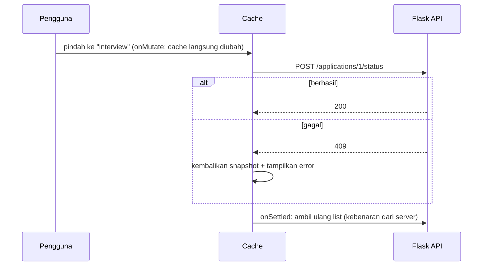

::part[Pelajari Konsepnya]{n="1"}

## 🎯 Yang akan kamu pelajari

- **Server state** vs client state, dan kenapa fetch di `useEffect` bermasalah
- Setup TanStack Query di Next.js
- `useQuery`: query key, `staleTime`, membatalkan request lama
- Menata query key agar bisa menyegarkan kelompok data
- `useMutation`: menyimpan data lalu menyegarkan list sesudahnya
- **Optimistic update**: tampilkan perubahan seketika, batalkan kalau server menolak
- Kapan memakai TanStack Query vs Server Component

## 🔤 Istilah penting

| Istilah | Artinya (sederhana) |
|---|---|
| **Server state** | Data yang sebenarnya ada di backend; browser hanya punya salinannya |
| **Client state** | Data yang hanya penting bagi browser: menu yang terbuka, draf |
| **Query** | Request yang membaca data (`useQuery`) |
| **Query key** | Nama/alamat query di cache: `["applications", "list", filters]` |
| **Stale** | Salinannya mungkin sudah usang dan sebaiknya segera disegarkan |
| **Mutation** | Request yang mengubah data (`useMutation`) |
| **Invalidate** | Menandai data cache sebagai lama agar diambil ulang |
| **Optimistic update** | Tampilkan perubahan sebelum server menjawab; batalkan kalau gagal |
| **Race condition** | Response lama yang lebih lambat tiba terakhir dan menimpa data yang lebih baru |

## 🧠 Ide besarnya

Server state itu **pinjaman**. Datanya tinggal di database Flask, dan browser hanya memegang **salinan** yang langsung usang begitu ada orang lain yang mengubahnya — seperti **fotokopi buku perpustakaan**.

TanStack Query adalah **pustakawan** untuk salinan-salinan itu: ia ingat apa yang kamu pinjam, sadar saat salinannya sudah lama, mengambil yang baru di latar belakang, menghindari mengambil hal yang sama dua kali, dan memperbarui semua orang yang membaca buku yang sama.

## ❓ Kenapa ini penting

Fetch manual terlihat sederhana, lalu mengumpulkan bug:

```tsx
const [data, setData] = useState(null);
const [loading, setLoading] = useState(true);
useEffect(() => {
  fetch(`/api/applications?status=${status}`).then((r) => r.json()).then(setData).finally(() => setLoading(false));
}, [status]);
```

- **Race condition**: ganti filter dengan cepat, dan response yang lebih lama bisa menimpa yang lebih baru.
- **Tanpa cache**: kembali ke sebuah halaman memuat semuanya lagi dan memunculkan spinner.
- Tanpa retry, tanpa penyegaran di latar belakang, tanpa berbagi antar component.
- Setelah menyimpan sesuatu, setiap list yang menampilkan data itu harus diperbarui secara manual.

## 📖 Langkah demi langkah

### 1. Setup di Next.js

```tsx
// app/providers.tsx
"use client";

import { QueryClient, QueryClientProvider } from "@tanstack/react-query";

let browserQueryClient: QueryClient | undefined;
function getQueryClient() {
  if (typeof window === "undefined") return new QueryClient();   // a fresh client per server render
  return (browserQueryClient ??= new QueryClient());             // one client in the browser
}

export function Providers({ children }: { children: React.ReactNode }) {
  return <QueryClientProvider client={getQueryClient()}>{children}</QueryClientProvider>;
}
```

- `QueryClient` adalah pustakawannya: **satu** di browser, dan yang baru untuk setiap render di server (agar pengguna tidak pernah berbagi data).
- Taruh `<Providers>` di layout halaman-halaman yang membutuhkannya.
- Panel React Query DevTools (`@tanstack/react-query-devtools`) menampilkan semua isi cache.

### 2. Query dan key

```tsx
export const applicationKeys = {
  all: ["applications"] as const,
  lists: () => [...applicationKeys.all, "list"] as const,
  list: (filters: Filters) => [...applicationKeys.lists(), filters] as const,
  detail: (id: number) => [...applicationKeys.all, "detail", id] as const,
};

export function useApplications(api: ApplicationsApi, filters: Filters) {
  return useQuery({
    queryKey: applicationKeys.list(filters),                       // cache identity; changes → refetch
    queryFn: ({ signal }) => api.listApplications(filters, { signal }),   // signal aborts outdated requests
    staleTime: 30_000,                                             // fresh for 30 s → no refetch on remount
    placeholderData: keepPreviousData,                             // keep showing the old list while a new filter loads
  });
}
```

- **Query key** adalah alamat cache — seperti **nomor rak di perpustakaan**. Masukkan **setiap** nilai yang dipakai request (seperti `filters`), kalau tidak, filter yang berbeda akan berbagi data yang salah.
- **Key factory** (`applicationKeys`) mencegah salah ketik dan membiarkanmu menyegarkan kelompok: semua yang diawali `["applications", "list"]` berarti "semua list".
- `signal` membatalkan request yang sudah tidak dibutuhkan.
- `keepPreviousData` mempertahankan list lama di layar selagi filter baru dimuat, jadi halaman tidak berkedip kosong.

| Opsi | Artinya |
|---|---|
| `staleTime` | berapa lama data dianggap segar (default 0 = sering disegarkan) |
| `gcTime` | berapa lama data yang tidak dipakai tetap di memori (default 5 menit) |
| `enabled` | hanya jalan kalau bernilai true (misalnya teks pencarian tidak kosong) |
| `retry` | percobaan ulang otomatis untuk request yang gagal (default 3 di browser) |
| `refetchOnWindowFocus` | menyegarkan saat kamu kembali ke tab (default true) |

### 3. Keadaan-keadaannya

```tsx
const query = useApplications(api, filters);
if (query.isPending) return <p role="status">Loading applications…</p>;   // no data yet
if (query.isError) return <ErrorPanel onRetry={() => query.refetch()} />;
return (
  <>
    {query.isFetching && <p aria-live="polite">Updating…</p>}   {/* background refresh with data on screen */}
    <List applications={query.data} />
  </>
);
```

- `isPending` = **belum** ada data (pemuatan pertama) → tampilkan layar loading.
- `isFetching` = ada request yang berjalan, mungkin di latar belakang selagi data lama tampil → tampilkan "Memperbarui…" kecil.

### 4. Mutation dan invalidation

```tsx
const queryClient = useQueryClient();
const addNote = useMutation({
  mutationFn: (body: string) => api.addNote(applicationId, body),
  onSuccess: () => queryClient.invalidateQueries({ queryKey: noteKeys.list(applicationId) }),
});

<button disabled={addNote.isPending} onClick={() => addNote.mutate(text)}>Save note</button>
{addNote.isError && <p role="alert">Couldn't save the note</p>}
```

Setelah menyimpan, `invalidateQueries` memberi tahu pustakawan: "salinan catatan sudah lama". List catatan mana pun yang ada di layar otomatis diambil ulang.

### 5. Optimistic update

```tsx
useMutation({
  mutationFn: ({ id, status }) => api.moveStatus(id, status),
  onMutate: async ({ id, status }) => {
    await queryClient.cancelQueries({ queryKey: applicationKeys.lists() });          // stop in-flight fetches overwriting us
    const snapshot = queryClient.getQueriesData<Application[]>({ queryKey: applicationKeys.lists() });
    queryClient.setQueriesData<Application[]>({ queryKey: applicationKeys.lists() }, (old) =>
      old?.map((a) => (a.id === id ? { ...a, status } : a)),
    );
    return { snapshot };
  },
  onError: (_error, _variables, context) => context?.snapshot.forEach(([key, data]) => queryClient.setQueryData(key, data)),
  onSettled: (_data, _error, { id }) => {
    queryClient.invalidateQueries({ queryKey: applicationKeys.lists() });
    queryClient.invalidateQueries({ queryKey: applicationKeys.detail(id) });
  },
});
```



Seperti menulis janji temu dengan **pensil** di kalendermu sebelum orang lain mengonfirmasi: kalau dia menolak, kamu menghapusnya.

1. `onMutate`: hentikan request lama, simpan **snapshot** (versi sebelum ditulis pensil), dan ubah cache saat itu juga.
2. `onError`: kembalikan snapshot dan tampilkan error.
3. `onSettled`: ambil data sungguhan dari server, apa pun hasilnya.

Pakai untuk aksi cepat yang biasanya berhasil (memindahkan status, like, toggle). Untuk pembayaran atau aksi yang tidak bisa dibatalkan, tampilkan "Menyimpan…" dan tunggu server.

### 6. TanStack Query dan Server Component

| Kamu butuh | Pakai |
|---|---|
| Data halaman di HTML pertama, SEO, rahasia | Server Component (+ `use cache`, materi 06) |
| Menyimpan data dari form | Server Action (Minggu 5) |
| Layar yang sangat interaktif: filter live, infinite scroll, polling, drag-and-drop optimistis | TanStack Query |
| Keduanya | muat di server dulu, lalu serahkan datanya ke cache browser (`HydrationBoundary`) |

Banyak aplikasi Next.js memuat sebagian besar halaman dengan Server Component, dan memakai TanStack Query hanya untuk bagian yang interaktif — seperti papan pipeline CareerPilot.

## ⚠️ Kesalahan umum

- Query key yang kekurangan sebuah nilai (`["applications"]` untuk semua filter) → data cache yang salah.
- Menyalin data query ke `useState` lalu mengubahnya di sana.
- Optimistic update tanpa `cancelQueries` (response lama menimpa perubahan instan).
- Membuat `QueryClient` baru di dalam component setiap render.
- Memakai TanStack Query untuk state UI seperti menu yang terbuka — itu tugas `useState` atau Zustand.
- Memuat ulang data di browser yang sudah di-render Server Component, tanpa alasan.

## 🏆 Praktik terbaik

- [ ] Satu `QueryClient` per sesi browser; yang baru untuk setiap render di server.
- [ ] Pakai key factory, dan masukkan setiap input ke dalam key.
- [ ] Oper `signal` ke request agar request lama dibatalkan.
- [ ] Pilih `staleTime` yang masuk akal (0 berarti sering mengambil ulang).
- [ ] Tangani `isPending`, `isError`, dan `isFetching` di latar belakang secara terpisah.
- [ ] Invalidate berdasarkan prefix setelah mutation; optimistic update hanya dengan snapshot + rollback + refetch di `onSettled`.
- [ ] Jangan simpan data server di store global client.
- [ ] Pakai React Query DevTools selama development.

::part[Jelaskan & Rancang]{n="2"}

## 🗣️ Jelaskan

Jelaskan ide pustakawan ke rekan tim, dan pakai ide itu untuk menggambarkan apa yang terjadi saat dua component meminta daftar lamaran yang sama pada waktu bersamaan.

## 📐 Rancang

Rancang lapisan TanStack Query untuk **papan pipeline** CareerPilot: kolom per status, menyeret kartu untuk mengubah statusnya, menambah catatan dari kartu, mengecek pembaruan setiap 60 detik selama tab terlihat, dan menampilkan banner "3 pembaruan baru" alih-alih memindahkan kartu di bawah kursor pengguna. Tentukan key, query, mutation, dan pembaruan cache-nya.

:::quiz
Tampilkan contoh desainnya

```ts
export const boardKeys = {
  all: ["board"] as const,
  board: (filters: BoardFilters) => [...boardKeys.all, filters] as const,
  notes: (applicationId: number) => ["notes", applicationId] as const,
};

// Query: whole board in one request (grouped server-side)
useQuery({
  queryKey: boardKeys.board(filters),
  queryFn: ({ signal }) => api.getBoard(filters, { signal }),
  staleTime: 30_000,
  refetchInterval: 60_000,                  // polling
  refetchIntervalInBackground: false,        // pause when the tab is hidden
  placeholderData: keepPreviousData,
  select: (board) => board,                  // could derive counts here
});

// "New updates" banner instead of silent reordering:
// keep a `displayed` snapshot in local state; when fresh data differs (compare updatedAt values),
// show "3 new updates" and apply the new data when the user clicks the banner.

// Mutation: move card (optimistic)
useMutation({
  mutationFn: ({ id, to }) => api.moveStatus(id, to),
  onMutate: async ({ id, to }) => {
    await queryClient.cancelQueries({ queryKey: boardKeys.all });
    const snapshot = queryClient.getQueriesData({ queryKey: boardKeys.all });
    queryClient.setQueriesData({ queryKey: boardKeys.all }, (board) => moveCard(board, id, to));   // pure helper
    return { snapshot };
  },
  onError: (error, vars, ctx) => { restore(ctx.snapshot); toast(messageFor(error)); },   // 409 invalid_transition
  onSettled: () => queryClient.invalidateQueries({ queryKey: boardKeys.all }),
});

// Mutation: add note (not optimistic on the board; optimistic in the notes list)
useMutation({
  mutationFn: ({ applicationId, body }) => api.addNote(applicationId, body),
  onSuccess: (_note, { applicationId }) => {
    queryClient.invalidateQueries({ queryKey: boardKeys.notes(applicationId) });
    queryClient.invalidateQueries({ queryKey: boardKeys.all });   // note count badge on cards
  },
});
```

- Polling berhenti saat tab tersembunyi (menghemat request dan baterai).
- Data baru ditahan di balik banner, jadi kartu tidak melompat selagi pengguna bekerja.
- Menu "Pindahkan ke…" memakai mutation yang sama, sebagai alternatif drag-and-drop yang ramah keyboard.
:::

### 📝 Checklist self-review

- [ ] Key berisi setiap input dan bisa disegarkan berdasarkan prefix
- [ ] Polling berhenti di tab yang tersembunyi
- [ ] Optimistic update dengan cancel, snapshot, rollback, dan refetch
- [ ] Konten tidak melompat di bawah kursor pengguna

::ai-review{task="design"}

::part[Latihan Kecil]{n="3"}

:::exercise{path="exercises/web/m4/w4/07-tanstack-query" ai="ai-allowed" title="Query, key, dan mutation status yang optimistis"}
Tulis query key factory, hook `useApplications` dengan pembatalan, stale time, dan "pertahankan data sebelumnya" selagi filter berubah, serta mutation `useMoveStatus` dengan update cache optimistis, rollback, dan invalidation — lalu panel yang menampilkan loading, error dengan tombol coba lagi, pembaruan di latar belakang, dan error mutation. Tes memakai `QueryClient` sungguhan dengan API palsu yang bisa dikendalikan.
:::

:::hints
- `useQuery({ queryKey, queryFn: ({ signal }) => …, staleTime: 30_000, placeholderData: keepPreviousData })`.
- `getQueriesData` mengembalikan pasangan `[key, data]` — kembalikan masing-masing dengan `setQueryData(key, data)`.
- Untuk menyebut lamaran yang gagal, pakai `move.variables?.id` saat `move.isError`.
:::

## ✅ Cek cepat

:::quiz
Apa beda `isPending` dan `isFetching`?

`isPending` berarti belum ada data (pemuatan pertama). `isFetching` berarti ada request yang berjalan, termasuk penyegaran di latar belakang selagi data lama masih tampil.
:::

:::quiz
Kenapa memanggil `cancelQueries` di awal optimistic update?

Agar request yang sedang berjalan tidak selesai belakangan lalu menimpa perubahan instan dengan data server yang lebih lama.
:::

## 📚 Lanjut belajar

- [TanStack Query docs: Overview](https://tanstack.com/query/latest/docs/framework/react/overview)
- [TanStack Query docs: Optimistic Updates](https://tanstack.com/query/latest/docs/framework/react/guides/optimistic-updates)
- Dokumentasi Next.js (tersedia di dalam proyek): Client-side data fetching → panduan TanStack Query

## 📣 Akhir Minggu 4 — bagikan progresmu

:::linkedin{type="weekly"}
🧭 Minggu 4: Next.js App Router, beneran.

- Folder menjadi route: layout, halaman dinamis `[id]`, route group, tampilan loading dan not-found
- Memindahkan rahasia keluar dari browser: Server Component memuat data dari Flask API-ku; hanya "pulau" kecil `"use client"` yang mengirim JavaScript
- Caching Next.js 16: daftar lowongan publik di-cache dengan `use cache` + tag, data pribadi tidak pernah di-cache, `updateTag` setelah perubahan
- TanStack Query untuk papan interaktif, dengan perubahan status optimistis yang dibatalkan saat error

Konsep yang mengubah cara berpikirku: [jawabanmu].

Berikutnya: form, autentikasi, dan UI berbasis role. 🔐

#NextJS #React #WebDevelopment #LearningInPublic
:::
