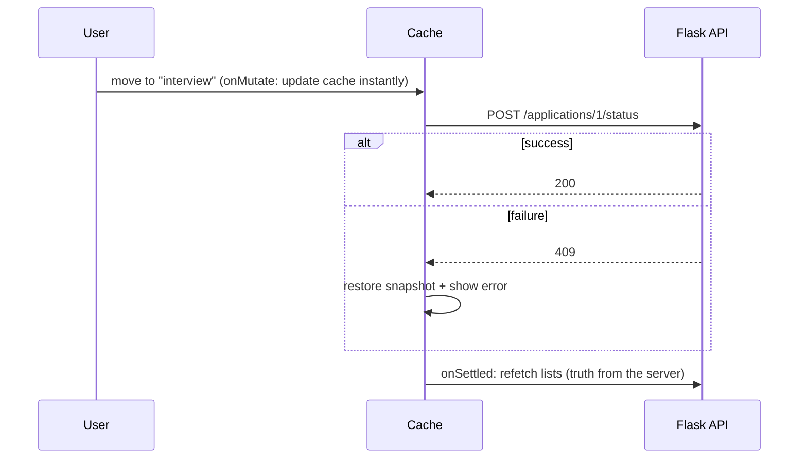

::part[Learn the Concept]{n="1"}

## 🎯 What you'll learn

- **Server state** vs client state, and why fetching in `useEffect` breaks
- Setting up TanStack Query in Next.js
- `useQuery`: query keys, `staleTime`, cancelling old requests
- Organizing query keys so you can refresh groups of data
- `useMutation`: saving data and refreshing lists afterwards
- **Optimistic updates**: show the change instantly, undo it if the server says no
- When to use TanStack Query vs Server Components

## 🔤 Key words

| Word | In simple words | Bahasa Indonesia |
|---|---|---|
| **Server state** | Data that really lives in the backend; the browser only has a copy | Data milik server |
| **Client state** | Data only the browser cares about: an open menu, a draft | Data milik browser |
| **Query** | A request that reads data (`useQuery`) | Pengambilan data |
| **Query key** | The name/address of a cached query: `["applications", "list", filters]` | Kunci query |
| **Stale** | The copy might be out of date and should be refreshed soon | Basi |
| **Mutation** | A request that changes data (`useMutation`) | Perubahan data |
| **Invalidate** | Mark cached data as old so it's fetched again | Tandai perlu ambil ulang |
| **Optimistic update** | Show the change before the server answers; undo if it fails | Update optimis |
| **Race condition** | An older, slower response arrives last and overwrites newer data | Balapan respons |

## 🧠 The big idea

Server state is **borrowed**. It lives in the Flask database, and the browser only holds a **copy** that becomes outdated as soon as someone else changes it — like a **photocopy of a library book**.

TanStack Query is the **librarian** for those copies: it remembers what you borrowed, notices when copies are old, gets new ones in the background, avoids fetching the same thing twice, and updates everyone reading the same book.

## ❓ Why it matters

Fetching by hand looks simple, then collects bugs:

```tsx
const [data, setData] = useState(null);
const [loading, setLoading] = useState(true);
useEffect(() => {
  fetch(`/api/applications?status=${status}`).then((r) => r.json()).then(setData).finally(() => setLoading(false));
}, [status]);
```

- **Race condition**: switch filters quickly, and an older response can overwrite the newer one.
- **No cache**: going back to a page loads everything again and flashes a spinner.
- No retries, no background refresh, no sharing between components.
- After saving something, every list showing that data must be updated by hand.

## 📖 Step by step

### 1. Setup in Next.js

```tsx
// app/providers.tsx
"use client";

import { QueryClient, QueryClientProvider } from "@tanstack/react-query";

let browserQueryClient: QueryClient | undefined;
function getQueryClient() {
  if (typeof window === "undefined") return new QueryClient();   // a fresh client per server render
  return (browserQueryClient ??= new QueryClient());             // one client in the browser
}

export function Providers({ children }: { children: React.ReactNode }) {
  return <QueryClientProvider client={getQueryClient()}>{children}</QueryClientProvider>;
}
```

- The `QueryClient` is the librarian: **one** in the browser, and a new one for each server render (so users never share data).
- Put `<Providers>` in the layout of the pages that need it.
- The React Query DevTools panel (`@tanstack/react-query-devtools`) shows everything in the cache.

### 2. Queries and keys

```tsx
export const applicationKeys = {
  all: ["applications"] as const,
  lists: () => [...applicationKeys.all, "list"] as const,
  list: (filters: Filters) => [...applicationKeys.lists(), filters] as const,
  detail: (id: number) => [...applicationKeys.all, "detail", id] as const,
};

export function useApplications(api: ApplicationsApi, filters: Filters) {
  return useQuery({
    queryKey: applicationKeys.list(filters),                       // cache identity; changes → refetch
    queryFn: ({ signal }) => api.listApplications(filters, { signal }),   // signal aborts outdated requests
    staleTime: 30_000,                                             // fresh for 30 s → no refetch on remount
    placeholderData: keepPreviousData,                             // keep showing the old list while a new filter loads
  });
}
```

- The **query key** is the cache address — like a **library shelf number**. Include **every** value the request uses (like `filters`), or different filters will share the wrong data.
- A **key factory** (`applicationKeys`) prevents typos and lets you refresh groups: everything starting with `["applications", "list"]` means "all lists".
- `signal` cancels a request that is no longer needed.
- `keepPreviousData` keeps the old list on screen while the new filter loads, so the page doesn't flash empty.

| Option | Meaning |
|---|---|
| `staleTime` | how long data counts as fresh (default 0 = refresh often) |
| `gcTime` | how long unused data stays in memory (default 5 minutes) |
| `enabled` | only run when this is true (for example, search text isn't empty) |
| `retry` | automatic retries for failed requests (default 3 in the browser) |
| `refetchOnWindowFocus` | refresh when you come back to the tab (default true) |

### 3. States

```tsx
const query = useApplications(api, filters);
if (query.isPending) return <p role="status">Loading applications…</p>;   // no data yet
if (query.isError) return <ErrorPanel onRetry={() => query.refetch()} />;
return (
  <>
    {query.isFetching && <p aria-live="polite">Updating…</p>}   {/* background refresh with data on screen */}
    <List applications={query.data} />
  </>
);
```

- `isPending` = no data **yet** (first load) → show a loading screen.
- `isFetching` = a request is running, maybe in the background while old data is on screen → show a small "Updating…".

### 4. Mutations and invalidation

```tsx
const queryClient = useQueryClient();
const addNote = useMutation({
  mutationFn: (body: string) => api.addNote(applicationId, body),
  onSuccess: () => queryClient.invalidateQueries({ queryKey: noteKeys.list(applicationId) }),
});

<button disabled={addNote.isPending} onClick={() => addNote.mutate(text)}>Save note</button>
{addNote.isError && <p role="alert">Couldn't save the note</p>}
```

After saving, `invalidateQueries` tells the librarian: "the notes copy is old". Any notes list on screen is fetched again automatically.

### 5. Optimistic updates

```tsx
useMutation({
  mutationFn: ({ id, status }) => api.moveStatus(id, status),
  onMutate: async ({ id, status }) => {
    await queryClient.cancelQueries({ queryKey: applicationKeys.lists() });          // stop in-flight fetches overwriting us
    const snapshot = queryClient.getQueriesData<Application[]>({ queryKey: applicationKeys.lists() });
    queryClient.setQueriesData<Application[]>({ queryKey: applicationKeys.lists() }, (old) =>
      old?.map((a) => (a.id === id ? { ...a, status } : a)),
    );
    return { snapshot };
  },
  onError: (_error, _variables, context) => context?.snapshot.forEach(([key, data]) => queryClient.setQueryData(key, data)),
  onSettled: (_data, _error, { id }) => {
    queryClient.invalidateQueries({ queryKey: applicationKeys.lists() });
    queryClient.invalidateQueries({ queryKey: applicationKeys.detail(id) });
  },
});
```



Like writing a meeting in **pencil** in your calendar before the other person confirms: if they say no, you erase it.

1. `onMutate`: stop old requests, save a **snapshot** (the pencil-free version), and change the cache right away.
2. `onError`: put the snapshot back and show an error.
3. `onSettled`: fetch the real data from the server either way.

Use this for quick actions that usually succeed (moving a status, likes, toggles). For payments or actions you can't undo, show "Saving…" and wait for the server.

### 6. TanStack Query and Server Components

| You need | Use |
|---|---|
| Page data in the first HTML, SEO, secrets | Server Components (+ `use cache`, lesson 06) |
| Saving data from forms | Server Actions (Week 5) |
| Very interactive screens: live filters, infinite scroll, polling, optimistic drag-and-drop | TanStack Query |
| Both | load on the server first, then hand the data to the browser cache (`HydrationBoundary`) |

Many Next.js apps load most pages with Server Components, and use TanStack Query only for the interactive parts — like CareerPilot's pipeline board.

## ⚠️ Common mistakes

- A query key missing a value (`["applications"]` for every filter) → the wrong cached data.
- Copying query data into `useState` and changing it there.
- Optimistic updates without `cancelQueries` (an old response overwrites the instant change).
- Creating a new `QueryClient` inside a component on every render.
- Using TanStack Query for UI state like open menus — that's `useState` or Zustand.
- Loading the same data again in the browser that a Server Component already rendered, without a reason.

## 🏆 Best practices

- [ ] One `QueryClient` per browser session; a fresh one per server render.
- [ ] Use key factories, and put every input in the key.
- [ ] Pass `signal` to the request so old requests are cancelled.
- [ ] Choose a sensible `staleTime` (0 means refetching often).
- [ ] Handle `isPending`, `isError` and background `isFetching` separately.
- [ ] Invalidate by prefix after mutations; optimistic updates only with snapshot + rollback + `onSettled` refetch.
- [ ] Keep server data out of global client stores.
- [ ] Use React Query DevTools while developing.

::part[Explain & Design]{n="2"}

## 🗣️ Explain it

Explain the librarian idea to a teammate, and use it to describe what happens when two components ask for the same applications list at the same time.

## 📐 Design it

Design the TanStack Query layer for CareerPilot's **pipeline board**: columns per status, drag a card to change its status, add a note from a card, check for updates every 60 seconds while the tab is visible, and show a "3 new updates" banner instead of moving cards under the user's mouse. Define the keys, queries, mutations and cache updates.

:::quiz
Show a possible design

```ts
export const boardKeys = {
  all: ["board"] as const,
  board: (filters: BoardFilters) => [...boardKeys.all, filters] as const,
  notes: (applicationId: number) => ["notes", applicationId] as const,
};

// Query: whole board in one request (grouped server-side)
useQuery({
  queryKey: boardKeys.board(filters),
  queryFn: ({ signal }) => api.getBoard(filters, { signal }),
  staleTime: 30_000,
  refetchInterval: 60_000,                  // polling
  refetchIntervalInBackground: false,        // pause when the tab is hidden
  placeholderData: keepPreviousData,
  select: (board) => board,                  // could derive counts here
});

// "New updates" banner instead of silent reordering:
// keep a `displayed` snapshot in local state; when fresh data differs (compare updatedAt values),
// show "3 new updates" and apply the new data when the user clicks the banner.

// Mutation: move card (optimistic)
useMutation({
  mutationFn: ({ id, to }) => api.moveStatus(id, to),
  onMutate: async ({ id, to }) => {
    await queryClient.cancelQueries({ queryKey: boardKeys.all });
    const snapshot = queryClient.getQueriesData({ queryKey: boardKeys.all });
    queryClient.setQueriesData({ queryKey: boardKeys.all }, (board) => moveCard(board, id, to));   // pure helper
    return { snapshot };
  },
  onError: (error, vars, ctx) => { restore(ctx.snapshot); toast(messageFor(error)); },   // 409 invalid_transition
  onSettled: () => queryClient.invalidateQueries({ queryKey: boardKeys.all }),
});

// Mutation: add note (not optimistic on the board; optimistic in the notes list)
useMutation({
  mutationFn: ({ applicationId, body }) => api.addNote(applicationId, body),
  onSuccess: (_note, { applicationId }) => {
    queryClient.invalidateQueries({ queryKey: boardKeys.notes(applicationId) });
    queryClient.invalidateQueries({ queryKey: boardKeys.all });   // note count badge on cards
  },
});
```

- Polling stops when the tab is hidden (saves requests and battery).
- New data is held back behind a banner, so cards don't jump while the user is working.
- A "Move to…" menu uses the same mutation, as a keyboard-friendly alternative to drag-and-drop.
:::

### 📝 Self-review checklist

- [ ] Keys include every input and allow refreshing by prefix
- [ ] Polling pauses in hidden tabs
- [ ] Optimistic update with cancel, snapshot, rollback and refetch
- [ ] Content doesn't jump under the user's cursor

::ai-review{task="design"}

::part[Toy Exercise]{n="3"}

:::exercise{path="exercises/web/m4/w4/07-tanstack-query" ai="ai-allowed" title="Queries, keys and an optimistic status mutation"}
Write a query key factory, a `useApplications` hook with cancellation, stale time and "keep previous data" while filters change, and a `useMoveStatus` mutation with an optimistic cache update, rollback and invalidation — then a panel that shows loading, an error with retry, background updating and mutation errors. The tests use a real `QueryClient` with a controllable fake API.
:::

:::hints
- `useQuery({ queryKey, queryFn: ({ signal }) => …, staleTime: 30_000, placeholderData: keepPreviousData })`.
- `getQueriesData` returns `[key, data]` pairs — restore each one with `setQueryData(key, data)`.
- To name the failed application, use `move.variables?.id` when `move.isError`.
:::

## ✅ Quick check

:::quiz
What's the difference between `isPending` and `isFetching`?

`isPending` means there's no data yet (first load). `isFetching` means a request is running, including background refreshes while old data is still on screen.
:::

:::quiz
Why call `cancelQueries` at the start of an optimistic update?

So a request that's already running doesn't finish later and overwrite the instant change with older server data.
:::

## 📚 Keep learning

- [TanStack Query docs: Overview](https://tanstack.com/query/latest/docs/framework/react/overview)
- [TanStack Query docs: Optimistic Updates](https://tanstack.com/query/latest/docs/framework/react/guides/optimistic-updates)
- Next.js docs (bundled): Client-side data fetching → TanStack Query guide

## 📣 End of Week 4 — share your progress

:::linkedin{type="weekly"}
🧭 Week 4: the Next.js App Router, for real.

- Folders became routes: layouts, dynamic `[id]` pages, route groups, loading and not-found UI
- Moved secrets out of the browser: Server Components fetch from my Flask API; only small "use client" islands ship JavaScript
- Next.js 16 caching: public job lists cached with `use cache` + tags, personal data never cached, `updateTag` after mutations
- TanStack Query for the interactive board, with optimistic status changes that roll back on errors

The concept that changed how I think: [your answer].

Next: forms, authentication and role-based UI. 🔐

#NextJS #React #WebDevelopment #LearningInPublic
:::
