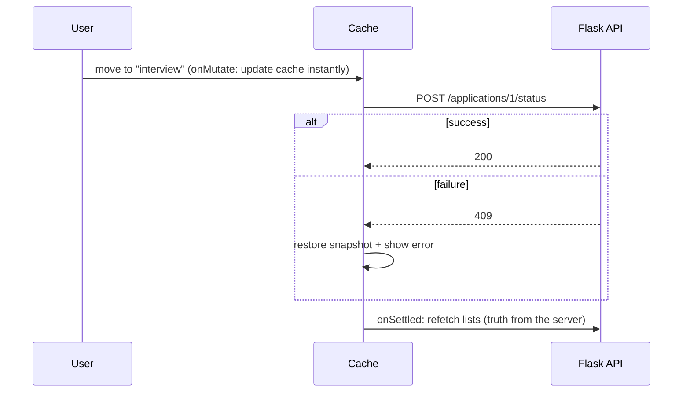

::part[Learn the Concept]{n="1"}

## 🎯 What you'll learn

- **Server state** vs client state, and why `useEffect` fetching breaks
- Setting up `QueryClientProvider` in a Next.js App Router project
- `useQuery`: query keys, `queryFn`, `staleTime`, `gcTime`, `enabled`, `placeholderData`, `signal`
- Query key factories and invalidation by prefix
- `useMutation`: pending/error state, `invalidateQueries`, **optimistic updates with rollback**
- When to use TanStack Query vs Server Components + Server Actions

## 🧠 The big idea

Server state is **borrowed**: it lives in the Flask database, and the browser only holds a **copy** that goes stale the moment someone else changes it. TanStack Query is a **librarian** for those copies: it remembers what you borrowed, notices when copies are old, fetches new ones in the background, avoids duplicate requests, and updates everyone reading the same book.

## ❓ Why does this exist?

Hand-written fetching looks simple and then accumulates bugs:

```tsx
const [data, setData] = useState(null);
const [loading, setLoading] = useState(true);
useEffect(() => {
  fetch(`/api/applications?status=${status}`).then((r) => r.json()).then(setData).finally(() => setLoading(false));
}, [status]);
```

- Race condition: switching filters quickly lets an older response overwrite a newer one.
- No cache: navigating back refetches and flashes a spinner.
- No retry, no background refresh, no sharing between components, no cancellation.
- After a mutation, every list showing that data must be updated manually.

## 💥 What happens if we DON'T use a server-state tool?

Multiple components each fetch the same applications list, show inconsistent data after a status change, and the team writes a custom global store to sync API responses — reinventing a cache, badly.

## 📖 How it works, step by step

### 1. Setup in Next.js

```tsx
// app/providers.tsx
"use client";

import { QueryClient, QueryClientProvider } from "@tanstack/react-query";

let browserQueryClient: QueryClient | undefined;
function getQueryClient() {
  if (typeof window === "undefined") return new QueryClient();   // a fresh client per server render
  return (browserQueryClient ??= new QueryClient());             // one client in the browser
}

export function Providers({ children }: { children: React.ReactNode }) {
  return <QueryClientProvider client={getQueryClient()}>{children}</QueryClientProvider>;
}
```

Render `<Providers>` in the layout of the routes that need it. The React Query DevTools panel (`@tanstack/react-query-devtools`) shows every cached query.

### 2. Queries and keys

```tsx
export const applicationKeys = {
  all: ["applications"] as const,
  lists: () => [...applicationKeys.all, "list"] as const,
  list: (filters: Filters) => [...applicationKeys.lists(), filters] as const,
  detail: (id: number) => [...applicationKeys.all, "detail", id] as const,
};

export function useApplications(api: ApplicationsApi, filters: Filters) {
  return useQuery({
    queryKey: applicationKeys.list(filters),                       // cache identity; changes → refetch
    queryFn: ({ signal }) => api.listApplications(filters, { signal }),   // signal aborts outdated requests
    staleTime: 30_000,                                             // fresh for 30 s → no refetch on remount
    placeholderData: keepPreviousData,                             // keep showing the old list while a new filter loads
  });
}
```

- The **query key** is like a cache address. Include every variable the `queryFn` uses.
- A key factory prevents typos and enables **prefix invalidation** (`["applications", "list"]` matches every list).

| Option | Meaning |
|---|---|
| `staleTime` | how long data counts as fresh (default 0 → refetch on mount/focus) |
| `gcTime` | how long unused data stays in memory (default 5 min) |
| `enabled` | run only when true (e.g. query text not empty) |
| `retry` | automatic retries for failed queries (default 3 in the browser) |
| `refetchOnWindowFocus` | refresh when the tab regains focus (default true) |

### 3. States

```tsx
const query = useApplications(api, filters);
if (query.isPending) return <p role="status">Loading applications…</p>;   // no data yet
if (query.isError) return <ErrorPanel onRetry={() => query.refetch()} />;
return (
  <>
    {query.isFetching && <p aria-live="polite">Updating…</p>}   {/* background refresh with data on screen */}
    <List applications={query.data} />
  </>
);
```

`isPending` = no data yet; `isFetching` = a request is running (maybe in the background). TypeScript narrows `query.data` after the checks.

### 4. Mutations and invalidation

```tsx
const queryClient = useQueryClient();
const addNote = useMutation({
  mutationFn: (body: string) => api.addNote(applicationId, body),
  onSuccess: () => queryClient.invalidateQueries({ queryKey: noteKeys.list(applicationId) }),
});

<button disabled={addNote.isPending} onClick={() => addNote.mutate(text)}>Save note</button>
{addNote.isError && <p role="alert">Couldn't save the note</p>}
```

Invalidation marks matching queries stale and refetches the ones on screen.

### 5. Optimistic updates

```tsx
useMutation({
  mutationFn: ({ id, status }) => api.moveStatus(id, status),
  onMutate: async ({ id, status }) => {
    await queryClient.cancelQueries({ queryKey: applicationKeys.lists() });          // stop in-flight fetches overwriting us
    const snapshot = queryClient.getQueriesData<Application[]>({ queryKey: applicationKeys.lists() });
    queryClient.setQueriesData<Application[]>({ queryKey: applicationKeys.lists() }, (old) =>
      old?.map((a) => (a.id === id ? { ...a, status } : a)),
    );
    return { snapshot };
  },
  onError: (_error, _variables, context) => context?.snapshot.forEach(([key, data]) => queryClient.setQueryData(key, data)),
  onSettled: (_data, _error, { id }) => {
    queryClient.invalidateQueries({ queryKey: applicationKeys.lists() });
    queryClient.invalidateQueries({ queryKey: applicationKeys.detail(id) });
  },
});
```



Use optimistic updates for quick, likely-to-succeed actions (status moves, likes, toggles). For payments or irreversible actions, show pending state and wait for the server.

### 6. TanStack Query and Server Components

| Need | Use |
|---|---|
| Page data that should be in the initial HTML, SEO, secrets | Server Components (+ `use cache`, lesson 06) |
| Mutations from forms | Server Actions (Week 5) — they can refresh server data with `updateTag`/`router.refresh()` |
| Highly interactive client views: live filtering, infinite scroll, polling, optimistic drag-and-drop | TanStack Query |
| Both | prefetch on the server and hydrate the client cache (`HydrationBoundary`) |

Many Next.js apps use Server Components for most reads and TanStack Query only for the rich interactive parts (like CareerPilot's pipeline board).

## ⚖️ Trade-offs

| Choice | ✅ | ❌ |
|---|---|---|
| TanStack Query | caching, dedupe, retries, background refresh, mutations | a library and concepts to learn; client JS |
| `useEffect` fetching | no dependency | race conditions, no cache, lots of boilerplate |
| Server Components only | less client JS, secure | less suited for very interactive, frequently-updating UIs |
| SWR | smaller, simple | fewer mutation features |
| Optimistic updates | instant feel | rollback logic; risk of confusing users if failures are common |

## ✅ When to use it / 🚫 When NOT to use it

- ✅ Client-side data that changes while the user interacts: boards, dashboards with polling, infinite lists, search-as-you-type.
- ✅ Mutations that should update several views.
- 🚫 Don't use it to store client UI state (open menus, form drafts) — that's `useState`/Zustand.
- 🚫 Don't duplicate data already rendered by Server Components unless the client needs to manage it.

## 🏆 Best practices

- [ ] One `QueryClient` per browser session; fresh client per server render.
- [ ] Query key factories; include every input in the key.
- [ ] Pass `signal` to fetch for cancellation.
- [ ] Set a sensible `staleTime` (0 means refetch often).
- [ ] Handle `isPending`, `isError` and background `isFetching` distinctly.
- [ ] Invalidate by prefix after mutations; optimistic updates only with snapshot + rollback + `onSettled` refetch.
- [ ] Keep server state out of global client stores.
- [ ] Use React Query DevTools while developing.

## 🏭 How it's used in industry

- TanStack Query is one of the most widely used React data libraries; job listings frequently mention "React Query".
- Trello-like boards, admin dashboards and chat UIs rely on optimistic updates and invalidation.
- Generated API clients (Orval, openapi-react-query) produce TanStack Query hooks directly from OpenAPI specs.

## ⚠️ Common mistakes

- Query keys missing a variable (`["applications"]` for every filter) → wrong cached data.
- Copying query data into `useState` and mutating it.
- Optimistic updates without cancelling in-flight queries (the old response overwrites the optimistic value).
- Creating a new `QueryClient` inside a component on every render.

::part[Explain & Design]{n="2"}

## 🗣️ Explain it

Explain the librarian analogy to a teammate and use it to describe what happens when two components request the same applications list at the same time.

## 📐 Design it

Design the TanStack Query layer for CareerPilot's **pipeline board**: columns per status, drag a card to move status, add a note from the card, poll for updates every 60 seconds while the tab is visible, and show a "3 new updates" banner instead of reordering cards under the user's cursor. Define keys, queries, mutations and their cache updates.

:::quiz
Show a possible design

```ts
export const boardKeys = {
  all: ["board"] as const,
  board: (filters: BoardFilters) => [...boardKeys.all, filters] as const,
  notes: (applicationId: number) => ["notes", applicationId] as const,
};

// Query: whole board in one request (grouped server-side)
useQuery({
  queryKey: boardKeys.board(filters),
  queryFn: ({ signal }) => api.getBoard(filters, { signal }),
  staleTime: 30_000,
  refetchInterval: 60_000,                  // polling
  refetchIntervalInBackground: false,        // pause when the tab is hidden
  placeholderData: keepPreviousData,
  select: (board) => board,                  // could derive counts here
});

// "New updates" banner instead of silent reordering:
// keep a `displayed` snapshot in local state; when fresh data differs (compare updatedAt values),
// show "3 new updates" and apply the new data when the user clicks the banner.

// Mutation: move card (optimistic)
useMutation({
  mutationFn: ({ id, to }) => api.moveStatus(id, to),
  onMutate: async ({ id, to }) => {
    await queryClient.cancelQueries({ queryKey: boardKeys.all });
    const snapshot = queryClient.getQueriesData({ queryKey: boardKeys.all });
    queryClient.setQueriesData({ queryKey: boardKeys.all }, (board) => moveCard(board, id, to));   // pure helper
    return { snapshot };
  },
  onError: (error, vars, ctx) => { restore(ctx.snapshot); toast(messageFor(error)); },   // 409 invalid_transition
  onSettled: () => queryClient.invalidateQueries({ queryKey: boardKeys.all }),
});

// Mutation: add note (not optimistic on the board; optimistic in the notes list)
useMutation({
  mutationFn: ({ applicationId, body }) => api.addNote(applicationId, body),
  onSuccess: (_note, { applicationId }) => {
    queryClient.invalidateQueries({ queryKey: boardKeys.notes(applicationId) });
    queryClient.invalidateQueries({ queryKey: boardKeys.all });   // note count badge on cards
  },
});
```

Keyboard-accessible alternative to drag and drop: a "Move to…" menu using the same mutation.
:::

### 📝 Self-review checklist

- [ ] Keys cover every input and support prefix invalidation
- [ ] Polling pauses in background tabs
- [ ] Optimistic update with cancel, snapshot, rollback, settle
- [ ] UX avoids content jumping under the cursor

::ai-review{task="design"}

::part[Toy Exercise]{n="3"}

:::exercise{path="exercises/web/m4/w4/07-tanstack-query" ai="ai-allowed" title="Queries, keys and an optimistic status mutation"}
Write a query key factory, a `useApplications` hook with cancellation, stale time and previous data while filters change, and a `useMoveStatus` mutation with optimistic cache updates, rollback and invalidation — then a panel that shows pending, error with retry, background updating and mutation errors. Tests use a real `QueryClient` with a controllable fake API.
:::

:::hints
- `useQuery({ queryKey, queryFn: ({ signal }) => …, staleTime: 30_000, placeholderData: keepPreviousData })`.
- `getQueriesData` returns `[key, data]` pairs — restore each with `setQueryData(key, data)`.
- The failed application's role: find it with `move.variables?.id` when `move.isError`.
:::

## ✅ Quick check

:::quiz
What's the difference between `isPending` and `isFetching`?

`isPending` means there's no data yet (first load); `isFetching` means a request is in progress, including background refetches while data is already shown.
:::

:::quiz
Why call `cancelQueries` at the start of an optimistic update?

So an in-flight refetch doesn't finish afterwards and overwrite the optimistic change with older server data.
:::

## 📖 Kamus (glossary)

| Term | Bahasa Indonesia |
|---|---|
| Server state | Data milik server yang disalin ke klien |
| Query key | Kunci kueri (identitas cache) |
| Stale | Basi — data dianggap perlu diperbarui |
| Invalidation | Menandai cache agar diambil ulang |
| Mutation | Perubahan data ke server |
| Optimistic update | Pembaruan optimis (tampil dulu sebelum server menjawab) |

## 📚 Keep learning

- [TanStack Query docs: Overview](https://tanstack.com/query/latest/docs/framework/react/overview)
- [TanStack Query docs: Optimistic Updates](https://tanstack.com/query/latest/docs/framework/react/guides/optimistic-updates)
- Next.js docs (bundled): Client-side data fetching → TanStack Query guide

## 📣 End of Week 4 — share your progress

:::linkedin{type="weekly"}
🧭 Week 4: the Next.js App Router, for real.

- Folders became routes: layouts, dynamic `[id]` pages, route groups, loading and not-found UI
- Moved secrets out of the browser: Server Components fetch from my Flask API; only small "use client" islands ship JavaScript
- Next.js 16 caching: public job lists cached with `use cache` + tags, personal data never cached, `updateTag` after mutations
- TanStack Query for the interactive board, with optimistic status changes that roll back on errors

The concept that changed how I think: [your answer].

Next: forms, authentication and role-based UI. 🔐

#NextJS #React #WebDevelopment #LearningInPublic
:::
