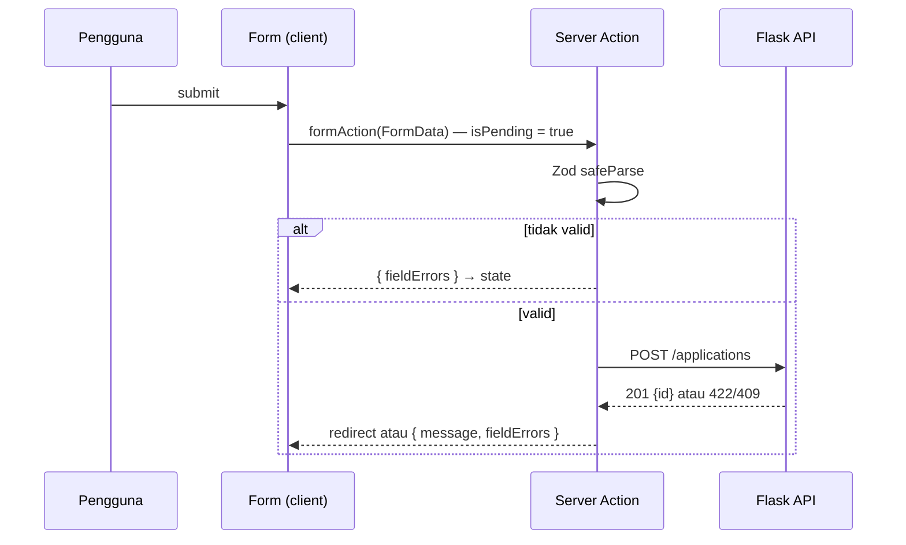

::part[Pelajari Konsepnya]{n="1"}

## 🎯 Yang akan kamu pelajari

- Bagaimana form HTML, `FormData`, dan **Server Action** bekerja bersama
- Mengecek data form di server dengan **Zod**
- Menampilkan error dengan **`useActionState`** dan tombol "Menyimpan…" dengan **`useFormStatus`**
- Menampilkan error `422` dan `409` dari Flask API di form
- Menyegarkan data dan redirect setelah berhasil menyimpan
- Pesan error yang bisa ditemukan semua orang (`aria-invalid`, `aria-describedby`)

## 🔤 Istilah penting

| Istilah | Artinya (sederhana) |
|---|---|
| **Server Action** | Function server yang bisa dipanggil form secara langsung, tanpa menulis route API |
| **`FormData`** | Semua field bernama dari form yang di-submit, berupa nilai teks |
| **Zod** | Library yang mengecek data punya bentuk yang benar dan mengubahnya |
| **Schema** | Aturan data yang valid: "role wajib diisi, maksimal 200 karakter" |
| **`useActionState`** | Hook yang menyimpan hasil kembalian Server Action (seperti error) |
| **`useFormStatus`** | Hook yang memberi tahu tombol apakah form-nya sedang di-submit |
| **Progressive enhancement** | Halaman tetap berfungsi tanpa JavaScript, dan jadi lebih nyaman saat JS dimuat |
| **Expected error** | Error yang sudah kamu rencanakan: input tidak valid, data ganda |

## 🧠 Ide besarnya

Form adalah **percakapan** antara pengguna dan server: "ini yang kuketik" → "bagian ini salah" → "sudah diperbaiki" → "tersimpan, ini halaman barumu". Seperti mengisi formulir di **loket kantor kelurahan**: kamu menyerahkannya, petugas menunjuk kolom yang perlu diperbaiki, kamu memperbaikinya, dan kamu mendapat tanda terima.

Server Action membuat form Next.js bisa berbicara dengan server **secara langsung** — tanpa route API terpisah dan panggilan `fetch`. React yang mengurus pengiriman form, keadaan menunggu, dan menampilkan balasannya.

## ❓ Kenapa ini penting

Form React buatan tangan biasanya butuh `useState` untuk setiap field, `preventDefault`, `fetch`, flag `loading`, `try/catch`, dan state error. Kodenya banyak — dan form sama sekali tidak berfungsi sampai JavaScript selesai diunduh.

Form seperti ini juga mudah salah:

```tsx
"use client";
export function NewApplication() {
  const [role, setRole] = useState("");
  const [error, setError] = useState("");
  async function onSubmit(e: React.FormEvent) {
    e.preventDefault();
    if (!role) return setError("Role is required");          // only client-side validation
    await fetch("/api/applications", { method: "POST", body: JSON.stringify({ role }) });  // no pending state, errors ignored
    router.push("/applications");                             // even when the request failed
  }
  ...
}
```

- Tombol tetap aktif → orang men-submit dua kali.
- Error 422 dari Flask diabaikan → pengguna mengira datanya sudah tersimpan.
- Pengecekan hanya di browser → siapa pun bisa mengirim data yang salah dengan `curl`.

## 📖 Langkah demi langkah

### 1. Form menghasilkan `FormData`

```tsx
<form action={createApplicationAction}>
  <input name="role" />
  <select name="company_id">…</select>
  <button type="submit">Save</button>
</form>
```

Saat di-submit, browser memasukkan setiap field yang punya **`name`** ke `FormData`. Setiap nilainya berupa **teks** (atau `File`): `"3"`, bukan `3`; field angka yang kosong bernilai `""`.

### 2. Server Action

```ts
// app/applications/new/actions.ts
"use server";

export async function createApplicationAction(prevState: FormState, formData: FormData): Promise<FormState> {
  // runs on the server — can use secrets, call Flask, read cookies
}
```

- `"use server"` di bagian atas membuat setiap function yang di-export menjadi Server Action.
- Ia berjalan di server, jadi bisa memakai rahasia, memanggil Flask, dan membaca cookie.
- Next.js mengubahnya menjadi **endpoint POST publik** dengan id yang sulit ditebak. Sulit ditebak **bukan** berarti privat — seperti pintu belakang tanpa papan nama tetaplah pintu. Selalu **cek login, cek izin, dan validasi** di dalamnya.

### 3. Cek data dengan Zod (di server)

```ts
import { z } from "zod";

const optionalSalary = z.preprocess(
  (v) => (v === "" ? undefined : v),
  z.coerce.number().int().nonnegative().optional(),
);

export const applicationSchema = z
  .object({
    company_id: z.coerce.number({ error: "Choose a company" }).int().positive("Choose a company"),
    role: z.string().trim().min(1, "Role is required").max(200),
    salary_min: optionalSalary,
    salary_max: optionalSalary,
  })
  .refine((d) => d.salary_min === undefined || d.salary_max === undefined || d.salary_min <= d.salary_max, {
    message: "Maximum must be at least the minimum",
    path: ["salary_max"],
  });
```

```ts
const parsed = applicationSchema.safeParse(Object.fromEntries(formData));
if (!parsed.success) {
  return { message: "Please fix the errors below", fieldErrors: z.flattenError(parsed.error).fieldErrors };
}
// parsed.data is typed: { company_id: number; role: string; salary_min?: number; ... }
```

Schema Zod itu seperti **checklist yang dipakai petugas** di loket:
- `z.coerce.number()` mengubah teks `"3"` menjadi angka `3`.
- `z.preprocess` mengubah field kosong `""` menjadi "tidak diisi".
- `.refine(..., { path: ["salary_max"] })` mengecek dua field sekaligus dan menaruh error-nya di `salary_max`.
- `z.flattenError(error).fieldErrors` menghasilkan `{ role: ["Role is required"], ... }` — persis yang dibutuhkan form.
- Setelah berhasil, `parsed.data` punya type sungguhan (angka benar-benar angka).

### 4. Panggil Flask dan tampilkan error-nya

```ts
try {
  created = await createApplication(parsed.data);          // Flask POST /api/v1/applications
} catch (error) {
  if (error instanceof ApiError && error.status === 422) return { message: "Please fix the errors below", fieldErrors: error.fields ?? {} };
  if (error instanceof ApiError && error.status === 409) return { message: "You already have an application for this role", fieldErrors: {} };
  throw error;                                              // unexpected → nearest error.tsx
}

updateTag("applications");                                  // expire cached lists (W4 L6)
redirect(`/applications/${created.id}`);                    // outside try/catch!
```

- Flask API-mu dari Modul 2 sudah mengembalikan error per field dengan bentuk yang sama dengan yang dipakai form.
- Error **yang diperkirakan** (422 tidak valid, 409 ganda) **dikembalikan** dan ditampilkan di form.
- Error **tak terduga** **dilempar** ke layar error.
- Setelah berhasil: segarkan list di cache, lalu redirect.

:::warning[redirect() melempar]
`redirect()` bekerja dengan melempar sinyal khusus. Panggil **setelah** `try/catch`, kalau tidak `catch`-mu akan menelan redirect-nya.
:::

### 5. `useActionState` — putaran percakapan

```tsx
"use client";
import { useActionState } from "react";

const initialState: FormState = { message: null, fieldErrors: {} };

export function ApplicationForm({ companies }: Props) {
  const [state, formAction, isPending] = useActionState(createApplicationAction, initialState);
  return (
    <form action={formAction}>
      {state.message && <p role="alert">{state.message}</p>}
      <label htmlFor="role">Role</label>
      <input
        id="role"
        name="role"
        aria-invalid={state.fieldErrors.role ? true : undefined}
        aria-describedby={state.fieldErrors.role ? "role-error" : undefined}
      />
      {state.fieldErrors.role && <p id="role-error">{state.fieldErrors.role[0]}</p>}
      <SubmitButton />
    </form>
  );
}
```

- Berikan `formAction` (dari hook) ke form, bukan action mentahnya.
- Apa pun yang dikembalikan action menjadi `state` berikutnya — seperti petugas yang mengembalikan formulirmu beserta catatannya.
- `role="alert"` membacakan ringkasannya; `aria-describedby` menghubungkan setiap error ke field-nya.



### 6. `useFormStatus` untuk tombol

```tsx
"use client";
import { useFormStatus } from "react-dom";

function SubmitButton() {
  const { pending } = useFormStatus();         // status of the PARENT <form>
  return <button type="submit" disabled={pending}>{pending ? "Saving…" : "Save application"}</button>;
}
```

`useFormStatus` hanya berfungsi di component yang berada **di dalam** `<form>` — seperti lampu yang hanya menyala saat dicolokkan ke form itu. Itulah kenapa tombolnya dibuat sebagai component sendiri.

### 7. Mempertahankan ketikan pengguna setelah error

Dengan `action={formAction}`, React **mengosongkan field uncontrolled** setelah action selesai. Untuk pengalaman yang lebih baik saat ada error, kembalikan nilai yang di-submit di `state` dan pakai sebagai `defaultValue`, atau jadikan field penting sebagai controlled. Untuk form yang panjang dan rumit, React Hook Form (materi 07) sering lebih cocok.

## ⚠️ Kesalahan umum

- Input tanpa `name` → tidak ada di `FormData`.
- `redirect()` di dalam `try` → tertangkap sebagai error.
- `useFormStatus` di component yang sama dengan yang me-render `<form>` → `pending` selalu `false`.
- Menganggap `formData.get("salary")` sebagai angka (itu teks).
- Mengambil id pengguna dari input tersembunyi alih-alih dari sesi.
- Memakai Server Action untuk **membaca** data — muat data di Server Component atau TanStack Query.

## 🏆 Praktik terbaik

- [ ] Cek data **di server** dengan schema, walaupun browser juga mengecek.
- [ ] Cek login dan izin **di dalam** setiap Server Action.
- [ ] Kembalikan error yang diperkirakan sebagai state; lempar yang tak terduga ke `error.tsx`.
- [ ] Masukkan error per field `422` dari Flask ke bentuk `fieldErrors` yang sama — satu tampilan error untuk keduanya.
- [ ] Nonaktifkan tombol submit selama menyimpan, dan tampilkan "Menyimpan…".
- [ ] Beri label pada setiap field; pakai `aria-invalid`, `aria-describedby`, dan ringkasan `role="alert"`.
- [ ] Pakai pesan umum untuk kegagalan yang sensitif soal keamanan (seperti login).
- [ ] Segarkan data cache **setelah** berhasil; `redirect` di luar `try/catch`.
- [ ] Jangan pernah memercayai input tersembunyi untuk identitas — baca dari sesi.

::part[Jelaskan & Rancang]{n="2"}

## 🗣️ Jelaskan

Jelaskan ke orang awam kenapa sebuah form mengecek input dua kali — sekali di browser dan sekali di server — dengan contoh teller bank yang tetap menghitung uangmu walaupun ATM sudah menghitungnya.

## 📐 Rancang

Rancang form **"Jadwalkan interview"**: lamaran (sudah dipilih dari halaman), jenis interview (`hr`, `technical`, `system_design`, `final`), waktu mulai dan selesai (datetime-local), URL meeting opsional, dan catatan opsional. Tulis schema Zod-nya (termasuk aturan antar field), type `FormState`, error mana yang datang dari Zod vs Flask, dan ke mana redirect-nya.

:::quiz
Tampilkan contoh desainnya

```ts
const interviewSchema = z
  .object({
    application_id: z.coerce.number().int().positive(),       // from the route param, re-checked against the session owner
    type: z.enum(["hr", "technical", "system_design", "final"], { error: "Choose an interview type" }),
    starts_at: z.coerce.date({ error: "Choose a start time" }),
    ends_at: z.coerce.date({ error: "Choose an end time" }),
    meeting_url: z.preprocess((v) => (v === "" ? undefined : v), z.url({ protocol: /^https$/ }).optional()),
    notes: z.string().trim().max(2000).optional(),
  })
  .refine((d) => d.ends_at > d.starts_at, { path: ["ends_at"], message: "End must be after start" });

type InterviewFormState = {
  message: string | null;
  fieldErrors: Partial<Record<"type" | "starts_at" | "ends_at" | "meeting_url" | "notes", string[]>>;
  values?: Record<string, string>;   // re-fill fields after an error
};
```

- **Zod mengecek bentuk:** field wajib, jenis yang diizinkan, format URL, selesai setelah mulai, panjang maksimal.
- **Flask mengecek aturan bisnis:** lamarannya ada dan milik pengguna ini (404), ada interview lain di waktu yang sama (409), waktu mulai di masa lalu untuk lamaran yang sudah ditutup (422).
- **Zona waktu:** `datetime-local` tidak punya zona waktu, jadi ubah dengan zona waktu pengguna di server sebelum mengirim tanggal ISO ke Flask.
- **Berhasil:** `updateTag("interviews")`, lalu `redirect(`/applications/${id}?tab=interviews`)`.
:::

### 📝 Checklist self-review

- [ ] Setiap field punya label dan tempat untuk error-nya
- [ ] Aturan antar field menampilkan error di field tertentu
- [ ] Identitas berasal dari sesi, bukan dari form

::ai-review{task="design"}

::part[Latihan Kecil]{n="3"}

:::exercise{path="exercises/web/m4/w5/01-server-action-forms" ai="no-ai" title="Form lamaran baru dengan Server Action"}
Tulis schema Zod, action `"use server"` (validasi, penanganan 422/409 dari Flask, `updateTag`, `redirect`), dan form client dengan `useActionState`, `useFormStatus`, serta error yang aksesibel.
:::

:::hints
- `Object.fromEntries(formData)` menghasilkan object biasa untuk `safeParse`.
- Pakai `z.preprocess` untuk mengubah `""` menjadi `undefined` pada angka opsional.
- Taruh `SubmitButton` di component tersendiri agar `useFormStatus` bisa melihat form-nya.
- Tes membuat `redirect` melempar error, sama seperti Next.js — jaga tetap di luar `try/catch`.
:::

## ✅ Cek cepat

:::quiz
Action-mu mengembalikan `{ fieldErrors }`, tapi form tidak pernah menampilkannya. Form memakai `<form action={createApplicationAction}>`. Apa yang salah?

Form memakai action mentah, bukan `formAction` dari `useActionState`, jadi state yang dikembalikan tidak ke mana-mana. Berikan `formAction` ke `action`.
:::

:::quiz
Kenapa Server Action berisiko kalau kamu lupa mengecek sesi?

Karena itu endpoint POST publik. Siapa pun bisa memanggilnya dengan `FormData` buatan sendiri, walaupun halaman yang berisi form-nya dilindungi.
:::

## 📚 Lanjut belajar

- Dokumentasi Next.js (tersedia di dalam proyek): panduan Forms; Server Actions / Updating Data; `useActionState`
- [React docs: useActionState](https://react.dev/reference/react/useActionState) · [useFormStatus](https://react.dev/reference/react-dom/hooks/useFormStatus)
- [Zod 4: error formatting](https://zod.dev/error-formatting)
