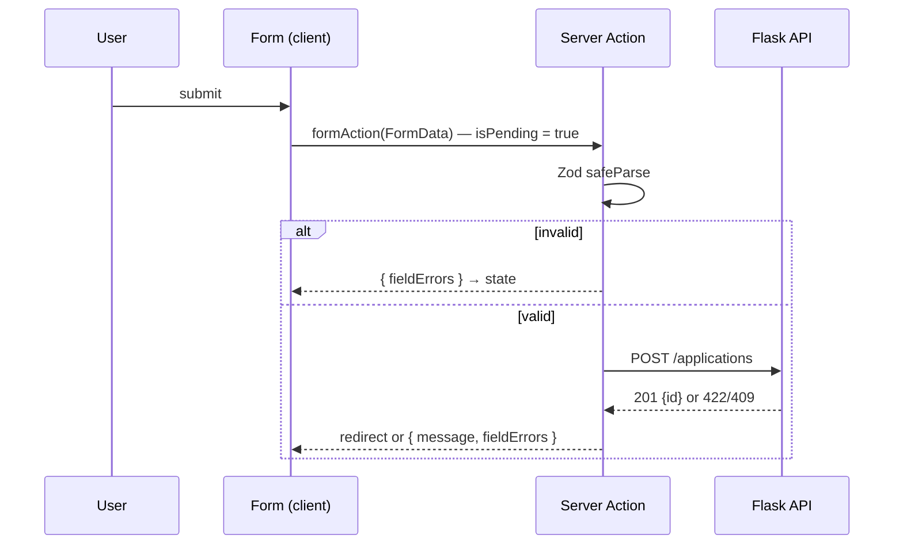

::part[Learn the Concept]{n="1"}

## 🎯 What you'll learn

- How HTML forms, `FormData` and **Server Actions** fit together
- Validating on the server with **Zod 4** (`safeParse`, `z.flattenError`)
- Returning errors with **`useActionState`** and pending UI with **`useFormStatus`**
- Mapping the Flask API's `422` field errors and `409` conflicts back onto the form
- Revalidating cached data and redirecting after a successful mutation
- Accessible error messages (`aria-invalid`, `aria-describedby`, `role="alert"`)

## 🧠 The big idea

A form is a **conversation** between the user and the server: "here's what I typed" → "these parts are wrong" → "fixed" → "saved, here's your new page". Every reply must reach the user clearly, even if the network is slow or JavaScript hasn't loaded yet.

Server Actions let a Next.js form talk to the server **directly**, without writing a separate API route and `fetch` call. React takes care of submitting, pending state and showing what the server replied.

## ❓ Why does this exist?

Typical hand-made React forms: `useState` for every field, `onSubmit` with `preventDefault`, `fetch` to an API route, a `loading` flag, a `try/catch`, and manual error state. That's a lot of code — and the form is dead until the JavaScript bundle loads.

HTML already had a working model: `<form action="/somewhere" method="post">`. Server Actions bring that model back, with React on top: **progressive enhancement** (works without JS) plus smooth updates (no full reload) once JS is ready.

## 💥 What happens if we DON'T?

```tsx
"use client";
export function NewApplication() {
  const [role, setRole] = useState("");
  const [error, setError] = useState("");
  async function onSubmit(e: React.FormEvent) {
    e.preventDefault();
    if (!role) return setError("Role is required");          // only client-side validation
    await fetch("/api/applications", { method: "POST", body: JSON.stringify({ role }) });  // no pending state, errors ignored
    router.push("/applications");                             // even when the request failed
  }
  ...
}
```

- Double submissions (button stays enabled).
- A 422 from Flask is silently ignored; the user thinks it saved.
- Anyone can `curl` the endpoint with invalid data — the client check is not protection.

## 📖 How it works, step by step

### 1. Forms produce `FormData`

```tsx
<form action={createApplicationAction}>
  <input name="role" />
  <select name="company_id">…</select>
  <button type="submit">Save</button>
</form>
```

When submitted, the browser collects every **named** field into `FormData`. All values are **strings** (or `File`) — `"3"`, not `3`; an empty number input is `""`.

### 2. A Server Action

```ts
// app/applications/new/actions.ts
"use server";

export async function createApplicationAction(prevState: FormState, formData: FormData): Promise<FormState> {
  // runs on the server — can use secrets, call Flask, read cookies
}
```

`"use server"` at the top marks every export as a Server Action. Next.js turns each one into a **public POST endpoint** with an unguessable id. "Unguessable" is not "private": treat it exactly like an API route — **authenticate, authorize and validate** inside.

### 3. Validate with Zod (on the server)

```ts
import { z } from "zod";

const optionalSalary = z.preprocess(
  (v) => (v === "" ? undefined : v),
  z.coerce.number().int().nonnegative().optional(),
);

export const applicationSchema = z
  .object({
    company_id: z.coerce.number({ error: "Choose a company" }).int().positive("Choose a company"),
    role: z.string().trim().min(1, "Role is required").max(200),
    salary_min: optionalSalary,
    salary_max: optionalSalary,
  })
  .refine((d) => d.salary_min === undefined || d.salary_max === undefined || d.salary_min <= d.salary_max, {
    message: "Maximum must be at least the minimum",
    path: ["salary_max"],
  });
```

```ts
const parsed = applicationSchema.safeParse(Object.fromEntries(formData));
if (!parsed.success) {
  return { message: "Please fix the errors below", fieldErrors: z.flattenError(parsed.error).fieldErrors };
}
// parsed.data is typed: { company_id: number; role: string; salary_min?: number; ... }
```

- `z.coerce.number()` converts the string `"3"` to `3`.
- `z.flattenError(error).fieldErrors` → `{ role: ["Role is required"], ... }` — perfect for forms.
- `.refine` with `path` attaches cross-field errors to a specific field.

### 4. Call the backend and map its errors

```ts
try {
  created = await createApplication(parsed.data);          // Flask POST /api/v1/applications
} catch (error) {
  if (error instanceof ApiError && error.status === 422) return { message: "Please fix the errors below", fieldErrors: error.fields ?? {} };
  if (error instanceof ApiError && error.status === 409) return { message: "You already have an application for this role", fieldErrors: {} };
  throw error;                                              // unexpected → nearest error.tsx
}

updateTag("applications");                                  // expire cached lists (W4 L6)
redirect(`/applications/${created.id}`);                    // outside try/catch!
```

Your Flask API from Module 2 already returns `{"error": {"code": "validation_failed", "fields": {...}}}` — the same shape the form needs. **Expected** errors (validation, conflicts) are **returned** as state; **unexpected** errors are **thrown** to the error boundary.

:::warning[redirect() throws]
`redirect()` works by throwing a special error. Call it **after** the `try/catch`, otherwise your `catch` swallows the redirect.
:::

### 5. `useActionState` — the conversation loop

```tsx
"use client";
import { useActionState } from "react";

const initialState: FormState = { message: null, fieldErrors: {} };

export function ApplicationForm({ companies }: Props) {
  const [state, formAction, isPending] = useActionState(createApplicationAction, initialState);
  return (
    <form action={formAction}>
      {state.message && <p role="alert">{state.message}</p>}
      <label htmlFor="role">Role</label>
      <input
        id="role"
        name="role"
        aria-invalid={state.fieldErrors.role ? true : undefined}
        aria-describedby={state.fieldErrors.role ? "role-error" : undefined}
      />
      {state.fieldErrors.role && <p id="role-error">{state.fieldErrors.role[0]}</p>}
      <SubmitButton />
    </form>
  );
}
```

The action's **first parameter** becomes the previous state; whatever it returns becomes the next `state`.



### 6. `useFormStatus` for the button

```tsx
"use client";
import { useFormStatus } from "react-dom";

function SubmitButton() {
  const { pending } = useFormStatus();         // status of the PARENT <form>
  return <button type="submit" disabled={pending}>{pending ? "Saving…" : "Save application"}</button>;
}
```

`useFormStatus` only works in a component **rendered inside** the `<form>` — not in the component that renders the form.

### 7. Keeping typed values after an error

With `action={formAction}`, React **resets uncontrolled fields** after the action finishes. For a better experience on errors, either return the submitted values in state and use them as `defaultValue`, or make key fields controlled. Keep it simple for short forms; for long forms, React Hook Form (lesson 07) is often the better tool.

## ⚖️ Trade-offs

| Approach | ✅ | ❌ |
|---|---|---|
| Server Action + `useActionState` | works without JS, little code, server validation built in | per-keystroke validation needs extra work; fields reset after submit |
| Client `onSubmit` + `fetch` to Route Handler | full control, easy instant feedback | more code, no progressive enhancement, still need server validation |
| React Hook Form + Zod (+ action) | best for complex, dynamic forms | extra library; JS required |

## ✅ When to use it / 🚫 When NOT to use it

- ✅ Create/edit forms, settings, login, "add note" — most CRUD forms.
- ✅ Mutations that should revalidate server-rendered data.
- 🚫 Not for **reading** data (Server Actions are POST and run one at a time) — fetch in Server Components or TanStack Query.
- 🚫 Not for public APIs other apps call — use Route Handlers (lesson 05).

## 🏆 Best practices

- [ ] Validate **on the server** with a schema (Zod) even if the client validates too.
- [ ] Authenticate and authorize **inside** every Server Action.
- [ ] Return expected errors as state; throw unexpected ones to `error.tsx`.
- [ ] Map backend `422` fields onto the same `fieldErrors` shape — one error UI for both sources.
- [ ] Disable the submit button while pending; show progress text.
- [ ] Accessible errors: `aria-invalid`, `aria-describedby`, a summary in `role="alert"`, labels on every field.
- [ ] Use generic messages for security-sensitive failures (login, duplicates of other users' data).
- [ ] `updateTag`/`revalidatePath` **after** success, `redirect` outside `try/catch`.
- [ ] Never trust hidden inputs (`<input type="hidden" name="user_id">`) — read identity from the session.

## 🏭 How it's used in industry

- Next.js teams use Server Actions for internal app mutations and keep Route Handlers for webhooks and public APIs.
- Remix/React Router popularised the same "forms + actions + progressive enhancement" model; React 19 made `useActionState`/`useFormStatus` part of React itself.
- Shared Zod schemas are a common way to keep frontend and backend validation rules in sync in TypeScript stacks; with a Python backend, the API's `422` response stays the source of truth.

## ⚠️ Common mistakes

- Forgetting `name` on inputs → the field isn't in `FormData`.
- `redirect()` inside `try` → "NEXT_REDIRECT" caught as an error.
- `useFormStatus` in the same component as `<form>` → `pending` is always `false`.
- Treating `formData.get("salary")` as a number.
- Using the user id from a hidden field instead of the session.

::part[Explain & Design]{n="2"}

## 🗣️ Explain it

Explain to a non-programmer why a form checks your input twice — once in the browser and once on the server — using the example of a bank teller who still counts the money even though the ATM already counted it.

## 📐 Design it

Design the **"Schedule interview"** form for CareerPilot: application (preselected from the page), interview type (`hr`, `technical`, `system_design`, `final`), start and end (datetime-local), optional meeting URL, optional notes. Write the Zod schema (including cross-field rules), the `FormState` type, which errors come from Zod vs Flask, and where the action redirects.

:::quiz
Show a possible design

```ts
const interviewSchema = z
  .object({
    application_id: z.coerce.number().int().positive(),       // from the route param, re-checked against the session owner
    type: z.enum(["hr", "technical", "system_design", "final"], { error: "Choose an interview type" }),
    starts_at: z.coerce.date({ error: "Choose a start time" }),
    ends_at: z.coerce.date({ error: "Choose an end time" }),
    meeting_url: z.preprocess((v) => (v === "" ? undefined : v), z.url({ protocol: /^https$/ }).optional()),
    notes: z.string().trim().max(2000).optional(),
  })
  .refine((d) => d.ends_at > d.starts_at, { path: ["ends_at"], message: "End must be after start" });

type InterviewFormState = {
  message: string | null;
  fieldErrors: Partial<Record<"type" | "starts_at" | "ends_at" | "meeting_url" | "notes", string[]>>;
  values?: Record<string, string>;   // re-fill fields after an error
};
```

- **Zod (shape):** required fields, enum, URL format, end after start, max lengths.
- **Flask (business rules):** application exists and belongs to the user (404), overlapping interview for the same user (409), start in the past when the application is closed (422).
- Timezone: `datetime-local` has no timezone → convert using the user's timezone on the server before sending ISO strings to Flask.
- Success → `updateTag("interviews")`, `redirect(`/applications/${id}?tab=interviews`)`.
:::

### 📝 Self-review checklist

- [ ] Every field has a label and an error slot
- [ ] Cross-field rule attached to a specific field
- [ ] Identity comes from the session, not the form

::ai-review{task="design"}

::part[Toy Exercise]{n="3"}

:::exercise{path="exercises/web/m4/w5/01-server-action-forms" ai="no-ai" title="New application form with a Server Action"}
Write the Zod schema, the `"use server"` action (validation, Flask 422/409 mapping, `updateTag`, `redirect`) and the client form with `useActionState`, `useFormStatus` and accessible errors.
:::

:::hints
- `Object.fromEntries(formData)` gives a plain object for `safeParse`.
- Use `z.preprocess` to turn `""` into `undefined` for optional numbers.
- Put `SubmitButton` in its own component so `useFormStatus` can see the form.
- The test mocks `redirect` to throw, just like Next.js does — keep it outside `try/catch`.
:::

## ✅ Quick check

:::quiz
Your action returns `{ fieldErrors }`, but the form never shows them. The form uses `<form action={createApplicationAction}>`. What's wrong?

The form uses the raw action, not the `formAction` returned by `useActionState`, so the returned state goes nowhere. Pass `formAction` to `action`.
:::

:::quiz
Why is a Server Action an authorization risk if you forget to check the session?

It's a public POST endpoint. Anyone can call it with crafted `FormData` even if the page with the form is protected.
:::

## 📖 Kamus (glossary)

| Term | Bahasa Indonesia |
|---|---|
| Server Action | Fungsi server yang dipanggil langsung dari form |
| Progressive enhancement | Peningkatan bertahap — tetap berfungsi tanpa JavaScript |
| Validation | Validasi input |
| Pending state | Status menunggu (sedang diproses) |
| Field error | Pesan kesalahan per kolom |
| Redirect | Pengalihan halaman |

## 📚 Keep learning

- Next.js docs (bundled): Forms guide; Server Actions / Updating Data; `useActionState`
- [React docs: useActionState](https://react.dev/reference/react/useActionState) · [useFormStatus](https://react.dev/reference/react-dom/hooks/useFormStatus)
- [Zod 4: error formatting](https://zod.dev/error-formatting)
