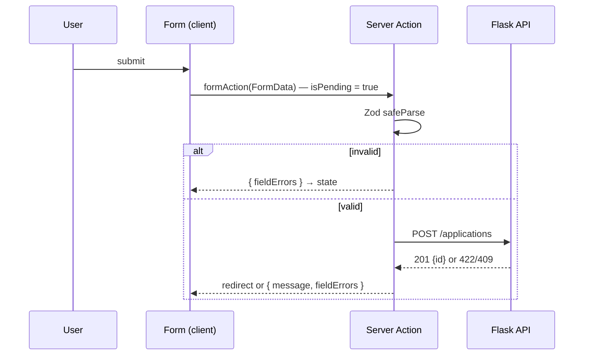

::part[Learn the Concept]{n="1"}

## 🎯 What you'll learn

- How HTML forms, `FormData` and **Server Actions** work together
- Checking form data on the server with **Zod**
- Showing errors with **`useActionState`** and a "Saving…" button with **`useFormStatus`**
- Showing the Flask API's `422` and `409` errors on the form
- Refreshing data and redirecting after a successful save
- Error messages everyone can find (`aria-invalid`, `aria-describedby`)

## 🔤 Key words

| Word | In simple words | Bahasa Indonesia |
|---|---|---|
| **Server Action** | A server function a form can call directly, without writing an API route | Fungsi server untuk form |
| **`FormData`** | All named fields of a submitted form, as text values | Data form |
| **Zod** | A library that checks data has the right shape and converts it | Pengecek data |
| **Schema** | The rules for valid data: "role is required, max 200 characters" | Aturan data |
| **`useActionState`** | A hook that keeps what the Server Action returned (like errors) | State hasil aksi |
| **`useFormStatus`** | A hook that tells a button whether its form is being submitted | Status form |
| **Progressive enhancement** | The page works without JavaScript, and gets nicer when JS loads | Tetap jalan tanpa JS |
| **Expected error** | An error you plan for: invalid input, duplicate | Error yang diperkirakan |

## 🧠 The big idea

A form is a **conversation** between the user and the server: "here's what I typed" → "these parts are wrong" → "fixed" → "saved, here's your new page". Like filling a form at a **government office counter**: you hand it in, the officer points at the fields to fix, you fix them, and you get your receipt.

Server Actions let a Next.js form talk to the server **directly** — no separate API route and `fetch` call. React handles sending the form, the waiting state and showing the reply.

## ❓ Why it matters

A typical hand-made React form needs `useState` for every field, `preventDefault`, a `fetch`, a `loading` flag, `try/catch` and error state. That's a lot of code — and the form doesn't work at all until the JavaScript has downloaded.

It also easily gets things wrong:

```tsx
"use client";
export function NewApplication() {
  const [role, setRole] = useState("");
  const [error, setError] = useState("");
  async function onSubmit(e: React.FormEvent) {
    e.preventDefault();
    if (!role) return setError("Role is required");          // only client-side validation
    await fetch("/api/applications", { method: "POST", body: JSON.stringify({ role }) });  // no pending state, errors ignored
    router.push("/applications");                             // even when the request failed
  }
  ...
}
```

- The button stays enabled → people submit twice.
- A 422 from Flask is ignored → the user thinks it was saved.
- The check only runs in the browser → anyone can send bad data with `curl`.

## 📖 Step by step

### 1. A form produces `FormData`

```tsx
<form action={createApplicationAction}>
  <input name="role" />
  <select name="company_id">…</select>
  <button type="submit">Save</button>
</form>
```

When submitted, the browser puts every field that has a **`name`** into `FormData`. Every value is **text** (or a `File`): `"3"`, not `3`; an empty number field is `""`.

### 2. A Server Action

```ts
// app/applications/new/actions.ts
"use server";

export async function createApplicationAction(prevState: FormState, formData: FormData): Promise<FormState> {
  // runs on the server — can use secrets, call Flask, read cookies
}
```

- `"use server"` at the top makes every exported function a Server Action.
- It runs on the server, so it can use secrets, call Flask and read cookies.
- Next.js turns it into a **public POST endpoint** with a hard-to-guess id. Hard to guess is **not** private — like an unmarked back door is still a door. Always **check login, check permission and validate** inside.

### 3. Check the data with Zod (on the server)

```ts
import { z } from "zod";

const optionalSalary = z.preprocess(
  (v) => (v === "" ? undefined : v),
  z.coerce.number().int().nonnegative().optional(),
);

export const applicationSchema = z
  .object({
    company_id: z.coerce.number({ error: "Choose a company" }).int().positive("Choose a company"),
    role: z.string().trim().min(1, "Role is required").max(200),
    salary_min: optionalSalary,
    salary_max: optionalSalary,
  })
  .refine((d) => d.salary_min === undefined || d.salary_max === undefined || d.salary_min <= d.salary_max, {
    message: "Maximum must be at least the minimum",
    path: ["salary_max"],
  });
```

```ts
const parsed = applicationSchema.safeParse(Object.fromEntries(formData));
if (!parsed.success) {
  return { message: "Please fix the errors below", fieldErrors: z.flattenError(parsed.error).fieldErrors };
}
// parsed.data is typed: { company_id: number; role: string; salary_min?: number; ... }
```

A Zod schema is like the **checklist the officer uses** at the counter:
- `z.coerce.number()` turns the text `"3"` into the number `3`.
- `z.preprocess` turns an empty field `""` into "not given".
- `.refine(..., { path: ["salary_max"] })` checks two fields together and puts the error on `salary_max`.
- `z.flattenError(error).fieldErrors` gives `{ role: ["Role is required"], ... }` — exactly what a form needs.
- After success, `parsed.data` has real types (numbers are numbers).

### 4. Call Flask and show its errors

```ts
try {
  created = await createApplication(parsed.data);          // Flask POST /api/v1/applications
} catch (error) {
  if (error instanceof ApiError && error.status === 422) return { message: "Please fix the errors below", fieldErrors: error.fields ?? {} };
  if (error instanceof ApiError && error.status === 409) return { message: "You already have an application for this role", fieldErrors: {} };
  throw error;                                              // unexpected → nearest error.tsx
}

updateTag("applications");                                  // expire cached lists (W4 L6)
redirect(`/applications/${created.id}`);                    // outside try/catch!
```

- Your Flask API from Module 2 already returns field errors in the same shape the form uses.
- **Expected** errors (422 invalid, 409 duplicate) are **returned** and shown on the form.
- **Unexpected** errors are **thrown** to the error screen.
- After success: refresh the cached list, then redirect.

:::warning[redirect() throws]
`redirect()` works by throwing a special signal. Call it **after** the `try/catch`, or your `catch` will swallow the redirect.
:::

### 5. `useActionState` — the conversation loop

```tsx
"use client";
import { useActionState } from "react";

const initialState: FormState = { message: null, fieldErrors: {} };

export function ApplicationForm({ companies }: Props) {
  const [state, formAction, isPending] = useActionState(createApplicationAction, initialState);
  return (
    <form action={formAction}>
      {state.message && <p role="alert">{state.message}</p>}
      <label htmlFor="role">Role</label>
      <input
        id="role"
        name="role"
        aria-invalid={state.fieldErrors.role ? true : undefined}
        aria-describedby={state.fieldErrors.role ? "role-error" : undefined}
      />
      {state.fieldErrors.role && <p id="role-error">{state.fieldErrors.role[0]}</p>}
      <SubmitButton />
    </form>
  );
}
```

- Give the form `formAction` (from the hook), not the raw action.
- Whatever the action returns becomes the next `state` — like the officer handing your form back with notes.
- `role="alert"` reads the summary aloud; `aria-describedby` connects each error to its field.



### 6. `useFormStatus` for the button

```tsx
"use client";
import { useFormStatus } from "react-dom";

function SubmitButton() {
  const { pending } = useFormStatus();         // status of the PARENT <form>
  return <button type="submit" disabled={pending}>{pending ? "Saving…" : "Save application"}</button>;
}
```

`useFormStatus` only works in a component **inside** the `<form>` — like a lamp that only lights up when it's plugged into that form. That's why the button is its own component.

### 7. Keeping what the user typed after an error

With `action={formAction}`, React **clears uncontrolled fields** after the action finishes. For a better experience on errors, return the submitted values in `state` and use them as `defaultValue`, or make key fields controlled. For long, complex forms, React Hook Form (lesson 07) is often better.

## ⚠️ Common mistakes

- An input without `name` → it's missing from `FormData`.
- `redirect()` inside `try` → it's caught as an error.
- `useFormStatus` in the same component that renders `<form>` → `pending` is always `false`.
- Treating `formData.get("salary")` as a number (it's text).
- Taking the user id from a hidden input instead of the session.
- Using Server Actions to **read** data — load data in Server Components or TanStack Query.

## 🏆 Best practices

- [ ] Check data **on the server** with a schema, even if the browser checks too.
- [ ] Check login and permission **inside** every Server Action.
- [ ] Return expected errors as state; throw unexpected ones to `error.tsx`.
- [ ] Put Flask's `422` field errors into the same `fieldErrors` shape — one error display for both.
- [ ] Disable the submit button while saving, and show "Saving…".
- [ ] Label every field; use `aria-invalid`, `aria-describedby` and a `role="alert"` summary.
- [ ] Use general messages for security-sensitive failures (like login).
- [ ] Refresh cached data **after** success; `redirect` outside `try/catch`.
- [ ] Never trust hidden inputs for identity — read it from the session.

::part[Explain & Design]{n="2"}

## 🗣️ Explain it

Explain to a non-programmer why a form checks your input twice — once in the browser and once on the server — using a bank teller who still counts your money even though the ATM already counted it.

## 📐 Design it

Design the **"Schedule interview"** form: the application (already chosen from the page), the interview type (`hr`, `technical`, `system_design`, `final`), start and end time (datetime-local), an optional meeting URL and optional notes. Write the Zod schema (including rules across fields), the `FormState` type, which errors come from Zod vs Flask, and where to redirect.

:::quiz
Show a possible design

```ts
const interviewSchema = z
  .object({
    application_id: z.coerce.number().int().positive(),       // from the route param, re-checked against the session owner
    type: z.enum(["hr", "technical", "system_design", "final"], { error: "Choose an interview type" }),
    starts_at: z.coerce.date({ error: "Choose a start time" }),
    ends_at: z.coerce.date({ error: "Choose an end time" }),
    meeting_url: z.preprocess((v) => (v === "" ? undefined : v), z.url({ protocol: /^https$/ }).optional()),
    notes: z.string().trim().max(2000).optional(),
  })
  .refine((d) => d.ends_at > d.starts_at, { path: ["ends_at"], message: "End must be after start" });

type InterviewFormState = {
  message: string | null;
  fieldErrors: Partial<Record<"type" | "starts_at" | "ends_at" | "meeting_url" | "notes", string[]>>;
  values?: Record<string, string>;   // re-fill fields after an error
};
```

- **Zod checks the shape:** required fields, the allowed types, URL format, end after start, maximum lengths.
- **Flask checks the business rules:** the application exists and belongs to this user (404), another interview at the same time (409), a start time in the past for a closed application (422).
- **Time zones:** `datetime-local` has no time zone, so convert using the user's time zone on the server before sending ISO dates to Flask.
- **Success:** `updateTag("interviews")`, then `redirect(`/applications/${id}?tab=interviews`)`.
:::

### 📝 Self-review checklist

- [ ] Every field has a label and a place for its error
- [ ] The cross-field rule shows its error on a specific field
- [ ] Identity comes from the session, not the form

::ai-review{task="design"}

::part[Toy Exercise]{n="3"}

:::exercise{path="exercises/web/m4/w5/01-server-action-forms" ai="no-ai" title="New application form with a Server Action"}
Write the Zod schema, the `"use server"` action (validation, Flask 422/409 handling, `updateTag`, `redirect`) and the client form with `useActionState`, `useFormStatus` and accessible errors.
:::

:::hints
- `Object.fromEntries(formData)` gives a plain object for `safeParse`.
- Use `z.preprocess` to turn `""` into `undefined` for optional numbers.
- Put `SubmitButton` in its own component so `useFormStatus` can see the form.
- The test makes `redirect` throw, just like Next.js does — keep it outside `try/catch`.
:::

## ✅ Quick check

:::quiz
Your action returns `{ fieldErrors }`, but the form never shows them. The form uses `<form action={createApplicationAction}>`. What's wrong?

The form uses the raw action instead of the `formAction` from `useActionState`, so the returned state goes nowhere. Pass `formAction` to `action`.
:::

:::quiz
Why is a Server Action risky if you forget to check the session?

It's a public POST endpoint. Anyone can call it with their own `FormData`, even if the page with the form is protected.
:::

## 📚 Keep learning

- Next.js docs (bundled): Forms guide; Server Actions / Updating Data; `useActionState`
- [React docs: useActionState](https://react.dev/reference/react/useActionState) · [useFormStatus](https://react.dev/reference/react-dom/hooks/useFormStatus)
- [Zod 4: error formatting](https://zod.dev/error-formatting)
