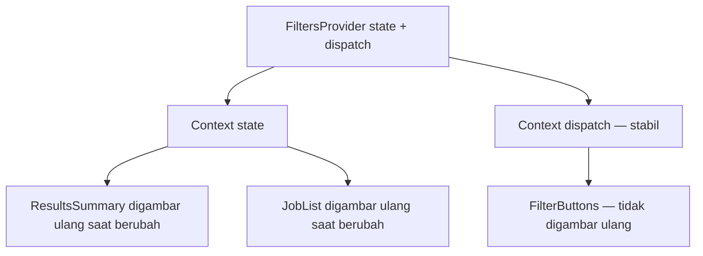

::part[Pelajari Konsepnya]{n="1"}

## 🎯 Yang akan kamu pelajari

- Apa itu **prop drilling**, dan kapan menjadi masalah
- `createContext`, provider, dan `useContext`
- Tempat provider di proyek Next.js App Router
- Custom hook yang memberi error jelas saat provider-nya tidak ada
- `useReducer` dengan **context state dan dispatch terpisah** untuk menghindari gambar ulang yang tidak perlu
- Menjaga nilai context tetap stabil; contoh toast
- Kapan memakai URL, TanStack Query, atau Zustand sebagai gantinya

## 🔤 Istilah penting

| Istilah | Artinya (sederhana) |
|---|---|
| **Prop drilling** | Mengoper prop melewati banyak component yang tidak memakainya |
| **Context** | Nilai yang dibagikan ke semua component di dalam sebuah provider |
| **Provider** | Component yang memberikan nilai context ke semua yang ada di dalamnya |
| **Consumer** | Component yang membaca context (`useContext`) |
| **Reducer** | Function yang mengembalikan state berikutnya untuk sebuah aksi: `(state, action) => newState` |
| **Dispatch** | Function yang kamu panggil untuk mengirim aksi ke reducer |
| **Memoize** | Mempertahankan nilai yang sama di antara render alih-alih membuat yang baru |

## 🧠 Ide besarnya

Prop drilling itu seperti mengoper secarik kertas di sepanjang barisan 10 orang di bioskop hanya untuk sampai ke orang terakhir — semua yang di tengah harus ikut memegangnya. Context adalah **pengumuman lewat pengeras suara masjid**: provider berbicara, dan semua orang di lingkungan itu yang mendengarkan langsung mendengarnya.

Masalahnya: **semua yang mendengarkan bereaksi** pada setiap pengumuman. Jadi umumkan dengan hati-hati — hanya hal yang dibutuhkan banyak orang, dan jangan terlalu sering.

## ❓ Kenapa ini penting

Beberapa nilai dibutuhkan banyak component di kedalaman yang berbeda: pengguna saat ini, tema, bahasa, function "tampilkan toast". Mengopernya lewat setiap layout dan component membuat component di tengah bergantung pada props yang tidak mereka pakai.

Dua cara yang salah:

```tsx
// Drilling: ApplicationsPage → Board → Column → Card → CardMenu, just for `showToast`
<Board showToast={showToast} user={user} />

// Misuse: one giant context with a new object every render
<AppContext value={{ user, filters, setFilters, toasts, showToast, theme }}>
```

- Yang pertama: lima lapisan ikut mengoper `showToast`.
- Yang kedua: **semua** yang membaca context ini digambar ulang setiap kali **apa pun** berubah — mengetik di kotak pencarian menggambar ulang header, avatar, dan toast.

## 📖 Langkah demi langkah

### 1. Buat, sediakan, baca

```tsx
"use client";
import { createContext, useContext } from "react";

type User = { id: number; name: string; role: "member" | "mentor" | "admin" };
const UserContext = createContext<User | undefined>(undefined);

export function UserProvider({ user, children }: { user: User; children: React.ReactNode }) {
  return <UserContext value={user}>{children}</UserContext>;     // React 19: <Context> is the provider
}

export function useUser() {
  const user = useContext(UserContext);
  if (user === undefined) throw new Error("useUser must be used inside <UserProvider>");
  return user;
}
```

1. `createContext` membuat "saluran pengeras suara".
2. Provider (`<UserContext value={user}>`) menyiarkan nilainya ke semua yang ada di dalamnya.
3. `useUser()` mendengarkan. Kalau tidak ada provider di atasnya, ia **melempar error yang jelas** alih-alih diam-diam mengembalikan `undefined`.

(`<UserContext.Provider value>` masih berfungsi; React 19 membolehkan menulis `<UserContext value>` langsung.)

### 2. Provider di App Router

Context butuh fitur browser, tapi layout sebaiknya tetap Server Component:

```tsx
// app/(app)/layout.tsx — Server Component
export default async function AppLayout({ children }: LayoutProps<"/">) {
  const user = await getCurrentUser();          // DAL, DTO only
  return <Providers user={user}>{children}</Providers>;
}

// app/(app)/providers.tsx
"use client";
export function Providers({ user, children }: { user: UserDto; children: React.ReactNode }) {
  return (
    <UserProvider user={user}>
      <ToastProvider>{children}</ToastProvider>
    </UserProvider>
  );
}
```

- Layout (server) memuat pengguna dan mengirim DTO kecil ke component client `Providers`.
- Halaman-halaman di dalamnya (`children`) tetap bisa berupa Server Component (Minggu 4 materi 05).
- Taruh provider **serendah mungkin**: provider filter cukup membungkus halaman lamaran, bukan root layout.

### 3. Helper "strict context" yang bisa dipakai ulang

```tsx
export function createStrictContext<T>(name: string) {
  const Context = createContext<T | undefined>(undefined);
  function Provider({ value, children }: { value: T; children: React.ReactNode }) {
    return <Context value={value}>{children}</Context>;
  }
  function useValue() {
    const value = useContext(Context);
    if (value === undefined) throw new Error(`use${name} must be used inside <${name}Provider>`);
    return value;
  }
  return [Provider, useValue] as const;
}
```

Satu factory kecil yang membuat provider dan hook yang ketat, agar kamu tidak mengulang kode yang sama untuk setiap context.

### 4. `useReducer` + context terpisah

```tsx
function filtersReducer(state: Filters, action: FiltersAction): Filters {
  switch (action.type) {
    case "setStatus": return { ...state, status: action.status };
    case "setQuery":  return { ...state, query: action.query };
    case "reset":     return DEFAULT_FILTERS;
  }
}

export function FiltersProvider({ children }: { children: React.ReactNode }) {
  const [state, dispatch] = useReducer(filtersReducer, DEFAULT_FILTERS);
  return (
    <FiltersDispatchContext value={dispatch}>          {/* dispatch never changes */}
      <FiltersStateContext value={state}>{children}</FiltersStateContext>
    </FiltersDispatchContext>
  );
}
```

- **Reducer** itu seperti **kasir dengan daftar harga**: kamu memberi aksi ("setStatus: interview"), ia mengembalikan state baru. Semua perubahan mengikuti aturan yang sama di satu tempat.
- `dispatch` tidak pernah berubah. Dengan menaruhnya di context **sendiri**, component yang hanya mengirim aksi (seperti tombol "Reset") tidak digambar ulang saat filter berubah.



Seperti punya dua saluran radio: saluran "berita" (state) untuk orang yang butuh kabar terbaru, dan "saluran telepon" (dispatch) untuk orang yang hanya menelepon masuk.

### 5. Jaga nilai object tetap stabil

```tsx
const show = useCallback((message: string) => { … }, []);
const dismiss = useCallback((id: number) => { … }, []);
const api = useMemo(() => ({ show, dismiss }), [show, dismiss]);
return <ToastApiContext value={api}>…</ToastApiContext>;
```

Tanpa `useMemo`, `{ show, dismiss }` adalah object **baru** di setiap render, jadi semua consumer digambar ulang padahal tidak ada yang benar-benar berubah. `useMemo` dan `useCallback` mempertahankan object dan function yang sama. (**React Compiler** bisa melakukan ini secara otomatis, tapi kamu tetap perlu memahami alasannya.)

### 6. Pilih tempat yang tepat untuk setiap jenis state

| State | Tempat terbaik |
|---|---|
| Data server (lamaran, lowongan) | Server Component / **TanStack Query** |
| State tampilan yang bisa dibagikan (filter, tab, halaman) | **URL search params** |
| Input form | form-nya (`useActionState`, React Hook Form) |
| UI lokal (buka/tutup) | `useState` di component itu |
| Nilai seluruh aplikasi yang jarang berubah (pengguna, tema, bahasa, API toast) | **Context** |
| State browser bersama yang sering berubah, dipakai component yang berjauhan | **Zustand** (materi 09) |

## ⚠️ Kesalahan umum

- Memakai context **di luar** provider-nya dan diam-diam mendapat `undefined`.
- Mengirim `{ value, setValue }` sebagai object baru tanpa `useMemo`.
- Menaruh `"use client"` di root layout untuk menambahkan provider.
- Satu "AppContext" raksasa untuk semuanya.
- Me-render provider **di dalam** component yang membacanya (provider harus berada di atasnya).
- Menaruh data server, rahasia, atau token di context (context seluruhnya ada di browser).
- Memakai context hanya untuk 2 lapis props — coba komposisi `children` dulu.

## 🏆 Praktik terbaik

- [ ] Nilai default `undefined` + custom hook yang melempar error yang membantu.
- [ ] Export hook-nya, bukan context mentahnya.
- [ ] Jaga provider tetap kecil, fokus, dan serendah mungkin di pohon component.
- [ ] Pisahkan state dan dispatch (atau setter) ke context yang berbeda.
- [ ] Jaga nilai object dan function tetap stabil (`useMemo` / `useCallback`, atau React Compiler).
- [ ] Biarkan layout tetap Server Component; taruh provider di pembungkus `"use client"`.
- [ ] Taruh state filter/urutan/halaman di URL kalau pengguna perlu membagikan atau menyimpannya.

::part[Jelaskan & Rancang]{n="2"}

## 🗣️ Jelaskan

Jelaskan ide kertas di bioskop vs pengeras suara, lalu jelaskan kenapa "terlalu sering mengumumkan" adalah masalah performa dan bagaimana memisahkan state dan dispatch membantu.

## 📐 Rancang

Halaman lamaran CareerPilot punya: kotak pencarian, tab status, papan dengan 5 kolom kartu, pilihan "bandingkan", toast setelah aksi, dan avatar pengguna di header. Tentukan tempat setiap state (props, URL, Context, TanStack Query, Zustand, state lokal) dan jelaskan alasannya.

:::quiz
Tampilkan contoh jawabannya

| State | Tempat | Kenapa |
|---|---|---|
| Data lamaran | pemuatan awal di Server Component + **TanStack Query** untuk papan interaktif | data server dengan caching dan perpindahan status instan |
| Teks pencarian saat mengetik | `useState` lokal di kotak pencarian, dengan debounce | berubah setiap tekan tombol |
| Pencarian akhir + tab status | **URL** `?q=data&status=interview` | bisa dibagikan, Back berfungsi, server bisa membacanya |
| Pengguna saat ini (avatar) | **Context** dari layout (DTO) | jarang berubah, dipakai di header dan menu |
| Toast | **Context** dengan API `show()` yang stabil | API-nya tidak pernah berubah, dipakai di mana-mana |
| Pilihan bandingkan (maksimal 3) | store **Zustand** | dipakai kartu dan baki melayang, sering berubah, selector mencegah 50 kartu digambar ulang |
| Menu kartu terbuka/tertutup | `useState` lokal | hanya kartu itu yang peduli |
:::

### 📝 Checklist self-review

- [ ] Tidak ada data server di Context
- [ ] Filter yang bisa dibagikan ada di URL
- [ ] Context hanya untuk nilai stabil yang dipakai di banyak tempat

::ai-review{task="design"}

::part[Latihan Kecil]{n="3"}

:::exercise{path="exercises/web/m4/w5/04-context" ai="no-ai" title="Context ketat, filter terpisah, dan toast"}
Bangun factory `createStrictContext`, provider filter dengan `useReducer` dan context state/dispatch yang terpisah (tes menghitung jumlah gambar ulang), serta provider toast dengan API yang stabil, hilang otomatis, dan pembersihan timer.
:::

:::hints
- Di hook yang ketat, bandingkan dengan `undefined` — jangan cek "falsy".
- `dispatch` dari `useReducer` sudah stabil — cukup beri context sendiri.
- Simpan timer di `useRef(new Map())` dan bersihkan semuanya di cleanup effect.
:::

## ✅ Cek cepat

:::quiz
Sebuah `ThemeToggle` memakai `useTheme()` dan digambar ulang setiap kali pengguna mengetik di kotak pencarian di tempat lain. Apa kemungkinan penyebabnya?

State pencarian berada di nilai context yang sama dengan tema (atau provider membuat object nilai baru di setiap render), jadi semua consumer digambar ulang. Pisahkan context-nya dan jaga nilainya stabil, atau pindahkan state pencarian keluar.
:::

:::quiz
Kenapa pembungkus provider butuh `"use client"`, tapi layout yang me-render-nya tidak?

Provider memakai context, yang merupakan fitur browser. Layout server bisa me-render Client Component dan tetap mengirim Server Component di dalamnya sebagai `children`.
:::

## 📚 Lanjut belajar

- [React docs: Passing Data Deeply with Context](https://react.dev/learn/passing-data-deeply-with-context)
- [React docs: Scaling Up with Reducer and Context](https://react.dev/learn/scaling-up-with-reducer-and-context)
- Dokumentasi Next.js (tersedia di dalam proyek): Server and Client Components → Context providers
