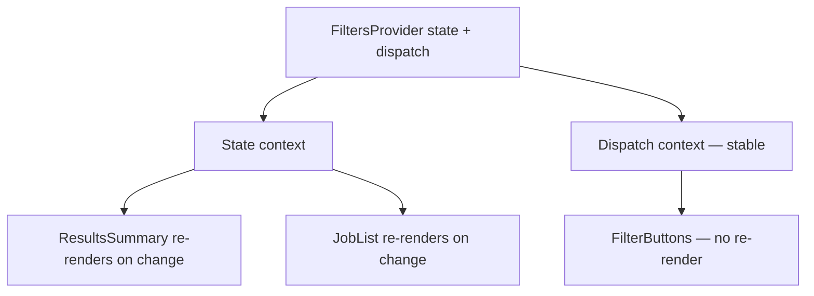

::part[Learn the Concept]{n="1"}

## 🎯 What you'll learn

- What **prop drilling** is and when it becomes a problem
- `createContext`, `<Context>` providers and `useContext` (or `use`)
- Where providers go in a Next.js App Router project
- A **strict custom hook** that throws outside its provider
- `useReducer` + **separate state and dispatch contexts** to limit re-renders
- Memoizing context values; building a toast system
- When to use Context, URL state, TanStack Query or Zustand instead

## 🧠 The big idea

Prop drilling is like passing a note along a row of 10 people in a cinema just to reach the person at the end — everyone in the middle has to hold it. Context is the **public announcement system**: the provider speaks, and anyone in the building who's listening hears it directly.

The catch: **everyone listening reacts** to every announcement. So you announce carefully — only things many people need, and not too often.

## ❓ Why does this exist?

Some values are needed by many components at different depths: the current user DTO, theme, locale, a toast function, feature flags. Passing them through every layout and component makes intermediate components depend on props they don't use, and refactors become painful.

## 💥 What happens if we DON'T (or use it badly)?

```tsx
// Drilling: ApplicationsPage → Board → Column → Card → CardMenu, just for `showToast`
<Board showToast={showToast} user={user} />

// Misuse: one giant context with a new object every render
<AppContext value={{ user, filters, setFilters, toasts, showToast, theme }}>
```

The second version re-renders **every consumer** whenever **anything** changes — typing in a search box re-renders the header, the avatar, the toasts.

## 📖 How it works, step by step

### 1. Create, provide, consume

```tsx
"use client";
import { createContext, useContext } from "react";

type User = { id: number; name: string; role: "member" | "mentor" | "admin" };
const UserContext = createContext<User | undefined>(undefined);

export function UserProvider({ user, children }: { user: User; children: React.ReactNode }) {
  return <UserContext value={user}>{children}</UserContext>;     // React 19: <Context> is the provider
}

export function useUser() {
  const user = useContext(UserContext);
  if (user === undefined) throw new Error("useUser must be used inside <UserProvider>");
  return user;
}
```

- `<UserContext.Provider value>` still works; React 19 allows `<UserContext value>` directly.
- A **default of `undefined` + a throwing hook** turns "forgot the provider" into a clear error instead of a silent `null` bug.

### 2. Providers in the App Router

Context needs client features, but layouts should stay Server Components:

```tsx
// app/(app)/layout.tsx — Server Component
export default async function AppLayout({ children }: LayoutProps<"/">) {
  const user = await getCurrentUser();          // DAL, DTO only
  return <Providers user={user}>{children}</Providers>;
}

// app/(app)/providers.tsx
"use client";
export function Providers({ user, children }: { user: UserDto; children: React.ReactNode }) {
  return (
    <UserProvider user={user}>
      <ToastProvider>{children}</ToastProvider>
    </UserProvider>
  );
}
```

`children` pages can still be Server Components (W4 L5). Place providers **as deep as possible** — a filters provider belongs around the applications page, not the root layout.

### 3. A reusable strict context factory

```tsx
export function createStrictContext<T>(name: string) {
  const Context = createContext<T | undefined>(undefined);
  function Provider({ value, children }: { value: T; children: React.ReactNode }) {
    return <Context value={value}>{children}</Context>;
  }
  function useValue() {
    const value = useContext(Context);
    if (value === undefined) throw new Error(`use${name} must be used inside <${name}Provider>`);
    return value;
  }
  return [Provider, useValue] as const;
}
```

### 4. `useReducer` + split contexts

```tsx
function filtersReducer(state: Filters, action: FiltersAction): Filters {
  switch (action.type) {
    case "setStatus": return { ...state, status: action.status };
    case "setQuery":  return { ...state, query: action.query };
    case "reset":     return DEFAULT_FILTERS;
  }
}

export function FiltersProvider({ children }: { children: React.ReactNode }) {
  const [state, dispatch] = useReducer(filtersReducer, DEFAULT_FILTERS);
  return (
    <FiltersDispatchContext value={dispatch}>          {/* dispatch never changes */}
      <FiltersStateContext value={state}>{children}</FiltersStateContext>
    </FiltersDispatchContext>
  );
}
```

A `<ResetFiltersButton>` that only reads dispatch **won't re-render** when filters change (if it's memoized or its parent doesn't re-render).



### 5. Memoize object values

```tsx
const show = useCallback((message: string) => { … }, []);
const dismiss = useCallback((id: number) => { … }, []);
const api = useMemo(() => ({ show, dismiss }), [show, dismiss]);
return <ToastApiContext value={api}>…</ToastApiContext>;
```

Without `useMemo`, `{ show, dismiss }` is a new object each render → all consumers re-render. (The **React Compiler** can add this memoization automatically when enabled, but understanding why it matters is still essential.)

### 6. Choosing the right home for state

| State | Best home |
|---|---|
| Server data (applications, jobs) | Server Components / **TanStack Query** |
| Shareable UI state (filters, tab, page) | **URL search params** |
| Form input | the form (`useActionState`, RHF) |
| Local UI (open/closed) | `useState` in the component |
| Rarely-changing app-wide values (user DTO, theme, locale, toast API) | **Context** |
| Frequently-changing shared client state across distant components | **Zustand** (lesson 09) |

## ⚖️ Trade-offs

| | ✅ | ❌ |
|---|---|---|
| Props | explicit, easy to trace | drilling through many layers |
| Context | built-in, no library, great for stable values | every consumer re-renders on value change; no selectors |
| Composition (`children`) | often removes drilling without context | not always possible |
| External store (Zustand) | selectors, fine-grained updates | extra dependency, another pattern |

## ✅ When to use it / 🚫 When NOT to use it

- ✅ Theme, locale, current user DTO, toast/modal APIs, compound components (Architecture Stage G).
- 🚫 Server data caches — use TanStack Query.
- 🚫 Values that change on every keystroke used by many components.
- 🚫 As a first reflex for 2 levels of props — try composition first.

## 🏆 Best practices

- [ ] Default `undefined` + a custom hook that throws a helpful error.
- [ ] Export the hook, not the raw context.
- [ ] Keep providers small, focused and as low in the tree as possible.
- [ ] Split state and dispatch (or setters) into separate contexts.
- [ ] Memoize object/function values (`useMemo`/`useCallback`) or use the React Compiler.
- [ ] Keep layouts as Server Components; put providers in a `"use client"` wrapper.
- [ ] Never put secrets or tokens in context — it's all client-side.
- [ ] Put filter/sort/page state in the URL when users should share or bookmark it.

## 🏭 How it's used in industry

- Libraries expose their setup through providers: `QueryClientProvider`, `ThemeProvider` (next-themes), i18n providers, design system providers.
- Component libraries (Radix, shadcn/ui) use context internally for compound components like `<Dialog>`, `<Tabs>`.
- Teams typically combine: server data in TanStack Query, URL state for filters, a few contexts, and sometimes Zustand for complex client UI.

## ⚠️ Common mistakes

- Using a context **outside** its provider and getting `undefined` silently.
- Providing `{ value, setValue }` inline without memoization.
- Putting `"use client"` on the root layout to add a provider.
- Keeping one "AppContext" for everything.
- A provider rendered **inside** the component that consumes it (it must be an ancestor).

::part[Explain & Design]{n="2"}

## 🗣️ Explain it

Explain the cinema note vs announcement system analogy, then explain why "announcing too often" is a performance problem and how splitting state and dispatch helps.

## 📐 Design it

The CareerPilot applications page has: a search box, status tabs, a board with 5 columns of cards, a "compare" selection, toasts after actions, and the logged-in user's avatar in the header. Decide where each piece of state lives (props, URL, Context, TanStack Query, Zustand, local state) and justify it.

:::quiz
Show a possible answer

| State | Home | Why |
|---|---|---|
| Applications data | Server Component initial data + **TanStack Query** for the interactive board | server state with caching and optimistic moves |
| Search text (typing) | local `useState` in the search box, debounced | changes every keystroke |
| Committed search + status tab | **URL** `?q=data&status=interview` | shareable, back button works, server can read it |
| Current user (avatar) | **Context** from the layout (DTO) | stable, needed in header and menus |
| Toasts | **Context** with memoized `show()` API | stable API, used everywhere |
| Compare selection (up to 3) | **Zustand** store per provider | shared by cards and a floating tray, changes often, selectors avoid re-rendering 50 cards |
| Card menu open/closed | local `useState` | only that card cares |
:::

### 📝 Self-review checklist

- [ ] No server data in Context
- [ ] URL state for shareable filters
- [ ] Contexts only for stable, widely-used values

::ai-review{task="design"}

::part[Toy Exercise]{n="3"}

:::exercise{path="exercises/web/m4/w5/04-context" ai="no-ai" title="Strict contexts, split filters and toasts"}
Build a `createStrictContext` factory, a filters provider with `useReducer` and separate state/dispatch contexts (tests count re-renders), and a toast provider with a stable API, auto-dismiss and timer cleanup.
:::

:::hints
- Compare against `undefined`, not falsiness, in the strict hook.
- `dispatch` from `useReducer` is already stable — just give it its own context.
- Keep timers in a `useRef(new Map())` and clear them all in an effect cleanup.
:::

## ✅ Quick check

:::quiz
A `ThemeToggle` uses `useTheme()` and re-renders every time the user types in a search box elsewhere. What's the likely cause?

The search state lives in the same context value as the theme (or the provider creates a new value object each render), so every consumer re-renders. Split contexts and memoize the value, or move search state out.
:::

:::quiz
Why does the provider wrapper need `"use client"` but the layout that renders it doesn't?

Providers use context (a client feature). The server layout can render a Client Component and pass Server Components as `children`.
:::

## 📖 Kamus (glossary)

| Term | Bahasa Indonesia |
|---|---|
| Prop drilling | Meneruskan props melewati banyak komponen |
| Context | Konteks — nilai bersama untuk subtree komponen |
| Provider | Penyedia nilai konteks |
| Consumer | Komponen yang membaca konteks |
| Reducer | Fungsi pengubah state berdasarkan aksi |
| Memoization | Menyimpan hasil agar tidak dibuat ulang |

## 📚 Keep learning

- [React docs: Passing Data Deeply with Context](https://react.dev/learn/passing-data-deeply-with-context)
- [React docs: Scaling Up with Reducer and Context](https://react.dev/learn/scaling-up-with-reducer-and-context)
- Next.js docs (bundled): Server and Client Components → Context providers
