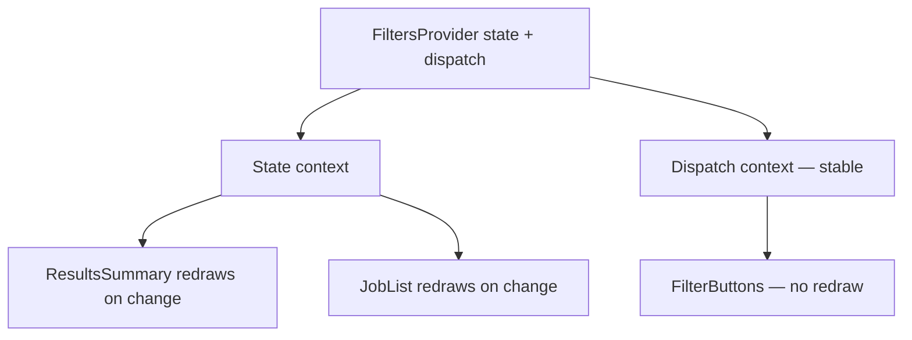

::part[Learn the Concept]{n="1"}

## 🎯 What you'll learn

- What **prop drilling** is, and when it becomes a problem
- `createContext`, providers and `useContext`
- Where providers go in a Next.js App Router project
- A custom hook that gives a clear error when the provider is missing
- `useReducer` with **separate state and dispatch contexts** to avoid extra redraws
- Keeping context values stable; a toast example
- When to use the URL, TanStack Query or Zustand instead

## 🔤 Key words

| Word | In simple words | Bahasa Indonesia |
|---|---|---|
| **Prop drilling** | Passing a prop through many components that don't use it | Oper props berlapis |
| **Context** | A value shared with all components inside a provider | Nilai bersama |
| **Provider** | The component that gives the context value to everything inside it | Penyedia nilai |
| **Consumer** | A component that reads the context (`useContext`) | Pembaca nilai |
| **Reducer** | A function that returns the next state for an action: `(state, action) => newState` | Pengubah state |
| **Dispatch** | The function you call to send an action to the reducer | Pengirim aksi |
| **Memoize** | Keep the same value between renders instead of creating a new one | Mengingat nilai |

## 🧠 The big idea

Prop drilling is like passing a note along a row of 10 people in a cinema just to reach the last person — everyone in the middle has to hold it. Context is the **mosque loudspeaker announcement**: the provider speaks, and everyone in the neighbourhood who's listening hears it directly.

The catch: **everyone listening reacts** to every announcement. So announce carefully — only things many people need, and not too often.

## ❓ Why it matters

Some values are needed by many components at different depths: the current user, theme, language, a "show toast" function. Passing them through every layout and component makes middle components depend on props they don't use.

Two ways it goes wrong:

```tsx
// Drilling: ApplicationsPage → Board → Column → Card → CardMenu, just for `showToast`
<Board showToast={showToast} user={user} />

// Misuse: one giant context with a new object every render
<AppContext value={{ user, filters, setFilters, toasts, showToast, theme }}>
```

- The first: five layers pass `showToast` along.
- The second: **everything** that reads this context redraws whenever **anything** changes — typing in the search box redraws the header, the avatar and the toasts.

## 📖 Step by step

### 1. Create, provide, read

```tsx
"use client";
import { createContext, useContext } from "react";

type User = { id: number; name: string; role: "member" | "mentor" | "admin" };
const UserContext = createContext<User | undefined>(undefined);

export function UserProvider({ user, children }: { user: User; children: React.ReactNode }) {
  return <UserContext value={user}>{children}</UserContext>;     // React 19: <Context> is the provider
}

export function useUser() {
  const user = useContext(UserContext);
  if (user === undefined) throw new Error("useUser must be used inside <UserProvider>");
  return user;
}
```

1. `createContext` creates the "loudspeaker channel".
2. The provider (`<UserContext value={user}>`) broadcasts the value to everything inside.
3. `useUser()` listens. If there's no provider above, it **throws a clear error** instead of silently returning `undefined`.

(`<UserContext.Provider value>` still works; React 19 lets you write `<UserContext value>` directly.)

### 2. Providers in the App Router

Context needs browser features, but layouts should stay Server Components:

```tsx
// app/(app)/layout.tsx — Server Component
export default async function AppLayout({ children }: LayoutProps<"/">) {
  const user = await getCurrentUser();          // DAL, DTO only
  return <Providers user={user}>{children}</Providers>;
}

// app/(app)/providers.tsx
"use client";
export function Providers({ user, children }: { user: UserDto; children: React.ReactNode }) {
  return (
    <UserProvider user={user}>
      <ToastProvider>{children}</ToastProvider>
    </UserProvider>
  );
}
```

- The layout (server) loads the user and passes a small DTO to a client `Providers` component.
- The pages inside (`children`) can still be Server Components (Week 4 lesson 05).
- Put providers **as deep as possible**: a filters provider belongs around the applications page, not the root layout.

### 3. A reusable "strict context" helper

```tsx
export function createStrictContext<T>(name: string) {
  const Context = createContext<T | undefined>(undefined);
  function Provider({ value, children }: { value: T; children: React.ReactNode }) {
    return <Context value={value}>{children}</Context>;
  }
  function useValue() {
    const value = useContext(Context);
    if (value === undefined) throw new Error(`use${name} must be used inside <${name}Provider>`);
    return value;
  }
  return [Provider, useValue] as const;
}
```

One small factory that creates a provider and a strict hook, so you don't repeat the same code for every context.

### 4. `useReducer` + separate contexts

```tsx
function filtersReducer(state: Filters, action: FiltersAction): Filters {
  switch (action.type) {
    case "setStatus": return { ...state, status: action.status };
    case "setQuery":  return { ...state, query: action.query };
    case "reset":     return DEFAULT_FILTERS;
  }
}

export function FiltersProvider({ children }: { children: React.ReactNode }) {
  const [state, dispatch] = useReducer(filtersReducer, DEFAULT_FILTERS);
  return (
    <FiltersDispatchContext value={dispatch}>          {/* dispatch never changes */}
      <FiltersStateContext value={state}>{children}</FiltersStateContext>
    </FiltersDispatchContext>
  );
}
```

- A **reducer** is like a **cashier with a price list**: you give an action ("setStatus: interview"), it returns the new state. All changes follow the same rules in one place.
- `dispatch` never changes. By putting it in its **own** context, components that only send actions (like a "Reset" button) don't redraw when the filters change.



Like having two radio channels: the "news" channel (state) for people who need updates, and the "request line" (dispatch) for people who only call in.

### 5. Keep object values stable

```tsx
const show = useCallback((message: string) => { … }, []);
const dismiss = useCallback((id: number) => { … }, []);
const api = useMemo(() => ({ show, dismiss }), [show, dismiss]);
return <ToastApiContext value={api}>…</ToastApiContext>;
```

Without `useMemo`, `{ show, dismiss }` is a **new** object on every render, so every consumer redraws even though nothing really changed. `useMemo` and `useCallback` keep the same object and functions. (The **React Compiler** can do this automatically, but you should still understand why.)

### 6. Choose the right place for each kind of state

| State | Best place |
|---|---|
| Server data (applications, jobs) | Server Components / **TanStack Query** |
| Shareable view state (filters, tab, page) | **URL search params** |
| Form input | the form (`useActionState`, React Hook Form) |
| Local UI (open/closed) | `useState` in that component |
| App-wide values that rarely change (user, theme, language, toast API) | **Context** |
| Shared browser state that changes often, used by distant components | **Zustand** (lesson 09) |

## ⚠️ Common mistakes

- Using a context **outside** its provider and silently getting `undefined`.
- Passing `{ value, setValue }` as a new object without `useMemo`.
- Putting `"use client"` on the root layout to add a provider.
- One huge "AppContext" for everything.
- Rendering the provider **inside** the component that reads it (it must be above it).
- Putting server data, secrets or tokens in context (context is all browser-side).
- Using context for only 2 levels of props — try `children` composition first.

## 🏆 Best practices

- [ ] Default value `undefined` + a custom hook that throws a helpful error.
- [ ] Export the hook, not the raw context.
- [ ] Keep providers small, focused, and as low in the tree as possible.
- [ ] Put state and dispatch (or setters) in separate contexts.
- [ ] Keep object and function values stable (`useMemo` / `useCallback`, or the React Compiler).
- [ ] Keep layouts as Server Components; put providers in a `"use client"` wrapper.
- [ ] Put filter/sort/page state in the URL when users should share or bookmark it.

::part[Explain & Design]{n="2"}

## 🗣️ Explain it

Explain the cinema note vs loudspeaker idea, then explain why "announcing too often" is a performance problem and how separating state and dispatch helps.

## 📐 Design it

The CareerPilot applications page has: a search box, status tabs, a board with 5 columns of cards, a "compare" selection, toasts after actions, and the user's avatar in the header. Decide where each piece of state lives (props, URL, Context, TanStack Query, Zustand, local state) and explain why.

:::quiz
Show a possible answer

| State | Place | Why |
|---|---|---|
| Applications data | Server Component first load + **TanStack Query** for the interactive board | server data with caching and instant status moves |
| Search text while typing | local `useState` in the search box, debounced | changes on every key press |
| Final search + status tab | **URL** `?q=data&status=interview` | shareable, Back works, the server can read it |
| Current user (avatar) | **Context** from the layout (DTO) | rarely changes, used in the header and menus |
| Toasts | **Context** with a stable `show()` API | the API never changes, used everywhere |
| Compare selection (up to 3) | **Zustand** store | used by cards and a floating tray, changes often, selectors avoid redrawing 50 cards |
| Card menu open/closed | local `useState` | only that card cares |
:::

### 📝 Self-review checklist

- [ ] No server data in Context
- [ ] Shareable filters live in the URL
- [ ] Contexts only for stable values used in many places

::ai-review{task="design"}

::part[Toy Exercise]{n="3"}

:::exercise{path="exercises/web/m4/w5/04-context" ai="no-ai" title="Strict contexts, split filters and toasts"}
Build a `createStrictContext` factory, a filters provider with `useReducer` and separate state/dispatch contexts (the tests count redraws), and a toast provider with a stable API, auto-dismiss and timer cleanup.
:::

:::hints
- In the strict hook, compare with `undefined` — don't check "falsy".
- `dispatch` from `useReducer` is already stable — just give it its own context.
- Keep timers in `useRef(new Map())` and clear them all in an effect cleanup.
:::

## ✅ Quick check

:::quiz
A `ThemeToggle` uses `useTheme()` and redraws every time the user types in a search box somewhere else. What's the likely cause?

The search state is in the same context value as the theme (or the provider creates a new value object on every render), so every consumer redraws. Split the contexts and keep the value stable, or move the search state out.
:::

:::quiz
Why does the provider wrapper need `"use client"`, but the layout that renders it doesn't?

Providers use context, which is a browser feature. A server layout can render a Client Component and still pass Server Components inside it as `children`.
:::

## 📚 Keep learning

- [React docs: Passing Data Deeply with Context](https://react.dev/learn/passing-data-deeply-with-context)
- [React docs: Scaling Up with Reducer and Context](https://react.dev/learn/scaling-up-with-reducer-and-context)
- Next.js docs (bundled): Server and Client Components → Context providers
