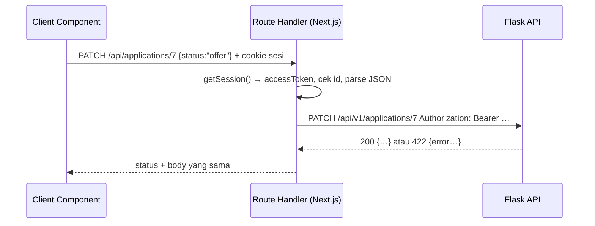

::part[Pelajari Konsepnya]{n="1"}

## 🎯 Yang akan kamu pelajari

- Method HTTP mana yang cocok untuk setiap aksi, dan arti **safe** serta **idempotent**
- Tiga cara frontend Next.js berbicara dengan Flask: Server Component, Server Action, **Route Handler**
- Pola **Backend-for-Frontend (BFF)**
- Handler `route.ts` untuk `GET`, `POST`, `PATCH`, `DELETE`
- Meneruskan status code (`201`, `204`, `401`, `404`, `409`, `422`, `502`)
- Client kecil ber-type untuk Client Component

## 🔤 Istilah penting

| Istilah | Artinya (sederhana) |
|---|---|
| **HTTP method** | "Kata kerja" sebuah request: GET, POST, PATCH, PUT, DELETE |
| **Safe** | Request tidak mengubah apa pun (hanya membaca) |
| **Idempotent** | Melakukannya dua kali hasilnya sama dengan sekali |
| **Status code** | Angka di response yang menyatakan apa yang terjadi: 200, 404… |
| **Route Handler** | File endpoint API di Next.js (`route.ts`) |
| **BFF** | Server Next.js-mu memanggil Flask untuk browser, sambil menambahkan token |
| **Upstream** | Server di belakang servermu — di sini, Flask |
| **Proxy** | Sesuatu yang meneruskan request ke server lain |

## 🧠 Ide besarnya

Method HTTP adalah **kata kerja** dalam kalimat ke server:

- `GET /applications` — "tunjukkan" (membaca, tanpa perubahan)
- `POST /applications` — "buatkan ini"
- `PATCH /applications/7` — "ubah sebagian ini"
- `PUT /applications/7` — "ganti ini seluruhnya"
- `DELETE /applications/7` — "hapus ini"

BFF adalah **resepsionis**. Browser hanya berbicara dengan resepsionis (server Next.js-mu, situs yang sama, dengan cookie sesi). Resepsionis menghubungi departemen yang tepat (Flask) memakai kartu staf (access token) yang tidak pernah dipegang tamu.

## ❓ Kenapa ini penting

Client Component — seperti papan drag-and-drop atau editor catatan yang menyimpan selagi kamu mengetik — perlu memanggil API **dari browser**. Tapi:

- Token Flask ada di **cookie httpOnly**, yang tidak bisa dibaca JavaScript browser (materi 02).
- Memanggil Flask langsung dari browser butuh CORS dan membocorkan alamat API-nya.

Route Handler menyelesaikan keduanya. Browser memanggil `/api/applications` di **situsmu sendiri**; handler membaca sesi di server dan meneruskan request ke Flask.

Yang salah kalau tanpa aturan yang jelas:
- `POST` untuk semuanya → cache, retry, dan log tidak bisa memahami request-nya.
- `DELETE` mengembalikan `200` dengan JSON di satu tempat dan `204` kosong di tempat lain → kode client crash saat membaca body kosong.
- Proxy yang meneruskan **path apa pun** (`/api/proxy/[...path]`) membuat pengguna bisa menjangkau endpoint admin yang tidak pernah ingin kamu buka.
- Pesan error seperti `connect ECONNREFUSED 10.0.3.7:5091` membocorkan server internalmu ke pengguna.

## 📖 Langkah demi langkah

### 1. Method dan janjinya

| Method | Dipakai untuk | Safe? | Idempotent? | Sukses biasanya |
|---|---|---|---|---|
| GET | membaca | ✅ | ✅ | 200 |
| POST | membuat / menjalankan aksi | ❌ | ❌ | 201 (+ `Location`) / 200 / 202 |
| PUT | mengganti | ❌ | ✅ | 200 / 204 |
| PATCH | mengubah sebagian | ❌ | tidak dijamin | 200 |
| DELETE | menghapus | ❌ | ✅ | 204 |

**Idempotent** penting untuk retry. Seperti menekan **tombol lift** dua kali: lift-nya tetap datang sekali — aman diulang. Tapi memesan makanan dua kali membuatmu mendapat **dua** porsi. `DELETE` yang timeout aman dicoba lagi; mengulang `POST` bisa membuat dua lamaran. Untuk pembayaran, tambahkan header `Idempotency-Key` (Architecture F).

### 2. Memilih jalur yang tepat di Next.js

| Kamu butuh | Pakai |
|---|---|
| Menampilkan halaman dengan data | **Server Component** memanggil Flask langsung (DAL) |
| Form atau tombol yang mengubah data dan menyegarkan UI yang di-render server | **Server Action** (materi 01) |
| Client Component yang memuat atau mengubah data (TanStack Query, autosave, drag-and-drop) | **Route Handler** (BFF) |
| Webhook, callback dari layanan lain, file, API publik | **Route Handler** |

### 3. Helper penerus bersama

```ts
// lib/bff.ts
export async function forwardToFlask(path: string, init: { method: string; body?: unknown }) {
  const session = await getSession();
  if (!session) return Response.json({ error: { code: "unauthenticated" } }, { status: 401 });

  const hasBody = init.body !== undefined;
  let upstream: Response;
  try {
    upstream = await fetch(`${process.env.API_URL}${path}`, {
      method: init.method,
      headers: {
        Authorization: `Bearer ${session.accessToken}`,
        Accept: "application/json",
        ...(hasBody ? { "Content-Type": "application/json" } : {}),
      },
      body: hasBody ? JSON.stringify(init.body) : undefined,
      cache: "no-store",
    });
  } catch {
    return Response.json({ error: { code: "upstream_unavailable" } }, { status: 502 });
  }

  if (upstream.status === 204) return new Response(null, { status: 204 });
  return new Response(await upstream.text(), { status: upstream.status, headers: { "Content-Type": "application/json" } });
}
```

- Tanpa sesi → `401`.
- Menambahkan token dari sesi — browser tidak pernah melihatnya.
- Flask tidak bisa dijangkau → `502` dengan kode error umum, bukan detail internal.
- Meneruskan status code dari Flask, jadi browser tetap mendapat error per field `422`.
- `204` harus **tanpa body**.

### 4. Route Handler

```ts
// app/api/applications/route.ts → /api/applications
export async function GET(request: Request) {
  const { search } = new URL(request.url);             // keep ?status=applied&page=2
  return forwardToFlask(`/api/v1/applications${search}`, { method: "GET" });
}

export async function POST(request: Request) {
  const body = await readJson(request);                // 400 on invalid JSON
  if (!body.ok) return body.response;
  return forwardToFlask("/api/v1/applications", { method: "POST", body: body.data });
}
```

```ts
// app/api/applications/[id]/route.ts → /api/applications/7
export async function PATCH(request: Request, ctx: RouteContext<"/api/applications/[id]">) {
  const { id } = await ctx.params;                     // params are a Promise in Next.js 15+
  if (!/^\d+$/.test(id)) return Response.json({ error: { code: "invalid_id" } }, { status: 400 });
  const body = await readJson(request);
  if (!body.ok) return body.response;
  return forwardToFlask(`/api/v1/applications/${id}`, { method: "PATCH", body: body.data });
}
```

- Export function dengan nama method-nya: `GET`, `POST`, `PATCH`, `DELETE`.
- Setiap handler memanggil **satu path tertentu** di Flask — tanpa proxy "teruskan apa saja".
- Cek id-nya (`/^\d+$/`) sebelum menyusun URL Flask, agar tidak ada yang menyelipkan `../admin/users`.
- `params` adalah Promise — `await` dulu.
- `RouteContext<'/api/applications/[id]'>` adalah type yang dibuat Next.js untukmu. Di latihan, kamu menulis type-nya sendiri.

:::warning[Route Handler bersifat publik]
Seperti Server Action, setiap `route.ts` bisa dipanggil siapa pun. Cek login (dan izin) di setiap handler. Handler `GET` **tidak di-cache** secara default — pertahankan begitu untuk data pribadi.
:::

### 5. Client untuk browser

```ts
// lib/applications-client.ts — imported by Client Components
async function request<T>(path: string, method: string, body?: unknown): Promise<T> {
  const response = await fetch(path, {
    method,
    headers: body === undefined ? { Accept: "application/json" } : { Accept: "application/json", "Content-Type": "application/json" },
    body: body === undefined ? undefined : JSON.stringify(body),
  });
  if (response.status === 204) return null as T;
  const json = await response.json().catch(() => null);          // error pages may be HTML
  if (!response.ok) throw new ApiError(response.status, json?.error?.code ?? "unknown_error");
  return json as T;
}

export const applicationsClient = {
  list: (status?: string) => request<Application[]>(status ? `/api/applications?status=${encodeURIComponent(status)}` : "/api/applications", "GET"),
  create: (input: NewApplication) => request<Application>("/api/applications", "POST", input),
  update: (id: number, patch: ApplicationPatch) => request<Application>(`/api/applications/${id}`, "PATCH", patch),
  remove: (id: number) => request<null>(`/api/applications/${id}`, "DELETE"),
};
```

- Browser otomatis mengirim cookie saat memanggil situsmu sendiri.
- `204` → kembalikan `null` tanpa membaca JSON.
- `encodeURIComponent` membuat nilai aman di dalam URL.
- Pakai function-function ini di `queryFn` / `mutationFn` TanStack Query (Minggu 4 materi 07).



## ⚠️ Kesalahan umum

- `await response.json()` pada `204` → "Unexpected end of JSON input".
- Menyusun `/api/v1/applications/${id}` tanpa mengecek `id`.
- Lupa bahwa `params` adalah Promise → `id` bernilai `undefined`.
- Mengembalikan error dengan status `200`.
- Mengirim body bersama `GET`.
- Memanggil Route Handler milik sendiri **dari Server Component** — panggil function data-nya langsung (perjalanan HTTP tambahan yang sia-sia).
- Proxy umum yang meneruskan path dan method apa pun.

## 🏆 Praktik terbaik

- [ ] Pakai method sesuai maknanya: GET membaca, POST membuat, PATCH mengubah sebagian, DELETE menghapus.
- [ ] `201` untuk pembuatan, `204` tanpa body untuk penghapusan, dan satu bentuk error (`{ error: { code, message?, fields? } }`).
- [ ] Cek login di setiap handler; teruskan hanya path yang kamu pilih.
- [ ] Cek route params dan JSON sebelum memanggil Flask.
- [ ] Jangan pernah menampilkan detail error upstream atau alamat internal; catat di server.
- [ ] `cache: "no-store"` untuk data pribadi.
- [ ] Tambahkan timeout ke panggilan upstream (`AbortSignal.timeout(10_000)`).
- [ ] Hanya kirim `Content-Type: application/json` kalau ada body.
- [ ] Susun query string dengan `encodeURIComponent` atau `URLSearchParams`.

::part[Jelaskan & Rancang]{n="2"}

## 🗣️ Jelaskan

Jelaskan ide resepsionis untuk BFF, lalu jelaskan (dengan ide tombol lift vs memesan makanan) kenapa mengulang `DELETE` yang timeout itu aman tapi mengulang `POST` mungkin tidak.

## 📐 Rancang

**Editor catatan** CareerPilot menyimpan selagi mengetik, bisa menyematkan catatan, mengurutkan ulang catatan dengan drag-and-drop, dan menghapus catatan. Rancang Route Handler-nya (path, method, body, status code sukses dan error) serta endpoint Flask yang sesuai. Tandai operasi mana yang idempotent.

:::quiz
Tampilkan contoh desainnya

| Route Next.js | Method | Body | Flask | Sukses | Error | Idempotent |
|---|---|---|---|---|---|---|
| `/api/applications/[id]/notes` | GET | — | `GET /api/v1/applications/{id}/notes` | 200 `Note[]` | 401, 404 | ✅ |
| `/api/applications/[id]/notes` | POST | `{ body }` | `POST …/notes` | **201** `Note` + `Location` | 401, 404, 422 | ❌ (kirim UUID `Idempotency-Key` dari browser agar autosave-create aman) |
| `/api/notes/[noteId]` | PATCH | `{ body?, pinned? }` | `PATCH /api/v1/notes/{noteId}` | 200 `Note` | 401, 404, 409 (diedit di tab lain, memakai `version`), 422 | ✅ dalam praktiknya (body sama → hasil sama) |
| `/api/applications/[id]/notes/order` | PUT | `{ noteIds: number[] }` | `PUT …/notes/order` | 204 | 401, 404, 422 (id tidak cocok) | ✅ (mengganti seluruh urutan) |
| `/api/notes/[noteId]` | DELETE | — | `DELETE /api/v1/notes/{noteId}` | 204 | 401, 404 | ✅ |

- Autosave: tunggu 800 ms setelah berhenti mengetik, lalu `PATCH` dengan `version`, agar editan dari tab lain tidak tertimpa (409 → "diperbarui di tempat lain").
- Pengurutan ulang memakai **satu PUT** berisi urutan lengkap, bukan banyak PATCH — satu request, aman diulang.
- Setiap handler mengecek id dan login; Flask mengecek kepemilikan.
:::

### 📝 Checklist self-review

- [ ] Status code sesuai dengan makna setiap method
- [ ] Konflik dan error validasi bisa dibedakan
- [ ] Tanpa proxy "teruskan apa saja"

::ai-review{task="design"}

::part[Latihan Kecil]{n="3"}

:::exercise{path="exercises/web/m4/w5/05-route-handlers" ai="no-ai" title="BFF untuk lamaran"}
Tulis helper penerus, Route Handler untuk list dan item dengan GET/POST/PATCH/DELETE (dengan pengecekan id, penanganan JSON tidak valid, meneruskan `204`, dan `502` saat error jaringan), serta client browser ber-type.
:::

:::hints
- `new URL(request.url).search` mempertahankan query string (termasuk `?`).
- `await request.json()` melempar error untuk JSON yang tidak valid — tangkap.
- Tes kasus `204`: `new Response(null, { status: 204 })`.
:::

## ✅ Cek cepat

:::quiz
Sebuah Server Component butuh daftar lamaran. Apakah sebaiknya ia memanggil `fetch("/api/applications")`?

Tidak. Panggil function data server (DAL) secara langsung. Route Handler dibuat untuk browser dan pemanggil dari luar; memanggilnya dari server menambah perjalanan HTTP dan butuh URL lengkap serta cookie yang diteruskan.
:::

:::quiz
Apa beda PUT dan PATCH dengan `{ "status": "offer" }`?

PATCH hanya mengubah `status`. PUT berarti "ini adalah data lengkapnya" — field yang tidak kamu kirim akan dikosongkan atau ditolak.
:::

## 📚 Lanjut belajar

- Dokumentasi Next.js (tersedia di dalam proyek): panduan Backend for Frontend; konvensi file `route.js`; Route Handlers
- [MDN: HTTP request methods](https://developer.mozilla.org/en-US/docs/Web/HTTP/Methods)
- [MDN: HTTP response status codes](https://developer.mozilla.org/en-US/docs/Web/HTTP/Status)
