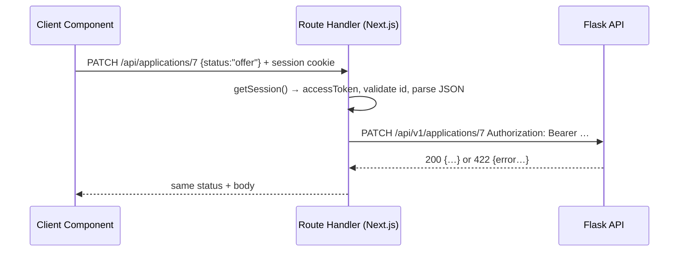

::part[Learn the Concept]{n="1"}

## 🎯 What you'll learn

- Which HTTP method fits each action, and what **safe** and **idempotent** mean
- Three ways a Next.js frontend talks to Flask: Server Components, Server Actions, **Route Handlers**
- The **Backend-for-Frontend (BFF)** pattern
- `route.ts` handlers for `GET`, `POST`, `PATCH`, `DELETE`
- Passing status codes through (`201`, `204`, `401`, `404`, `409`, `422`, `502`)
- A small typed client for Client Components

## 🔤 Key words

| Word | In simple words | Bahasa Indonesia |
|---|---|---|
| **HTTP method** | The "verb" of a request: GET, POST, PATCH, PUT, DELETE | Kata kerja request |
| **Safe** | The request doesn't change anything (reading) | Aman / tidak mengubah |
| **Idempotent** | Doing it twice gives the same result as doing it once | Diulang hasilnya sama |
| **Status code** | The number in the response that says what happened: 200, 404… | Kode status |
| **Route Handler** | An API endpoint file in Next.js (`route.ts`) | Endpoint di Next.js |
| **BFF** | Your Next.js server calls Flask for the browser, adding the token | Server perantara |
| **Upstream** | The server behind yours — here, Flask | Server tujuan |
| **Proxy** | Something that forwards requests to another server | Penerus request |

## 🧠 The big idea

HTTP methods are **verbs** in a sentence to the server:

- `GET /applications` — "show me" (reading, no changes)
- `POST /applications` — "create this"
- `PATCH /applications/7` — "change part of this"
- `PUT /applications/7` — "replace this completely"
- `DELETE /applications/7` — "remove this"

The BFF is a **receptionist**. The browser only talks to the receptionist (your Next.js server, same website, with the session cookie). The receptionist calls the right department (Flask) using a staff badge (the access token) that visitors never hold.

## ❓ Why it matters

Client Components — like a drag-and-drop board or a notes editor that saves while you type — need to call the API **from the browser**. But:

- The Flask token is in an **httpOnly cookie**, which browser JavaScript can't read (lesson 02).
- Calling Flask directly from the browser needs CORS and reveals the API's address.

Route Handlers solve both. The browser calls `/api/applications` on **your own site**; the handler reads the session on the server and forwards the request to Flask.

What goes wrong without clear rules:
- `POST` for everything → caches, retries and logs can't understand the requests.
- `DELETE` returns `200` with JSON in one place and an empty `204` in another → client code crashes reading an empty body.
- A proxy that forwards **any path** (`/api/proxy/[...path]`) lets users reach admin endpoints you never meant to expose.
- Error messages like `connect ECONNREFUSED 10.0.3.7:5091` leak your internal servers to users.

## 📖 Step by step

### 1. Methods and what they promise

| Method | Use | Safe? | Idempotent? | Usual success |
|---|---|---|---|---|
| GET | read | ✅ | ✅ | 200 |
| POST | create / run an action | ❌ | ❌ | 201 (+ `Location`) / 200 / 202 |
| PUT | replace | ❌ | ✅ | 200 / 204 |
| PATCH | change part | ❌ | not guaranteed | 200 |
| DELETE | remove | ❌ | ✅ | 204 |

**Idempotent** matters for retries. Like pressing a **lift button** twice: the lift still comes once — safe to repeat. But ordering food twice gets you **two** meals. A timed-out `DELETE` can be retried safely; retrying a `POST` might create two applications. For payments, add an `Idempotency-Key` header (Architecture F).

### 2. Choosing the right channel in Next.js

| You need | Use |
|---|---|
| Show a page with data | **Server Component** calls Flask directly (DAL) |
| A form or button that changes data and refreshes server-rendered UI | **Server Action** (lesson 01) |
| A Client Component loading or changing data (TanStack Query, autosave, drag-and-drop) | **Route Handler** (BFF) |
| Webhooks, callbacks from other services, files, a public API | **Route Handler** |

### 3. A shared forwarding helper

```ts
// lib/bff.ts
export async function forwardToFlask(path: string, init: { method: string; body?: unknown }) {
  const session = await getSession();
  if (!session) return Response.json({ error: { code: "unauthenticated" } }, { status: 401 });

  const hasBody = init.body !== undefined;
  let upstream: Response;
  try {
    upstream = await fetch(`${process.env.API_URL}${path}`, {
      method: init.method,
      headers: {
        Authorization: `Bearer ${session.accessToken}`,
        Accept: "application/json",
        ...(hasBody ? { "Content-Type": "application/json" } : {}),
      },
      body: hasBody ? JSON.stringify(init.body) : undefined,
      cache: "no-store",
    });
  } catch {
    return Response.json({ error: { code: "upstream_unavailable" } }, { status: 502 });
  }

  if (upstream.status === 204) return new Response(null, { status: 204 });
  return new Response(await upstream.text(), { status: upstream.status, headers: { "Content-Type": "application/json" } });
}
```

- No session → `401`.
- Adds the token from the session — the browser never sees it.
- Flask unreachable → `502` with a general error code, not internal details.
- Passes Flask's status code through, so the browser still gets `422` field errors.
- `204` must have **no body**.

### 4. Route Handlers

```ts
// app/api/applications/route.ts → /api/applications
export async function GET(request: Request) {
  const { search } = new URL(request.url);             // keep ?status=applied&page=2
  return forwardToFlask(`/api/v1/applications${search}`, { method: "GET" });
}

export async function POST(request: Request) {
  const body = await readJson(request);                // 400 on invalid JSON
  if (!body.ok) return body.response;
  return forwardToFlask("/api/v1/applications", { method: "POST", body: body.data });
}
```

```ts
// app/api/applications/[id]/route.ts → /api/applications/7
export async function PATCH(request: Request, ctx: RouteContext<"/api/applications/[id]">) {
  const { id } = await ctx.params;                     // params are a Promise in Next.js 15+
  if (!/^\d+$/.test(id)) return Response.json({ error: { code: "invalid_id" } }, { status: 400 });
  const body = await readJson(request);
  if (!body.ok) return body.response;
  return forwardToFlask(`/api/v1/applications/${id}`, { method: "PATCH", body: body.data });
}
```

- Export a function named after the method: `GET`, `POST`, `PATCH`, `DELETE`.
- Each handler calls **one specific** Flask path — no "forward anything" proxy.
- Check the id (`/^\d+$/`) before building the Flask URL, so nobody can sneak in `../admin/users`.
- `params` is a Promise — `await` it.
- `RouteContext<'/api/applications/[id]'>` is a type Next.js generates for you. In the exercise, you write the type by hand.

:::warning[Route Handlers are public]
Like Server Actions, every `route.ts` can be called by anyone. Check login (and permissions) in every handler. `GET` handlers are **not cached** by default — keep it that way for personal data.
:::

### 5. The browser client

```ts
// lib/applications-client.ts — imported by Client Components
async function request<T>(path: string, method: string, body?: unknown): Promise<T> {
  const response = await fetch(path, {
    method,
    headers: body === undefined ? { Accept: "application/json" } : { Accept: "application/json", "Content-Type": "application/json" },
    body: body === undefined ? undefined : JSON.stringify(body),
  });
  if (response.status === 204) return null as T;
  const json = await response.json().catch(() => null);          // error pages may be HTML
  if (!response.ok) throw new ApiError(response.status, json?.error?.code ?? "unknown_error");
  return json as T;
}

export const applicationsClient = {
  list: (status?: string) => request<Application[]>(status ? `/api/applications?status=${encodeURIComponent(status)}` : "/api/applications", "GET"),
  create: (input: NewApplication) => request<Application>("/api/applications", "POST", input),
  update: (id: number, patch: ApplicationPatch) => request<Application>(`/api/applications/${id}`, "PATCH", patch),
  remove: (id: number) => request<null>(`/api/applications/${id}`, "DELETE"),
};
```

- The browser sends cookies automatically when calling your own site.
- `204` → return `null` without reading JSON.
- `encodeURIComponent` makes values safe inside the URL.
- Use these functions in TanStack Query's `queryFn` / `mutationFn` (Week 4 lesson 07).



## ⚠️ Common mistakes

- `await response.json()` on a `204` → "Unexpected end of JSON input".
- Building `/api/v1/applications/${id}` without checking `id`.
- Forgetting that `params` is a Promise → `id` is `undefined`.
- Returning errors with status `200`.
- Sending a body with `GET`.
- Calling your own Route Handler **from a Server Component** — call the data function directly instead (an extra HTTP hop for nothing).
- A generic proxy that forwards any path and method.

## 🏆 Best practices

- [ ] Use methods by meaning: GET reads, POST creates, PATCH changes part, DELETE removes.
- [ ] `201` for creates, `204` with no body for deletes, and one error shape (`{ error: { code, message?, fields? } }`).
- [ ] Check login in every handler; forward only paths you chose.
- [ ] Check route params and JSON before calling Flask.
- [ ] Never show upstream error details or internal addresses; log them on the server.
- [ ] `cache: "no-store"` for personal data.
- [ ] Add timeouts to upstream calls (`AbortSignal.timeout(10_000)`).
- [ ] Only send `Content-Type: application/json` when there is a body.
- [ ] Build query strings with `encodeURIComponent` or `URLSearchParams`.

::part[Explain & Design]{n="2"}

## 🗣️ Explain it

Explain the receptionist idea for the BFF, then explain (with the lift button vs food order idea) why retrying a timed-out `DELETE` is safe but retrying a `POST` might not be.

## 📐 Design it

CareerPilot's **notes editor** saves while typing, lets users pin a note, reorder notes with drag-and-drop, and delete notes. Design the Route Handlers (paths, methods, bodies, success and error status codes) and the matching Flask endpoints. Mark which operations are idempotent.

:::quiz
Show a possible design

| Next.js route | Method | Body | Flask | Success | Errors | Idempotent |
|---|---|---|---|---|---|---|
| `/api/applications/[id]/notes` | GET | — | `GET /api/v1/applications/{id}/notes` | 200 `Note[]` | 401, 404 | ✅ |
| `/api/applications/[id]/notes` | POST | `{ body }` | `POST …/notes` | **201** `Note` + `Location` | 401, 404, 422 | ❌ (send an `Idempotency-Key` UUID from the browser to make autosave-create safe) |
| `/api/notes/[noteId]` | PATCH | `{ body?, pinned? }` | `PATCH /api/v1/notes/{noteId}` | 200 `Note` | 401, 404, 409 (edited in another tab, using a `version`), 422 | ✅ in practice (same body → same result) |
| `/api/applications/[id]/notes/order` | PUT | `{ noteIds: number[] }` | `PUT …/notes/order` | 204 | 401, 404, 422 (ids don't match) | ✅ (replaces the whole order) |
| `/api/notes/[noteId]` | DELETE | — | `DELETE /api/v1/notes/{noteId}` | 204 | 401, 404 | ✅ |

- Autosave: wait 800 ms after typing stops, then `PATCH` with a `version`, so edits from another tab aren't overwritten (409 → "updated elsewhere").
- Reordering uses **one PUT** of the full order instead of many PATCHes — one request, safe to repeat.
- Every handler checks ids and login; Flask checks ownership.
:::

### 📝 Self-review checklist

- [ ] Status codes match what each method means
- [ ] Conflicts and validation errors can be told apart
- [ ] No "forward anything" proxy

::ai-review{task="design"}

::part[Toy Exercise]{n="3"}

:::exercise{path="exercises/web/m4/w5/05-route-handlers" ai="no-ai" title="A BFF for applications"}
Write a forwarding helper, list and item Route Handlers for GET/POST/PATCH/DELETE (with id checks, invalid-JSON handling, passing `204` through and `502` on network errors), and a typed browser client.
:::

:::hints
- `new URL(request.url).search` keeps the query string (including `?`).
- `await request.json()` throws on invalid JSON — catch it.
- Test the `204` case: `new Response(null, { status: 204 })`.
:::

## ✅ Quick check

:::quiz
A Server Component needs the applications list. Should it `fetch("/api/applications")`?

No. Call the server data function (DAL) directly. Route Handlers are for the browser and outside callers; calling them from the server adds an extra HTTP trip and needs a full URL and forwarded cookies.
:::

:::quiz
What's the difference between PUT and PATCH with `{ "status": "offer" }`?

PATCH changes only `status`. PUT means "this is the whole item" — fields you leave out would be cleared or rejected.
:::

## 📚 Keep learning

- Next.js docs (bundled): Backend for Frontend guide; `route.js` file convention; Route Handlers
- [MDN: HTTP request methods](https://developer.mozilla.org/en-US/docs/Web/HTTP/Methods)
- [MDN: HTTP response status codes](https://developer.mozilla.org/en-US/docs/Web/HTTP/Status)
