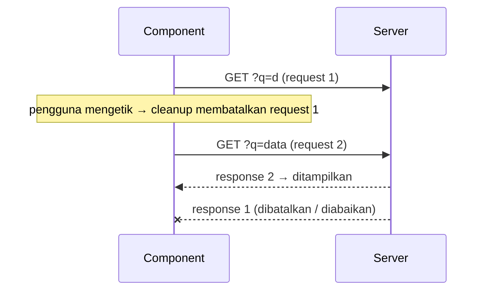

::part[Pelajari Konsepnya]{n="1"}

## 🎯 Yang akan kamu pelajari

- Apa itu **side effect**: berinteraksi dengan hal di luar React
- Array dependency, cleanup, dan kenapa effect berjalan dua kali saat development
- Timer, event listener, dan debounce dengan cleanup yang benar
- Memuat data di effect dengan aman (dan kenapa biasanya sebaiknya tidak)
- `useSyncExternalStore` untuk API browser; `localStorage` yang aman untuk SSR
- Menulis **custom hook**
- Effect yang tidak kamu butuhkan

## 🔤 Istilah penting

| Istilah | Artinya (sederhana) |
|---|---|
| **Side effect** | Kode yang menyentuh hal di luar React: timer, listener, jaringan, storage |
| **`useEffect`** | Menjalankan kode setelah React menampilkan layar, dengan cara untuk membersihkannya |
| **Dependencies** | Nilai-nilai yang dipakai effect; saat berubah, effect dijalankan lagi |
| **Cleanup** | Function yang membatalkan effect: hentikan timer, lepas listener |
| **Race condition** | Response lama yang lambat tiba terakhir dan menggantikan data yang lebih baru |
| **Strict Mode** | Mode development yang menjalankan effect dua kali untuk menemukan cleanup yang hilang |
| **Custom hook** | Hook buatanmu sendiri yang bisa dipakai ulang, seperti `useOnlineStatus` |
| **Hydration mismatch** | HTML dari server berbeda dengan render pertama di browser |

## 🧠 Ide besarnya

Render seharusnya seperti **mengikuti resep**: bahan yang sama (props, state) → hidangan yang sama (JSX), tanpa menyentuh apa pun di luar dapur. Effect dipakai saat hidangan harus **berbicara dengan dunia luar**: memulai timer, mendengarkan status "online/offline", membuka WebSocket, menyimpan ke `localStorage`.

Setiap effect adalah janji: **"Aku akan memulai ini, dan aku akan membereskannya."** Seperti meminjam ruang rapat: kamu memesannya (setup), dan merapikannya saat selesai atau saat rencana berubah (cleanup).

## ❓ Kenapa ini penting

Component di-render berkali-kali, di server dan di browser. Kode yang memulai timer atau listener tidak boleh berjalan saat render — ia akan berjalan berkali-kali, dan di server `window` tidak ada. `useEffect` berjalan **setelah** React memperbarui layar, hanya di browser, dan memberimu tempat untuk membereskannya.

Kesalahan yang umum:

```tsx
// ❌ derived state via effect: extra render, flicker, easy to get out of sync
const [count, setCount] = useState(0);
useEffect(() => setCount(jobs.filter(matches).length), [jobs, query]);

// ❌ listener never removed → leaks and duplicate handlers after every re-mount
useEffect(() => { window.addEventListener("resize", onResize); }, []);

// ❌ race condition: type "d", "da", "data" quickly — the slow "d" response may arrive last and win
useEffect(() => { fetch(`/api/jobs?q=${query}`).then(r => r.json()).then(setJobs); }, [query]);

// ❌ infinite loop: object dependency recreated each render
useEffect(() => { setFilters({ ...filters, page: 1 }); }, [filters]);
```

- Menghitung nilai di effect → render tambahan dan tampilan berkedip.
- Listener yang tidak pernah dilepas → duplikatnya menumpuk.
- Tanpa pembatalan → response lama menimpa yang baru.
- Dependency berupa object yang baru di setiap render → loop tanpa akhir.

## 📖 Langkah demi langkah

### 1. Bagian-bagian effect

```tsx
useEffect(() => {
  // setup: runs after render when dependencies changed
  const id = setInterval(tick, 1000);
  return () => clearInterval(id);        // cleanup: before the next setup and on unmount
}, [tick]);                              // dependencies: every reactive value used inside
```

| Dependencies | Kapan dijalankan |
|---|---|
| tidak ada | setelah **setiap** render |
| `[]` | sekali setelah component muncul (cleanup saat component hilang) |
| `[a, b]` | setelah muncul, dan setiap kali `a` atau `b` berubah |

- Saat development, **Strict Mode** menampilkan component, menghapusnya, lalu menampilkannya lagi — jadi kamu melihat setup → cleanup → setup. Kalau itu merusak sesuatu, berarti cleanup-mu hilang. Seperti latihan evakuasi kebakaran: menguji bahwa semua orang tahu cara keluar dengan benar.
- Biarkan aturan lint `react-hooks/exhaustive-deps` yang memberi tahu dependency-nya. Jangan sembunyikan nilai darinya.

### 2. Debounce sebuah nilai

```tsx
export function useDebouncedValue<T>(value: T, delayMs: number) {
  const [debounced, setDebounced] = useState(value);
  useEffect(() => {
    const timer = setTimeout(() => setDebounced(value), delayMs);
    return () => clearTimeout(timer);                   // value changed again → cancel
  }, [value, delayMs]);
  return debounced;
}

const q = useDebouncedValue(search, 300);               // use q in the query key / URL
```

Setiap kali nilainya berubah, timer lama dibatalkan dan timer baru dimulai. Nilainya baru diperbarui setelah 300 ms tanpa ketikan — seperti pintu lift yang menunggu sampai orang berhenti masuk.

### 3. Mendengarkan browser: `useSyncExternalStore`

```tsx
function subscribe(callback: () => void) {
  window.addEventListener("online", callback);
  window.addEventListener("offline", callback);
  return () => {
    window.removeEventListener("online", callback);
    window.removeEventListener("offline", callback);
  };
}

export function useOnlineStatus() {
  return useSyncExternalStore(subscribe, () => navigator.onLine, () => true /* server snapshot */);
}
```

- `subscribe` = mulai mendengarkan, dan kembalikan cara berhentinya.
- Function kedua membaca nilai saat ini di browser.
- Function ketiga memberi nilai untuk server, agar HTML-nya cocok (tanpa hydration mismatch).

Pakai untuk nilai yang ada **di luar** React dan bisa berubah kapan saja (status online, ukuran jendela, store global).

### 4. Memuat data di effect (hanya kalau terpaksa)

```tsx
useEffect(() => {
  if (!url) return;
  const controller = new AbortController();
  setState({ status: "loading" });
  fetch(url, { signal: controller.signal })
    .then(async (r) => {
      if (!r.ok) throw new Error(`Request failed with status ${r.status}`);
      const data = await r.json();
      if (!controller.signal.aborted) setState({ status: "success", data });
    })
    .catch((e) => {
      if (!controller.signal.aborted) setState({ status: "error", error: e.message });
    });
  return () => controller.abort();          // url changed or unmounted → cancel + ignore
}, [url]);
```



Saat URL berubah, cleanup **membatalkan** request lama, dan response lamanya diabaikan — seperti membatalkan pesanan makanan pertama saat kamu berubah pikiran. Ini batas minimal agar benar. Di aplikasi sungguhan, utamakan **Server Component** untuk data halaman dan **TanStack Query** di browser (Minggu 4 materi 05–07).

### 5. `localStorage` yang aman untuk SSR

```tsx
export function useLocalStorage<T>(key: string, initial: T) {
  const [value, setValue] = useState(initial);            // server and first client render match
  useEffect(() => {
    setValue(readStorage(key, initial));                   // after mount: read real value
    const onStorage = (e: StorageEvent) => { if (e.key === key) setValue(readStorage(key, initial)); };
    window.addEventListener("storage", onStorage);         // other tabs
    return () => window.removeEventListener("storage", onStorage);
  }, [key]);
  const save = useCallback((next: T) => {
    setValue(next);
    try { localStorage.setItem(key, JSON.stringify(next)); } catch { /* quota / private mode */ }
  }, [key]);
  return [value, save] as const;
}
```

- Render pertama memakai `initial` di server dan browser, jadi keduanya cocok.
- Setelah component muncul, baca nilai yang sebenarnya tersimpan.
- Event `storage` menjaga tab lain yang terbuka tetap sinkron.
- `try/catch`, karena storage bisa penuh atau diblokir di mode privat.

Membaca `localStorage` langsung saat render akan crash di server dan menyebabkan hydration mismatch.

### 6. Effect yang tidak kamu butuhkan

| Situasi | Lakukan ini, bukan effect |
|---|---|
| Nilai yang dihitung dari props/state (list terfilter, total) | hitung saat render |
| Menanggapi aksi pengguna (submit, klik → toast, panggilan API) | lakukan di **event handler** |
| Reset state saat sebuah prop berubah (`applicationId` baru) | `<NotesEditor key={applicationId} />` |
| Memuat data halaman | Server Component / TanStack Query |
| Memberi tahu parent tentang perubahan | panggil callback parent di event handler yang sama |
| Effect yang mengubah state yang memicu effect lain | hitung state berikutnya sekaligus di satu handler atau reducer |

### 7. Custom hook

Pindahkan logika effect ke function bernama `useSomething`:
- Yang dibagikan adalah **logika, bukan state** — setiap component yang memanggil hook mendapat state-nya sendiri.
- Namanya harus diawali `use`, dan aturan hook berlaku (hanya di tingkat atas).
- Nama yang baik menjelaskan tujuannya: `useOnlineStatus`, `useDebouncedValue` — bukan `useMount`.

## ⚠️ Kesalahan umum

- Tanpa cleanup → kebocoran memori dan update state setelah component hilang.
- Memberikan function `async` langsung ke `useEffect` (mengembalikan Promise, bukan cleanup).
- Object atau array literal di dependency → effect berjalan di setiap render.
- Mematikan aturan lint alih-alih menata ulang kodenya.
- Memakai `[]` tapi membaca props di dalamnya → nilai basi (seperti latihan debugging Minggu 3).
- Memakai effect untuk nilai hitungan atau untuk klik dan submit.

## 🏆 Praktik terbaik

- [ ] Tanyakan: "sistem luar mana yang sedang kuhubungkan?" Kalau tidak ada, kemungkinan kamu tidak butuh effect.
- [ ] Selalu kembalikan cleanup untuk timer, listener, subscription, dan request.
- [ ] Ikuti `react-hooks/exhaustive-deps`; perbaiki dependency dengan memindahkan object/function ke dalam effect atau ke luar component.
- [ ] Pakai `AbortController` (atau flag "abaikan") untuk pekerjaan async di effect.
- [ ] Pakai `useSyncExternalStore` untuk store browser dan global, dengan nilai untuk server.
- [ ] Sentuh `window` / `localStorage` hanya di effect atau handler; bungkus storage dengan `try/catch`.
- [ ] Taruh effect yang dipakai ulang di custom hook dengan nama yang jelas dan tes dengan `renderHook`.
- [ ] Biarkan Strict Mode tetap aktif; anggap bug "berjalan dua kali" sebagai bug sungguhan.

::part[Jelaskan & Rancang]{n="2"}

## 🗣️ Jelaskan

Dengan ide ruang rapat, jelaskan kenapa React menjalankan cleanup effect-mu sebelum menjalankannya lagi dengan dependency baru — dan apa yang salah kalau tanpa cleanup.

## 📐 Rancang

Halaman pencarian lowongan CareerPilot punya: kotak pencarian (dengan debounce), hasil dari API, banner "offline", daftar "lowongan yang baru dilihat" yang disimpan di `localStorage` dan sinkron antar tab, serta shortcut keyboard `/` untuk memfokuskan pencarian. Untuk setiap fitur, pilih: effect, `useSyncExternalStore`, event handler, nilai hitungan, atau TanStack Query — dan jelaskan cleanup-nya kalau perlu.

:::quiz
Tampilkan contoh jawabannya

| Fitur | Alat | Catatan / cleanup |
|---|---|---|
| Pencarian dengan debounce | `useDebouncedValue` (effect + timer) | `clearTimeout` saat berubah dan saat component hilang; masukkan `q` yang sudah di-debounce ke URL dengan `router.replace` |
| Hasil | **TanStack Query** dengan key `["jobs", { q }]` (atau Server Component yang membaca `searchParams`) | pembatalan lewat `signal`; `placeholderData: keepPreviousData` |
| Banner offline | `useSyncExternalStore` | lepas listener `online` / `offline`; nilai server `true` |
| Baru dilihat | `useLocalStorage` (effect setelah muncul + listener `storage`) | lepas listener-nya; simpan di **event handler** "buka lowongan", bukan di effect |
| Shortcut `/` | effect yang menambahkan listener `keydown` di `window` | lepas listener-nya; abaikan saat input sudah punya fokus |
| Teks "N hasil" | dihitung saat render | tanpa state, tanpa effect |
:::

### 📝 Checklist self-review

- [ ] Setiap subscription punya unsubscribe yang sesuai
- [ ] Tidak ada effect untuk nilai hitungan atau klik
- [ ] API browser hanya dipakai setelah component muncul

::ai-review{task="design"}

::part[Latihan Kecil]{n="3"}

:::exercise{path="exercises/web/m4/w5/06-effects-hooks" ai="no-ai" title="Custom hook dengan effect yang benar"}
Bangun `useDebouncedValue`, `useOnlineStatus` (dengan `useSyncExternalStore`), `useFetchJson` yang aman dari race condition dengan `AbortController`, `useLocalStorage` yang aman untuk SSR dan sinkron antar tab, serta component yang menghitung nilai tanpa effect apa pun.
:::

:::hints
- Tes hook fetch menyelesaikan request **lama** setelah request baru — cek `signal.aborted` sebelum mengubah state.
- Saat URL berubah, langsung tampilkan state loading, bukan data dari URL sebelumnya.
- `renderToString` di tes berperan seperti server: tidak ada effect yang dijalankan di sana.
:::

## ✅ Cek cepat

:::quiz
Kenapa ini berputar tanpa akhir? `useEffect(() => setOptions({ page: 1 }), [options])`

`setOptions` membuat object baru → `options` menjadi object yang berbeda → effect dijalankan lagi → membuat object baru lagi… Hapus effect-nya (atur di event yang mengubah filter) atau bergantung pada nilai sederhana.
:::

:::quiz
Saat development, effect analytics-mu mengirim "page viewed" dua kali. Apakah itu bug di production?

Tidak — Strict Mode menjalankan effect dua kali saat development untuk menemukan cleanup yang hilang. Di production hanya sekali. Tetap pastikan effect-nya aman diulang (atau kirim analytics dari event router).
:::

## 📚 Lanjut belajar

- [React docs: Synchronizing with Effects](https://react.dev/learn/synchronizing-with-effects)
- [React docs: You Might Not Need an Effect](https://react.dev/learn/you-might-not-need-an-effect)
- [React docs: useSyncExternalStore](https://react.dev/reference/react/useSyncExternalStore)
