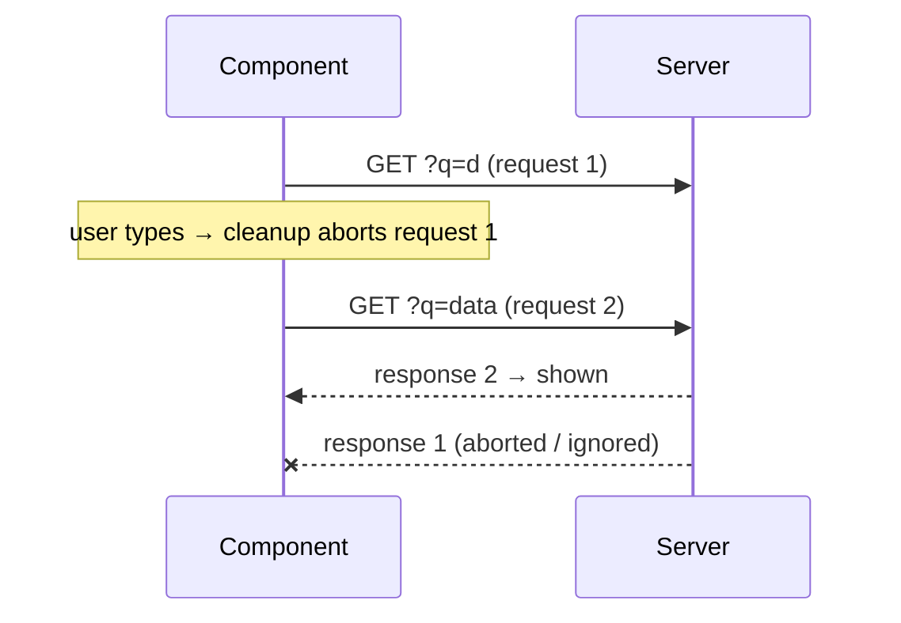

::part[Learn the Concept]{n="1"}

## 🎯 What you'll learn

- What a **side effect** is, and the mental model "effects synchronize with external systems"
- The dependency array, cleanup functions and why Strict Mode runs effects twice in development
- Timers, event listeners and **debouncing** with correct cleanup
- Fetching in effects safely (**AbortController**, stale responses) — and why you usually shouldn't
- `useSyncExternalStore` for browser APIs; **SSR-safe** `localStorage`
- Extracting **custom hooks**
- "You Might Not Need an Effect": derived data, event handlers, resetting state with `key`

## 🧠 The big idea

Rendering should be like a **recipe**: same ingredients (props, state) → same dish (JSX), no touching anything outside the kitchen. Effects are for when the dish must **talk to the outside world**: start a timer, subscribe to "online/offline", open a WebSocket, sync with `localStorage`.

Every effect is a promise: **"I'll start this, and I'll clean it up."** Like borrowing a meeting room — book it (setup) and leave it tidy when you're done or when plans change (cleanup).

## ❓ Why does this exist?

React components re-render often, on the server and in the browser. Code that subscribes, sets timers or mutates the DOM can't run during render (it would run many times, and on the server where `window` doesn't exist). `useEffect` runs **after** React commits to the screen, only in the browser, and gives you a place to undo the work.

## 💥 What happens if we DON'T (or misuse it)?

```tsx
// ❌ derived state via effect: extra render, flicker, easy to get out of sync
const [count, setCount] = useState(0);
useEffect(() => setCount(jobs.filter(matches).length), [jobs, query]);

// ❌ listener never removed → leaks and duplicate handlers after every re-mount
useEffect(() => { window.addEventListener("resize", onResize); }, []);

// ❌ race condition: type "d", "da", "data" quickly — the slow "d" response may arrive last and win
useEffect(() => { fetch(`/api/jobs?q=${query}`).then(r => r.json()).then(setJobs); }, [query]);

// ❌ infinite loop: object dependency recreated each render
useEffect(() => { setFilters({ ...filters, page: 1 }); }, [filters]);
```

## 📖 How it works, step by step

### 1. Anatomy

```tsx
useEffect(() => {
  // setup: runs after render when dependencies changed
  const id = setInterval(tick, 1000);
  return () => clearInterval(id);        // cleanup: before the next setup and on unmount
}, [tick]);                              // dependencies: every reactive value used inside
```

| Dependencies | Runs |
|---|---|
| none | after **every** render |
| `[]` | after mount (cleanup on unmount) |
| `[a, b]` | after mount and when `a` or `b` changes (`Object.is`) |

In development, **Strict Mode mounts, unmounts and re-mounts** components once — so setup → cleanup → setup. If that breaks your feature, your cleanup is missing. Let the `react-hooks/exhaustive-deps` lint rule decide dependencies; don't lie to it.

### 2. Debouncing a value

```tsx
export function useDebouncedValue<T>(value: T, delayMs: number) {
  const [debounced, setDebounced] = useState(value);
  useEffect(() => {
    const timer = setTimeout(() => setDebounced(value), delayMs);
    return () => clearTimeout(timer);                   // value changed again → cancel
  }, [value, delayMs]);
  return debounced;
}

const q = useDebouncedValue(search, 300);               // use q in the query key / URL
```

### 3. Subscribing to the browser: `useSyncExternalStore`

```tsx
function subscribe(callback: () => void) {
  window.addEventListener("online", callback);
  window.addEventListener("offline", callback);
  return () => {
    window.removeEventListener("online", callback);
    window.removeEventListener("offline", callback);
  };
}

export function useOnlineStatus() {
  return useSyncExternalStore(subscribe, () => navigator.onLine, () => true /* server snapshot */);
}
```

`useSyncExternalStore` is the React-approved way to read **external mutable sources** without tearing, and its server snapshot avoids hydration mismatches.

### 4. Fetching in an effect (when you must)

```tsx
useEffect(() => {
  if (!url) return;
  const controller = new AbortController();
  setState({ status: "loading" });
  fetch(url, { signal: controller.signal })
    .then(async (r) => {
      if (!r.ok) throw new Error(`Request failed with status ${r.status}`);
      const data = await r.json();
      if (!controller.signal.aborted) setState({ status: "success", data });
    })
    .catch((e) => {
      if (!controller.signal.aborted) setState({ status: "error", error: e.message });
    });
  return () => controller.abort();          // url changed or unmounted → cancel + ignore
}, [url]);
```



This is the minimum for correctness. In real apps prefer **Server Components** for page data and **TanStack Query** for client fetching (caching, retries, dedupe) — W4 L5–L7.

### 5. SSR-safe browser storage

```tsx
export function useLocalStorage<T>(key: string, initial: T) {
  const [value, setValue] = useState(initial);            // server and first client render match
  useEffect(() => {
    setValue(readStorage(key, initial));                   // after mount: read real value
    const onStorage = (e: StorageEvent) => { if (e.key === key) setValue(readStorage(key, initial)); };
    window.addEventListener("storage", onStorage);         // other tabs
    return () => window.removeEventListener("storage", onStorage);
  }, [key]);
  const save = useCallback((next: T) => {
    setValue(next);
    try { localStorage.setItem(key, JSON.stringify(next)); } catch { /* quota / private mode */ }
  }, [key]);
  return [value, save] as const;
}
```

Reading `localStorage` during render crashes on the server and causes **hydration mismatches** in the browser.

### 6. Effects you don't need

| Situation | Instead of an effect |
|---|---|
| Value computed from props/state (filtered list, total) | calculate during render (`useMemo` only if expensive) |
| Respond to a user action (submit, click → toast, API call) | do it in the **event handler** |
| Reset state when a prop changes (new `applicationId`) | `<NotesEditor key={applicationId} />` |
| Fetch page data | Server Component / TanStack Query |
| Notify parent of a change | call the parent callback in the same event handler |
| Chains of effects setting state that triggers effects | compute the next state together in one handler/reducer |

### 7. Custom hooks

Extract effect logic into `useSomething` functions: they **share logic, not state** (each call has its own state), must start with `use`, and follow hook rules (top level, not in conditions). Good hook names describe the purpose: `useOnlineStatus`, `useDebouncedValue` — not `useMount`.

## ⚖️ Trade-offs

| Tool | ✅ | ❌ |
|---|---|---|
| `useEffect` | general-purpose sync with anything | easy to create loops, races, leaks; runs after paint |
| `useLayoutEffect` | measure DOM before paint (tooltips) | blocks painting; warns on server |
| `useSyncExternalStore` | correct subscriptions, SSR snapshot | only for subscribe/snapshot sources |
| Event handlers | direct, no extra render | only for user-triggered logic |
| TanStack Query | fetching done right | a dependency |

## ✅ When to use it / 🚫 When NOT to use it

- ✅ Timers, subscriptions, WebSockets, analytics page views, integrating non-React widgets (maps, charts), browser storage sync.
- 🚫 Derived values, handling clicks/submits, data fetching for pages, resetting state on prop change.

## 🏆 Best practices

- [ ] Ask "what external system am I synchronizing with?" — if none, you probably don't need an effect.
- [ ] Always return a cleanup for timers, listeners, subscriptions and requests.
- [ ] Follow `react-hooks/exhaustive-deps`; fix dependencies by moving objects/functions inside the effect or out of the component.
- [ ] Use `AbortController` (or an ignore flag) for any async work in effects.
- [ ] Use `useSyncExternalStore` for browser/global stores; provide a server snapshot.
- [ ] Access `window`/`localStorage` only in effects or handlers; wrap storage in `try/catch`.
- [ ] Extract reusable effects into well-named custom hooks and test them with `renderHook`.
- [ ] Keep Strict Mode on; treat double-invocation bugs as real bugs.

## 🏭 How it's used in industry

- The React team's "You Might Not Need an Effect" guidance is widely used in code reviews; the React Compiler and lint rules (`eslint-plugin-react-hooks`) flag many misuse patterns.
- Libraries hide effect complexity: TanStack Query (fetching), `usehooks-ts` style utility hooks, Zustand (`useSyncExternalStore` inside).
- Real-time features (notifications, collaborative editing) rely on effects with careful cleanup for WebSockets/SSE.

## ⚠️ Common mistakes

- Missing cleanup → memory leaks and "Can't perform a React state update on an unmounted component"-style bugs.
- `async` function passed directly to `useEffect` (it returns a Promise, not a cleanup).
- Object/array literals in dependencies → effect runs every render.
- Suppressing the lint rule instead of restructuring.
- Using `[]` and reading stale props inside (stale closure, like the W3 debugging exercise).

::part[Explain & Design]{n="2"}

## 🗣️ Explain it

Using the meeting room analogy, explain why React calls your effect's cleanup before running it again with new dependencies — and what goes wrong if there's no cleanup.

## 📐 Design it

CareerPilot's job search page has: a search input (debounced), results from the API, an "offline" banner, a "recently viewed jobs" list saved in `localStorage` and synced across tabs, and a keyboard shortcut `/` to focus search. For each feature decide: effect, `useSyncExternalStore`, event handler, derived value, or TanStack Query — and describe the cleanup where relevant.

:::quiz
Show a possible answer

| Feature | Tool | Notes / cleanup |
|---|---|---|
| Debounced search | `useDebouncedValue` (effect + timer) | `clearTimeout` on change/unmount; push debounced `q` into the URL with `router.replace` |
| Results | **TanStack Query** keyed by `["jobs", { q }]` (or Server Component reading `searchParams`) | query cancellation via `signal`; `placeholderData: keepPreviousData` |
| Offline banner | `useSyncExternalStore` | unsubscribe `online`/`offline` listeners; server snapshot `true` |
| Recently viewed | `useLocalStorage` (effect after mount + `storage` listener) | remove listener; write in the "open job" **event handler**, not an effect |
| `/` shortcut | effect adding a `keydown` listener on `window` | remove listener; ignore when focus is already in an input |
| "N results" text | derived during render | no state, no effect |
:::

### 📝 Self-review checklist

- [ ] Every subscription has a matching unsubscribe
- [ ] No effect for derived values or clicks
- [ ] Browser APIs accessed only after mount

::ai-review{task="design"}

::part[Toy Exercise]{n="3"}

:::exercise{path="exercises/web/m4/w5/06-effects-hooks" ai="no-ai" title="Custom hooks with correct effects"}
Build `useDebouncedValue`, `useOnlineStatus` (with `useSyncExternalStore`), a race-safe `useFetchJson` with `AbortController`, an SSR-safe `useLocalStorage` that syncs across tabs, and a component that derives a value without any effect.
:::

:::hints
- The fetch hook test resolves an **old** request after a new one — check `signal.aborted` before setting state.
- When the URL changes, return a loading state immediately instead of showing the previous URL's data.
- `renderToString` in the tests simulates the server: no effects run there.
:::

## ✅ Quick check

:::quiz
Why does this loop forever? `useEffect(() => setOptions({ page: 1 }), [options])`

`setOptions` creates a new object → `options` changes identity → the effect runs again → sets a new object… Remove the effect (set it in the event that changes filters) or depend on primitives.
:::

:::quiz
In development your analytics effect sends "page viewed" twice. Is that a bug in production?

No — Strict Mode re-runs effects in development to reveal missing cleanup. In production it runs once. Still make sure the effect is safe to repeat (or send analytics from a router event).
:::

## 📖 Kamus (glossary)

| Term | Bahasa Indonesia |
|---|---|
| Side effect | Efek samping — interaksi dengan dunia luar |
| Cleanup | Pembersihan (membatalkan langganan/timer) |
| Dependency array | Daftar dependensi efek |
| Race condition | Kondisi balapan (respons lama menimpa yang baru) |
| Debounce | Menunda eksekusi sampai input berhenti |
| Hydration mismatch | Ketidakcocokan HTML server dan render klien |

## 📚 Keep learning

- [React docs: Synchronizing with Effects](https://react.dev/learn/synchronizing-with-effects)
- [React docs: You Might Not Need an Effect](https://react.dev/learn/you-might-not-need-an-effect)
- [React docs: useSyncExternalStore](https://react.dev/reference/react/useSyncExternalStore)
