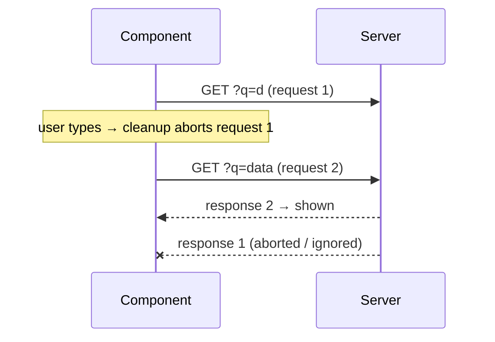

::part[Learn the Concept]{n="1"}

## 🎯 What you'll learn

- What a **side effect** is: talking to things outside React
- The dependency array, cleanup, and why effects run twice in development
- Timers, event listeners and debouncing with proper cleanup
- Loading data in an effect safely (and why you usually shouldn't)
- `useSyncExternalStore` for browser APIs; `localStorage` that works with SSR
- Writing **custom hooks**
- Effects you don't need

## 🔤 Key words

| Word | In simple words | Bahasa Indonesia |
|---|---|---|
| **Side effect** | Code that touches something outside React: timers, listeners, network, storage | Efek samping |
| **`useEffect`** | Runs code after React shows the screen, with a way to clean up | Hook efek |
| **Dependencies** | The values an effect uses; when they change, the effect runs again | Dependensi |
| **Cleanup** | The function that undoes the effect: stop the timer, remove the listener | Pembersihan |
| **Race condition** | An old, slow response arrives last and replaces newer data | Balapan respons |
| **Strict Mode** | A development mode that runs effects twice to find missing cleanup | Mode ketat |
| **Custom hook** | Your own reusable hook, like `useOnlineStatus` | Hook buatan sendiri |
| **Hydration mismatch** | Server HTML and the first browser render are different | HTML tidak cocok |

## 🧠 The big idea

Rendering should be like **following a recipe**: same ingredients (props, state) → same dish (JSX), without touching anything outside the kitchen. Effects are for when the dish must **talk to the outside world**: start a timer, listen for "online/offline", open a WebSocket, save to `localStorage`.

Every effect is a promise: **"I'll start this, and I'll clean it up."** Like borrowing a meeting room: you book it (setup), and you tidy it up when you're done or when plans change (cleanup).

## ❓ Why it matters

Components render many times, on the server and in the browser. Code that starts timers or listeners can't run during render — it would run many times, and on the server `window` doesn't exist. `useEffect` runs **after** React updates the screen, only in the browser, and gives you a place to clean up.

Common mistakes:

```tsx
// ❌ derived state via effect: extra render, flicker, easy to get out of sync
const [count, setCount] = useState(0);
useEffect(() => setCount(jobs.filter(matches).length), [jobs, query]);

// ❌ listener never removed → leaks and duplicate handlers after every re-mount
useEffect(() => { window.addEventListener("resize", onResize); }, []);

// ❌ race condition: type "d", "da", "data" quickly — the slow "d" response may arrive last and win
useEffect(() => { fetch(`/api/jobs?q=${query}`).then(r => r.json()).then(setJobs); }, [query]);

// ❌ infinite loop: object dependency recreated each render
useEffect(() => { setFilters({ ...filters, page: 1 }); }, [filters]);
```

- Calculating a value in an effect → an extra render and a flicker.
- A listener that's never removed → duplicates pile up.
- No cancelling → old responses overwrite new ones.
- An object dependency that's new every render → an endless loop.

## 📖 Step by step

### 1. The parts of an effect

```tsx
useEffect(() => {
  // setup: runs after render when dependencies changed
  const id = setInterval(tick, 1000);
  return () => clearInterval(id);        // cleanup: before the next setup and on unmount
}, [tick]);                              // dependencies: every reactive value used inside
```

| Dependencies | When it runs |
|---|---|
| none | after **every** render |
| `[]` | once after the component appears (cleanup when it disappears) |
| `[a, b]` | after it appears, and whenever `a` or `b` changes |

- In development, **Strict Mode** shows the component, removes it, and shows it again — so you see setup → cleanup → setup. If that breaks something, your cleanup is missing. Like a fire drill: it tests that everyone knows how to leave properly.
- Let the `react-hooks/exhaustive-deps` lint rule tell you the dependencies. Don't hide values from it.

### 2. Debouncing a value

```tsx
export function useDebouncedValue<T>(value: T, delayMs: number) {
  const [debounced, setDebounced] = useState(value);
  useEffect(() => {
    const timer = setTimeout(() => setDebounced(value), delayMs);
    return () => clearTimeout(timer);                   // value changed again → cancel
  }, [value, delayMs]);
  return debounced;
}

const q = useDebouncedValue(search, 300);               // use q in the query key / URL
```

Every time the value changes, the old timer is cancelled and a new one starts. The value only updates after 300 ms of no typing — like a lift door that waits until people stop walking in.

### 3. Listening to the browser: `useSyncExternalStore`

```tsx
function subscribe(callback: () => void) {
  window.addEventListener("online", callback);
  window.addEventListener("offline", callback);
  return () => {
    window.removeEventListener("online", callback);
    window.removeEventListener("offline", callback);
  };
}

export function useOnlineStatus() {
  return useSyncExternalStore(subscribe, () => navigator.onLine, () => true /* server snapshot */);
}
```

- `subscribe` = start listening, and return how to stop.
- The second function reads the current value in the browser.
- The third gives a value for the server, so the HTML matches (no hydration mismatch).

Use it for values that live **outside** React and can change at any time (online status, window size, a global store).

### 4. Loading data in an effect (only when you must)

```tsx
useEffect(() => {
  if (!url) return;
  const controller = new AbortController();
  setState({ status: "loading" });
  fetch(url, { signal: controller.signal })
    .then(async (r) => {
      if (!r.ok) throw new Error(`Request failed with status ${r.status}`);
      const data = await r.json();
      if (!controller.signal.aborted) setState({ status: "success", data });
    })
    .catch((e) => {
      if (!controller.signal.aborted) setState({ status: "error", error: e.message });
    });
  return () => controller.abort();          // url changed or unmounted → cancel + ignore
}, [url]);
```



When the URL changes, the cleanup **cancels** the old request, and the old response is ignored — like cancelling your first food order when you change your mind. This is the minimum to be correct. In real apps, prefer **Server Components** for page data and **TanStack Query** in the browser (Week 4 lessons 05–07).

### 5. `localStorage` that works with SSR

```tsx
export function useLocalStorage<T>(key: string, initial: T) {
  const [value, setValue] = useState(initial);            // server and first client render match
  useEffect(() => {
    setValue(readStorage(key, initial));                   // after mount: read real value
    const onStorage = (e: StorageEvent) => { if (e.key === key) setValue(readStorage(key, initial)); };
    window.addEventListener("storage", onStorage);         // other tabs
    return () => window.removeEventListener("storage", onStorage);
  }, [key]);
  const save = useCallback((next: T) => {
    setValue(next);
    try { localStorage.setItem(key, JSON.stringify(next)); } catch { /* quota / private mode */ }
  }, [key]);
  return [value, save] as const;
}
```

- The first render uses `initial` on both server and browser, so they match.
- After the component appears, read the real saved value.
- The `storage` event keeps other open tabs in sync.
- `try/catch`, because storage can be full or blocked in private mode.

Reading `localStorage` directly during render crashes on the server and causes hydration mismatches.

### 6. Effects you don't need

| Situation | Do this instead of an effect |
|---|---|
| A value calculated from props/state (filtered list, total) | calculate it during render |
| Reacting to a user action (submit, click → toast, API call) | do it in the **event handler** |
| Reset state when a prop changes (a new `applicationId`) | `<NotesEditor key={applicationId} />` |
| Loading page data | Server Component / TanStack Query |
| Telling the parent about a change | call the parent's callback in the same event handler |
| Effects that set state that triggers more effects | calculate the next state together in one handler or reducer |

### 7. Custom hooks

Move effect logic into functions named `useSomething`:
- They share **logic, not state** — each component that calls the hook gets its own state.
- The name must start with `use`, and hook rules apply (top level only).
- Good names describe the purpose: `useOnlineStatus`, `useDebouncedValue` — not `useMount`.

## ⚠️ Common mistakes

- No cleanup → memory leaks and state updates after the component is gone.
- Passing an `async` function directly to `useEffect` (it returns a Promise, not a cleanup).
- Object or array literals in dependencies → the effect runs every render.
- Turning off the lint rule instead of restructuring the code.
- Using `[]` but reading props inside → stale values (like the Week 3 debugging exercise).
- Using an effect for calculated values or for clicks and submits.

## 🏆 Best practices

- [ ] Ask: "which outside system am I connecting to?" If none, you probably don't need an effect.
- [ ] Always return a cleanup for timers, listeners, subscriptions and requests.
- [ ] Follow `react-hooks/exhaustive-deps`; fix dependencies by moving objects/functions inside the effect or outside the component.
- [ ] Use `AbortController` (or an "ignore" flag) for async work in effects.
- [ ] Use `useSyncExternalStore` for browser and global stores, with a server value.
- [ ] Touch `window` / `localStorage` only in effects or handlers; wrap storage in `try/catch`.
- [ ] Put reusable effects in well-named custom hooks and test them with `renderHook`.
- [ ] Keep Strict Mode on; treat "runs twice" bugs as real bugs.

::part[Explain & Design]{n="2"}

## 🗣️ Explain it

Using the meeting-room idea, explain why React runs your effect's cleanup before running it again with new dependencies — and what goes wrong without a cleanup.

## 📐 Design it

CareerPilot's job search page has: a search box (debounced), results from the API, an "offline" banner, a "recently viewed jobs" list saved in `localStorage` and synced across tabs, and a `/` keyboard shortcut to focus the search. For each feature, choose: effect, `useSyncExternalStore`, event handler, calculated value, or TanStack Query — and describe the cleanup where needed.

:::quiz
Show a possible answer

| Feature | Tool | Notes / cleanup |
|---|---|---|
| Debounced search | `useDebouncedValue` (effect + timer) | `clearTimeout` on change and unmount; put the debounced `q` into the URL with `router.replace` |
| Results | **TanStack Query** with key `["jobs", { q }]` (or a Server Component reading `searchParams`) | cancelling via `signal`; `placeholderData: keepPreviousData` |
| Offline banner | `useSyncExternalStore` | remove the `online` / `offline` listeners; server value `true` |
| Recently viewed | `useLocalStorage` (effect after mount + `storage` listener) | remove the listener; save in the "open job" **event handler**, not an effect |
| `/` shortcut | effect that adds a `keydown` listener on `window` | remove the listener; ignore it when an input already has focus |
| "N results" text | calculated during render | no state, no effect |
:::

### 📝 Self-review checklist

- [ ] Every subscription has a matching unsubscribe
- [ ] No effects for calculated values or clicks
- [ ] Browser APIs are only used after the component appears

::ai-review{task="design"}

::part[Toy Exercise]{n="3"}

:::exercise{path="exercises/web/m4/w5/06-effects-hooks" ai="no-ai" title="Custom hooks with correct effects"}
Build `useDebouncedValue`, `useOnlineStatus` (with `useSyncExternalStore`), a race-safe `useFetchJson` with `AbortController`, an SSR-safe `useLocalStorage` that syncs across tabs, and a component that calculates a value without any effect.
:::

:::hints
- The fetch hook test finishes an **old** request after a new one — check `signal.aborted` before setting state.
- When the URL changes, show a loading state right away instead of the previous URL's data.
- `renderToString` in the tests acts like the server: no effects run there.
:::

## ✅ Quick check

:::quiz
Why does this loop forever? `useEffect(() => setOptions({ page: 1 }), [options])`

`setOptions` creates a new object → `options` is a different object → the effect runs again → sets a new object… Remove the effect (set it in the event that changes the filters) or depend on simple values.
:::

:::quiz
In development, your analytics effect sends "page viewed" twice. Is that a bug in production?

No — Strict Mode runs effects twice in development to find missing cleanup. In production it runs once. Still make sure the effect is safe to repeat (or send analytics from a router event).
:::

## 📚 Keep learning

- [React docs: Synchronizing with Effects](https://react.dev/learn/synchronizing-with-effects)
- [React docs: You Might Not Need an Effect](https://react.dev/learn/you-might-not-need-an-effect)
- [React docs: useSyncExternalStore](https://react.dev/reference/react/useSyncExternalStore)
