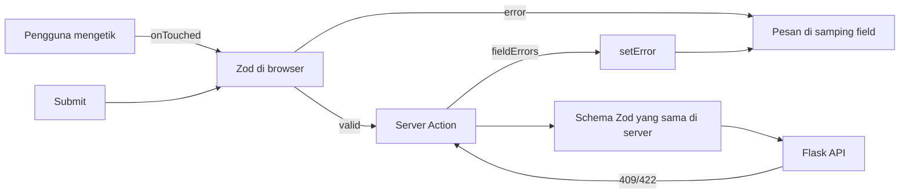

::part[Pelajari Konsepnya]{n="1"}

## 🎯 Yang akan kamu pelajari

- Kenapa form besar jadi merepotkan dengan `useState` atau form Server Action sederhana
- `useForm`, `register`, `handleSubmit`, `formState`
- **Satu schema Zod** untuk pengecekan di browser, type TypeScript, dan pengecekan di server
- Kapan menampilkan error (mode validasi)
- Baris berulang dengan **`useFieldArray`**
- Menampilkan error dari server dengan **`setError`**
- Input custom dengan `Controller`

## 🔤 Istilah penting

| Istilah | Artinya (sederhana) |
|---|---|
| **React Hook Form (RHF)** | Library yang mengelola nilai form, error, dan proses submit |
| **`register`** | Menghubungkan input ke form: `{...register("name")}` |
| **Resolver** | Jembatan yang membuat RHF bisa memakai schema Zod |
| **Uncontrolled input** | Browser menyimpan nilai yang diketik; React tidak digambar ulang di setiap tombol |
| **Touched** | Pengguna pernah masuk ke sebuah field lalu meninggalkannya |
| **Dirty** | Nilainya berbeda dari nilai awal |
| **Field array** | Daftar kelompok field yang berulang (link, skill) |
| **`setError`** | Memasang error pada field dari kodemu sendiri (misalnya error dari server) |

## 🧠 Ide besarnya

React Hook Form memperlakukan form seperti **papan jalan dengan checklist**, bukan siaran TV langsung. Dengan `useState` untuk setiap field, React menggambar ulang seluruh form di setiap tekan tombol. RHF membiarkan input browser menyimpan nilainya sendiri dan hanya memberi tahu React saat ada hal **penting** yang berubah: error muncul, form sudah diubah, proses submit dimulai.

Zod adalah **checklist**-nya: satu daftar aturan yang dipakai browser untuk umpan balik instan, dan dipakai server sebagai gerbang terakhir.

## ❓ Kenapa ini penting

**Form profil** CareerPilot punya nama, email, headline, daftar link portofolio yang berulang (tambah/hapus, maksimal 5), dan error dari server ("email sudah dipakai"). Dengan `useState` kamu butuh:

- 10+ variabel state dan handler `onChange` di mana-mana,
- menggambar ulang seluruh form di setiap tekan tombol,
- pelacakan "touched" buatan sendiri agar error tidak muncul saat mengetik,
- state array untuk link, dengan bug key berupa index,
- aturan yang sama ditulis dua kali (browser dan server).

Bug yang umum:

```tsx
const [links, setLinks] = useState([{ label: "", url: "" }]);
{links.map((link, i) => (
  <input key={i} value={link.url} onChange={(e) => { links[i].url = e.target.value; setLinks(links); }} />   // mutation → no re-render
))}
```

Key berupa index ditambah mengubah array secara langsung → menghapus link 1 membuat baris yang tersisa menampilkan nilai yang salah, dan ketikan terasa lambat di HP yang pelan.

## 📖 Langkah demi langkah

### 1. Install

```bash
npm install react-hook-form zod @hookform/resolvers
```

`@hookform/resolvers` (v5) menghubungkan Zod 4 lewat `zodResolver`.

### 2. Satu schema

```ts
// app/profile/profile-schema.ts — no "use client"/"use server": shared by both
import { z } from "zod";

export const profileSchema = z.object({
  name: z.string().trim().min(2, "Name must be at least 2 characters"),
  email: z.email("Enter a valid email"),
  headline: z.string().trim().max(120, "Keep your headline under 120 characters"),
  links: z.array(z.object({
    label: z.string().trim().min(1, "Label is required"),
    url: z.url("Enter a full URL, e.g. https://…"),
  })).max(5),
});

export type ProfileValues = z.infer<typeof profileSchema>;
```

- File ini tidak punya `"use client"` atau `"use server"`, jadi kedua sisi bisa meng-import-nya.
- `z.infer` membuat type TypeScript dari schema — aturan dan type tidak pernah berbeda.
- Zod 4 punya `z.email()` dan `z.url()` langsung (`z.string().email()` yang lama masih berfungsi).

### 3. `useForm` + `register`

```tsx
"use client";
const { register, handleSubmit, setError, reset, control, formState: { errors, isSubmitting } } =
  useForm<ProfileValues>({ resolver: zodResolver(profileSchema), defaultValues, mode: "onTouched" });

<label htmlFor="name">Name</label>
<input id="name" {...register("name")} aria-invalid={errors.name ? true : undefined}
       aria-describedby={errors.name ? "name-error" : undefined} />
{errors.name && <p id="name-error">{errors.name.message}</p>}
```

- `register("name")` mengembalikan `{ name, ref, onChange, onBlur }` — sebarkan ke input-nya.
- `errors.name.message` adalah pesan dari schema Zod-mu.

| `mode` | Mengecek | Cocok untuk |
|---|---|---|
| `onSubmit` (default) | saat submit, lalu saat berubah | form pendek |
| `onTouched` | setelah pengguna meninggalkan field sekali, lalu saat berubah | kebanyakan form — tanpa error saat pertama mengetik |
| `onBlur` | saat meninggalkan field | form panjang |
| `onChange` | setiap perubahan | pengukur kekuatan password (lebih berat) |

`onTouched` seperti guru yang menunggu kamu selesai menulis jawaban sebelum menilainya, bukan mengoreksi setiap huruf.

### 4. Baris berulang dengan `useFieldArray`

```tsx
const { fields, append, remove } = useFieldArray({ control, name: "links" });

{fields.map((field, index) => (
  <div key={field.id}>                                            {/* RHF's stable id, not index */}
    <label htmlFor={`links.${index}.url`}>{`Link ${index + 1} URL`}</label>
    <input id={`links.${index}.url`} {...register(`links.${index}.url`)} />
    {errors.links?.[index]?.url && <p>{errors.links[index].url.message}</p>}
    <button type="button" onClick={() => remove(index)}>{`Remove link ${index + 1}`}</button>
  </div>
))}
<button type="button" disabled={fields.length >= 5} onClick={() => append({ label: "", url: "" })}>Add link</button>
```

- `append` menambah baris; `remove(index)` menghapus satu.
- Pakai **`field.id`** sebagai key (id stabil dari RHF), bukan index — seperti name tag yang tetap menempel pada setiap orang saat ada yang keluar dari antrean.
- `type="button"` penting: tombol di dalam form otomatis men-submit.

### 5. Submit dan error dari server

```tsx
const onSubmit = handleSubmit(async (values) => {           // only called when Zod passes
  const result = await saveProfile(values);                  // Server Action or API call
  if (result?.fieldErrors) {
    for (const [field, message] of Object.entries(result.fieldErrors)) {
      setError(field as "email", { type: "server", message });
    }
    return;
  }
  if (result?.message) return setError("root.server", { type: "server", message: result.message });
  reset(values);                                             // new baseline → isDirty false
  toast.show("Profile saved");
});
```

```ts
// app/profile/actions.ts
"use server";
export async function saveProfile(input: unknown) {
  const session = await verifySession();
  const parsed = profileSchema.safeParse(input);              // same schema, never trust the client
  if (!parsed.success) return { message: "Invalid data" };
  try {
    await updateProfile(session, parsed.data);
  } catch (e) {
    if (e instanceof ApiError && e.status === 409) return { fieldErrors: { email: "Email already in use" } };
    throw e;
  }
  updateTag(`profile:${session.userId}`);
}
```

- `handleSubmit` hanya memanggil function-mu kalau pengecekan Zod lolos.
- Server Action mengecek **lagi** dengan schema yang sama — jangan pernah percaya browser.
- Error field dari server → `setError(field, …)`; error umum → `setError("root.server", …)`.
- Setelah berhasil, `reset(values)` menjadikan nilai yang tersimpan sebagai titik awal baru, jadi form tidak lagi dianggap "diubah".
- Memanggil Server Action dengan object biasa itu berfungsi. Kamu kehilangan "berfungsi tanpa JavaScript", tapi RHF memang butuh JavaScript.



### 6. Input custom: `Controller`

Beberapa input dari library UI (date picker, select custom, editor teks kaya) tidak bisa memakai `register`. Pakai `Controller`:

```tsx
<Controller control={control} name="status" render={({ field }) => <StatusSelect value={field.value} onValueChange={field.onChange} />} />
```

Seperti colokan adaptor untuk stopkontak luar negeri. Component form shadcn/ui (materi 08) memakai persis pola ini.

## ⚠️ Kesalahan umum

- Lupa `{...register("x")}` → nilainya tidak ada saat submit.
- Memakai `index` array sebagai `key` di field array.
- Membaca error bersarang dengan titik: pakai `errors.links?.[0]?.url`, bukan `errors.links.0.url`.
- Nilai `<input type="number">` berupa teks — pakai `valueAsNumber: true` atau `z.coerce`.
- Tanpa `defaultValues` → muncul peringatan dan `reset` / `isDirty` tidak bekerja dengan baik.
- Memakai RHF **sebagai pengganti** validasi server.
- RHF untuk form kecil seperti login atau "tambah catatan" — form Server Action lebih sederhana dan berfungsi tanpa JS.

## 🏆 Praktik terbaik

- [ ] Satu file schema yang dipakai bersama browser dan server; type dari `z.infer`.
- [ ] Selalu berikan `defaultValues`.
- [ ] `mode: "onTouched"` agar waktu munculnya error ramah.
- [ ] Pakai `field.id` sebagai key di field array.
- [ ] Error field dari server dengan `setError`; error umum dengan `root.server` di kotak `role="alert"`.
- [ ] Nonaktifkan submit dengan `isSubmitting`; `reset(values)` setelah berhasil.
- [ ] Label, `aria-invalid`, `aria-describedby`; RHF otomatis memfokuskan error pertama.
- [ ] `type="button"` pada tombol yang tidak men-submit.
- [ ] Cek dan otorisasi lagi di server.

::part[Jelaskan & Rancang]{n="2"}

## 🗣️ Jelaskan

Jelaskan ide papan jalan vs siaran langsung: kenapa membiarkan browser menyimpan nilai input membuat form besar terasa lebih cepat, dan apa yang tetap perlu digambar ulang oleh React Hook Form.

## 📐 Rancang

Rancang **wizard "Tambah lamaran"** 3 langkah: (1) perusahaan — pilih yang sudah ada atau buat baru (nama, website); (2) posisi — judul, level, rentang gaji, URL lowongan; (3) skill — daftar berulang `{ skill, level 1–5 }`, minimal satu. Jelaskan schema untuk setiap langkah, cara mengecek hanya langkah saat ini, di mana data disimpan di antara langkah, dan apa yang dilakukan server saat submit terakhir.

:::quiz
Tampilkan contoh desainnya

```ts
const companyStep = z.discriminatedUnion("mode", [
  z.object({ mode: z.literal("existing"), companyId: z.coerce.number().int().positive() }),
  z.object({ mode: z.literal("new"), name: z.string().trim().min(2), website: z.url().optional() }),
]);
const roleStep = z.object({
  title: z.string().trim().min(1), level: z.enum(["intern", "junior", "mid", "senior"]),
  salaryMin: z.number().int().nonnegative().optional(), salaryMax: z.number().int().nonnegative().optional(),
  jobUrl: z.url().optional(),
}).refine((r) => r.salaryMin === undefined || r.salaryMax === undefined || r.salaryMin <= r.salaryMax, { path: ["salaryMax"], message: "Max must be ≥ min" });
const skillsStep = z.object({ skills: z.array(z.object({ skill: z.string().trim().min(1), level: z.number().int().min(1).max(5) })).min(1, "Add at least one skill") });

export const wizardSchema = z.object({ company: companyStep, role: roleStep, skills: skillsStep.shape.skills });
```

- **Satu `useForm`** untuk seluruh wizard, dengan `resolver: zodResolver(wizardSchema)` dan `shouldUnregister: false` (nilai tetap ada saat sebuah langkah disembunyikan).
- Tombol "Berikutnya" memanggil `await trigger(["role.title", "role.level", …])` — ini hanya mengecek field di langkah saat ini.
- Skill memakai `useFieldArray` dengan key `field.id`.
- Progres disimpan di state form; kamu juga bisa menyimpan draf ke `localStorage` (dengan debounce) untuk berjaga-jaga saat reload.
- **Submit terakhir** → Server Action mengecek semuanya lagi dengan `wizardSchema`, mengecek sesi, membuat perusahaan kalau `mode === "new"` dan lamarannya dalam satu panggilan Flask, mengirim error `409` / `422` kembali dengan `setError`, dan melompat ke langkah yang berisi error pertama.
:::

### 📝 Checklist self-review

- [ ] Setiap langkah bisa dicek tanpa kehilangan nilai langkah lain
- [ ] Server mengecek ulang seluruh data
- [ ] Error dari server membawa pengguna ke langkah yang tepat

::ai-review{task="design"}

::part[Latihan Kecil]{n="3"}

:::exercise{path="exercises/web/m4/w5/07-react-hook-form-zod" ai="ai-allowed" title="Form profil dengan link dinamis"}
Tulis schema Zod bersama dan form profil React Hook Form dengan waktu validasi yang ramah, error yang aksesibel, link berulang dengan `useFieldArray` (maksimal 5), state menyimpan, error field dan umum dari server dengan `setError`, serta reset setelah berhasil.
:::

:::hints
- `getFieldState(name)` memberikan error untuk path apa pun, termasuk `links.0.url`.
- Menghapus satu baris harus mempertahankan nilai yang sudah diketik di baris lain — itulah gunanya key `field.id`.
- Kalau memakai AI, minta ia menjelaskan setiap function React Hook Form yang dipakainya, lalu cek dokumentasinya.
:::

## ✅ Cek cepat

:::quiz
Kenapa Server Action harus mengecek data dengan schema lagi padahal React Hook Form sudah melakukannya?

Browser bisa dilewati — siapa pun bisa memanggil action dengan data apa pun. Pengecekan di browser untuk pengalaman yang nyaman; pengecekan di server untuk kebenaran dan keamanan.
:::

:::quiz
Setelah berhasil menyimpan, tulisan "Perubahan belum disimpan" masih muncul. Apa yang terlupa?

`reset(values)` — menjadikan nilai yang di-submit sebagai nilai awal baru, jadi `isDirty` menjadi `false`.
:::

## 📚 Lanjut belajar

- [React Hook Form docs](https://react-hook-form.com/docs) — `useForm`, `useFieldArray`, `setError`
- [Zod 4 docs](https://zod.dev)
- [@hookform/resolvers](https://github.com/react-hook-form/resolvers)
