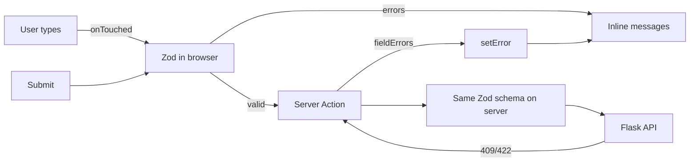

::part[Learn the Concept]{n="1"}

## 🎯 What you'll learn

- Why big forms become painful with `useState` or simple Server Action forms
- `useForm`, `register`, `handleSubmit`, `formState`
- **One Zod schema** for browser checks, TypeScript types and server checks
- When to show errors (validation modes)
- Repeating rows with **`useFieldArray`**
- Showing server errors with **`setError`**
- Custom inputs with `Controller`

## 🔤 Key words

| Word | In simple words | Bahasa Indonesia |
|---|---|---|
| **React Hook Form (RHF)** | A library that manages form values, errors and submitting | Library form |
| **`register`** | Connects an input to the form: `{...register("name")}` | Mendaftarkan input |
| **Resolver** | The bridge that lets RHF use a Zod schema | Penghubung validasi |
| **Uncontrolled input** | The browser keeps the typed value; React isn't redrawn on every key | Input yang dipegang browser |
| **Touched** | The user entered a field and then left it | Sudah disentuh |
| **Dirty** | The value is different from the starting value | Sudah diubah |
| **Field array** | A list of repeating field groups (links, skills) | Daftar field berulang |
| **`setError`** | Put an error on a field from your own code (like a server error) | Pasang error |

## 🧠 The big idea

React Hook Form treats a form like a **clipboard with a checklist**, not a live TV broadcast. With `useState` for every field, React redraws the whole form on every key press. RHF lets the browser's inputs hold their own values and only tells React when something **important** changes: an error appears, the form was changed, submitting starts.

Zod is the **checklist**: one list of rules the browser uses for instant feedback, and the server uses as the final gate.

## ❓ Why it matters

CareerPilot's **profile form** has a name, email, headline, a repeating list of portfolio links (add/remove, up to 5), and errors from the server ("email already in use"). With `useState` you'd need:

- 10+ state variables and `onChange` handlers everywhere,
- a full redraw on every key press,
- your own "touched" tracking so errors don't appear while typing,
- array state for links, with index-key bugs,
- the same rules written twice (browser and server).

A typical bug:

```tsx
const [links, setLinks] = useState([{ label: "", url: "" }]);
{links.map((link, i) => (
  <input key={i} value={link.url} onChange={(e) => { links[i].url = e.target.value; setLinks(links); }} />   // mutation → no re-render
))}
```

Index keys plus changing the array directly → removing link 1 shows the wrong values in the rows that remain, and typing lags on slow phones.

## 📖 Step by step

### 1. Install

```bash
npm install react-hook-form zod @hookform/resolvers
```

`@hookform/resolvers` (v5) connects Zod 4 through `zodResolver`.

### 2. One schema

```ts
// app/profile/profile-schema.ts — no "use client"/"use server": shared by both
import { z } from "zod";

export const profileSchema = z.object({
  name: z.string().trim().min(2, "Name must be at least 2 characters"),
  email: z.email("Enter a valid email"),
  headline: z.string().trim().max(120, "Keep your headline under 120 characters"),
  links: z.array(z.object({
    label: z.string().trim().min(1, "Label is required"),
    url: z.url("Enter a full URL, e.g. https://…"),
  })).max(5),
});

export type ProfileValues = z.infer<typeof profileSchema>;
```

- The file has no `"use client"` or `"use server"`, so both sides can import it.
- `z.infer` creates the TypeScript type from the schema — rules and types never drift apart.
- Zod 4 has `z.email()` and `z.url()` directly (the older `z.string().email()` still works).

### 3. `useForm` + `register`

```tsx
"use client";
const { register, handleSubmit, setError, reset, control, formState: { errors, isSubmitting } } =
  useForm<ProfileValues>({ resolver: zodResolver(profileSchema), defaultValues, mode: "onTouched" });

<label htmlFor="name">Name</label>
<input id="name" {...register("name")} aria-invalid={errors.name ? true : undefined}
       aria-describedby={errors.name ? "name-error" : undefined} />
{errors.name && <p id="name-error">{errors.name.message}</p>}
```

- `register("name")` returns `{ name, ref, onChange, onBlur }` — spread it onto the input.
- `errors.name.message` is the message from your Zod schema.

| `mode` | Checks | Good for |
|---|---|---|
| `onSubmit` (default) | on submit, then on change | short forms |
| `onTouched` | after the user leaves a field once, then on change | most forms — no errors while first typing |
| `onBlur` | when leaving a field | long forms |
| `onChange` | every change | password strength meters (costs more) |

`onTouched` is like a teacher who waits until you finish writing an answer before marking it, instead of correcting every letter.

### 4. Repeating rows with `useFieldArray`

```tsx
const { fields, append, remove } = useFieldArray({ control, name: "links" });

{fields.map((field, index) => (
  <div key={field.id}>                                            {/* RHF's stable id, not index */}
    <label htmlFor={`links.${index}.url`}>{`Link ${index + 1} URL`}</label>
    <input id={`links.${index}.url`} {...register(`links.${index}.url`)} />
    {errors.links?.[index]?.url && <p>{errors.links[index].url.message}</p>}
    <button type="button" onClick={() => remove(index)}>{`Remove link ${index + 1}`}</button>
  </div>
))}
<button type="button" disabled={fields.length >= 5} onClick={() => append({ label: "", url: "" })}>Add link</button>
```

- `append` adds a row; `remove(index)` removes one.
- Use **`field.id`** as the key (RHF's stable id), not the index — like name tags that stay with each person when someone leaves the queue.
- `type="button"` matters: a button inside a form submits by default.

### 5. Submitting and server errors

```tsx
const onSubmit = handleSubmit(async (values) => {           // only called when Zod passes
  const result = await saveProfile(values);                  // Server Action or API call
  if (result?.fieldErrors) {
    for (const [field, message] of Object.entries(result.fieldErrors)) {
      setError(field as "email", { type: "server", message });
    }
    return;
  }
  if (result?.message) return setError("root.server", { type: "server", message: result.message });
  reset(values);                                             // new baseline → isDirty false
  toast.show("Profile saved");
});
```

```ts
// app/profile/actions.ts
"use server";
export async function saveProfile(input: unknown) {
  const session = await verifySession();
  const parsed = profileSchema.safeParse(input);              // same schema, never trust the client
  if (!parsed.success) return { message: "Invalid data" };
  try {
    await updateProfile(session, parsed.data);
  } catch (e) {
    if (e instanceof ApiError && e.status === 409) return { fieldErrors: { email: "Email already in use" } };
    throw e;
  }
  updateTag(`profile:${session.userId}`);
}
```

- `handleSubmit` only calls your function when the Zod checks pass.
- The Server Action checks **again** with the same schema — never trust the browser.
- Server field errors → `setError(field, …)`; a general error → `setError("root.server", …)`.
- After success, `reset(values)` makes the saved values the new starting point, so the form is no longer "changed".
- Calling a Server Action with a plain object works. You lose "works without JavaScript", but RHF needs JavaScript anyway.



### 6. Custom inputs: `Controller`

Some inputs from UI libraries (date pickers, custom selects, rich text editors) don't work with `register`. Use `Controller`:

```tsx
<Controller control={control} name="status" render={({ field }) => <StatusSelect value={field.value} onValueChange={field.onChange} />} />
```

Like an adapter plug for a foreign socket. shadcn/ui's form components (lesson 08) use exactly this.

## ⚠️ Common mistakes

- Forgetting `{...register("x")}` → the value is missing when submitting.
- Using the array `index` as `key` in field arrays.
- Reading nested errors with dots: use `errors.links?.[0]?.url`, not `errors.links.0.url`.
- `<input type="number">` values are text — use `valueAsNumber: true` or `z.coerce`.
- No `defaultValues` → warnings and `reset` / `isDirty` don't work well.
- Using RHF **instead of** server validation.
- RHF for a tiny login or "add note" form — a Server Action form is simpler and works without JS.

## 🏆 Best practices

- [ ] One schema file shared by browser and server; types from `z.infer`.
- [ ] Always give `defaultValues`.
- [ ] `mode: "onTouched"` for friendly error timing.
- [ ] Use `field.id` as the key in field arrays.
- [ ] Server field errors with `setError`; general errors with `root.server` in a `role="alert"` box.
- [ ] Disable submit with `isSubmitting`; `reset(values)` after success.
- [ ] Labels, `aria-invalid`, `aria-describedby`; RHF focuses the first error by default.
- [ ] `type="button"` on buttons that don't submit.
- [ ] Check and authorize again on the server.

::part[Explain & Design]{n="2"}

## 🗣️ Explain it

Explain the clipboard vs live broadcast idea: why letting the browser hold input values makes big forms feel faster, and what React Hook Form still needs to redraw.

## 📐 Design it

Design a 3-step **"Add application" wizard**: (1) company — pick an existing one or create a new one (name, website); (2) role — title, level, salary range, job post URL; (3) skills — a repeating list of `{ skill, level 1–5 }`, at least one. Describe the schemas for each step, how to check only the current step, where data is kept between steps, and what the server does on the final submit.

:::quiz
Show a possible design

```ts
const companyStep = z.discriminatedUnion("mode", [
  z.object({ mode: z.literal("existing"), companyId: z.coerce.number().int().positive() }),
  z.object({ mode: z.literal("new"), name: z.string().trim().min(2), website: z.url().optional() }),
]);
const roleStep = z.object({
  title: z.string().trim().min(1), level: z.enum(["intern", "junior", "mid", "senior"]),
  salaryMin: z.number().int().nonnegative().optional(), salaryMax: z.number().int().nonnegative().optional(),
  jobUrl: z.url().optional(),
}).refine((r) => r.salaryMin === undefined || r.salaryMax === undefined || r.salaryMin <= r.salaryMax, { path: ["salaryMax"], message: "Max must be ≥ min" });
const skillsStep = z.object({ skills: z.array(z.object({ skill: z.string().trim().min(1), level: z.number().int().min(1).max(5) })).min(1, "Add at least one skill") });

export const wizardSchema = z.object({ company: companyStep, role: roleStep, skills: skillsStep.shape.skills });
```

- **One `useForm`** for the whole wizard, with `resolver: zodResolver(wizardSchema)` and `shouldUnregister: false` (values stay when a step is hidden).
- The "Next" button calls `await trigger(["role.title", "role.level", …])` — this checks only the current step's fields.
- Skills use `useFieldArray` with `field.id` keys.
- Progress lives in the form state; you can also save a draft to `localStorage` (debounced) in case of a refresh.
- **Final submit** → the Server Action checks everything again with `wizardSchema`, checks the session, creates the company if `mode === "new"` and the application in one Flask call, sends `409` / `422` errors back with `setError`, and jumps to the step with the first error.
:::

### 📝 Self-review checklist

- [ ] Each step can be checked without losing the other steps' values
- [ ] The server checks the full data again
- [ ] Server errors take the user to the right step

::ai-review{task="design"}

::part[Toy Exercise]{n="3"}

:::exercise{path="exercises/web/m4/w5/07-react-hook-form-zod" ai="ai-allowed" title="Profile form with dynamic links"}
Write the shared Zod schema and a React Hook Form profile form with friendly validation timing, accessible errors, repeating links with `useFieldArray` (max 5), a saving state, server field and general errors with `setError`, and a reset after success.
:::

:::hints
- `getFieldState(name)` gives the error for any path, including `links.0.url`.
- Removing a row must keep the other rows' typed values — that's what `field.id` keys are for.
- If you use AI, ask it to explain each React Hook Form function it uses, and check the docs.
:::

## ✅ Quick check

:::quiz
Why must the Server Action check the data with the schema again if React Hook Form already did?

The browser can be skipped — anyone can call the action with any data. Browser checks are for a nice experience; server checks are for correctness and security.
:::

:::quiz
After a successful save, "Unsaved changes" still shows. What did you forget?

`reset(values)` — it makes the submitted values the new starting values, so `isDirty` becomes `false`.
:::

## 📚 Keep learning

- [React Hook Form docs](https://react-hook-form.com/docs) — `useForm`, `useFieldArray`, `setError`
- [Zod 4 docs](https://zod.dev)
- [@hookform/resolvers](https://github.com/react-hook-form/resolvers)
