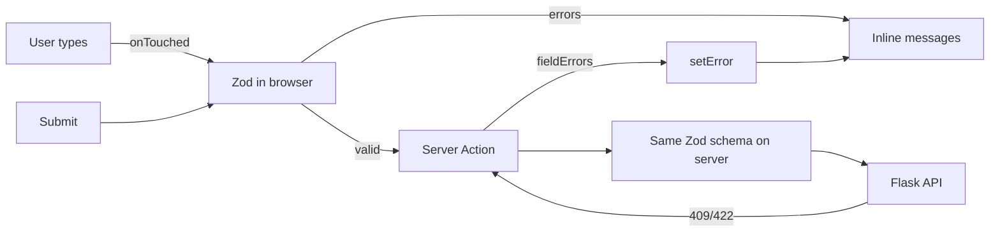

::part[Learn the Concept]{n="1"}

## 🎯 What you'll learn

- Why complex forms outgrow `useState` and plain Server Action forms
- `useForm`, `register`, `handleSubmit`, `formState` (`errors`, `isSubmitting`, `isDirty`)
- **One Zod schema** for client validation, types (`z.infer`) and server re-validation
- Validation modes (`onSubmit`, `onBlur`, `onTouched`, `onChange`)
- Dynamic lists with **`useFieldArray`**
- Mapping server errors with **`setError`** and `root` errors
- Controlled third-party inputs with `Controller`, and calling Server Actions from RHF

## 🧠 The big idea

React Hook Form treats inputs like a **clipboard with a checklist** rather than a live broadcast. Instead of React re-rendering the whole form on every keystroke (`useState` per field), RHF lets the browser's inputs hold their values (**uncontrolled**) and only tells React when something **important** changes: an error appears, the form becomes dirty, submission starts.

Zod is the **checklist**: one list of rules that the browser uses for instant feedback and the server uses as the final gate.

## ❓ Why does this exist?

CareerPilot's **profile form** has name, email, headline, a dynamic list of portfolio links (add/remove, up to 5), and errors from the server ("email already in use"). With `useState`:

- 10+ state variables, `onChange` handlers everywhere
- re-render of the whole form per keystroke
- manual "touched" tracking so errors don't show before the user types
- manual array state for links with index-key bugs
- duplicated validation rules on client and server

## 💥 What happens if we DON'T?

```tsx
const [links, setLinks] = useState([{ label: "", url: "" }]);
{links.map((link, i) => (
  <input key={i} value={link.url} onChange={(e) => { links[i].url = e.target.value; setLinks(links); }} />   // mutation → no re-render
))}
```

Index keys + mutation → removing link 1 shows the wrong values in the remaining rows; validation rules drift from the server's; typing lags on slower phones.

## 📖 How it works, step by step

### 1. Install

```bash
npm install react-hook-form zod @hookform/resolvers
```

`@hookform/resolvers` v5 supports Zod 4 via `zodResolver`.

### 2. One schema

```ts
// app/profile/profile-schema.ts — no "use client"/"use server": shared by both
import { z } from "zod";

export const profileSchema = z.object({
  name: z.string().trim().min(2, "Name must be at least 2 characters"),
  email: z.email("Enter a valid email"),
  headline: z.string().trim().max(120, "Keep your headline under 120 characters"),
  links: z.array(z.object({
    label: z.string().trim().min(1, "Label is required"),
    url: z.url("Enter a full URL, e.g. https://…"),
  })).max(5),
});

export type ProfileValues = z.infer<typeof profileSchema>;
```

Zod 4 has top-level format schemas like `z.email()` and `z.url()` (the older `z.string().email()` still works but is deprecated).

### 3. `useForm` + `register`

```tsx
"use client";
const { register, handleSubmit, setError, reset, control, formState: { errors, isSubmitting } } =
  useForm<ProfileValues>({ resolver: zodResolver(profileSchema), defaultValues, mode: "onTouched" });

<label htmlFor="name">Name</label>
<input id="name" {...register("name")} aria-invalid={errors.name ? true : undefined}
       aria-describedby={errors.name ? "name-error" : undefined} />
{errors.name && <p id="name-error">{errors.name.message}</p>}
```

`register("name")` returns `{ name, ref, onChange, onBlur }` — spread it onto the input.

| `mode` | Validates | Good for |
|---|---|---|
| `onSubmit` (default) | on submit, then on change | short forms |
| `onTouched` | after a field is blurred once, then on change | most forms — no errors while first typing |
| `onBlur` | on blur | long forms |
| `onChange` | every change | password strength meters (costly) |

### 4. Dynamic rows with `useFieldArray`

```tsx
const { fields, append, remove } = useFieldArray({ control, name: "links" });

{fields.map((field, index) => (
  <div key={field.id}>                                            {/* RHF's stable id, not index */}
    <label htmlFor={`links.${index}.url`}>{`Link ${index + 1} URL`}</label>
    <input id={`links.${index}.url`} {...register(`links.${index}.url`)} />
    {errors.links?.[index]?.url && <p>{errors.links[index].url.message}</p>}
    <button type="button" onClick={() => remove(index)}>{`Remove link ${index + 1}`}</button>
  </div>
))}
<button type="button" disabled={fields.length >= 5} onClick={() => append({ label: "", url: "" })}>Add link</button>
```

`type="button"` matters: buttons inside a form default to `submit`.

### 5. Submitting and server errors

```tsx
const onSubmit = handleSubmit(async (values) => {           // only called when Zod passes
  const result = await saveProfile(values);                  // Server Action or API call
  if (result?.fieldErrors) {
    for (const [field, message] of Object.entries(result.fieldErrors)) {
      setError(field as "email", { type: "server", message });
    }
    return;
  }
  if (result?.message) return setError("root.server", { type: "server", message: result.message });
  reset(values);                                             // new baseline → isDirty false
  toast.show("Profile saved");
});
```

```ts
// app/profile/actions.ts
"use server";
export async function saveProfile(input: unknown) {
  const session = await verifySession();
  const parsed = profileSchema.safeParse(input);              // same schema, never trust the client
  if (!parsed.success) return { message: "Invalid data" };
  try {
    await updateProfile(session, parsed.data);
  } catch (e) {
    if (e instanceof ApiError && e.status === 409) return { fieldErrors: { email: "Email already in use" } };
    throw e;
  }
  updateTag(`profile:${session.userId}`);
}
```

A Server Action called with a plain object works fine (arguments are serialized). You lose "works without JavaScript", which RHF forms need anyway.



### 6. Controlled components

Custom inputs that don't expose a native `ref` (date pickers, selects from UI libraries, rich text editors) use `Controller`:

```tsx
<Controller control={control} name="status" render={({ field }) => <StatusSelect value={field.value} onValueChange={field.onChange} />} />
```

shadcn/ui's Form components (lesson 08) wrap exactly this pattern.

## ⚖️ Trade-offs

| | ✅ | ❌ |
|---|---|---|
| `useActionState` form | no library, works without JS | clunky instant validation, dynamic arrays, fields reset |
| RHF + Zod | performance, dynamic fields, typed errors, huge ecosystem | JS required; another API to learn |
| TanStack Form | strong typing, framework-agnostic | smaller ecosystem than RHF (so far) |
| Formik | familiar in older codebases | re-renders more, less active |

## ✅ When to use it / 🚫 When NOT to use it

- ✅ Multi-field forms, wizards, dynamic rows, instant validation, forms inside dialogs.
- ✅ When you want the same Zod schema on client and server (TypeScript full-stack or a Next.js BFF).
- 🚫 A login or "add note" form — a Server Action form is simpler and works without JS.
- 🚫 Don't use RHF **instead of** server validation.

## 🏆 Best practices

- [ ] One schema file shared by client and server; derive types with `z.infer`.
- [ ] Always provide `defaultValues` (avoids uncontrolled → controlled warnings, enables `reset`/`isDirty`).
- [ ] `mode: "onTouched"` for friendly validation timing.
- [ ] Use `field.id` as the key in field arrays.
- [ ] Map server `fieldErrors` with `setError`; general errors via `root.server` in `role="alert"`.
- [ ] Disable submit with `isSubmitting`; `reset(values)` after success.
- [ ] Accessible fields: labels, `aria-invalid`, `aria-describedby`, focus the first error (`shouldFocusError` is on by default).
- [ ] `type="button"` on non-submit buttons inside forms.
- [ ] Re-validate and authorize on the server.

## 🏭 How it's used in industry

- React Hook Form is one of the most downloaded React form libraries, and **RHF + Zod** is the default pairing in many Next.js starters and in shadcn/ui's form docs.
- Backends in other languages (Flask, FastAPI) remain the source of truth; teams often generate Zod schemas or TypeScript types from OpenAPI to keep contracts aligned.

## ⚠️ Common mistakes

- Forgetting `{...register("x")}` → the value is missing from submit data.
- Using array `index` as `key` in field arrays.
- Showing `errors.links.0.url` with dot access — errors are nested objects: `errors.links?.[0]?.url`.
- Calling `setError` for a field and never clearing it — RHF clears errors when the field re-validates or on the next submit.
- Coercing numbers: `<input type="number">` values are strings unless you use `valueAsNumber: true` or `z.coerce`.

::part[Explain & Design]{n="2"}

## 🗣️ Explain it

Explain the clipboard vs live broadcast analogy: why uncontrolled inputs make large forms feel faster, and what React Hook Form still has to re-render.

## 📐 Design it

Design a 3-step **"Add application" wizard** for CareerPilot: (1) company — pick existing or create new (name, website); (2) role — title, level, salary range, job post URL; (3) skills — dynamic list of `{ skill, level 1–5 }`, at least one. Describe the schemas per step, how you validate only the current step, where data is kept between steps, and what the server does on final submit.

:::quiz
Show a possible design

```ts
const companyStep = z.discriminatedUnion("mode", [
  z.object({ mode: z.literal("existing"), companyId: z.coerce.number().int().positive() }),
  z.object({ mode: z.literal("new"), name: z.string().trim().min(2), website: z.url().optional() }),
]);
const roleStep = z.object({
  title: z.string().trim().min(1), level: z.enum(["intern", "junior", "mid", "senior"]),
  salaryMin: z.number().int().nonnegative().optional(), salaryMax: z.number().int().nonnegative().optional(),
  jobUrl: z.url().optional(),
}).refine((r) => r.salaryMin === undefined || r.salaryMax === undefined || r.salaryMin <= r.salaryMax, { path: ["salaryMax"], message: "Max must be ≥ min" });
const skillsStep = z.object({ skills: z.array(z.object({ skill: z.string().trim().min(1), level: z.number().int().min(1).max(5) })).min(1, "Add at least one skill") });

export const wizardSchema = z.object({ company: companyStep, role: roleStep, skills: skillsStep.shape.skills });
```

- **One `useForm`** for the whole wizard with `resolver: zodResolver(wizardSchema)` and `shouldUnregister: false` (values survive unmounting steps).
- "Next" calls `await trigger(["role.title", "role.level", …])` — validates only the current step's fields.
- Skills use `useFieldArray` with `field.id` keys.
- Progress is kept in the form state; optionally save a draft to `localStorage` (debounced) for refreshes.
- Final submit → Server Action re-parses with `wizardSchema`, verifies the session, creates the company if `mode === "new"` and the application in one Flask call (or a transaction endpoint), maps `409`/`422` back with `setError` and jumps to the step containing the first error.
:::

### 📝 Self-review checklist

- [ ] Step validation without losing other steps' values
- [ ] Server re-validates the full payload
- [ ] Server errors lead the user to the right step

::ai-review{task="design"}

::part[Toy Exercise]{n="3"}

:::exercise{path="exercises/web/m4/w5/07-react-hook-form-zod" ai="ai-allowed" title="Profile form with dynamic links"}
Write the shared Zod schema and a React Hook Form profile form with touched-based validation, accessible errors, `useFieldArray` links (max 5), pending state, server field/root errors via `setError`, and reset after success.
:::

:::hints
- `getFieldState(name)` gives the error for any path, including `links.0.url`.
- Removing a row must keep the other rows' typed values — that's what `field.id` keys are for.
- If you use AI, ask it to explain each RHF API it uses and verify against the docs.
:::

## ✅ Quick check

:::quiz
Why must the Server Action parse the data with the schema again if RHF already validated it?

The client can be bypassed — anyone can call the action with any payload. Client validation is for UX; server validation is for correctness and security.
:::

:::quiz
After a successful save, "Unsaved changes" still shows. What did you forget?

`reset(values)` — it sets the submitted values as the new defaults so `isDirty` becomes `false`.
:::

## 📖 Kamus (glossary)

| Term | Bahasa Indonesia |
|---|---|
| Uncontrolled input | Input yang nilainya disimpan oleh DOM |
| Resolver | Penghubung RHF ke library validasi |
| Schema | Skema aturan data |
| Field array | Daftar kolom dinamis |
| Dirty | Sudah diubah dari nilai awal |
| Touched | Sudah pernah difokus lalu ditinggalkan |

## 📚 Keep learning

- [React Hook Form docs](https://react-hook-form.com/docs) — `useForm`, `useFieldArray`, `setError`
- [Zod 4 docs](https://zod.dev)
- [@hookform/resolvers](https://github.com/react-hook-form/resolvers)
