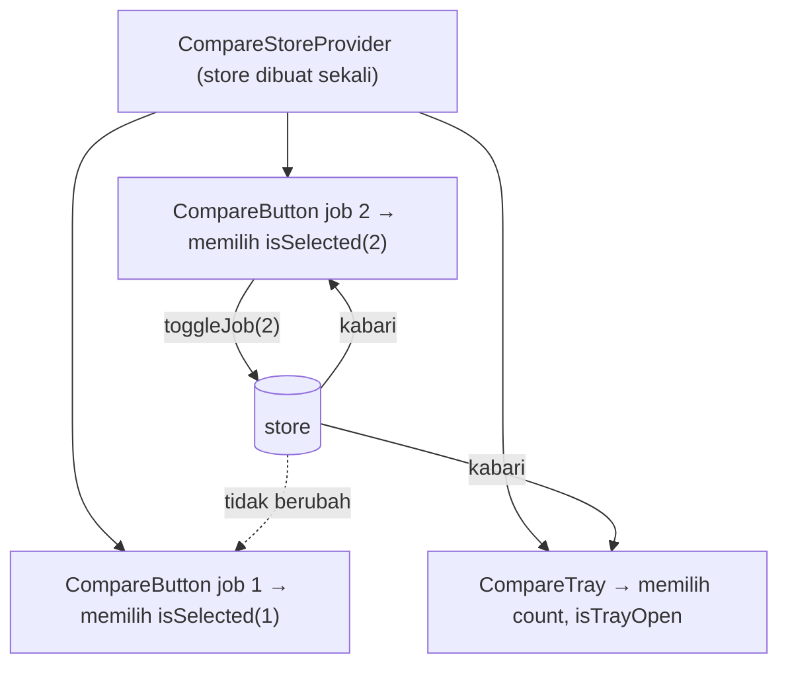

::part[Pelajari Konsepnya]{n="1"}

## 🎯 Yang akan kamu pelajari

- Empat jenis state, dan kenapa kebanyakan tidak cocok ditaruh di store bersama
- Membuat store Zustand: state, action, `set`, `get`
- **Selector** dan `useShallow`, supaya komponen hanya render ulang saat bagiannya berubah
- Update immutable dan mengembalikan hasil dari action
- **`persist`** dengan `partialize`
- Pola **store-per-provider** untuk Next.js (data tidak bocor antar pengguna)
- Menguji store tanpa React

## 🔤 Istilah penting

| Istilah | Artinya (sederhana) |
|---|---|
| **Store** | Satu wadah state bersama (data + fungsi pengubahnya) yang bisa dipakai komponen mana pun |
| **Action** | Fungsi di dalam store yang mengubah state |
| **Selector** | Fungsi kecil yang memilih bagian state yang dibutuhkan komponen |
| **Subscribe** | "Kabari aku kalau ini berubah" |
| **Re-render** | React menjalankan ulang komponen untuk memperbarui layar |
| **Persist** | Menyimpan state (misalnya di `localStorage`) supaya bertahan setelah refresh |
| **Hydration** | Browser mengambil alih HTML yang dikirim server |
| **Singleton** | Hanya ada satu salinan, dipakai bersama oleh semua dalam proses yang sama |

## 🧠 Ide besarnya

Context itu seperti **pengeras suara**: saat ia bicara, semua yang mendengar menerima semuanya. Zustand seperti **grup WhatsApp dengan filter notifikasi**: store menyimpan percakapannya, dan tiap komponen hanya dapat notifikasi untuk pesan yang ia pedulikan ("kabari aku hanya kalau job 7 dipilih"). Perubahan pada job 2 tidak membangunkan tombol job 7.

## ❓ Kenapa ini penting

Daftar lowongan CareerPilot menampilkan 50 kartu. Tiap kartu punya tombol **Compare**; tray melayang menampilkan "Compare (2/3)"; header menampilkan jumlahnya.

- Dengan **Context** yang menyimpan `jobIds`, setiap toggle membuat **50 kartu**, tray, dan header render ulang.
- Dengan **`useState` di parent bersama**, kamu harus mengoper props melewati banyak lapisan (prop drilling).
- **Redux** bisa, tapi butuh banyak setup untuk logika 30 baris.

Zustand adalah store mungil (~1 KB) yang dipakai sebagai hook, lengkap dengan selector. Tidak perlu provider untuk aplikasi sederhana, hampir tanpa boilerplate.

Tapi jangan taruh **data server** (lamaran, lowongan) di sini — nanti kamu menulis cache sendiri secara manual. Itu tugas TanStack Query.

## 📖 Langkah demi langkah

### 1. State mana ditaruh di mana

| Jenis | Contoh | Alat |
|---|---|---|
| State server | lamaran, lowongan | Server Components, TanStack Query |
| State URL | filter, tab, halaman | `searchParams` |
| State UI lokal | menu sedang terbuka | `useState` |
| **State UI klien bersama** | tray compare, draft multi-langkah, panel editor, pemutar media | **Zustand** (atau Context kalau jarang berubah) |

Bayangkan sebuah rumah: data server ada di **gudang** (API), URL adalah **alamat yang bisa dibagikan**, `useState` adalah **laci di satu kamar**, dan Zustand adalah **papan tulis keluarga di lorong** — untuk catatan yang dibutuhkan banyak kamar.

### 2. Store dasar

```tsx
import { create } from "zustand";

type CompareState = {
  jobIds: number[];
  toggleJob: (id: number) => "added" | "removed" | "full";
  clear: () => void;
};

export const useCompareStore = create<CompareState>()((set, get) => ({
  jobIds: [],
  toggleJob: (id) => {
    const { jobIds } = get();
    if (jobIds.includes(id)) {
      set({ jobIds: jobIds.filter((j) => j !== id) });
      return "removed";
    }
    if (jobIds.length >= 3) return "full";
    set({ jobIds: [...jobIds, id] });          // new array — never push()
    return "added";
  },
  clear: () => set({ jobIds: [] }),
}));
```

- `get()` membaca state saat ini; `set()` mengubahnya.
- `set` **menggabungkan** level teratas (`set({ jobIds })` tetap menyimpan key lain). Object bersarang harus kamu salin sendiri.
- Aturannya (maksimal 3) ada **di dalam** store, dekat datanya. Action mengembalikan hasil supaya UI bisa menampilkan "Tray sudah penuh".

### 3. Selector

```tsx
const isSelected = useCompareStore((s) => s.jobIds.includes(jobId));   // boolean → re-render only when it flips
const toggleJob = useCompareStore((s) => s.toggleJob);                 // actions are stable
const count = useCompareStore((s) => s.jobIds.length);

// ❌ subscribes to everything
const { jobIds, toggleJob } = useCompareStore();

// selecting several values → useShallow to avoid re-renders from a new object each time
import { useShallow } from "zustand/react/shallow";
const { count, isTrayOpen } = useCompareStore(useShallow((s) => ({ count: s.jobIds.length, isTrayOpen: s.isTrayOpen })));
```

Setiap ada perubahan, Zustand menjalankan selector-mu dan membandingkan jawaban baru dengan yang lama memakai `Object.is`. Jawabannya sama → tidak render ulang.

Hati-hati: selector yang membuat **object atau array baru** setiap kali tidak pernah memberi "jawaban yang sama", jadi komponen render ulang terus (Zustand v5 bahkan bisa memberi peringatan infinite loop). Pilih nilai sederhana (angka, boolean) atau bungkus dengan `useShallow`, yang membandingkan isinya.

### 4. Persist

```tsx
import { createJSONStorage, persist } from "zustand/middleware";

create<CompareState>()(
  persist((set, get) => ({ … }), {
    name: "careerpilot-compare",
    storage: createJSONStorage(() => localStorage),
    partialize: (s) => ({ jobIds: s.jobIds }),       // don't persist UI flags or functions
  }),
);
```

`partialize` memilih **apa yang dimasukkan ke koper** sebelum pergi: lowongan yang dipilih, bukan "tray sedang terbuka".

Dengan server rendering, state yang tersimpan baru muncul **setelah hydration** (server tidak bisa membaca `localStorage`). Pastikan render pertama yang masih kosong tetap terlihat wajar, atau pakai `skipHydration` lalu panggil `persist.rehydrate()` di dalam effect.

### 5. Next.js: satu store per provider

Store yang dibuat dengan `create()` di bagian atas file adalah **singleton per proses server**. Saat server rendering, request dari dua pengguna bisa berbagi store yang sama — seperti dua pelanggan menulis di satu lembar pesanan. Kalau store bisa menyimpan data per pengguna atau berjalan di server, buat store di dalam provider:

```tsx
"use client";
import { createStore } from "zustand/vanilla";
import { useStore } from "zustand";

export const createCompareStore = (initial?: Partial<CompareData>) =>
  createStore<CompareState>()(persist((set, get) => ({ jobIds: [], isTrayOpen: false, ...initial, /* actions */ }), { … }));

const CompareStoreContext = createContext<ReturnType<typeof createCompareStore> | null>(null);

export function CompareStoreProvider({ initial, children }: Props) {
  const [store] = useState(() => createCompareStore(initial));      // created once per mount
  return <CompareStoreContext value={store}>{children}</CompareStoreContext>;
}

export function useCompareStore<T>(selector: (s: CompareState) => T) {
  const store = useContext(CompareStoreContext);
  if (!store) throw new Error("useCompareStore must be used inside <CompareStoreProvider>");
  return useStore(store, selector);
}
```

Context hanya mengoper **object store**, yang tidak pernah berubah — jadi Context-nya sendiri tidak pernah memicu render ulang. Perubahan tetap mengalir lewat selector.



### 6. Testing

Vanilla store adalah object biasa — uji aturannya tanpa merender apa pun:

```ts
const store = createCompareStore();
store.getState().toggleJob(1);
expect(store.getState().jobIds).toEqual([1]);
```

Lalu uji perilaku komponen, dan pakai `<Profiler>` dari React kalau jumlah render penting.

### Kapan dipakai

- ✅ State UI khusus browser yang dipakai bersama komponen berjauhan dan sering berubah: tray compare, pemutar media, alat editor, wizard yang kompleks.
- 🚫 Data server → TanStack Query atau Server Components.
- 🚫 Filter yang perlu dibagikan lewat link → URL.
- 🚫 State untuk satu komponen → `useState`.

Pilihan lain yang akan kamu temui di tempat kerja: **Redux Toolkit** (lebih terstruktur, umum di codebase besar yang sudah lama) dan **Jotai** (banyak potongan state kecil yang disebut atom).

## ⚠️ Kesalahan umum

- `useStore()` tanpa selector → render ulang di setiap perubahan.
- Selector yang mengembalikan array atau object baru (`s.jobs.filter(...)`) → render berlebih atau loop.
- Mengubah state langsung (`get().jobIds.push(id)`) → komponen tidak ter-update.
- Store global yang menyimpan data pengguna saat server rendering → data tercampur antar request.
- Membaca nilai yang tersimpan di render pertama → hydration mismatch.

## 🏆 Praktik terbaik

- [ ] Buat store **kecil dan fokus** (satu per fitur), bukan satu store raksasa.
- [ ] Selalu pakai **selector**; pilih nilai sederhana atau pakai `useShallow`.
- [ ] Update secara immutable; simpan action di dalam store, dekat state yang diubahnya.
- [ ] Di Next.js, utamakan pola **store-per-provider**; jangan simpan data per pengguna di store level atas yang dipakai di server.
- [ ] `persist` hanya yang perlu lewat `partialize`; tambahkan `version` + `migrate` saat bentuk datanya berubah.
- [ ] Jangan simpan rahasia atau token di store klien (script di halaman bisa membacanya).
- [ ] Uji store sebagai object biasa.
- [ ] Pakai middleware `devtools` saat development untuk store yang kompleks.

::part[Jelaskan & Rancang]{n="2"}

## 🗣️ Jelaskan

Jelaskan analogi grup WhatsApp dengan filter notifikasi, lalu jelaskan ke rekan tim kenapa `useCompareStore()` (tanpa selector) membuat tujuan Zustand sia-sia.

## 📐 Rancang

**Ruang latihan interview** CareerPilot punya: daftar pertanyaan, timer, panel catatan, toggle "focus mode" yang menyembunyikan sidebar, dan feedback AI yang diambil setelah setiap jawaban. Tentukan apa yang masuk ke store Zustand (bentuk + action), apa yang ditaruh di tempat lain, dan selector apa yang dipakai tiap komponen.

:::quiz
Lihat contoh rancangan

```ts
type PrepState = {
  currentQuestionId: number | null;
  timer: { status: "idle" | "running" | "paused"; startedAt: number | null; elapsedMs: number };
  focusMode: boolean;
  panels: { notes: boolean; hints: boolean };
  selectQuestion: (id: number) => void;
  startTimer: () => void; pauseTimer: () => void; resetTimer: () => void;
  toggleFocusMode: () => void;
  togglePanel: (panel: keyof PrepState["panels"]) => void;
};
```

- **Store (per provider)**: pertanyaan saat ini, state timer (simpan `startedAt` lalu hitung waktu berjalan di dalam komponen dengan interval — jangan `set` setiap 100 ms), focus mode, visibilitas panel. Persist hanya `focusMode` dan `panels`.
- **Di tempat lain**: daftar pertanyaan + feedback AI → TanStack Query (`["prep", "questions"]`, mutation untuk "kirim jawaban"); teks catatan → RHF/Server Action dengan autosave; id pertanyaan terpilih juga di URL (`?q=12`) kalau perlu bisa dibagikan.
- **Selector**: `QuestionItem` → `s.currentQuestionId === id`; `Timer` → `useShallow(s => s.timer)`; `Sidebar` → `s.focusMode`; `NotesPanel` → `s.panels.notes`; tombol hanya memilih action-nya.
:::

### 📝 Checklist review mandiri

- [ ] Tidak ada data server di store
- [ ] Update yang sangat sering dihindari atau dibuat lokal
- [ ] Setiap komponen memakai selector yang sempit

::ai-review{task="design"}

::part[Latihan Kecil]{n="3"}

:::exercise{path="exercises/web/m4/w5/09-zustand" ai="ai-allowed" title="Store compare lowongan"}
Buat vanilla store Zustand dengan aturan toggle (maksimal 3), tray, `persist` dengan `partialize`, hook store-per-provider, dan komponen dengan langganan yang cukup sempit sehingga toggle satu lowongan tidak membuat tombol lowongan lain render ulang (diukur dengan Profiler dari React).
:::

:::hints
- `createStore<CompareState>()(persist((set, get) => ({ … }), { … }))` — perhatikan `()` tambahan.
- Pilih boolean di `CompareButton`, bukan seluruh array `jobIds`.
- `useState(() => createCompareStore(initial))` membuat store tepat sekali.
:::

## ✅ Cek cepat

:::quiz
Kenapa `useCompareStore((s) => s.jobIds.filter((id) => id > 10))` bermasalah?

`filter` mengembalikan array baru setiap kali, jadi jawabannya tidak pernah `Object.is`-sama dengan yang sebelumnya → komponen render ulang di setiap perubahan store (Zustand v5 bisa memberi peringatan infinite loop). Pilih state mentahnya lalu hitung saat render, atau pakai `useShallow`.
:::

:::quiz
Tray compare harus tetap ada setelah halaman di-refresh, tapi status "tray terbuka" tidak. Caranya?

`persist` dengan `partialize: (s) => ({ jobIds: s.jobIds })`.
:::

## 🔗 Minggu ini di CareerPilot

Minggu 5 adalah inti dari **CareerPilot Phase 4** (frontend Next.js untuk Flask API dari Phase 2): login dengan session httpOnly, route yang dilindungi, form lamaran baru, navigasi yang menyesuaikan role, route BFF untuk papan interaktif, dan komponen shadcn/ui. Mulai [brief Phase 4](/projects/careerpilot/04-phase-4-web-app) sekarang: checkpoint C1–C5 sesuai dengan minggu ini.

## 📚 Lanjut belajar

- [Dokumentasi Zustand](https://zustand.docs.pmnd.rs/) — Introduction, Setup with Next.js, Persisting store data, Prevent re-renders with useShallow
- [TkDodo: Working with Zustand](https://tkdodo.eu/blog/working-with-zustand)

## 📣 Akhir Minggu 5 — bagikan progresmu

:::linkedin{type="weekly"}
🔐 Minggu 5: form, autentikasi, dan "siapa boleh apa" di Next.js.

- Server Actions + Zod: form yang tetap jalan sebelum JavaScript dimuat, dengan error 422 dari Flask dipetakan kembali ke field-nya
- Auth tanpa localStorage: cookie session httpOnly yang ditandatangani, Data Access Layer, dan proxy.ts untuk redirect cepat
- RBAC: satu tabel izin untuk UI *dan* server — menyembunyikan tombol bukanlah keamanan
- React Hook Form, AlertDialog shadcn/ui, dan store Zustand dengan selector yang sempit

Pelajaran terbesar: [jawabanmu].

Berikutnya: testing dengan Playwright dan deployment. 🚀

#NextJS #React #WebSecurity #LearningInPublic
:::
