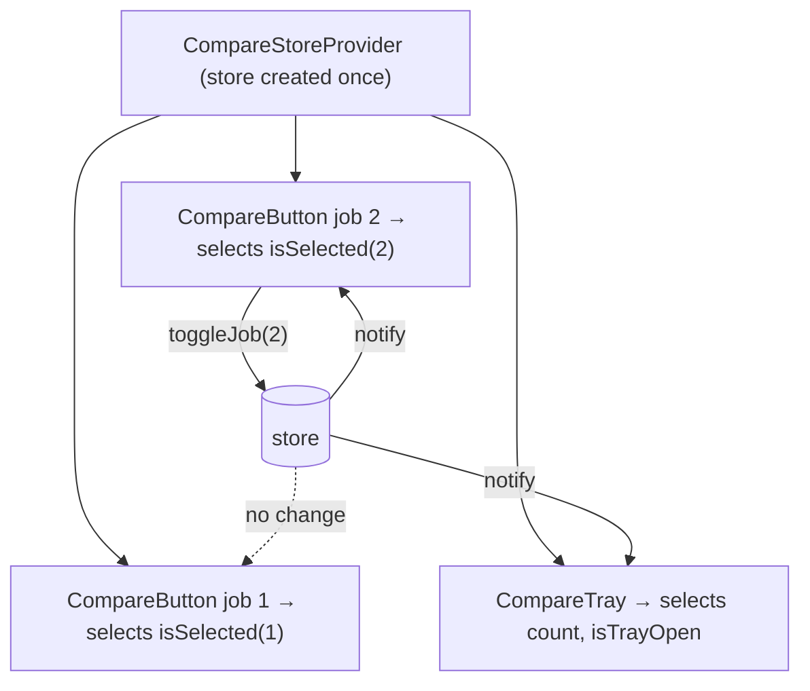

::part[Learn the Concept]{n="1"}

## 🎯 What you'll learn

- The four kinds of state and why most don't belong in a global store
- Creating a Zustand store: state, actions, `set`, `get`
- **Selectors** and `useShallow` for fine-grained subscriptions
- Immutable updates and returning results from actions
- **`persist`** middleware with `partialize`
- The **store-per-provider** pattern for Next.js App Router (no cross-request leaks)
- Testing stores without React

## 🧠 The big idea

Context is a **loudspeaker**: when it speaks, everyone listening hears everything. Zustand is a **group chat with notification filters**: the store holds the conversation, and each component subscribes only to the messages it cares about ("tell me only if job 7 is selected"). A change to job 2 doesn't wake up job 7's button.

## ❓ Why does this exist?

CareerPilot's job list shows 50 cards. Each card has a **Compare** toggle; a floating tray shows "Compare (2/3)"; the header shows a badge with the count. With Context holding `jobIds`, every toggle re-renders **all 50 cards**, the tray and the header. With `useState` in a common parent, you drill props through the list.

Zustand gives a tiny (~1 KB), hook-based external store with selector subscriptions — no provider required for simple apps, no reducers/boilerplate.

## 💥 What happens if we DON'T?

- Context with frequently changing state → the whole page re-renders on every interaction.
- Redux for a compare tray → actions, reducers, slices, store setup for 30 lines of logic (Redux Toolkit is great for large, event-heavy apps, but heavy here).
- Putting **server data** in Zustand → hand-written caching, stale data, no refetch — TanStack Query's job.

## 📖 How it works, step by step

### 1. Which state goes where

| Kind | Example | Tool |
|---|---|---|
| Server state | applications, jobs | Server Components, TanStack Query |
| URL state | filters, tab, page | `searchParams` |
| Local UI state | a menu is open | `useState` |
| **Shared client UI state** | compare tray, multi-step drafts, editor panels, player | **Zustand** (or Context if it rarely changes) |

### 2. A basic store

```tsx
import { create } from "zustand";

type CompareState = {
  jobIds: number[];
  toggleJob: (id: number) => "added" | "removed" | "full";
  clear: () => void;
};

export const useCompareStore = create<CompareState>()((set, get) => ({
  jobIds: [],
  toggleJob: (id) => {
    const { jobIds } = get();
    if (jobIds.includes(id)) {
      set({ jobIds: jobIds.filter((j) => j !== id) });
      return "removed";
    }
    if (jobIds.length >= 3) return "full";
    set({ jobIds: [...jobIds, id] });          // new array — never push()
    return "added";
  },
  clear: () => set({ jobIds: [] }),
}));
```

`set` **merges** the top level (`set({ jobIds })` keeps other keys). Nested objects must be copied yourself.

### 3. Selectors

```tsx
const isSelected = useCompareStore((s) => s.jobIds.includes(jobId));   // boolean → re-render only when it flips
const toggleJob = useCompareStore((s) => s.toggleJob);                 // actions are stable
const count = useCompareStore((s) => s.jobIds.length);

// ❌ subscribes to everything
const { jobIds, toggleJob } = useCompareStore();

// selecting several values → useShallow to avoid re-renders from a new object each time
import { useShallow } from "zustand/react/shallow";
const { count, isTrayOpen } = useCompareStore(useShallow((s) => ({ count: s.jobIds.length, isTrayOpen: s.isTrayOpen })));
```

Zustand compares the selector result with `Object.is`. Returning a **new object/array** from a selector each time causes extra renders (or, in v5, an infinite-loop warning) — use `useShallow` or select primitives.

### 4. Persist

```tsx
import { createJSONStorage, persist } from "zustand/middleware";

create<CompareState>()(
  persist((set, get) => ({ … }), {
    name: "careerpilot-compare",
    storage: createJSONStorage(() => localStorage),
    partialize: (s) => ({ jobIds: s.jobIds }),       // don't persist UI flags or functions
  }),
);
```

With server rendering, persisted state appears **after hydration** — design the UI so the first render (empty) is acceptable, or use `skipHydration` and call `persist.rehydrate()` in an effect.

### 5. The Next.js pattern: a store per provider

A module-level `create()` store is a **singleton per server process**. During SSR, two users' requests could share it. For anything that might be initialized per user or touched on the server, create the store inside a provider:

```tsx
"use client";
import { createStore } from "zustand/vanilla";
import { useStore } from "zustand";

export const createCompareStore = (initial?: Partial<CompareData>) =>
  createStore<CompareState>()(persist((set, get) => ({ jobIds: [], isTrayOpen: false, ...initial, /* actions */ }), { … }));

const CompareStoreContext = createContext<ReturnType<typeof createCompareStore> | null>(null);

export function CompareStoreProvider({ initial, children }: Props) {
  const [store] = useState(() => createCompareStore(initial));      // created once per mount
  return <CompareStoreContext value={store}>{children}</CompareStoreContext>;
}

export function useCompareStore<T>(selector: (s: CompareState) => T) {
  const store = useContext(CompareStoreContext);
  if (!store) throw new Error("useCompareStore must be used inside <CompareStoreProvider>");
  return useStore(store, selector);
}
```

The context holds the **store object** (which never changes), so the context itself never triggers re-renders — subscriptions go through selectors.



### 6. Testing

Vanilla stores are plain objects — test the logic without rendering:

```ts
const store = createCompareStore();
store.getState().toggleJob(1);
expect(store.getState().jobIds).toEqual([1]);
```

Then test components for behavior, and use React's `<Profiler>` if render counts matter.

## ⚖️ Trade-offs

| | ✅ | ❌ |
|---|---|---|
| Zustand | tiny, simple, selectors, works outside React | less structure; easy to overuse as a server cache |
| Context + `useReducer` | built-in | no selectors, re-renders all consumers |
| Redux Toolkit | strong conventions, devtools, RTK Query, great for big teams | more concepts and code |
| Jotai (atoms) | very granular, composable derived state | different mental model |
| URL state | shareable, SSR-friendly | only strings, limited size |

## ✅ When to use it / 🚫 When NOT to use it

- ✅ Client UI state shared across distant components that changes often: compare trays, media players, canvas/editor tools, complex wizards.
- 🚫 Server data (use TanStack Query / Server Components).
- 🚫 Filters users should share via links (use the URL).
- 🚫 A single component's state (use `useState`).

## 🏆 Best practices

- [ ] Keep stores **small and focused** (one per feature), not one mega-store.
- [ ] Always use **selectors**; select primitives or use `useShallow`.
- [ ] Update immutably; keep actions inside the store next to the state they change.
- [ ] In Next.js, prefer the **store-per-provider** pattern; never put per-user data in module-level stores rendered on the server.
- [ ] `persist` only what's needed via `partialize`; add `version` + `migrate` when the shape changes.
- [ ] Don't store secrets or tokens in client stores (they end up in `localStorage`/memory readable by scripts).
- [ ] Unit-test stores as plain objects.
- [ ] Use Redux DevTools via the `devtools` middleware in development for complex stores.

## 🏭 How it's used in industry

- Zustand is among the most downloaded React state libraries and is common in Next.js apps alongside TanStack Query (server state) — a popular "modern stack" split.
- Complex client apps (editors, whiteboards, AI chat UIs with panels) use Zustand or similar stores for UI state.
- Large enterprises with existing Redux codebases often keep Redux Toolkit; new features may still adopt lighter tools.

## ⚠️ Common mistakes

- `useStore()` without a selector → re-renders on every change.
- Selectors returning new arrays/objects (`s.jobs.filter(...)`) → extra renders or loops.
- Mutating state (`get().jobIds.push(id)`) → components don't update.
- Global store holding user data in SSR → data shared between requests.
- Hydration mismatch from reading persisted values during the first render.

::part[Explain & Design]{n="2"}

## 🗣️ Explain it

Explain the group chat with notification filters analogy, then explain to a teammate why `useCompareStore()` (no selector) defeats the purpose.

## 📐 Design it

CareerPilot's **interview prep workspace** has: a question list, a timer, a notes panel, a "focus mode" toggle that hides the sidebar, and AI feedback fetched after each answer. Decide what goes in a Zustand store (shape + actions), what stays elsewhere, and which selectors each component uses.

:::quiz
Show a possible design

```ts
type PrepState = {
  currentQuestionId: number | null;
  timer: { status: "idle" | "running" | "paused"; startedAt: number | null; elapsedMs: number };
  focusMode: boolean;
  panels: { notes: boolean; hints: boolean };
  selectQuestion: (id: number) => void;
  startTimer: () => void; pauseTimer: () => void; resetTimer: () => void;
  toggleFocusMode: () => void;
  togglePanel: (panel: keyof PrepState["panels"]) => void;
};
```

- **Store (per provider)**: current question, timer state (store `startedAt` and compute elapsed in the component with an interval effect — don't `set` every 100 ms), focus mode, panel visibility. Persist `focusMode` and `panels` only.
- **Elsewhere**: question list + AI feedback → TanStack Query (`["prep", "questions"]`, mutation for "submit answer"); notes text → RHF/Server Action with autosave; selected question id also mirrored in the URL (`?q=12`) if sharable.
- **Selectors**: `QuestionItem` → `s.currentQuestionId === id`; `Timer` → `useShallow(s => s.timer)`; `Sidebar` → `s.focusMode`; `NotesPanel` → `s.panels.notes`; buttons select only their action.
:::

### 📝 Self-review checklist

- [ ] No server data in the store
- [ ] High-frequency updates avoided or localized
- [ ] Every component uses a narrow selector

::ai-review{task="design"}

::part[Toy Exercise]{n="3"}

:::exercise{path="exercises/web/m4/w5/09-zustand" ai="ai-allowed" title="Compare-jobs store"}
Build a vanilla Zustand store with toggle rules (max 3), a tray, `persist` with `partialize`, a store-per-provider hook, and components whose subscriptions are narrow enough that toggling one job doesn't re-render another job's button (measured with React's Profiler).
:::

:::hints
- `createStore<CompareState>()(persist((set, get) => ({ … }), { … }))` — note the extra `()`.
- Select a boolean in `CompareButton`, not the whole `jobIds` array.
- `useState(() => createCompareStore(initial))` creates the store exactly once.
:::

## ✅ Quick check

:::quiz
Why is `useCompareStore((s) => s.jobIds.filter((id) => id > 10))` a problem?

`filter` returns a new array every time, so the selected value is never `Object.is`-equal → the component re-renders on every store change (Zustand v5 may warn about an infinite loop). Select raw state and derive in render, or use `useShallow`.
:::

:::quiz
The compare tray should survive a page refresh, but "tray open" shouldn't. How?

`persist` with `partialize: (s) => ({ jobIds: s.jobIds })`.
:::

## 🔗 This week in CareerPilot

Week 5 is the core of **CareerPilot Phase 4** (the Next.js frontend for your Phase 2 Flask API): login with httpOnly sessions, protected routes, the new-application form, RBAC-aware navigation, BFF routes for the interactive board, and shadcn/ui components. Start the [Phase 4 brief](/projects/careerpilot/04-phase-4-web-app) now: checkpoints C1–C5 match this week.

:::linkedin{type="weekly"}
🔐 Week 5: forms, authentication and "who can do what" in Next.js.

- Server Actions + Zod: forms that work before JavaScript loads, with Flask's 422 errors mapped back onto fields
- Auth without localStorage: signed httpOnly session cookies, a Data Access Layer, and proxy.ts for fast redirects
- RBAC: one permission table for the UI *and* the server — hiding a button is not security
- React Hook Form, shadcn/ui AlertDialogs and a Zustand store with narrow selectors

Biggest lesson: [your answer].

Next: testing with Playwright and deploying. 🚀

#NextJS #React #WebSecurity #LearningInPublic
:::

## 📖 Kamus (glossary)

| Term | Bahasa Indonesia |
|---|---|
| Store | Tempat penyimpanan state bersama |
| Selector | Fungsi pemilih bagian state |
| Subscription | Langganan perubahan state |
| Persist | Menyimpan state agar bertahan setelah refresh |
| Hydration | Hidrasi — mencocokkan state klien dengan HTML server |
| Singleton | Satu instance bersama untuk seluruh proses |

## 📚 Keep learning

- [Zustand docs](https://zustand.docs.pmnd.rs/) — Introduction, Setup with Next.js, Persisting store data, Prevent re-renders with useShallow
- [TkDodo: Working with Zustand](https://tkdodo.eu/blog/working-with-zustand)
