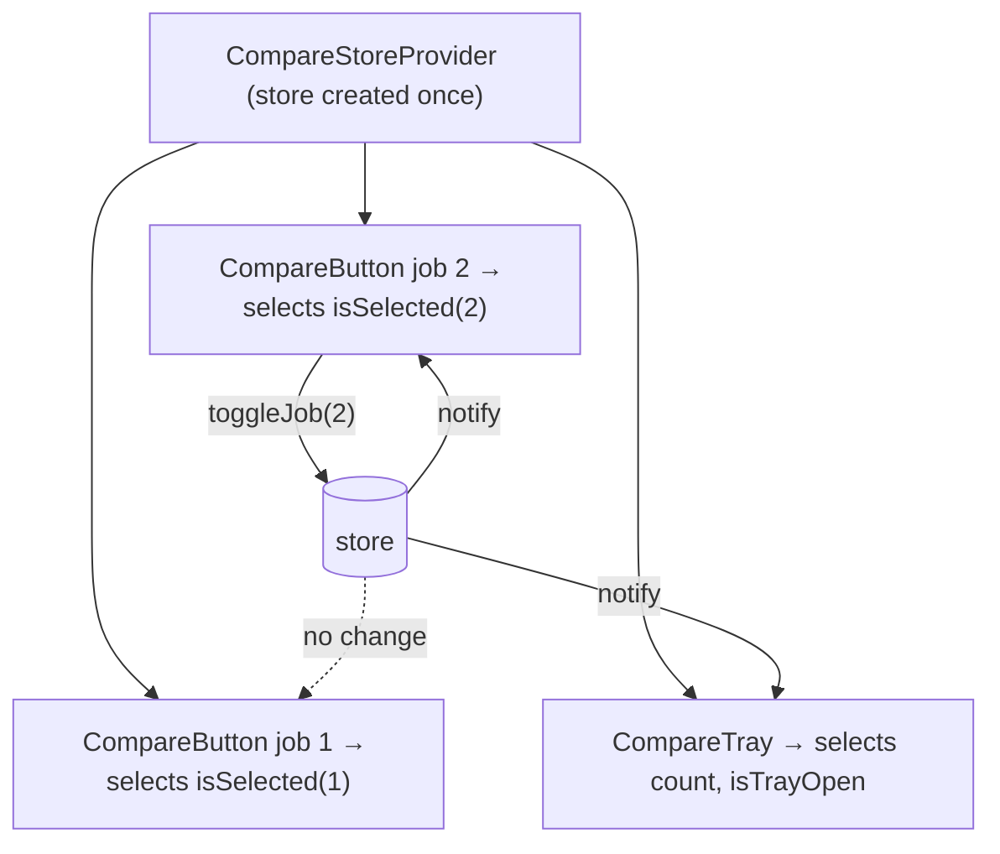

::part[Learn the Concept]{n="1"}

## 🎯 What you'll learn

- The four kinds of state, and why most don't belong in a shared store
- Creating a Zustand store: state, actions, `set`, `get`
- **Selectors** and `useShallow`, so a component re-renders only when its piece changes
- Immutable updates and returning results from actions
- **`persist`** with `partialize`
- The **store-per-provider** pattern for Next.js (no data leaking between users)
- Testing stores without React

## 🔤 Key words

| Word | In simple words | Bahasa Indonesia |
|---|---|---|
| **Store** | One shared box of state (data + functions to change it) that any component can use | Wadah state bersama |
| **Action** | A function inside the store that changes the state | Fungsi pengubah state |
| **Selector** | A small function that picks the piece of state a component needs | Pemilih bagian state |
| **Subscribe** | "Tell me when this changes" | Berlangganan perubahan |
| **Re-render** | React running a component again to update the screen | Render ulang |
| **Persist** | Saving state (e.g. in `localStorage`) so it survives a refresh | Menyimpan agar bertahan |
| **Hydration** | The browser taking over the HTML the server sent | Hidrasi |
| **Singleton** | Only one copy, shared by everyone in the same process | Satu salinan bersama |

## 🧠 The big idea

Context is a **loudspeaker**: when it speaks, everyone listening hears everything. Zustand is a **group chat with notification filters**: the store holds the conversation, and each component only gets notified about the messages it cares about ("tell me only if job 7 is selected"). A change to job 2 doesn't wake up job 7's button.

## ❓ Why it matters

CareerPilot's job list shows 50 cards. Each card has a **Compare** toggle; a floating tray shows "Compare (2/3)"; the header shows the count.

- With **Context** holding `jobIds`, every toggle re-renders **all 50 cards**, the tray and the header.
- With **`useState` in a common parent**, you pass props down through many layers (prop drilling).
- **Redux** works, but needs a lot of setup for 30 lines of logic.

Zustand is a tiny (~1 KB) store you use as a hook, with selectors. No provider needed for simple apps, almost no boilerplate.

But don't put **server data** (applications, jobs) in it — you'd be writing your own cache by hand. That's TanStack Query's job.

## 📖 Step by step

### 1. Which state goes where

| Kind | Example | Tool |
|---|---|---|
| Server state | applications, jobs | Server Components, TanStack Query |
| URL state | filters, tab, page | `searchParams` |
| Local UI state | a menu is open | `useState` |
| **Shared client UI state** | compare tray, multi-step drafts, editor panels, player | **Zustand** (or Context if it rarely changes) |

Think of a house: server data lives in the **warehouse** (the API), the URL is the **address you can share**, `useState` is a **drawer in one room**, and Zustand is the **family whiteboard in the hallway** — for notes many rooms need.

### 2. A basic store

```tsx
import { create } from "zustand";

type CompareState = {
  jobIds: number[];
  toggleJob: (id: number) => "added" | "removed" | "full";
  clear: () => void;
};

export const useCompareStore = create<CompareState>()((set, get) => ({
  jobIds: [],
  toggleJob: (id) => {
    const { jobIds } = get();
    if (jobIds.includes(id)) {
      set({ jobIds: jobIds.filter((j) => j !== id) });
      return "removed";
    }
    if (jobIds.length >= 3) return "full";
    set({ jobIds: [...jobIds, id] });          // new array — never push()
    return "added";
  },
  clear: () => set({ jobIds: [] }),
}));
```

- `get()` reads the current state; `set()` changes it.
- `set` **merges** the top level (`set({ jobIds })` keeps other keys). Nested objects you must copy yourself.
- The rules (max 3) live **inside** the store, next to the data. The action returns a result so the UI can show "Tray is full".

### 3. Selectors

```tsx
const isSelected = useCompareStore((s) => s.jobIds.includes(jobId));   // boolean → re-render only when it flips
const toggleJob = useCompareStore((s) => s.toggleJob);                 // actions are stable
const count = useCompareStore((s) => s.jobIds.length);

// ❌ subscribes to everything
const { jobIds, toggleJob } = useCompareStore();

// selecting several values → useShallow to avoid re-renders from a new object each time
import { useShallow } from "zustand/react/shallow";
const { count, isTrayOpen } = useCompareStore(useShallow((s) => ({ count: s.jobIds.length, isTrayOpen: s.isTrayOpen })));
```

After every change, Zustand runs your selector and compares the new answer with the old one using `Object.is`. Same answer → no re-render.

Watch out: a selector that builds a **new object or array** each time never gives "the same answer", so the component re-renders every time (Zustand v5 may even warn about an infinite loop). Pick simple values (numbers, booleans) or wrap with `useShallow`, which compares the insides.

### 4. Persist

```tsx
import { createJSONStorage, persist } from "zustand/middleware";

create<CompareState>()(
  persist((set, get) => ({ … }), {
    name: "careerpilot-compare",
    storage: createJSONStorage(() => localStorage),
    partialize: (s) => ({ jobIds: s.jobIds }),       // don't persist UI flags or functions
  }),
);
```

`partialize` chooses **what to pack** before you leave: the selected jobs, not "tray is open".

With server rendering, the saved state appears only **after hydration** (the server can't read `localStorage`). Make the first, empty render look fine, or use `skipHydration` and call `persist.rehydrate()` in an effect.

### 5. Next.js: a store per provider

A store made with `create()` at the top of a file is a **singleton per server process**. During server rendering, two users' requests could share it — like two customers writing on the same order form. If a store may hold per-user data or run on the server, create it inside a provider:

```tsx
"use client";
import { createStore } from "zustand/vanilla";
import { useStore } from "zustand";

export const createCompareStore = (initial?: Partial<CompareData>) =>
  createStore<CompareState>()(persist((set, get) => ({ jobIds: [], isTrayOpen: false, ...initial, /* actions */ }), { … }));

const CompareStoreContext = createContext<ReturnType<typeof createCompareStore> | null>(null);

export function CompareStoreProvider({ initial, children }: Props) {
  const [store] = useState(() => createCompareStore(initial));      // created once per mount
  return <CompareStoreContext value={store}>{children}</CompareStoreContext>;
}

export function useCompareStore<T>(selector: (s: CompareState) => T) {
  const store = useContext(CompareStoreContext);
  if (!store) throw new Error("useCompareStore must be used inside <CompareStoreProvider>");
  return useStore(store, selector);
}
```

The Context only passes the **store object**, which never changes — so the Context itself never causes re-renders. Updates still flow through selectors.



### 6. Testing

A vanilla store is a plain object — test its rules without rendering anything:

```ts
const store = createCompareStore();
store.getState().toggleJob(1);
expect(store.getState().jobIds).toEqual([1]);
```

Then test components for behavior, and use React's `<Profiler>` if render counts matter.

### When to use it

- ✅ Browser-only UI state that far-apart components share and that changes often: compare trays, media players, editor tools, complex wizards.
- 🚫 Server data → TanStack Query or Server Components.
- 🚫 Filters people should share with a link → the URL.
- 🚫 State for one component → `useState`.

Other options you'll see at work: **Redux Toolkit** (more structure, common in big older codebases) and **Jotai** (many tiny pieces of state called atoms).

## ⚠️ Common mistakes

- `useStore()` without a selector → re-renders on every change.
- Selectors returning new arrays or objects (`s.jobs.filter(...)`) → extra renders or loops.
- Changing state directly (`get().jobIds.push(id)`) → components don't update.
- A global store holding user data during server rendering → data shared between requests.
- Reading persisted values in the first render → hydration mismatch.

## 🏆 Best practices

- [ ] Keep stores **small and focused** (one per feature), not one mega-store.
- [ ] Always use **selectors**; select simple values or use `useShallow`.
- [ ] Update immutably; keep actions inside the store next to the state they change.
- [ ] In Next.js, prefer the **store-per-provider** pattern; never keep per-user data in top-level stores used on the server.
- [ ] `persist` only what's needed via `partialize`; add `version` + `migrate` when the shape changes.
- [ ] Don't keep secrets or tokens in client stores (scripts on the page can read them).
- [ ] Unit-test stores as plain objects.
- [ ] Use the `devtools` middleware in development for complex stores.

::part[Explain & Design]{n="2"}

## 🗣️ Explain it

Explain the group chat with notification filters analogy, then explain to a teammate why `useCompareStore()` (no selector) defeats the purpose.

## 📐 Design it

CareerPilot's **interview prep workspace** has: a question list, a timer, a notes panel, a "focus mode" toggle that hides the sidebar, and AI feedback fetched after each answer. Decide what goes in a Zustand store (shape + actions), what stays elsewhere, and which selector each component uses.

:::quiz
Show a possible design

```ts
type PrepState = {
  currentQuestionId: number | null;
  timer: { status: "idle" | "running" | "paused"; startedAt: number | null; elapsedMs: number };
  focusMode: boolean;
  panels: { notes: boolean; hints: boolean };
  selectQuestion: (id: number) => void;
  startTimer: () => void; pauseTimer: () => void; resetTimer: () => void;
  toggleFocusMode: () => void;
  togglePanel: (panel: keyof PrepState["panels"]) => void;
};
```

- **Store (per provider)**: current question, timer state (store `startedAt` and calculate the elapsed time inside the component with an interval — don't `set` every 100 ms), focus mode, panel visibility. Persist only `focusMode` and `panels`.
- **Elsewhere**: question list + AI feedback → TanStack Query (`["prep", "questions"]`, a mutation for "submit answer"); notes text → RHF/Server Action with autosave; selected question id also in the URL (`?q=12`) if it should be shareable.
- **Selectors**: `QuestionItem` → `s.currentQuestionId === id`; `Timer` → `useShallow(s => s.timer)`; `Sidebar` → `s.focusMode`; `NotesPanel` → `s.panels.notes`; buttons select only their action.
:::

### 📝 Self-review checklist

- [ ] No server data in the store
- [ ] Very frequent updates avoided or kept local
- [ ] Every component uses a narrow selector

::ai-review{task="design"}

::part[Toy Exercise]{n="3"}

:::exercise{path="exercises/web/m4/w5/09-zustand" ai="ai-allowed" title="Compare-jobs store"}
Build a vanilla Zustand store with toggle rules (max 3), a tray, `persist` with `partialize`, a store-per-provider hook, and components whose subscriptions are narrow enough that toggling one job doesn't re-render another job's button (measured with React's Profiler).
:::

:::hints
- `createStore<CompareState>()(persist((set, get) => ({ … }), { … }))` — note the extra `()`.
- Select a boolean in `CompareButton`, not the whole `jobIds` array.
- `useState(() => createCompareStore(initial))` creates the store exactly once.
:::

## ✅ Quick check

:::quiz
Why is `useCompareStore((s) => s.jobIds.filter((id) => id > 10))` a problem?

`filter` returns a new array every time, so the answer is never `Object.is`-equal to the last one → the component re-renders on every store change (Zustand v5 may warn about an infinite loop). Select the raw state and calculate in render, or use `useShallow`.
:::

:::quiz
The compare tray should survive a page refresh, but "tray open" shouldn't. How?

`persist` with `partialize: (s) => ({ jobIds: s.jobIds })`.
:::

## 🔗 This week in CareerPilot

Week 5 is the core of **CareerPilot Phase 4** (the Next.js frontend for your Phase 2 Flask API): login with httpOnly sessions, protected routes, the new-application form, role-aware navigation, BFF routes for the interactive board, and shadcn/ui components. Start the [Phase 4 brief](/projects/careerpilot/04-phase-4-web-app) now: checkpoints C1–C5 match this week.

## 📚 Keep learning

- [Zustand docs](https://zustand.docs.pmnd.rs/) — Introduction, Setup with Next.js, Persisting store data, Prevent re-renders with useShallow
- [TkDodo: Working with Zustand](https://tkdodo.eu/blog/working-with-zustand)

## 📣 End of Week 5 — share your progress

:::linkedin{type="weekly"}
🔐 Week 5: forms, authentication and "who can do what" in Next.js.

- Server Actions + Zod: forms that work before JavaScript loads, with Flask's 422 errors mapped back onto fields
- Auth without localStorage: signed httpOnly session cookies, a Data Access Layer, and proxy.ts for fast redirects
- RBAC: one permission table for the UI *and* the server — hiding a button is not security
- React Hook Form, shadcn/ui AlertDialogs and a Zustand store with narrow selectors

Biggest lesson: [your answer].

Next: testing with Playwright and deploying. 🚀

#NextJS #React #WebSecurity #LearningInPublic
:::
