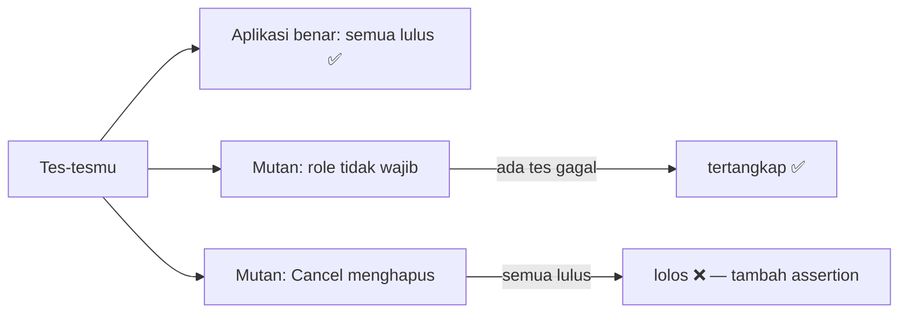

::part[Pelajari Konsepnya]{n="1"}

## 🎯 Yang akan kamu pelajari

- Mengubah spesifikasi produk menjadi kasus tes E2E (jalur sukses, validasi, error server)
- **Page Object Model** (POM) dan kapan berguna
- Mengisi form: `fill`, `selectOption`, `check`, `setInputFiles`, keyboard
- Mengecek URL, heading, pesan status, `aria-invalid`, nilai field
- Menguji dialog dan konfirmasi aksi berbahaya
- **Isolasi data tes**: user baru, membuat data lewat API, bersih-bersih
- Memalsukan request jaringan dengan `page.route` — dan kapan tidak boleh
- **Mutation testing**: cara tahu tesmu benar-benar menangkap bug

## 🔤 Istilah penting

| Istilah | Artinya (sederhana) |
|---|---|
| **Happy path** | Alur normal saat semuanya berjalan benar |
| **Page object** | Class yang tahu cara menemukan dan memakai elemen di satu halaman |
| **Fixture** | Sesuatu yang disiapkan Playwright untuk tes (page, user, data) |
| **Seeding** | Memasukkan data awal ke database sebelum tes |
| **Test isolation** | Setiap tes punya datanya sendiri, jadi tes tidak saling mengganggu |
| **Mock** | Respons palsu sebagai pengganti layanan asli |
| **Mutant** | Salinan aplikasi dengan satu bug kecil yang sengaja ditambahkan |
| **Kill / survive** | Mutan tertangkap (killed) kalau ada tes yang gagal; lolos (survive) kalau semua tes tetap lulus |

## 🧠 Ide besarnya

Tes E2E yang bagus itu seperti **mystery shopper** dengan daftar cek: ia berkeliling toko seperti pembeli dan mencatat persis apa yang ia lihat. Yang buruk hanya memastikan "tokonya ada".

Bagaimana tahu mystery shopper-nya bagus? **Tanam masalah** (mesin kasir rusak, harga salah) lalu lihat apakah ia melaporkannya. Itulah **mutation testing** — dan begitulah latihan minggu ini menilai tesmu.

## ❓ Kenapa ini penting

Form adalah tempat pengguna memberikan data, dan tempat bug paling menyakitkan: validasi yang tidak jalan, error yang menghilang, isian yang hilang setelah error, pesan sukses tidak muncul, data tidak tersimpan, tombol "Cancel" yang tetap menghapus. Form melewati browser, server, API, dan database — persis yang ditutup oleh tes E2E.

Tes yang lemah terlihat seperti ini:

```ts
test("new application", async ({ page }) => {
  await page.goto("/applications/new");
  await page.fill("#role", "Dev");
  await page.click("text=Save");
  await page.waitForTimeout(1000);
  expect(page.url()).toContain("/applications");      // passes even when the app shows an error on /applications/new
});
```

Tes ini lulus di aplikasi yang rusak (`/applications/new` juga mengandung `/applications`). Laporan coverage tetap bilang form-nya "sudah dites" — seperti mystery shopper yang hanya mengecek papan nama toko.

## 📖 Langkah demi langkah

### 1. Dari spesifikasi ke kasus tes

Untuk form **New application**:

| Kasus | Siapkan | Lakukan | Cek (yang dilihat pengguna) |
|---|---|---|---|
| role wajib | sudah login, buka form | kirim tanpa role | "Role is required", `aria-invalid`, isian lain tetap ada |
| rentang gaji | isi min > max | kirim | pesan di field max |
| jalur sukses | isi data valid | kirim | heading halaman detail, "Application created", muncul di daftar |
| konflik server | lamaran sudah ada | kirim role yang sama | "You already have an application for this role" |

Setiap assertion sebaiknya menangkap **bug tertentu**. Kalau kamu tidak bisa menyebut bug yang ditangkap sebuah baris, pertanyakan baris itu.

### 2. Page object

```ts
// e2e/pages/new-application-page.ts
export class NewApplicationPage {
  readonly role: Locator;
  readonly salaryMin: Locator;
  readonly save: Locator;

  constructor(readonly page: Page) {
    this.role = page.getByLabel("Role");
    this.salaryMin = page.getByLabel("Minimum salary");
    this.save = page.getByRole("button", { name: "Save application" });
  }

  async goto() { await this.page.goto("/applications/new"); }

  async fill({ company, role, salaryMin }: ApplicationInput) {
    if (company) await this.page.getByLabel("Company").selectOption({ label: company });
    if (role !== undefined) await this.role.fill(role);
    if (salaryMin !== undefined) await this.salaryMin.fill(salaryMin);
  }

  async submit() { await this.save.click(); }
}
```

Page object itu seperti **remote TV**: tes tinggal menekan "fill" dan "submit" tanpa perlu tahu kabel di dalamnya. Kalau HTML halaman berubah, kamu cukup memperbaiki remote-nya sekali, bukan setiap tes.

- Page object menyimpan **locator dan aksi**; **assertion tetap di dalam tes** (supaya tes terbaca seperti spesifikasi).
- Layak dipakai kalau banyak tes memakai halaman yang sama; untuk satu tes, locator langsung di tes sudah cukup.
- **Fixture** Playwright bisa memberikan page object yang sudah siap ke tes: `test.extend<{ newApplication: NewApplicationPage }>(…)`.

### 3. Tes-tesnya

```ts
test.beforeEach(async ({ page }) => logIn(page));

test("role is required and typed values are kept", async ({ page }) => {
  const form = new NewApplicationPage(page);
  await form.goto();
  await form.fill({ company: "Kopi Data", salaryMin: "9000000" });
  await form.submit();

  await expect(page.getByText("Role is required")).toBeVisible();
  await expect(form.role).toHaveAttribute("aria-invalid", "true");
  await expect(form.salaryMin).toHaveValue("9000000");        // catches "form resets on error"
});

test("a valid application is created and listed", async ({ page }) => {
  const form = new NewApplicationPage(page);
  await form.goto();
  await form.fill({ company: "Batik Cloud", role: "Platform Engineer" });
  await form.submit();

  await expect(page.getByRole("heading", { level: 1 })).toHaveText("Platform Engineer");
  await expect(page.getByRole("status")).toHaveText("Application created");
  await page.goto("/applications");
  await expect(page.getByRole("link", { name: "Platform Engineer" })).toBeVisible();   // catches "not saved"
});
```

### 4. Benar-benar tersimpan? Reload

UI bisa **terlihat** berubah tanpa benar-benar tersimpan (optimistic update yang tidak pernah dibatalkan, panggilan API yang salah). Reload, atau pindah halaman lalu kembali:

```ts
await page.getByLabel("Move to").selectOption("offer");
await page.getByRole("button", { name: "Update status" }).click();
await page.reload();
await expect(page.getByTestId("status")).toHaveText("offer");
```

Seperti mengecek transfer bank: layar "Berhasil" itu menyenangkan, tapi kamu tetap cek saldo lagi nanti.

### 5. Dialog

```ts
await page.getByRole("button", { name: "Delete" }).click();
const dialog = page.getByRole("dialog", { name: 'Delete "Data Engineer"?' });
await dialog.getByRole("button", { name: "Cancel" }).click();
await expect(dialog).toBeHidden();
// …and prove Cancel didn't delete
await page.goto("/applications");
await expect(page.getByRole("link", { name: "Data Engineer" })).toBeVisible();
```

`window.confirm()` bawaan browser butuh `page.once("dialog", (d) => d.accept())` — satu alasan lagi untuk memakai dialog HTML/Radix yang aksesibel.

### 6. Pisahkan data tes

Kalau tes berbagi data, mereka seperti anak kos yang berbagi satu rak kulkas: makananmu dimakan orang lain dan tesmu gagal tanpa alasan jelas.

| Strategi | Caranya | Untung-rugi |
|---|---|---|
| Data baru per tes | buat user/lamaran lewat **helper API** di `beforeEach` | cepat dan mandiri; butuh jalur khusus tes untuk membuat data |
| User per worker | fixture membuat satu user per worker Playwright | request lebih sedikit; tes dalam satu worker berbagi data |
| Reset DB berisi data awal | kosongkan + isi ulang sebelum suite | sederhana; tes harus jalan satu per satu |
| Setup lewat UI | membuat data dengan mengklik UI | lambat; hanya untuk alur yang sedang dites |

```ts
// fixtures.ts — create data through the API, not the UI
export const test = base.extend<{ application: { id: number; role: string } }>({
  application: async ({ request }, use) => {
    const res = await request.post("http://localhost:5091/api/v1/test/applications", { data: { role: `Role ${crypto.randomUUID()}` } });
    const app = await res.json();
    await use(app);
    await request.delete(`http://localhost:5091/api/v1/test/applications/${app.id}`);   // cleanup
  },
});
```

Nama yang unik (`crypto.randomUUID()`) mencegah tes yang berjalan paralel saling bentrok.

### 7. Memalsukan jaringan — secukupnya saja

```ts
await page.route("**/api/ai/match-score", (route) => route.fulfill({ json: { score: 82, strengths: ["SQL"] } }));
```

Palsukan layanan **luar atau mahal** (AI, pembayaran, email) dan error yang sulit dipicu (`route.fulfill({ status: 500 })`). Jangan palsukan backend-mu sendiri di perjalanan utama — itu sudah bukan end-to-end lagi, seperti latihan kebakaran tapi tidak ada yang keluar gedung.

### 8. Mutation testing: menguji tesmu

**Mutan** adalah salinan kode dengan satu bug kecil. Tesmu **membunuhnya** kalau minimal satu tes gagal. Mutan yang **lolos** menunjukkan perilaku yang tidak pernah kamu cek.



Alat seperti **Stryker** (JS/TS) dan **mutmut** (Python) membuat mutan otomatis untuk unit test. Coverage memberi tahu baris mana yang **dijalankan**; mutation score memberi tahu apakah pengecekanmu **berarti**.

### Kapan pakai apa

- ✅ E2E untuk alur utama membuat/mengubah/menghapus dan kegagalan terpentingnya.
- ✅ Page object begitu 2+ tes memakai halaman yang sama.
- 🚫 Jangan tes E2E setiap aturan validasi — satu per form sudah membuktikan sambungannya; sisanya di unit test schema.
- 🚫 Jangan berbagi data yang bisa berubah antar tes paralel.

## ⚠️ Kesalahan umum

- Hanya mengecek URL setelah submit.
- Tes yang hanya lulus kalau dijalankan dengan urutan tertentu.
- `page.fill("input[name=role]")` alih-alih `getByLabel("Role")` (menyembunyikan label yang hilang).
- Memalsukan API sendiri di tes "E2E", lalu merilis sambungan yang rusak.
- Meninggalkan data sehingga eksekusi kedua gagal ("already exists").
- `getByRole("alert")` di aplikasi Next.js cocok dengan **dua** elemen: Next.js menambahkan route announcer kosong dengan `role="alert"`. Filter dengan teks: `getByRole("alert").filter({ hasText: "Invalid email or password" })`.

## 🏆 Praktik terbaik

- [ ] Tulis kasus dari spesifikasi: jalur sukses + kegagalan yang paling mungkin.
- [ ] Cek apa yang dilihat pengguna **dan** bahwa datanya tersimpan (reload / halaman daftar).
- [ ] Assertion di tes, locator/aksi di page object.
- [ ] Pisahkan data (user baru atau nama unik); bersihkan data yang kamu buat.
- [ ] Buat data lewat API, bukan langkah UI yang lambat.
- [ ] Palsukan hanya layanan luar atau yang mahal.
- [ ] Cek jalur error: pesan validasi, `aria-invalid`, isian tetap ada, error server.
- [ ] Sesekali rusak aplikasinya dengan sengaja (atau jalankan alat mutation) untuk memastikan tes gagal.

::part[Jelaskan & Rancang]{n="2"}

## 🗣️ Jelaskan

Jelaskan mutation testing dengan analogi mystery shopper, dan kenapa code coverage 100% tetap bisa berarti tesnya lemah.

## 📐 Rancang

Tulis kasus tes E2E (nama + assertion utama) untuk dialog **"Schedule interview"** di CareerPilot: dibuka dari halaman lamaran, field type/start/end/meeting URL, validasi "end setelah start", konflik server untuk interview yang bertabrakan, toast sukses, dan interview muncul di timeline lamaran. Untuk setiap kasus, sebutkan bug yang akan ditangkap.

:::quiz
Lihat contoh jawaban

| Tes | Assertion utama | Bug yang ditangkap |
|---|---|---|
| terbuka dan tertutup | dialog dengan nama aksesibel; Escape menutup; fokus kembali ke tombol "Schedule interview" | aksesibilitas dialog rusak |
| end harus setelah start | error di field End, `aria-invalid`, dialog tetap terbuka, isian tetap ada | validasi hilang / form ter-reset |
| konflik jadwal (interview dibuat lewat API dulu) | alert "You already have an interview at that time"; tidak ada yang ditambahkan ke timeline | 409 diabaikan, gagal diam-diam |
| jalur sukses | toast "Interview scheduled", dialog tertutup, item timeline dengan type + waktu lokal | tidak tersimpan, zona waktu salah |
| tetap ada setelah reload | reload → timeline masih menampilkannya | UI optimistis tanpa penyimpanan |
| meeting URL tidak valid | "Enter a full URL" | link tidak dicek (bisa URL `javascript:`) |

Data: setiap tes membuat lamarannya sendiri lewat fixture API dengan role unik; tes konflik membuat interview lewat API terlebih dahulu.
:::

### 📝 Checklist review mandiri

- [ ] Setiap assertion terhubung ke bug nyata
- [ ] Minimal satu cek "benar-benar tersimpan?"
- [ ] Data dibuat per tes

::ai-review{task="design"}

::part[Latihan Kecil]{n="3"}

:::exercise{path="exercises/web/m4/w6/02-e2e-forms-flows" ai="no-ai" title="Tes E2E yang menangkap 9 bug tersembunyi"}
Tulis page object dan tes Playwright untuk login, form lamaran baru, dan halaman lamaran di mini app CareerPilot. Tesmu harus lulus di aplikasi asli dan gagal di masing-masing dari 9 versi rusak (mutan).
:::

:::hints
- Kalau ada mutan yang lolos, baca namanya, lalu tanya "apa yang terlihat berbeda oleh pengguna?" dan cek hal itu.
- Setiap login membuat data baru — login di dalam setiap tes (`beforeEach`).
- "Isian tetap ada" berarti `toHaveValue` pada field yang kamu isi tapi bukan field yang error.
:::

## ✅ Cek cepat

:::quiz
Tesmu mengklik "Update status" lalu mengecek teks status di halaman yang sama. Mutan yang tidak pernah menyimpan lolos. Kenapa, dan apa perbaikannya?

Halaman menampilkan nilai baru tanpa menyimpannya. Reload (atau pindah halaman lalu kembali) sebelum mengecek.
:::

:::quiz
Kenapa page object biasanya tidak berisi `expect`?

Tes seharusnya menunjukkan apa yang ia cek. Assertion yang tersembunyi di page object membuat tes sulit dibaca dan mengubah page object menjadi helper serba-bisa yang sulit dipakai ulang.
:::

## 📚 Lanjut belajar

- [Playwright: Page object models](https://playwright.dev/docs/pom) · [Fixtures](https://playwright.dev/docs/test-fixtures) · [Mock APIs](https://playwright.dev/docs/mock)
- [Stryker Mutator](https://stryker-mutator.io/)
