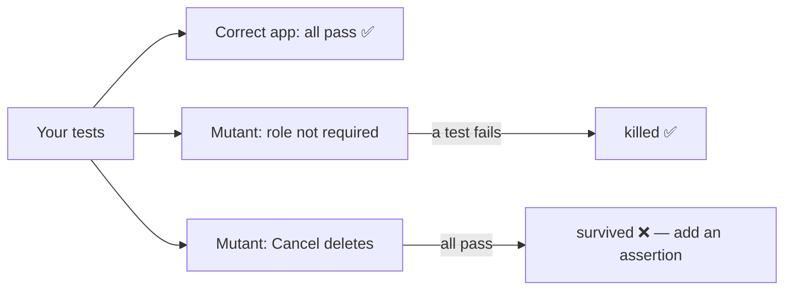

::part[Learn the Concept]{n="1"}

## 🎯 What you'll learn

- Turning a product spec into E2E test cases (happy path, validation, server errors)
- **Page Object Model** (POM) and when it helps
- Filling forms: `fill`, `selectOption`, `check`, `setInputFiles`, keyboard
- Checking URLs, headings, status messages, `aria-invalid`, field values
- Testing dialogs and dangerous confirmations
- **Test data isolation**: fresh users, creating data through the API, cleanup
- Faking network calls with `page.route` — and when not to
- **Mutation testing**: how to know your tests really catch bugs

## 🔤 Key words

| Word | In simple words | Bahasa Indonesia |
|---|---|---|
| **Happy path** | The normal flow where everything goes right | Jalur sukses |
| **Page object** | A class that knows how to find and use one page's elements | Objek halaman |
| **Fixture** | Something Playwright prepares for a test (a page, a user, data) | Persiapan tes |
| **Seeding** | Putting starting data into the database before tests | Mengisi data awal |
| **Test isolation** | Each test has its own data, so tests don't affect each other | Isolasi tes |
| **Mock** | A fake response instead of a real service | Tiruan |
| **Mutant** | A copy of the app with one small bug added on purpose | Mutan |
| **Kill / survive** | A mutant is killed when a test fails on it; it survives when all tests still pass | Tertangkap / lolos |

## 🧠 The big idea

A good E2E test is a **mystery shopper** with a checklist: they go through the shop like a customer and write down exactly what they saw. A bad one only confirms "the shop exists".

How do you know the shopper is any good? **Plant problems** (a broken cash register, a wrong price) and see if they report them. That's **mutation testing** — and it's how this week's exercises grade your tests.

## ❓ Why it matters

Forms are where users give you data, and where bugs hurt most: validation that doesn't run, errors that disappear, typed values lost after an error, missing success messages, records not saved, a "Cancel" that deletes anyway. Forms travel through the browser, server, API and database — exactly what E2E tests cover.

A weak test looks like this:

```ts
test("new application", async ({ page }) => {
  await page.goto("/applications/new");
  await page.fill("#role", "Dev");
  await page.click("text=Save");
  await page.waitForTimeout(1000);
  expect(page.url()).toContain("/applications");      // passes even when the app shows an error on /applications/new
});
```

It passes on a broken app (`/applications/new` also contains `/applications`). Coverage reports would still say the form "is tested" — like a shopper who only checks the shop's sign.

## 📖 Step by step

### 1. From spec to test cases

For the **New application** form:

| Case | Arrange | Act | Assert (what the user sees) |
|---|---|---|---|
| required role | logged in, open form | submit without role | "Role is required", `aria-invalid`, other values kept |
| salary range | fill min > max | submit | message on the max field |
| happy path | fill valid data | submit | detail page heading, "Application created", appears in list |
| server conflict | existing application | submit same role | "You already have an application for this role" |

Each assertion should catch a **specific bug**. If you can't name the bug a line would catch, question that line.

### 2. Page objects

```ts
// e2e/pages/new-application-page.ts
export class NewApplicationPage {
  readonly role: Locator;
  readonly salaryMin: Locator;
  readonly save: Locator;

  constructor(readonly page: Page) {
    this.role = page.getByLabel("Role");
    this.salaryMin = page.getByLabel("Minimum salary");
    this.save = page.getByRole("button", { name: "Save application" });
  }

  async goto() { await this.page.goto("/applications/new"); }

  async fill({ company, role, salaryMin }: ApplicationInput) {
    if (company) await this.page.getByLabel("Company").selectOption({ label: company });
    if (role !== undefined) await this.role.fill(role);
    if (salaryMin !== undefined) await this.salaryMin.fill(salaryMin);
  }

  async submit() { await this.save.click(); }
}
```

A page object is like a **TV remote**: the test presses "fill" and "submit" without knowing the wiring inside. If the page's HTML changes, you fix the remote once, not every test.

- Page objects hold **locators and actions**; **assertions stay in the tests** (so tests read like a spec).
- Worth it when many tests use the same page; for one test, inline locators are fine.
- Playwright **fixtures** can give tests ready-made page objects: `test.extend<{ newApplication: NewApplicationPage }>(…)`.

### 3. The tests

```ts
test.beforeEach(async ({ page }) => logIn(page));

test("role is required and typed values are kept", async ({ page }) => {
  const form = new NewApplicationPage(page);
  await form.goto();
  await form.fill({ company: "Kopi Data", salaryMin: "9000000" });
  await form.submit();

  await expect(page.getByText("Role is required")).toBeVisible();
  await expect(form.role).toHaveAttribute("aria-invalid", "true");
  await expect(form.salaryMin).toHaveValue("9000000");        // catches "form resets on error"
});

test("a valid application is created and listed", async ({ page }) => {
  const form = new NewApplicationPage(page);
  await form.goto();
  await form.fill({ company: "Batik Cloud", role: "Platform Engineer" });
  await form.submit();

  await expect(page.getByRole("heading", { level: 1 })).toHaveText("Platform Engineer");
  await expect(page.getByRole("status")).toHaveText("Application created");
  await page.goto("/applications");
  await expect(page.getByRole("link", { name: "Platform Engineer" })).toBeVisible();   // catches "not saved"
});
```

### 4. Was it really saved? Reload

A UI can **look** updated without saving (an optimistic update never rolled back, the wrong API call). Reload, or leave and come back:

```ts
await page.getByLabel("Move to").selectOption("offer");
await page.getByRole("button", { name: "Update status" }).click();
await page.reload();
await expect(page.getByTestId("status")).toHaveText("offer");
```

Like checking a bank transfer: the "Success" screen is nice, but you check the balance again later.

### 5. Dialogs

```ts
await page.getByRole("button", { name: "Delete" }).click();
const dialog = page.getByRole("dialog", { name: 'Delete "Data Engineer"?' });
await dialog.getByRole("button", { name: "Cancel" }).click();
await expect(dialog).toBeHidden();
// …and prove Cancel didn't delete
await page.goto("/applications");
await expect(page.getByRole("link", { name: "Data Engineer" })).toBeVisible();
```

The browser's built-in `window.confirm()` needs `page.once("dialog", (d) => d.accept())` — one more reason to use accessible HTML/Radix dialogs.

### 6. Keep test data separate

If tests share data, they're like housemates sharing one fridge shelf: someone eats your food and your test fails for no clear reason.

| Strategy | How | Trade-off |
|---|---|---|
| Fresh data per test | create a user/application through an **API helper** in `beforeEach` | fast and independent; needs a test-only way to create data |
| Per-worker user | a fixture creates one user per Playwright worker | fewer requests; tests in one worker share data |
| Reset the seeded DB | empty + seed before the suite | simple; tests must run one at a time |
| UI setup | create data by clicking through the UI | slow; only for the flow you're testing |

```ts
// fixtures.ts — create data through the API, not the UI
export const test = base.extend<{ application: { id: number; role: string } }>({
  application: async ({ request }, use) => {
    const res = await request.post("http://localhost:5091/api/v1/test/applications", { data: { role: `Role ${crypto.randomUUID()}` } });
    const app = await res.json();
    await use(app);
    await request.delete(`http://localhost:5091/api/v1/test/applications/${app.id}`);   // cleanup
  },
});
```

Unique names (`crypto.randomUUID()`) stop parallel tests from clashing.

### 7. Faking the network — only a little

```ts
await page.route("**/api/ai/match-score", (route) => route.fulfill({ json: { score: 82, strengths: ["SQL"] } }));
```

Fake **outside or expensive** services (AI, payments, email) and errors that are hard to trigger (`route.fulfill({ status: 500 })`). Don't fake your own backend in the main journeys — then it's not end-to-end anymore, like a fire drill where nobody leaves the building.

### 8. Mutation testing: testing your tests

A **mutant** is a copy of the code with one small bug. Your tests **kill** it if at least one test fails. A mutant that **survives** shows behavior you never checked.



Tools like **Stryker** (JS/TS) and **mutmut** (Python) create mutants automatically for unit tests. Coverage tells you which lines **ran**; mutation score tells you whether your checks **mean** something.

### When to use what

- ✅ E2E for the main create/update/delete flows and their most important failure.
- ✅ Page objects once 2+ tests share a page.
- 🚫 Don't E2E-test every validation rule — one per form proves the wiring; the rest belong in schema unit tests.
- 🚫 Don't share changing data between parallel tests.

## ⚠️ Common mistakes

- Only checking the URL after submit.
- Tests that only pass when run in a certain order.
- `page.fill("input[name=role]")` instead of `getByLabel("Role")` (hides missing labels).
- Faking your own API in "E2E" tests, then shipping a broken connection.
- Leaving data behind so the second run fails ("already exists").
- `getByRole("alert")` in a Next.js app matching **two** elements: Next.js adds an empty `role="alert"` route announcer. Filter by text: `getByRole("alert").filter({ hasText: "Invalid email or password" })`.

## 🏆 Best practices

- [ ] Write cases from the spec: happy path + the most likely failures.
- [ ] Check what the user sees **and** that it was saved (reload / list page).
- [ ] Keep assertions in tests, locators/actions in page objects.
- [ ] Separate data (fresh user or unique names); clean up what you create.
- [ ] Create data through APIs, not slow UI steps.
- [ ] Fake only outside or expensive services.
- [ ] Check error paths: validation messages, `aria-invalid`, kept values, server errors.
- [ ] Sometimes break the app on purpose (or run a mutation tool) to confirm tests fail.

::part[Explain & Design]{n="2"}

## 🗣️ Explain it

Explain mutation testing with the mystery shopper analogy, and why 100% code coverage can still mean weak tests.

## 📐 Design it

Write the E2E test cases (name + key assertions) for CareerPilot's **"Schedule interview"** dialog: opened from an application page, fields type/start/end/meeting URL, validation "end after start", a server conflict for overlapping interviews, a success toast, and the interview appearing in the application's timeline. For each case, name the bug it would catch.

:::quiz
Show a possible answer

| Test | Key assertions | Bug caught |
|---|---|---|
| opens and closes | dialog with accessible name; Escape closes; focus returns to "Schedule interview" button | broken dialog accessibility |
| end must be after start | error on End field, `aria-invalid`, dialog stays open, values kept | missing validation / form resets |
| overlap conflict (interview created via API first) | alert "You already have an interview at that time"; nothing added to timeline | 409 ignored, silent failure |
| happy path | toast "Interview scheduled", dialog closed, timeline item with type + local time | not saved, wrong timezone shown |
| still there after reload | reload → timeline still shows it | optimistic UI without saving |
| invalid meeting URL | "Enter a full URL" | unchecked links (possible `javascript:` URL) |

Data: each test creates its own application through an API fixture with a unique role; the overlap test creates an interview via the API first.
:::

### 📝 Self-review checklist

- [ ] Every assertion maps to a real bug
- [ ] At least one "was it saved?" check
- [ ] Data created per test

::ai-review{task="design"}

::part[Toy Exercise]{n="3"}

:::exercise{path="exercises/web/m4/w6/02-e2e-forms-flows" ai="no-ai" title="E2E tests that catch 9 hidden bugs"}
Write page objects and Playwright tests for login, the new application form and the application page of the CareerPilot mini app. Your tests must pass on the real app and fail on each of 9 broken versions (mutants).
:::

:::hints
- If a mutant survives, read its name, then ask "what would the user see differently?" and assert that.
- Every login creates fresh data — log in inside each test (`beforeEach`).
- "Kept values" means `toHaveValue` on a field you filled that wasn't the one with the error.
:::

## ✅ Quick check

:::quiz
Your test clicks "Update status" and checks the status text on the same page. A mutant that never saves survives. Why, and what fixes it?

The page shows the new value without saving it. Reload (or leave and come back) before checking.
:::

:::quiz
Why should page objects usually not contain `expect` calls?

Tests should show what they check. Assertions hidden inside page objects make tests harder to read and turn page objects into do-everything helpers that are hard to reuse.
:::

## 📚 Keep learning

- [Playwright: Page object models](https://playwright.dev/docs/pom) · [Fixtures](https://playwright.dev/docs/test-fixtures) · [Mock APIs](https://playwright.dev/docs/mock)
- [Stryker Mutator](https://stryker-mutator.io/)
