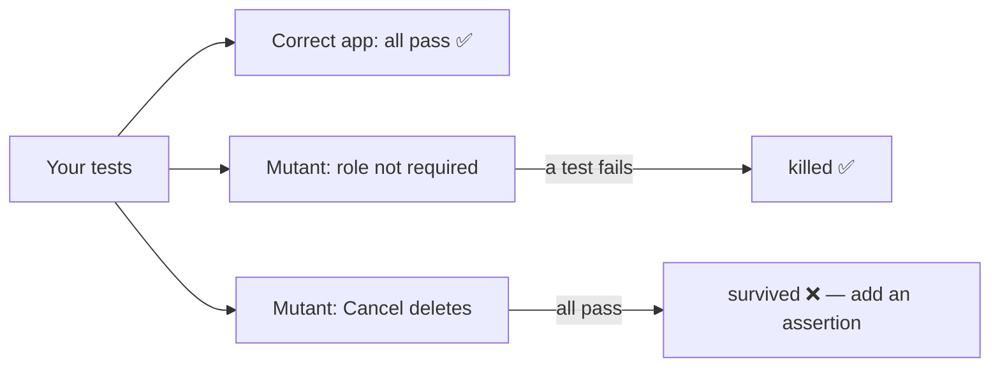

::part[Learn the Concept]{n="1"}

## 🎯 What you'll learn

- Turning a product spec into E2E test cases (happy path, validation, server errors)
- **Page Object Model** (POM) and when it helps
- Filling forms: `fill`, `selectOption`, `check`, `setInputFiles`, keyboard
- Asserting URLs, headings, status messages, `aria-invalid`, field values
- Testing dialogs and destructive confirmations
- **Test data isolation**: fresh users, API seeding, cleanup
- Mocking network calls with `page.route` — and when not to
- **Mutation testing**: how to know your tests actually catch bugs

## 🧠 The big idea

A good E2E test is a **mystery shopper** with a checklist: they go through the shop like a customer and write down exactly what they saw. A bad one just confirms "the shop exists".

How do you know the shopper is any good? **Plant problems** (a broken till, a wrong price) and see if they report them. That's **mutation testing** — and it's how the exercises in this week grade your tests.

## ❓ Why does this exist?

Forms are where users give you data and where most bugs hurt: validation that doesn't run, errors that disappear, typed values lost after an error, success messages missing, records not saved, a "Cancel" that deletes anyway. They cross the client, server, API and database — exactly what E2E tests exercise.

## 💥 What happens if we DON'T?

```ts
test("new application", async ({ page }) => {
  await page.goto("/applications/new");
  await page.fill("#role", "Dev");
  await page.click("text=Save");
  await page.waitForTimeout(1000);
  expect(page.url()).toContain("/applications");      // passes even when the app shows an error on /applications/new
});
```

This test passes on a broken app. Coverage reports would still say the form "is tested".

## 📖 How it works, step by step

### 1. From spec to test cases

For the **New application** form:

| Case | Arrange | Act | Assert (what the user sees) |
|---|---|---|---|
| required role | logged in, open form | submit without role | "Role is required", `aria-invalid`, other values kept |
| salary range | fill min > max | submit | message on the max field |
| happy path | fill valid data | submit | detail page heading, "Application created", appears in list |
| server conflict | existing application | submit same role | "You already have an application for this role" |

Each assertion targets a **specific bug** that could exist. If you can't name the bug a line would catch, question the line.

### 2. Page objects

```ts
// e2e/pages/new-application-page.ts
export class NewApplicationPage {
  readonly role: Locator;
  readonly salaryMin: Locator;
  readonly save: Locator;

  constructor(readonly page: Page) {
    this.role = page.getByLabel("Role");
    this.salaryMin = page.getByLabel("Minimum salary");
    this.save = page.getByRole("button", { name: "Save application" });
  }

  async goto() { await this.page.goto("/applications/new"); }

  async fill({ company, role, salaryMin }: ApplicationInput) {
    if (company) await this.page.getByLabel("Company").selectOption({ label: company });
    if (role !== undefined) await this.role.fill(role);
    if (salaryMin !== undefined) await this.salaryMin.fill(salaryMin);
  }

  async submit() { await this.save.click(); }
}
```

- Page objects hold **locators and actions**; **assertions stay in tests** (so tests read like specs).
- They pay off when many tests use the same page; for a single test, inline locators are fine.
- Playwright **fixtures** can inject page objects: `test.extend<{ newApplication: NewApplicationPage }>(…)`.

### 3. The tests

```ts
test.beforeEach(async ({ page }) => logIn(page));

test("role is required and typed values are kept", async ({ page }) => {
  const form = new NewApplicationPage(page);
  await form.goto();
  await form.fill({ company: "Kopi Data", salaryMin: "9000000" });
  await form.submit();

  await expect(page.getByText("Role is required")).toBeVisible();
  await expect(form.role).toHaveAttribute("aria-invalid", "true");
  await expect(form.salaryMin).toHaveValue("9000000");        // catches "form resets on error"
});

test("a valid application is created and listed", async ({ page }) => {
  const form = new NewApplicationPage(page);
  await form.goto();
  await form.fill({ company: "Batik Cloud", role: "Platform Engineer" });
  await form.submit();

  await expect(page.getByRole("heading", { level: 1 })).toHaveText("Platform Engineer");
  await expect(page.getByRole("status")).toHaveText("Application created");
  await page.goto("/applications");
  await expect(page.getByRole("link", { name: "Platform Engineer" })).toBeVisible();   // catches "not saved"
});
```

### 4. Persisted changes: reload

A UI can **look** updated without saving (optimistic update never rolled back, wrong API call). Reload or navigate away and back:

```ts
await page.getByLabel("Move to").selectOption("offer");
await page.getByRole("button", { name: "Update status" }).click();
await page.reload();
await expect(page.getByTestId("status")).toHaveText("offer");
```

### 5. Dialogs

```ts
await page.getByRole("button", { name: "Delete" }).click();
const dialog = page.getByRole("dialog", { name: 'Delete "Data Engineer"?' });
await dialog.getByRole("button", { name: "Cancel" }).click();
await expect(dialog).toBeHidden();
// …and prove Cancel didn't delete
await page.goto("/applications");
await expect(page.getByRole("link", { name: "Data Engineer" })).toBeVisible();
```

Native `window.confirm()` dialogs need `page.once("dialog", (d) => d.accept())` — another reason to use accessible HTML/Radix dialogs.

### 6. Test data isolation

| Strategy | How | Trade-off |
|---|---|---|
| Fresh data per test | create a user/application through an **API helper** in `beforeEach` | fast and independent; needs a test-only seeding path |
| Per-worker user | fixture creates one user per Playwright worker | fewer requests; tests in one worker share data |
| Seeded DB reset | truncate + seed before the suite | simple; forces serial runs |
| UI setup | create data through the UI | slow; only for the flow under test |

```ts
// fixtures.ts — create data through the API, not the UI
export const test = base.extend<{ application: { id: number; role: string } }>({
  application: async ({ request }, use) => {
    const res = await request.post("http://localhost:5091/api/v1/test/applications", { data: { role: `Role ${crypto.randomUUID()}` } });
    const app = await res.json();
    await use(app);
    await request.delete(`http://localhost:5091/api/v1/test/applications/${app.id}`);   // cleanup
  },
});
```

Unique names (`crypto.randomUUID()`) prevent parallel tests from colliding.

### 7. Mocking the network — sparingly

```ts
await page.route("**/api/ai/match-score", (route) => route.fulfill({ json: { score: 82, strengths: ["SQL"] } }));
```

Mock **third-party or expensive** services (AI, payments, email) and hard-to-trigger errors (`route.fulfill({ status: 500 })`). Don't mock your own backend in the main journeys — then it's not end-to-end anymore.

### 8. Mutation testing: testing your tests

A **mutant** is a copy of the code with one small bug. Your suite **kills** it if at least one test fails. A **surviving** mutant shows behavior you never checked.



Tools like **Stryker** (JS/TS) and **mutmut** (Python) generate mutants automatically for unit tests. Coverage says which lines ran; mutation score says whether your assertions **mean** something.

## ⚖️ Trade-offs

| | ✅ | ❌ |
|---|---|---|
| Page objects | reuse, one place to update locators | indirection; can hide what a test does |
| Inline locators | readable, obvious | duplication across many tests |
| API seeding | fast, isolated | needs test endpoints/credentials kept out of production |
| Mocked network | deterministic, tests error states | can drift from the real API |

## ✅ When to use it / 🚫 When NOT to use it

- ✅ E2E for the main create/update/delete flows and their most important failure.
- ✅ Page objects once 2+ tests share a page.
- 🚫 Don't E2E-test all validation rules — one per form proves wiring; the rest belong in schema unit tests.
- 🚫 Don't share mutable data between parallel tests.

## 🏆 Best practices

- [ ] Write cases from the spec: happy path + the most likely failures.
- [ ] Assert outcomes the user sees **and** persistence (reload / list page).
- [ ] Keep assertions in tests, locators/actions in page objects.
- [ ] Isolate data (fresh user or unique names), clean up what you create.
- [ ] Seed through APIs, not through slow UI steps.
- [ ] Mock only external or expensive services.
- [ ] Check error paths: validation messages, `aria-invalid`, kept values, server errors.
- [ ] Occasionally break the app on purpose (or run a mutation tool) to verify tests fail.

## 🏭 How it's used in industry

- Page Object Model is a long-standing pattern from the Selenium era and remains common in Playwright suites at scale.
- Mature teams seed test data through dedicated endpoints or factories and run E2E against ephemeral environments per pull request.
- Mutation testing (Stryker, PIT for Java) is used by quality-focused teams to audit critical modules like payments and permissions.

## ⚠️ Common mistakes

- Only asserting the URL after submit.
- Tests that depend on the order they run in.
- `page.fill("input[name=role]")` instead of `getByLabel("Role")` (hides missing labels).
- Mocking your own API in "E2E" tests, then shipping a broken integration.
- Leaving data behind so the second run fails ("already exists").

::part[Explain & Design]{n="2"}

## 🗣️ Explain it

Explain mutation testing with the mystery shopper analogy, and why 100% code coverage can still mean weak tests.

## 📐 Design it

Write the E2E test cases (name + key assertions) for CareerPilot's **"Schedule interview"** dialog: opened from an application page, fields type/start/end/meeting URL, validation "end after start", server conflict for overlapping interviews, success toast, and the interview appearing in the application's timeline. For each case, name the bug it would catch.

:::quiz
Show a possible answer

| Test | Key assertions | Bug caught |
|---|---|---|
| opens and closes | dialog with accessible name; Escape closes; focus returns to "Schedule interview" button | broken dialog a11y |
| end must be after start | error on End field, `aria-invalid`, dialog stays open, values kept | missing validation / reset form |
| overlap conflict (API seeded interview) | alert "You already have an interview at that time"; nothing added to timeline | 409 ignored, silent failure |
| happy path | toast "Interview scheduled", dialog closed, timeline item with type + local time | not saved, wrong timezone rendering |
| persists after reload | reload → timeline still shows it | optimistic UI without persistence |
| invalid meeting URL | "Enter a full URL" | unvalidated links (possible `javascript:` URL) |

Data: each test creates its own application through an API fixture with a unique role; the overlap test seeds an interview via API first.
:::

### 📝 Self-review checklist

- [ ] Every assertion maps to a real bug
- [ ] At least one persistence check
- [ ] Data created per test

::ai-review{task="design"}

::part[Toy Exercise]{n="3"}

:::exercise{path="exercises/web/m4/w6/02-e2e-forms-flows" ai="no-ai" title="E2E tests that catch 9 hidden bugs"}
Write page objects and Playwright tests for login, the new application form and the application page of the CareerPilot mini app. Your tests must pass on the real app and fail on each of 9 broken versions (mutants).
:::

:::hints
- If a mutant survives, read its name, then ask "which user-visible fact would be different?" and assert that fact.
- Every login creates fresh data — log in inside each test (`beforeEach`).
- "Kept values" means asserting `toHaveValue` on a field you filled but that wasn't the one with the error.
:::

## ✅ Quick check

:::quiz
Your test clicks "Update status" and checks the status text on the same page. A mutant that never saves survives. Why, and what fixes it?

The page renders the new value without persisting it. Reload (or navigate away and back) before asserting.
:::

:::quiz
Why should page objects usually not contain `expect` calls?

Tests should show what they verify. Assertions hidden in page objects make tests harder to read and turn page objects into multi-purpose helpers that are hard to reuse.
:::

## 📖 Kamus (glossary)

| Term | Bahasa Indonesia |
|---|---|
| Page Object Model | Pola objek halaman untuk tes |
| Test data isolation | Isolasi data uji antar tes |
| Seeding | Mengisi data awal |
| Mock | Tiruan (respons palsu) |
| Mutant | Salinan kode dengan satu bug sengaja |
| Mutation score | Persentase mutan yang tertangkap tes |

## 📚 Keep learning

- [Playwright: Page object models](https://playwright.dev/docs/pom) · [Fixtures](https://playwright.dev/docs/test-fixtures) · [Mock APIs](https://playwright.dev/docs/mock)
- [Stryker Mutator](https://stryker-mutator.io/)
