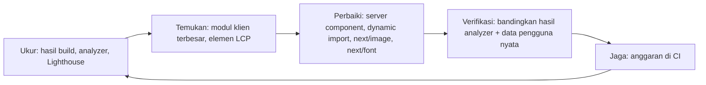

::part[Pelajari Konsepnya]{n="1"}

## 🎯 Yang akan kamu pelajari

- Apa yang dilakukan `next build` dan cara membaca daftar route-nya
- Menemukan kode berat dengan `next experimental-analyze` (Turbopack) atau `@next/bundle-analyzer`
- Kemenangan terbesar: menjaga pekerjaan tetap di **Server Components**
- **Lazy loading** dengan `next/dynamic` (dan `ssr: false` di Client Components)
- **`next/image`**: ukuran, `preload` untuk gambar utama, format, `remotePatterns`
- **`next/font`**: font dari domain sendiri, tanpa layout melompat
- `next/script` untuk script dari luar
- Halaman statis vs dinamis, caching, dan **anggaran performa**

## 🔤 Istilah penting

| Istilah | Artinya (sederhana) |
|---|---|
| **Bundle** | File JavaScript hasil build yang diunduh browser |
| **Code splitting** | Setiap halaman hanya mengunduh kodenya sendiri |
| **Lazy loading** | Mengunduh sesuatu hanya saat dibutuhkan |
| **Static / dynamic route** | Dibuat sekali di awal / dibuat ulang untuk setiap request |
| **LCP element** | Elemen terbesar yang terlihat saat halaman dimuat (sering banner atau heading) |
| **Layout shift** | Konten melompat-lompat saat halaman sedang dimuat |
| **Third-party script** | Kode dari perusahaan lain (analytics, widget chat) di halamanmu |
| **Performance budget** | Batas yang disepakati, misalnya "≤ 150 KB JavaScript" |

## 🧠 Ide besarnya

Setiap pengunjung mengunduh halamanmu seperti **membawa koper untuk perjalanan**. Build adalah proses packing. Jangan bawa satu lemari penuh (library chart 200 KB) untuk jalan-jalan sehari ke satu halaman:

- Barang berat tinggalkan di hotel → **server**.
- Bawa baju untuk hari ini saja → **code splitting per halaman**.
- Sisanya dikirim kalau perlu → **lazy loading**.

## ❓ Kenapa ini penting

Di HP Android kelas menengah dengan 4G, setiap 100 KB JavaScript butuh waktu yang terasa untuk dibaca dan dijalankan. Halaman lambat kehilangan pengguna dan peringkatnya turun di Google. Banyak pengguna — di Indonesia dan di kebanyakan pasar — browsing terutama lewat HP, jadi halaman lowongan CareerPilot harus cepat di HP murah, bukan hanya di laptopmu.

Masalah yang sering terjadi:

- Halaman lowongan mengimpor parser markdown, library tanggal, dan library chart ke Client Component → ratusan KB untuk teks yang tidak pernah berubah.
- `` mengirim JPEG 2 MB ke HP dan membuat layout melompat.
- `<link>` Google Fonts menahan halaman untuk tampil dan menghubungi Google dari browser pengguna.
- Snippet analytics dimuat duluan di `<head>` dan memperlambat semuanya.

## 📖 Langkah demi langkah

### 1. Build dan baca hasilnya

```bash
npm run build          # next build (Turbopack by default in Next.js 16)
npm run start          # production server — measure THIS, never next dev
```

Hasil build menampilkan setiap route dan apakah ia **statis** (dibuat di awal, seperti makanan yang sudah dimasak) atau **dinamis** (dimasak per pesanan). Perhatikan halaman yang tidak sengaja menjadi dinamis (misalnya membaca `cookies()` di layout bersama).

### 2. Temukan yang berat

```bash
npx next experimental-analyze            # Turbopack bundle analyzer (Next.js 16.1+): treemap + import chains
npx next experimental-analyze --output   # save to .next/diagnostics/analyze to compare before/after
```

Analyzer menggambar bundle-mu sebagai **treemap**: kotak lebih besar = kode lebih besar — seperti X-ray koper di bandara. (Build Webpack memakai `@next/bundle-analyzer` dengan `ANALYZE=true npm run build`.) Cari:

- library besar di bundle **browser**,
- library yang sama ikut dua kali,
- kode yang hanya dibutuhkan satu halaman tapi muncul di file bersama.

### 3. Utamakan Server Components

```tsx
// ❌ components/job-description.tsx
"use client";
import { renderMarkdown } from "../lib/markdown";           // parser shipped to every visitor

// ✅ Server Component — the parser runs on the server; the browser receives HTML
import { renderMarkdown } from "../lib/markdown";
export function JobDescription({ markdown }: { markdown: string }) {
  return <div className="prose" dangerouslySetInnerHTML={{ __html: renderMarkdown(markdown) }} />;
}
```

Parser-nya tetap jalan — tapi di server. Pengunjung menerima HTML yang sudah jadi, seperti membeli makanan matang alih-alih membawa pulang seluruh dapur.

- Highlight kode, markdown, format tanggal, dan transformasi data biasanya tidak butuh browser.
- Tambahkan `import "server-only"` ke file server yang berat supaya tidak tertarik ke kode browser tanpa sengaja.
- Selalu **sanitasi** HTML yang bukan kamu tulis sebelum memakai `dangerouslySetInnerHTML`.

### 4. Lazy-load widget berat khusus browser

```tsx
// components/salary-chart-lazy.tsx
"use client";
import dynamic from "next/dynamic";

export const SalaryChartLazy = dynamic(() => import("./salary-chart"), {
  ssr: false,                                        // browser-only library; allowed only in Client Components
  loading: () => <p>Loading salary chart…</p>,
});
```

- Kandidat yang cocok: chart, editor teks kaya, peta, pemilih emoji, modal yang jarang dibuka.
- Siapkan ruang untuk widget-nya (tinggi tetap) supaya layout tidak melompat saat widget datang.
- Kamu juga bisa memuat library saat diklik: `const { default: confetti } = await import("canvas-confetti")` di dalam handler klik.

### 5. `next/image`

```tsx
import Image from "next/image";

<Image src={job.bannerUrl} alt={`${job.title} at ${job.company}`} width={1200} height={400} sizes="100vw" preload />
<Image src={job.logoUrl} alt={`${job.company} logo`} width={64} height={64} />
```

- Membuat beberapa ukuran (`srcset`), mengirim **AVIF/WebP**, lazy-load secara default, dan menyiapkan ruang (tidak melompat).
- `sizes` memberi tahu browser selebar apa gambarnya nanti, supaya HP mengunduh file seukuran HP — seperti memesan minuman ukuran kecil, bukan botol keluarga.
- Untuk **gambar LCP** (biasanya banner di atas): pakai `preload` (Next.js 16 menggantikan `priority`), atau `loading="eager"` / `fetchPriority="high"`.
- Gambar dari domain lain harus diizinkan:

```ts
// next.config.ts
images: {
  remotePatterns: [new URL("https://cdn.careerpilot.app/logos/**")],
  formats: ["image/avif", "image/webp"],
},
```

Jangan pernah mengizinkan `hostname: "**"` — server-mu akan memproses (dan membayar untuk) gambar apa pun di internet.

### 6. `next/font`

```tsx
// app/layout.tsx
import { Inter } from "next/font/google";
const inter = Inter({ subsets: ["latin"], display: "swap", variable: "--font-sans" });

<html lang="en" className={inter.variable}>
```

- Font diunduh **saat build** dan disajikan dari domainmu — tidak ada request ke Google dari browser pengguna.
- Font cadangan yang ukurannya disesuaikan mencegah teks melompat saat font asli datang.
- Pakai `next/font/local` untuk font kustom. Muat hanya ketebalan dan set karakter yang dipakai.

### 7. Script pihak ketiga

```tsx
import Script from "next/script";
<Script src="https://analytics.example.com/script.js" strategy="afterInteractive" />   // default
<Script src="https://widget.example.com/chat.js" strategy="lazyOnload" />               // when the browser is idle
```

Setiap script dari luar adalah kode orang lain di halamanmu — seperti mengizinkan lapak orang asing di dalam tokomu. Cek ukuran dan dampak privasinya, pilih opsi yang lebih ringan atau di sisi server, dan muat setelah halaman bisa dipakai.

### 8. Rendering dan caching

- Halaman publik yang jarang berubah (daftar lowongan) → cache dengan `"use cache"` + `cacheLife` (W4 L6), atau buat di awal saat build.
- Halaman pribadi → dinamis, tapi alirkan bagian yang lambat dengan `<Suspense>` supaya kerangka halaman cepat tampil.
- File di `.next/static` punya hash konten di namanya → sajikan dari CDN dengan `Cache-Control` yang panjang.

### 9. Tetapkan anggaran

| Metrik | Contoh anggaran |
|---|---|
| JS klien untuk `/jobs/[id]` | ≤ 150 KB terkompresi |
| LCP di HP kelas menengah dengan 4G | ≤ 2,5 detik (materi 07) |
| Gambar | AVIF/WebP, ukuran tepat |
| Script pihak ketiga | ≤ 2, tidak ada yang menahan render |

Anggaran itu seperti batas bagasi maskapai: cek di CI (Lighthouse CI, cek ukuran bundle), supaya pull request yang melewati batas **gagal** alih-alih sampai ke pengguna.



### Kapan pakai apa

- ✅ Ukur dulu, lalu perbaiki masalah yang paling besar.
- ✅ Lazy-load widget yang ada di bawah layar atau dibuka lewat klik.
- 🚫 Jangan lazy-load elemen LCP atau komponen kecil (request tambahannya lebih mahal daripada penghematannya).
- 🚫 Jangan menaburkan `useMemo` di mana-mana sebelum mengecek bundle dan jaringan.

Setiap teknik punya harga: Server Components tidak bisa interaktif, `next/dynamic` menambah request belakangan dan state loading, optimasi gambar memakai CPU server, dan caching agresif bisa menampilkan data lama.

## ⚠️ Kesalahan umum

- Mengukur di `next dev` (tidak dioptimasi, bundle besar).
- `ssr: false` di dalam Server Component → error saat build.
- Tidak ada `sizes` pada gambar responsif → HP mengunduh file seukuran desktop.
- `preload` di semua gambar → tidak ada yang benar-benar diprioritaskan.
- Mengimpor seluruh library utilitas hanya untuk satu fungsi.

## 🏆 Praktik terbaik

- [ ] Selalu ukur build **production** (`next build && next start`).
- [ ] Taruh `"use client"` di komponen daun yang kecil; tandai file server yang berat dengan `server-only`.
- [ ] Analisis bundle sebelum dan sesudah perubahan dependency besar.
- [ ] `next/dynamic` untuk widget berat khusus browser, dengan placeholder loading berukuran tetap.
- [ ] `next/image` dengan `width`/`height`/`sizes` yang benar; `preload` hanya untuk gambar LCP; `remotePatterns` yang ketat.
- [ ] `next/font` dengan sedikit ketebalan dan subset.
- [ ] Script luar lewat `next/script` dengan strategi yang ditunda.
- [ ] `poweredByHeader: false`; kompresi aktif (default) atau di CDN.
- [ ] Anggaran performa yang dicek di CI.

::part[Jelaskan & Rancang]{n="2"}

## 🗣️ Jelaskan

Jelaskan analogi koper, lalu jelaskan kenapa memindahkan parser markdown dari Client Component ke Server Component membuat halaman lebih ringan walaupun parser-nya tetap dijalankan.

## 📐 Rancang

**Dashboard** CareerPilot berisi: header dengan avatar, 4 kartu statistik, chart pipeline (library chart), feed aktivitas terbaru (tanggal relatif), kotak "AI career tip" (memanggil LLM), dan video onboarding besar untuk pengguna baru. LCP-nya 4,8 detik di mobile. Usulkan rencana optimasi berurutan dari prioritas tertinggi, dengan perkiraan dampak setiap perubahan.

:::quiz
Lihat contoh rencana

1. **Alirkan AI tip yang lambat** (`<Suspense fallback={<TipSkeleton/>}>` di sekitar async Server Component, di-cache per pengguna selama sehari) — kerangka halaman dan statistik tidak lagi menunggu LLM (sering jadi kemenangan LCP terbesar).
2. **Statistik dan aktivitas sebagai Server Components**; format tanggal relatif di server (`Intl.RelativeTimeFormat`) → library tanggal keluar dari bundle browser.
3. **Lazy-load chart** dengan `next/dynamic` (`ssr: false`, skeleton dengan tinggi tetap) → JavaScript saat pertama dimuat jauh berkurang; tidak ada layout shift.
4. **Video onboarding**: jangan langsung dimuat — tampilkan poster `next/image` + tombol play yang memuat player saat diklik; hanya untuk pengguna baru (server yang menentukan).
5. **Avatar** dengan `next/image` 40×40 dan `sizes="40px"`; elemen LCP (kemungkinan kartu statistik atau heading) berupa teks → pastikan font memakai `next/font` dengan `display: swap`.
6. **Caching**: statistik di-cache per pengguna dengan `cacheLife` pendek dan `updateTag` setelah ada perubahan.
7. **Verifikasi** dengan `next experimental-analyze --output` sebelum/sesudah dan LCP pengguna nyata (persentil ke-75) selama seminggu; tambahkan anggaran (JS klien dashboard ≤ 180 KB) ke CI.
:::

### 📝 Checklist review mandiri

- [ ] Rencana dimulai dari pengukuran
- [ ] Elemen LCP sudah diidentifikasi
- [ ] Tidak ada konten di bagian atas halaman yang di-lazy-load

::ai-review{task="design"}

::part[Latihan Kecil]{n="3"}

:::exercise{path="exercises/web/m4/w6/04-build-optimization" ai="no-ai" title="Perbaiki halaman lowongan yang lambat"}
Refactor halaman lowongan: izinkan gambar dari domain lain dan format modern, ganti link font yang menahan render dengan `next/font`, pakai `next/image` dengan banner LCP yang di-preload, ubah Client Component yang tidak perlu menjadi Server Component, dan lazy-load chart khusus browser.
:::

:::hints
- `ssr: false` harus berada di file `"use client"` — itulah alasan `salary-chart-lazy.tsx` ada.
- Next.js 16 memakai `preload` sebagai pengganti prop `priority` yang lama.
- Grader memindai setiap file `"use client"` untuk mencari import statis dari modul yang berat.
:::

## ✅ Cek cepat

:::quiz
Kenapa banner utama sebaiknya memakai `preload`, tapi logo perusahaan di daftar tidak?

Banner kemungkinan besar adalah elemen LCP di bagian atas, jadi mengambilnya lebih awal mempercepat LCP. Preload banyak gambar membuat mereka berebut bandwidth dan memperlambat gambar yang penting; gambar di bagian bawah sebaiknya lazy-load.
:::

:::quiz
`next build` menampilkan `/jobs` sebagai dinamis, padahal seharusnya statis. Apa kemungkinan penyebabnya?

Ada sesuatu di dalamnya yang membaca data saat request — `cookies()`, `headers()`, `searchParams`, atau fetch yang tidak di-cache — sering di layout bersama atau komponen seperti menu pengguna. Pindahkan ke bagian kecil yang dibungkus Suspense atau ke client component, atau cache datanya.
:::

## 📚 Lanjut belajar

- Dokumentasi Next.js (tersedia di dalam proyek): panduan Package Bundling; panduan Lazy Loading; Images; Fonts; Production Checklist
- [web.dev: Optimize LCP](https://web.dev/articles/optimize-lcp)
