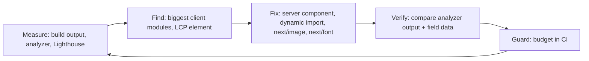

::part[Learn the Concept]{n="1"}

## 🎯 What you'll learn

- What `next build` does and how to read its route output
- Finding heavy code with `next experimental-analyze` (Turbopack) or `@next/bundle-analyzer`
- The biggest lever: keeping work in **Server Components**
- **Lazy loading** with `next/dynamic` (and `ssr: false` in Client Components)
- **`next/image`**: sizing, `sizes`, `preload` for the LCP image, formats, `remotePatterns`
- **`next/font`**: self-hosted fonts with no layout shift
- `next/script` strategies for third-party scripts
- Static vs dynamic rendering, caching, and a **performance budget**

## 🧠 The big idea

Every visitor downloads your page like **luggage for a trip**. The build is your packing step. Don't pack the whole wardrobe (a 200 KB chart library) when the trip is a day visit to one page. Leave heavy things at the hotel (the server), pack only what you'll use today (per-route code splitting), and have the rest delivered later if needed (lazy loading).

## ❓ Why does this exist?

On a mid-range Android phone on 4G, every 100 KB of JavaScript costs noticeable parse/execute time. Slow pages lose users and rank lower in search. Indonesia's users are mobile-first — CareerPilot's job pages must be fast on cheap phones, not just your laptop.

## 💥 What happens if we DON'T?

- A job page imports a markdown parser, a date library and a chart library into a Client Component → hundreds of KB for text that never changes.
- `` ships a 2 MB JPEG to phones and causes layout shift.
- A Google Fonts `<link>` blocks rendering and pings Google from the user's browser.
- An analytics snippet loads synchronously in `<head>` and delays everything.

## 📖 How it works, step by step

### 1. Build and read the output

```bash
npm run build          # next build (Turbopack by default in Next.js 16)
npm run start          # production server — measure THIS, never next dev
```

The build output lists each route and whether it's **static** (prerendered at build time) or **dynamic** (rendered per request), and shows bundle information. Watch for routes that became dynamic unexpectedly (e.g. reading `cookies()` in a shared layout).

### 2. Find the heavy stuff

```bash
npx next experimental-analyze            # Turbopack bundle analyzer (Next.js 16.1+): treemap + import chains
npx next experimental-analyze --output   # save to .next/diagnostics/analyze to compare before/after
```

Webpack builds use `@next/bundle-analyzer` with `ANALYZE=true npm run build`. Look for: big libraries in **client** bundles, the same library twice, and code only one page needs appearing in shared chunks.

### 3. Server Components first

```tsx
// ❌ components/job-description.tsx
"use client";
import { renderMarkdown } from "../lib/markdown";           // parser shipped to every visitor

// ✅ Server Component — the parser runs on the server; the browser receives HTML
import { renderMarkdown } from "../lib/markdown";
export function JobDescription({ markdown }: { markdown: string }) {
  return <div className="prose" dangerouslySetInnerHTML={{ __html: renderMarkdown(markdown) }} />;
}
```

Syntax highlighting, markdown, date formatting and data transformation usually don't need the browser. Add `import "server-only"` to heavy server modules so they can't be pulled into client code by accident. (Always **sanitize** HTML you didn't write before `dangerouslySetInnerHTML`.)

### 4. Lazy-load client-only heavy widgets

```tsx
// components/salary-chart-lazy.tsx
"use client";
import dynamic from "next/dynamic";

export const SalaryChartLazy = dynamic(() => import("./salary-chart"), {
  ssr: false,                                        // browser-only library; allowed only in Client Components
  loading: () => <p>Loading salary chart…</p>,
});
```

Good candidates: charts, rich text editors, maps, emoji pickers, modals opened rarely. Reserve space for the widget (fixed height) so it doesn't shift the layout when it arrives. You can also load a library on interaction: `const { default: confetti } = await import("canvas-confetti")` inside a click handler.

### 5. `next/image`

```tsx
import Image from "next/image";

<Image src={job.bannerUrl} alt={`${job.title} at ${job.company}`} width={1200} height={400} sizes="100vw" preload />
<Image src={job.logoUrl} alt={`${job.company} logo`} width={64} height={64} />
```

- Resizes per device (`srcset`), serves **AVIF/WebP**, lazy-loads by default, and reserves space (no layout shift).
- `sizes` tells the browser how wide the image renders so it downloads the right size.
- For the **LCP image** (usually the hero/banner above the fold): `preload` (Next.js 16 deprecated `priority`), or `loading="eager"` / `fetchPriority="high"`.
- Remote images must be allow-listed:

```ts
// next.config.ts
images: {
  remotePatterns: [new URL("https://cdn.careerpilot.app/logos/**")],
  formats: ["image/avif", "image/webp"],
},
```

Never allow `hostname: "**"` — your server would optimize (and pay for) any image on the internet.

### 6. `next/font`

```tsx
// app/layout.tsx
import { Inter } from "next/font/google";
const inter = Inter({ subsets: ["latin"], display: "swap", variable: "--font-sans" });

<html lang="en" className={inter.variable}>
```

Fonts are downloaded **at build time** and served from your domain, with a size-adjusted fallback to avoid layout shift. Use `next/font/local` for custom fonts. Load only the weights and subsets you use.

### 7. Third-party scripts

```tsx
import Script from "next/script";
<Script src="https://analytics.example.com/script.js" strategy="afterInteractive" />   // default
<Script src="https://widget.example.com/chat.js" strategy="lazyOnload" />               // when the browser is idle
```

Each third-party script is someone else's code on your page: check its size and privacy impact, prefer server-side analytics or lightweight options, and load it after the page is usable.

### 8. Rendering and caching

- Public pages that change rarely (job listings) → cache with `"use cache"` + `cacheLife` (W4 L6), or prerender.
- Personal pages → dynamic, but stream slow parts with `<Suspense>` so the shell appears fast.
- Static assets in `.next/static` are content-hashed → serve them with long `Cache-Control` from a CDN.

### 9. Set a budget

| Metric | Budget example |
|---|---|
| Client JS for `/jobs/[id]` | ≤ 150 KB compressed |
| LCP on 4G mid-range phone | ≤ 2.5 s (lesson 07) |
| Images | AVIF/WebP, correctly sized |
| Third-party scripts | ≤ 2, none render-blocking |

Check it in CI (Lighthouse CI, bundle size checks) so regressions fail a pull request instead of reaching users.



## ⚖️ Trade-offs

| Technique | ✅ | ❌ |
|---|---|---|
| Server Components | zero client JS for that part | no interactivity; server cost per request if dynamic |
| `next/dynamic` | smaller initial bundle | extra request later; loading state; possible layout shift |
| `next/image` optimization | smaller images, no CLS | server CPU/cost for optimization (or a paid image CDN) |
| Aggressive caching | fast, cheap | stale data; invalidation complexity |
| React Compiler (`reactCompiler: true`) | automatic memoization | slightly slower builds; still new for some codebases |

## ✅ When to use it / 🚫 When NOT to use it

- ✅ Measure first, then fix the biggest item.
- ✅ Lazy-load below-the-fold or on-interaction widgets.
- 🚫 Don't lazy-load the LCP element or tiny components (the extra request costs more).
- 🚫 Don't micro-optimize with `useMemo` everywhere before checking the bundle and network.

## 🏆 Best practices

- [ ] Always measure a **production** build (`next build && next start`).
- [ ] Keep `"use client"` at the leaves; heavy server-only modules marked `server-only`.
- [ ] Analyze bundles before and after big dependency changes.
- [ ] `next/dynamic` for heavy client-only widgets, with a sized loading placeholder.
- [ ] `next/image` with correct `width`/`height`/`sizes`; `preload` only for the LCP image; strict `remotePatterns`.
- [ ] `next/font` with limited weights and subsets.
- [ ] Third-party scripts via `next/script` with a deferred strategy.
- [ ] `poweredByHeader: false`; compression on (default) or at the CDN.
- [ ] A performance budget checked in CI.

## 🏭 How it's used in industry

- Performance teams track bundle size per pull request (bundle-size bots, Lighthouse CI) and block regressions.
- E-commerce and job portals invest heavily in LCP because it correlates with conversion; Google uses Core Web Vitals as a ranking signal.
- Moving from client-rendered pages to Server Components has been a major source of JavaScript reduction for teams migrating to the App Router.

## ⚠️ Common mistakes

- Measuring in `next dev` (unoptimized, huge bundles).
- `ssr: false` in a Server Component → build error.
- Missing `sizes` on responsive images → phones download desktop-size files.
- `preload` on every image → nothing is prioritized.
- Importing a whole utility library for one function.

::part[Explain & Design]{n="2"}

## 🗣️ Explain it

Explain the luggage analogy, then explain why moving a markdown parser from a Client Component to a Server Component makes the page lighter even though the parser still runs.

## 📐 Design it

The CareerPilot **dashboard** has: a header with avatar, 4 stat cards, a pipeline chart (chart library), a recent activity feed (relative dates), an "AI career tip" box (calls an LLM), and a big onboarding video for new users. LCP is 4.8 s on mobile. Propose an optimization plan in priority order, with the expected effect of each change.

:::quiz
Show a possible plan

1. **Stream the slow AI tip** (`<Suspense fallback={<TipSkeleton/>}>` around an async Server Component, cached per user for a day) — the page shell and stats no longer wait for the LLM (often the biggest LCP win).
2. **Stats and activity as Server Components**; format relative dates on the server (`Intl.RelativeTimeFormat`) → drop the date library from the client bundle.
3. **Lazy-load the chart** with `next/dynamic` (`ssr: false`, fixed-height skeleton) → large reduction in first-load JS; no CLS.
4. **Onboarding video**: don't autoload — show a poster `next/image` + play button that loads the player on click; only for new users (server decides).
5. **Avatar** via `next/image` 40×40 with `sizes="40px"`; LCP element (probably the stats cards or heading) is text → ensure fonts use `next/font` with `display: swap`.
6. **Caching**: aggregate stats cached per user with a short `cacheLife` and `updateTag` after mutations.
7. **Verify** with `next experimental-analyze --output` before/after and field LCP p75 over a week; add a budget (dashboard client JS ≤ 180 KB) to CI.
:::

### 📝 Self-review checklist

- [ ] Plan starts from measurement
- [ ] LCP element identified
- [ ] No lazy-loading of above-the-fold content

::ai-review{task="design"}

::part[Toy Exercise]{n="3"}

:::exercise{path="exercises/web/m4/w6/04-build-optimization" ai="no-ai" title="Fix a slow job page"}
Refactor a job page: allow-list remote images and modern formats, replace a render-blocking font link with `next/font`, switch to `next/image` with a preloaded LCP banner, turn a needless Client Component into a Server Component and lazy-load a browser-only chart.
:::

:::hints
- `ssr: false` must live in a `"use client"` file — that's why `salary-chart-lazy.tsx` exists.
- Next.js 16 uses `preload` instead of the deprecated `priority` prop.
- The grader scans every `"use client"` file for static imports of the heavy modules.
:::

## ✅ Quick check

:::quiz
Why should the hero banner use `preload` but the company logos in a list shouldn't?

The banner is the likely LCP element above the fold, so fetching it early speeds up LCP. Preloading many images competes for bandwidth and delays the important one; below-the-fold images should lazy-load.
:::

:::quiz
`next build` shows `/jobs` as dynamic, but it should be static. What's a likely cause?

Something in its tree reads request-time data — `cookies()`, `headers()`, `searchParams`, or an uncached fetch — often in a shared layout or a component like a user menu. Move that into a Suspense-wrapped leaf or a client component, or cache the data.
:::

## 📖 Kamus (glossary)

| Term | Bahasa Indonesia |
|---|---|
| Bundle | Paket kode JavaScript hasil build |
| Code splitting | Pemecahan kode per halaman/fitur |
| Lazy loading | Memuat belakangan saat dibutuhkan |
| Tree shaking | Membuang kode yang tidak dipakai |
| Performance budget | Batas anggaran performa |
| Layout shift | Pergeseran tata letak saat memuat |

## 📚 Keep learning

- Next.js docs (bundled): Package Bundling guide; Lazy Loading guide; Images; Fonts; Production Checklist
- [web.dev: Optimize LCP](https://web.dev/articles/optimize-lcp)
