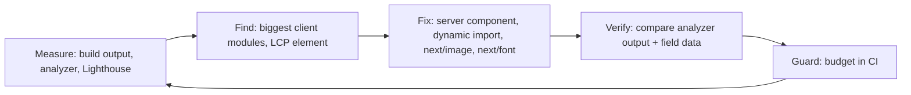

::part[Learn the Concept]{n="1"}

## 🎯 What you'll learn

- What `next build` does and how to read its route list
- Finding heavy code with `next experimental-analyze` (Turbopack) or `@next/bundle-analyzer`
- The biggest win: keeping work in **Server Components**
- **Lazy loading** with `next/dynamic` (and `ssr: false` in Client Components)
- **`next/image`**: sizes, `preload` for the main image, formats, `remotePatterns`
- **`next/font`**: fonts served from your own domain, with no layout jumps
- `next/script` for outside scripts
- Static vs dynamic pages, caching, and a **performance budget**

## 🔤 Key words

| Word | In simple words | Bahasa Indonesia |
|---|---|---|
| **Bundle** | The JavaScript files the build creates and the browser downloads | Paket kode |
| **Code splitting** | Each page downloads only its own code | Pemecahan kode |
| **Lazy loading** | Download something only when it's needed | Muat belakangan |
| **Static / dynamic route** | Built once ahead of time / built again for each request | Statis / dinamis |
| **LCP element** | The biggest thing visible when the page loads (often a banner or heading) | Elemen utama |
| **Layout shift** | Content jumping around while the page loads | Pergeseran tata letak |
| **Third-party script** | Code from another company (analytics, chat widget) on your page | Script pihak ketiga |
| **Performance budget** | A limit you agree on, like "≤ 150 KB of JavaScript" | Anggaran performa |

## 🧠 The big idea

Every visitor downloads your page like **luggage for a trip**. The build is packing. Don't pack the whole wardrobe (a 200 KB chart library) for a day trip to one page:

- Leave heavy things at the hotel → the **server**.
- Pack only today's clothes → **per-page code splitting**.
- Have the rest delivered if you need it → **lazy loading**.

## ❓ Why it matters

On a mid-range Android phone on 4G, every 100 KB of JavaScript costs noticeable time to read and run. Slow pages lose users and rank lower on Google. Many users — in Indonesia and in most markets — browse mainly on phones, so CareerPilot's job pages must be fast on cheap phones, not just on your laptop.

Common problems:

- A job page imports a markdown parser, a date library and a chart library into a Client Component → hundreds of KB for text that never changes.
- `` sends a 2 MB JPEG to phones and makes the layout jump.
- A Google Fonts `<link>` blocks the page from showing and pings Google from the user's browser.
- An analytics snippet loads first in `<head>` and delays everything.

## 📖 Step by step

### 1. Build and read the output

```bash
npm run build          # next build (Turbopack by default in Next.js 16)
npm run start          # production server — measure THIS, never next dev
```

The build lists each route and whether it's **static** (built ahead of time, like pre-cooked meals) or **dynamic** (cooked per order). Watch for pages that became dynamic by accident (for example, reading `cookies()` in a shared layout).

### 2. Find the heavy stuff

```bash
npx next experimental-analyze            # Turbopack bundle analyzer (Next.js 16.1+): treemap + import chains
npx next experimental-analyze --output   # save to .next/diagnostics/analyze to compare before/after
```

The analyzer draws your bundle as a **treemap**: bigger boxes = bigger code — like a luggage X-ray. (Webpack builds use `@next/bundle-analyzer` with `ANALYZE=true npm run build`.) Look for:

- big libraries in **browser** bundles,
- the same library included twice,
- code only one page needs showing up in shared files.

### 3. Server Components first

```tsx
// ❌ components/job-description.tsx
"use client";
import { renderMarkdown } from "../lib/markdown";           // parser shipped to every visitor

// ✅ Server Component — the parser runs on the server; the browser receives HTML
import { renderMarkdown } from "../lib/markdown";
export function JobDescription({ markdown }: { markdown: string }) {
  return <div className="prose" dangerouslySetInnerHTML={{ __html: renderMarkdown(markdown) }} />;
}
```

The parser still runs — but on the server. The visitor gets the finished HTML, like buying a cooked meal instead of carrying home the whole kitchen.

- Code highlighting, markdown, date formatting and data transformation usually don't need the browser.
- Add `import "server-only"` to heavy server files so they can't be pulled into browser code by accident.
- Always **sanitize** HTML you didn't write before using `dangerouslySetInnerHTML`.

### 4. Lazy-load heavy browser-only widgets

```tsx
// components/salary-chart-lazy.tsx
"use client";
import dynamic from "next/dynamic";

export const SalaryChartLazy = dynamic(() => import("./salary-chart"), {
  ssr: false,                                        // browser-only library; allowed only in Client Components
  loading: () => <p>Loading salary chart…</p>,
});
```

- Good candidates: charts, rich text editors, maps, emoji pickers, rarely opened modals.
- Reserve space for the widget (fixed height) so the layout doesn't jump when it arrives.
- You can also load a library on click: `const { default: confetti } = await import("canvas-confetti")` inside the click handler.

### 5. `next/image`

```tsx
import Image from "next/image";

<Image src={job.bannerUrl} alt={`${job.title} at ${job.company}`} width={1200} height={400} sizes="100vw" preload />
<Image src={job.logoUrl} alt={`${job.company} logo`} width={64} height={64} />
```

- Makes several sizes (`srcset`), serves **AVIF/WebP**, lazy-loads by default, and reserves space (no jumping).
- `sizes` tells the browser how wide the image will be, so a phone downloads a phone-sized file — like ordering a small drink instead of the family bottle.
- For the **LCP image** (usually the banner at the top): use `preload` (Next.js 16 replaced `priority`), or `loading="eager"` / `fetchPriority="high"`.
- Images from other domains must be allowed:

```ts
// next.config.ts
images: {
  remotePatterns: [new URL("https://cdn.careerpilot.app/logos/**")],
  formats: ["image/avif", "image/webp"],
},
```

Never allow `hostname: "**"` — your server would process (and pay for) any image on the internet.

### 6. `next/font`

```tsx
// app/layout.tsx
import { Inter } from "next/font/google";
const inter = Inter({ subsets: ["latin"], display: "swap", variable: "--font-sans" });

<html lang="en" className={inter.variable}>
```

- Fonts are downloaded **at build time** and served from your domain — no request to Google from the user's browser.
- A size-matched fallback font avoids text jumping when the real font arrives.
- Use `next/font/local` for custom fonts. Load only the weights and character sets you use.

### 7. Third-party scripts

```tsx
import Script from "next/script";
<Script src="https://analytics.example.com/script.js" strategy="afterInteractive" />   // default
<Script src="https://widget.example.com/chat.js" strategy="lazyOnload" />               // when the browser is idle
```

Every outside script is someone else's code on your page — like letting a stranger's stall inside your shop. Check its size and privacy impact, prefer lighter or server-side options, and load it after the page is usable.

### 8. Rendering and caching

- Public pages that rarely change (job listings) → cache with `"use cache"` + `cacheLife` (W4 L6), or build them ahead of time.
- Personal pages → dynamic, but stream slow parts with `<Suspense>` so the page frame appears fast.
- Files in `.next/static` have a content hash in their name → serve them from a CDN with a long `Cache-Control`.

### 9. Set a budget

| Metric | Budget example |
|---|---|
| Client JS for `/jobs/[id]` | ≤ 150 KB compressed |
| LCP on 4G mid-range phone | ≤ 2.5 s (lesson 07) |
| Images | AVIF/WebP, correctly sized |
| Third-party scripts | ≤ 2, none render-blocking |

A budget is like an airline's baggage limit: check it in CI (Lighthouse CI, bundle size checks), so a pull request that goes over **fails** instead of reaching users.



### When to use what

- ✅ Measure first, then fix the biggest item.
- ✅ Lazy-load widgets below the fold or opened by a click.
- 🚫 Don't lazy-load the LCP element or tiny components (the extra request costs more than it saves).
- 🚫 Don't sprinkle `useMemo` everywhere before checking the bundle and network.

Every technique has a cost: Server Components can't be interactive, `next/dynamic` adds a later request and a loading state, image optimization uses server CPU, and heavy caching can show old data.

## ⚠️ Common mistakes

- Measuring in `next dev` (not optimized, huge bundles).
- `ssr: false` inside a Server Component → build error.
- No `sizes` on responsive images → phones download desktop-size files.
- `preload` on every image → nothing is really first.
- Importing a whole utility library for one function.

## 🏆 Best practices

- [ ] Always measure a **production** build (`next build && next start`).
- [ ] Keep `"use client"` on small leaf components; mark heavy server files `server-only`.
- [ ] Analyze bundles before and after big dependency changes.
- [ ] `next/dynamic` for heavy browser-only widgets, with a fixed-size loading placeholder.
- [ ] `next/image` with correct `width`/`height`/`sizes`; `preload` only for the LCP image; strict `remotePatterns`.
- [ ] `next/font` with few weights and subsets.
- [ ] Outside scripts through `next/script` with a delayed strategy.
- [ ] `poweredByHeader: false`; compression on (default) or at the CDN.
- [ ] A performance budget checked in CI.

::part[Explain & Design]{n="2"}

## 🗣️ Explain it

Explain the luggage analogy, then explain why moving a markdown parser from a Client Component to a Server Component makes the page lighter even though the parser still runs.

## 📐 Design it

The CareerPilot **dashboard** has: a header with avatar, 4 stat cards, a pipeline chart (chart library), a recent activity feed (relative dates), an "AI career tip" box (calls an LLM), and a big onboarding video for new users. LCP is 4.8 s on mobile. Propose an optimization plan in priority order, with the expected effect of each change.

:::quiz
Show a possible plan

1. **Stream the slow AI tip** (`<Suspense fallback={<TipSkeleton/>}>` around an async Server Component, cached per user for a day) — the page frame and stats no longer wait for the LLM (often the biggest LCP win).
2. **Stats and activity as Server Components**; format relative dates on the server (`Intl.RelativeTimeFormat`) → the date library leaves the browser bundle.
3. **Lazy-load the chart** with `next/dynamic` (`ssr: false`, fixed-height skeleton) → much less JavaScript on first load; no layout shift.
4. **Onboarding video**: don't load it right away — show a poster `next/image` + play button that loads the player on click; only for new users (the server decides).
5. **Avatar** with `next/image` 40×40 and `sizes="40px"`; the LCP element (probably the stat cards or heading) is text → make sure fonts use `next/font` with `display: swap`.
6. **Caching**: stats cached per user with a short `cacheLife` and `updateTag` after changes.
7. **Verify** with `next experimental-analyze --output` before/after and real-user LCP (75th percentile) over a week; add a budget (dashboard client JS ≤ 180 KB) to CI.
:::

### 📝 Self-review checklist

- [ ] The plan starts from measurement
- [ ] LCP element identified
- [ ] Nothing at the top of the page is lazy-loaded

::ai-review{task="design"}

::part[Toy Exercise]{n="3"}

:::exercise{path="exercises/web/m4/w6/04-build-optimization" ai="no-ai" title="Fix a slow job page"}
Refactor a job page: allow-list remote images and modern formats, replace a render-blocking font link with `next/font`, switch to `next/image` with a preloaded LCP banner, turn a needless Client Component into a Server Component and lazy-load a browser-only chart.
:::

:::hints
- `ssr: false` must live in a `"use client"` file — that's why `salary-chart-lazy.tsx` exists.
- Next.js 16 uses `preload` instead of the old `priority` prop.
- The grader scans every `"use client"` file for static imports of the heavy modules.
:::

## ✅ Quick check

:::quiz
Why should the hero banner use `preload` but the company logos in a list shouldn't?

The banner is probably the LCP element at the top, so fetching it early speeds up LCP. Preloading many images makes them fight for bandwidth and delays the important one; images further down should lazy-load.
:::

:::quiz
`next build` shows `/jobs` as dynamic, but it should be static. What's a likely cause?

Something in its tree reads request-time data — `cookies()`, `headers()`, `searchParams`, or an uncached fetch — often in a shared layout or a component like a user menu. Move that into a small Suspense-wrapped part or a client component, or cache the data.
:::

## 📚 Keep learning

- Next.js docs (bundled): Package Bundling guide; Lazy Loading guide; Images; Fonts; Production Checklist
- [web.dev: Optimize LCP](https://web.dev/articles/optimize-lcp)
