::part[Pelajari Konsepnya]{n="1"}

## 🎯 Yang akan kamu pelajari

- Pilihan deploy: **Vercel**, platform lain, **Docker** di server/AWS, static export — dan apa yang didukung masing-masing
- Lingkungan (development, preview, staging, production) dan variabelnya
- Variabel saat build vs saat berjalan (`NEXT_PUBLIC_` ditanam saat build)
- **Mengecek konfigurasi** saat startup tanpa membocorkan rahasia
- `output: "standalone"` dan **Dockerfile multi-stage, non-root**
- **Health check**, log, dan berjalan di belakang load balancer
- CI/CD: cek → build → deploy, **preview deployment**, **rollback**
- Menghubungkan frontend ke Flask API dengan aman (CORS, cookie, domain)

## 🔤 Istilah penting

| Istilah | Artinya (sederhana) |
|---|---|
| **Deploy** | Menaruh satu versi aplikasi di server supaya pengguna asli bisa memakainya |
| **Environment** | Salinan aplikasi yang terpisah: preview, staging (gladi resik), production (pengguna asli) |
| **Environment variable** | Pengaturan yang diberikan ke aplikasi dari luar kode (URL API, secret) |
| **Build time / runtime** | Saat `next build` berjalan / saat server sedang berjalan |
| **Docker image** | Paket tersegel berisi aplikasimu dan semua yang dibutuhkan untuk berjalan |
| **Health check** | URL kecil yang menjawab "aku baik-baik saja" supaya platform tahu aplikasinya jalan |
| **Preview deployment** | Salinan sementara aplikasi untuk satu pull request |
| **Rollback** | Kembali ke versi sebelumnya yang masih berjalan baik |

## 🧠 Ide besarnya

Deploy itu seperti **membuka cabang restoran**. Resepnya (kode) sama di semua cabang, tapi setiap cabang punya kontak pemasok dan kunci sendiri (environment variable). Pintu tidak dibuka sebelum dapur lolos inspeksi (health check). Kalau menu baru bikin pelanggan sakit perut, langsung kembali ke menu lama (rollback).

**Docker image** adalah **paket perlengkapan cabang**: kotak tersegel yang sama dipakai di staging dan production — hanya pengaturannya yang berbeda.

## ❓ Kenapa ini penting

`npm run dev` di laptopmu belum menjadi produk. Production butuh: build yang dioptimasi, HTTPS, URL API dan secret yang benar per lingkungan, restart otomatis, log, update tanpa downtime, dan cara membatalkan rilis yang buruk dalam hitungan menit.

Yang terjadi tanpa ini:

- `NEXT_PUBLIC_API_URL` hanya diatur saat runtime → kode browser tetap berisi `undefined` (nilainya sudah ditanam saat build).
- `SESSION_SECRET` tidak ada di production → semua login gagal dengan 500 jam 2 pagi; atau pesan error-nya mencetak secret ke log.
- Image 1,5 GB yang berjalan sebagai root, dengan alat development dan file `.env` ikut tersalin.
- Tidak ada health check → load balancer mengirim pengguna ke container yang masih menyala.
- Deploy langsung dari laptop: tidak ada catatan versi yang berjalan, tidak bisa rollback.

## 📖 Langkah demi langkah

### 1. Deploy ke mana

| Pilihan | Cocok untuk | Catatan |
|---|---|---|
| **Vercel** | mulai paling cepat, preview per PR, CDN sudah tersedia | dibuat oleh tim Next.js; paket hobby gratis; biaya naik sesuai pemakaian |
| Netlify, Cloudflare, Render, Railway, Fly.io | pengalaman terkelola yang mirip | cek dukungan fitur Next.js terbaru di tiap platform |
| **Docker** (VPS, AWS ECS/App Runner, Google Cloud Run, Kubernetes) | kontrol penuh, setup sama dengan Flask API-mu, biaya lebih bisa ditebak | kamu yang mengurus scaling, CDN, TLS (Module 5) |
| Static export (`output: "export"`) | situs marketing, tanpa fitur server | tanpa Server Actions, cookie, proxy, rendering dinamis |

Vercel itu seperti **food court**: sewa satu lapak, listrik, kebersihan, dan keamanan sudah diurus. Docker di server sendiri seperti **sewa ruko**: kontrol lebih besar dan sering lebih murah saat skala besar, tapi semuanya kamu urus sendiri.

Next.js juga bisa di-host sendiri dengan `next start` atau Docker, termasuk fitur caching-nya; CDN di depan untuk file statis tetap disarankan.

### 2. Lingkungan dan variabel

| Variabel | Dibaca di mana | Kapan ditetapkan | Rahasia? |
|---|---|---|---|
| `API_URL=http://api:5091` | hanya server | runtime | tidak (internal) |
| `SESSION_SECRET` | hanya server | runtime | **ya** |
| `NEXT_PUBLIC_APP_URL` | server **dan** browser | **saat build** (ditanam) | tidak boleh |

Nilai `NEXT_PUBLIC_` itu **dicetak ke buku menu** saat build: browser menerima salinannya, jadi mengubah pengaturan server nanti tidak mengubah menu yang sudah dicetak. Dan siapa pun bisa membaca menunya — jadi jangan pernah taruh rahasia di sana.

- Simpan secret di tempat penyimpanan rahasia platform (env vars Vercel, AWS Secrets Manager/SSM, secret GitHub Actions) — jangan pernah di image atau Git.
- Memakai satu Docker image untuk staging dan production hanya bisa kalau nilai **publik**-nya sama, atau diberikan saat runtime lewat konfigurasi yang dirender server, bukan lewat `NEXT_PUBLIC_`.

### 3. Cek konfigurasi saat startup

```ts
// lib/env.ts
import { z } from "zod";

const serverEnvSchema = z.object({
  API_URL: z.url(),
  SESSION_SECRET: z.string().min(32),
  NEXT_PUBLIC_APP_URL: z.url(),
});

export function parseServerEnv(source = process.env) {
  const result = serverEnvSchema.safeParse(source);
  if (!result.success) {
    const names = [...new Set(result.error.issues.map((i) => String(i.path[0])))].sort();
    throw new Error(`Invalid environment variables: ${names.join(", ")}`);   // names, never values
  }
  return result.data;
}

export const env = parseServerEnv();
```

Seperti checklist pilot sebelum terbang: cek semuanya **sebelum** lepas landas, bukan saat sudah di udara.

- Panggil dari `instrumentation.ts` (jalan sekali saat server menyala) atau impor `env` di file server, supaya setup yang salah **langsung gagal**, bukan saat request pengguna pertama.
- Pesan error hanya menyebut **nama** variabel, tidak pernah nilainya — log dibaca banyak orang.

### 4. Output standalone

```ts
// next.config.ts
const nextConfig: NextConfig = { output: "standalone" };
```

`next build` membuat `.next/standalone` berisi `server.js` dan hanya dependency yang benar-benar dipakai aplikasi. Salin `public` dan `.next/static` ke sebelahnya (atau sajikan dari CDN).

### 5. Dockerfile untuk production

```dockerfile
# syntax=docker/dockerfile:1
FROM node:24-alpine AS deps
WORKDIR /app
COPY package.json package-lock.json ./
RUN npm ci

FROM node:24-alpine AS builder
WORKDIR /app
COPY --from=deps /app/node_modules ./node_modules
COPY . .
ENV NEXT_TELEMETRY_DISABLED=1
RUN npm run build

FROM node:24-alpine AS runner
WORKDIR /app
ENV NODE_ENV=production NEXT_TELEMETRY_DISABLED=1 PORT=3091 HOSTNAME=0.0.0.0
COPY --from=builder --chown=node:node /app/.next/standalone ./
COPY --from=builder --chown=node:node /app/.next/static ./.next/static
COPY --from=builder --chown=node:node /app/public ./public
USER node
EXPOSE 3091
HEALTHCHECK --interval=30s --timeout=3s --start-period=10s --retries=3 \
  CMD node -e "fetch('http://127.0.0.1:3091/api/health').then(r => process.exit(r.ok ? 0 : 1)).catch(() => process.exit(1))"
CMD ["node", "server.js"]
```

Build multi-stage itu seperti **dapur dan ruang makan**: kamu memasak di dapur dengan semua peralatan (stage build), lalu hanya piring berisi makanan jadi yang dibawa ke meja (stage runner). Pisau dan panci kotor tetap di dapur.

| Pilihan | Alasan |
|---|---|
| Tiga stage | alat build dan `node_modules` lengkap tidak pernah masuk ke image akhir |
| Salin `package*.json` sebelum kode | langkah `npm ci` dipakai ulang dari cache sampai dependency berubah |
| `node:24-alpine` dikunci (bisa juga dengan digest) | bisa diulang dan kecil; Node 24 adalah versi long-term support |
| `USER node` | tidak berjalan sebagai root di dalam container |
| `HOSTNAME=0.0.0.0` | mendengarkan di semua network interface supaya port container bisa dijangkau |
| `CMD` bentuk exec | Node menerima sinyal stop `SIGTERM` langsung dan bisa mati dengan rapi |
| `.dockerignore` berisi `node_modules`, `.next`, `.git`, `.env*` | build lebih cepat; secret tidak pernah tersalin |

Polanya sama dengan image Flask-mu di Module 2 W6 — sekarang kedua layanan bisa berjalan berdampingan di `docker compose` (Postgres 5491, Flask 5091, Next.js 3091).

### 6. Health check

```ts
// app/api/health/route.ts
export async function GET() {
  return Response.json({ status: "ok", version: process.env.APP_VERSION ?? "dev" }, { headers: { "Cache-Control": "no-store" } });
}
```

- **Liveness** ("prosesnya masih hidup?") — murah, tidak mengecek hal lain. Seperti mengecek denyut nadi.
- **Readiness** ("sudah bisa melayani pengguna?") — boleh mengecek bahwa Flask API merespons. Seperti mengecek karyawan sudah di posnya.
- Jangan buat liveness bergantung pada layanan lain, atau satu gangguan kecil di API membuat semua container frontend restart.
- Jangan pernah menaruh secret atau detail internal di response health.

### 7. CI/CD

```mermaid
flowchart LR
    PR[Pull request] --> Q[quality: lint, typecheck, tes unit/komponen]
    Q --> E[e2e: build + Playwright]
    E --> P[preview deploy per PR]
    P --> Review[code review + QA di URL preview]
    Review --> Main[merge ke main]
    Main --> B[build image dengan tag git SHA]
    B --> S[deploy staging + smoke E2E]
    S --> Prod[deploy production]
    Prod --> Mon[pantau error + Web Vitals]
    Mon -->|buruk| RB[rollback ke image/deployment sebelumnya]
```



- Beri tag image dengan **commit SHA** (`careerpilot-web:3f2c1ab`), bukan hanya `latest`. Maka rollback = deploy tag sebelumnya lagi — seperti versi buku menu bernomor yang bisa dicetak ulang.
- Vercel dan platform serupa membuat **preview deployment** untuk setiap PR dan menyediakan **instant rollback**.
- Jalankan migrasi database API **sebelum** deploy kode frontend yang membutuhkannya, dan buat perubahan yang tetap kompatibel dengan versi lama (expand → migrate → contract), supaya versi lama tetap jalan kalau kamu rollback.

### 8. Frontend ↔ API di production

- Situs yang sama (misalnya `app.careerpilot.id` dan `api.careerpilot.id`) membuat cookie `sameSite: "lax"` tetap sederhana.
- Dengan pola BFF (W5 L5), browser hanya bicara dengan situs Next.js; server Next.js memanggil Flask lewat jaringan privat → **tidak perlu CORS** untuk browser.
- Kalau browser memanggil Flask langsung, atur CORS di Flask dengan daftar origin yang diizinkan secara eksplisit — jangan pernah `*` bersama credentials.
- Tambahkan security header (`Content-Security-Policy`, `Strict-Transport-Security`, `X-Content-Type-Options`) lewat `headers()` di `next.config.ts` atau di proxy/CDN.

### Kapan memilih apa

- ✅ Vercel (atau sejenisnya) untuk portofolio, prototipe, dan tim tanpa platform engineer.
- ✅ Docker kalau perusahaan menjalankan infrastrukturnya sendiri (AWS, Kubernetes) atau frontend harus berada dekat API privat.
- 🚫 Jangan pakai static export untuk aplikasi dengan login, Server Actions, atau halaman per pengguna.
- 🚫 Jangan deploy ke production dari laptop.

## ⚠️ Kesalahan umum

- Mengira perubahan `NEXT_PUBLIC_*` berlaku tanpa build ulang.
- Lupa menyalin `.next/static` dan `public` ke image standalone → halaman tanpa CSS, file 404.
- Menjalankan `next start` di container tanpa `HOSTNAME=0.0.0.0` → tidak bisa dijangkau.
- Health check yang mengakses database setiap 5 detik dari setiap container.
- `COPY . .` tanpa `.dockerignore` → `.env.local` ikut masuk ke image.

## 🏆 Praktik terbaik

- [ ] Cek environment variable saat startup; pesan error menyebut nama variabel, tidak pernah nilainya.
- [ ] Secret hanya di tempat penyimpanan rahasia platform; tidak ada rahasia di `NEXT_PUBLIC_*`, `ARG`, atau `ENV` di Dockerfile.
- [ ] Image multi-stage, non-root, dengan base yang dikunci dan `.dockerignore`.
- [ ] Endpoint liveness/readiness dengan `Cache-Control: no-store`.
- [ ] Gerbang CI: lint, typecheck, tes, E2E, build — sebelum deploy apa pun.
- [ ] Preview deployment per PR; smoke test di staging; tag image yang tidak pernah berubah; rollback dengan satu perintah.
- [ ] Kunci GitHub Actions ke commit SHA; beri workflow hanya `permissions` yang dibutuhkan.
- [ ] Log terstruktur ke stdout; pelacakan error (misalnya Sentry) dengan source map yang diunggah secara privat.
- [ ] Security header dan HTTPS di mana-mana.

::part[Jelaskan & Rancang]{n="2"}

## 🗣️ Jelaskan

Dengan analogi cabang restoran, jelaskan perbedaan konfigurasi saat build dan saat runtime, dan kenapa `NEXT_PUBLIC_API_URL` tidak bisa diubah dengan mengedit environment server production.

## 📐 Rancang

Rancang setup production CareerPilot untuk **frontend Next.js + Flask API + Postgres** dengan budget terbatas: di mana masing-masing berjalan, domain, cara frontend menjangkau API, di mana secret disimpan, pipeline CI/CD, cara rollback rilis, dan apa yang dipantau.

:::quiz
Lihat contoh rancangan

**Opsi A (paling sederhana):** Next.js di Vercel (`app.careerpilot.id`), Flask API sebagai container Docker di Render/Fly.io/AWS App Runner (`api.careerpilot.id`), Postgres terkelola (Neon/Supabase/RDS). Server Next.js memanggil API lewat HTTPS dengan token pengguna dari session; browser hanya bicara dengan `app.` (BFF) → tidak ada CORS di browser.

**Opsi B (satu cloud):** AWS — kedua container di ECS Fargate di belakang Application Load Balancer (routing berdasarkan path/host), RDS Postgres di subnet privat, CloudFront di depan untuk file statis, secret di SSM Parameter Store/Secrets Manager yang diberikan ke container sebagai env var, image di ECR dengan tag git SHA.

**CI/CD (GitHub Actions, dikunci ke SHA):** PR → lint/typecheck/tes → Playwright terhadap `docker compose` (Postgres 5491, API 5091, web 3091) → preview (Vercel preview atau lingkungan sementara). Merge → build + push image → jalankan migrasi API (kompatibel dengan versi lama) → deploy staging → smoke E2E → persetujuan manual → production.

**Rollback:** deploy ulang tag image sebelumnya / "instant rollback" Vercel; perubahan database mengikuti expand-migrate-contract sehingga versi sebelumnya tetap jalan.

**Monitoring:** `/api/health` untuk liveness; readiness mengecek API merespons; log terstruktur → CloudWatch/Better Stack; Sentry untuk error frontend + API; Web Vitals dari pengguna nyata (materi 07); uptime check yang menjalankan journey login setiap 5 menit; alert untuk tingkat 5xx dan LCP p75.
:::

### 📝 Checklist review mandiri

- [ ] Secret tidak pernah ada di image, Git, atau variabel publik
- [ ] Rollback butuh hitungan menit dan tetap cocok dengan database
- [ ] Health check dan monitoring sudah ditentukan

::ai-review{task="design"}

::part[Latihan Kecil]{n="3"}

:::exercise{path="exercises/web/m4/w6/05-deployment" ai="ai-allowed" title="Build standalone, Docker, health check, dan CI"}
Aktifkan output standalone, validasi environment variable tanpa membocorkan nilainya, tambahkan route health, tulis Dockerfile tiga stage non-root beserta `.dockerignore`, dan workflow GitHub Actions yang dikunci ke SHA dengan job quality dan E2E. Tes akan membaca Dockerfile dan workflow-mu.
:::

:::hints
- Urutan di stage runner penting: `USER node` harus sebelum `CMD`.
- `.env*` juga mengecualikan `.env.example` — tambahkan `!.env.example` **setelahnya**.
- Kalau memakai AI, tanyakan kenapa setiap baris Dockerfile ada, dan hapus apa pun yang tidak bisa kamu jelaskan.
:::

## ✅ Cek cepat

:::quiz
Container-mu menyala tapi situsnya tanpa CSS dan semua file `/_next/static` mengembalikan 404. Apa yang terlupa?

Menyalin `.next/static` (dan `public`) ke output standalone — server standalone tidak menyertakannya secara default.
:::

:::quiz
Kenapa image production tidak boleh menjalankan `npm ci` di stage terakhir?

Itu akan menambahkan seluruh pohon dependency (dan npm itu sendiri) ke image akhir: lebih besar, lebih lambat di-deploy, lebih banyak celah keamanan. Output standalone sudah berisi hanya modul yang dibutuhkan.
:::

## 📚 Lanjut belajar

- Dokumentasi Next.js (tersedia di dalam proyek): Deploying; panduan Self-Hosting; konfigurasi `output`; panduan Environment Variables; Production Checklist
- [Dokumentasi Vercel: Deployments and rollbacks](https://vercel.com/docs/deployments)
- [Docker: Build best practices](https://docs.docker.com/build/building/best-practices/)
